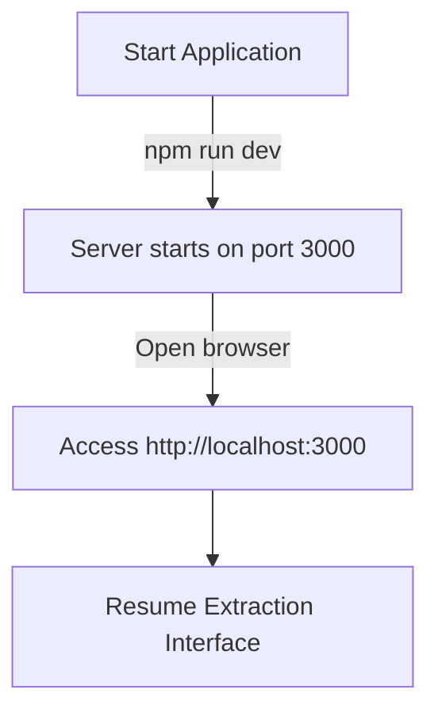
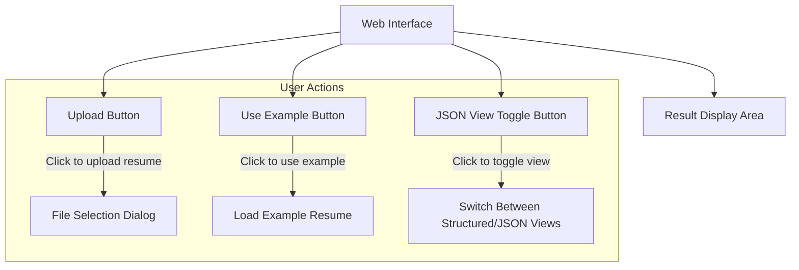
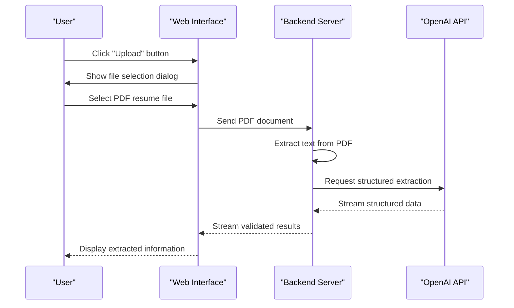
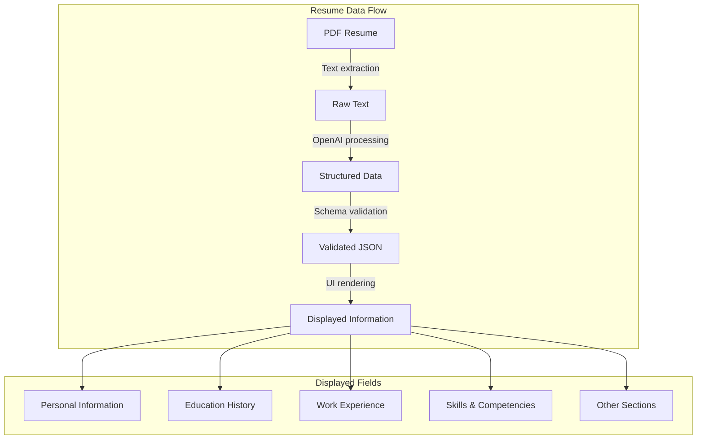
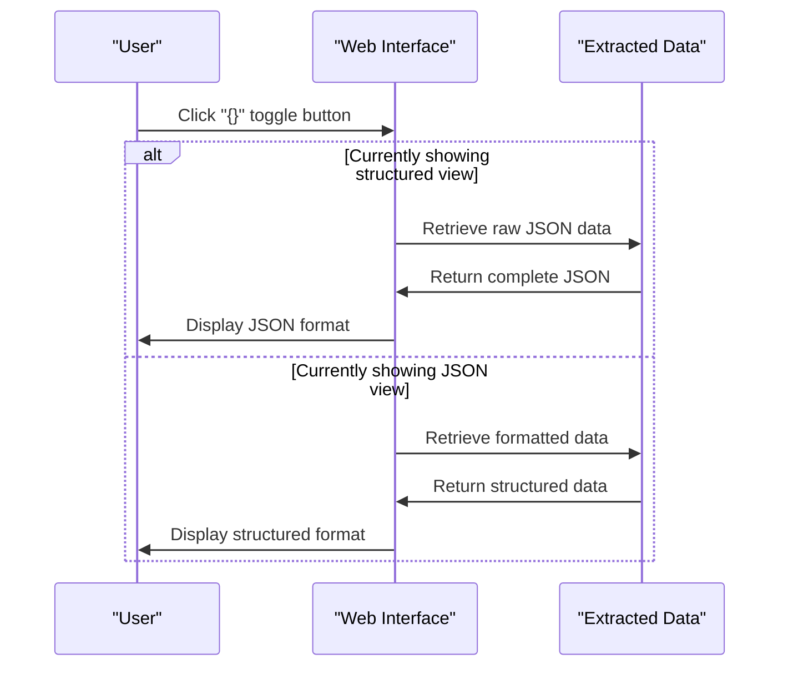
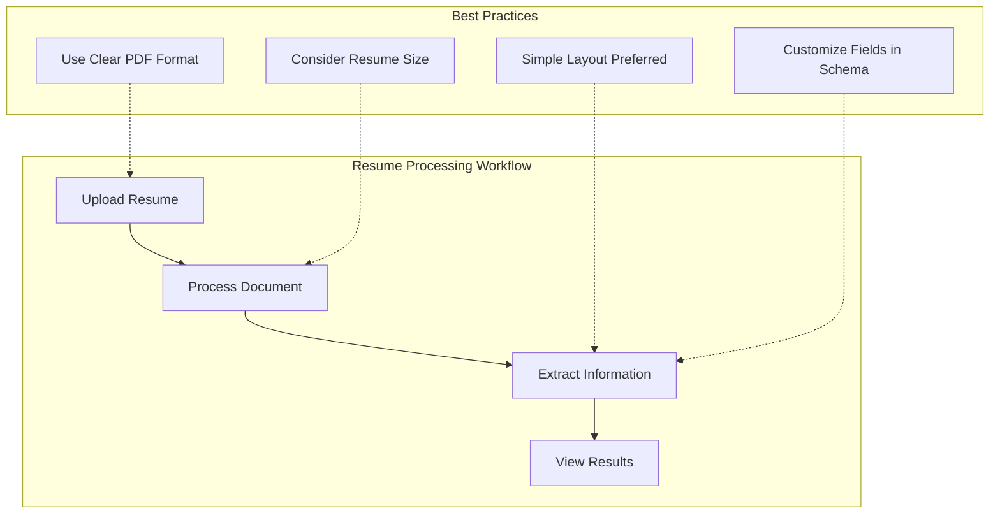

<!-- source: DeepWiki mcp.deepwiki.com · repo openai/openai-structured-outputs-samples · page 2.3 Usage Guide · fetched 2026-10-26 -->

# Usage Guide

Relevant source files

The following files were used as context for generating this wiki page:

- [resume-extraction/README.md](resume-extraction/README.md)
- [resume-extraction/public/screenshot-json.jpg](resume-extraction/public/screenshot-json.jpg)
- [resume-extraction/public/screenshot-streaming.jpg](resume-extraction/public/screenshot-streaming.jpg)

This guide explains how to use the Resume Extraction Demo application after you have completed the installation. It covers uploading resumes, using the example document, viewing extracted information, and toggling between different display modes. For installation instructions, see [Installation and Setup](#2.2).

## Accessing the Application

After completing the installation and starting the development server, access the Resume Extraction Demo by opening your web browser and navigating to `http://localhost:3000`.

Sources: [resume-extraction/README.md:44-50]()

## Application Interface

When you first access the application, you'll see a simple interface with:

1. An upload button for submitting your own PDF resume
2. An "Use the example" button to test with the provided sample resume
3. A display area where extracted information will appear
4. A JSON toggle button in the top right corner

Sources: [resume-extraction/README.md:52-58]()

## Uploading Your Resume

To process your own resume:

1. Click the "Upload" button in the interface
2. Select a PDF resume file from your local file system
3. The application will automatically begin processing once the file is selected
4. Watch as extracted information streams into the display area in real-time

Sources: [resume-extraction/README.md:52-56]()

## Using the Example Resume

To test the application without uploading your own file:

1. Click the "Use the example" button
2. The application will load the provided example resume (`example_resume.pdf`)
3. Processing will begin automatically
4. Watch as information is extracted and displayed

This option is useful for quickly testing the application's functionality or understanding what kind of information the system can extract.

Sources: [resume-extraction/README.md:54]()

## Viewing Extracted Information

As the system processes the resume, you'll see information appear in the display area in a structured format. The extraction happens in real-time, with fields appearing progressively as they are processed and validated.

The extracted information typically includes:

- Personal details (name, contact information)
- Education history
- Work experience
- Skills
- Other sections as defined in the resume schema

Sources: [resume-extraction/README.md:7-9](), [resume-extraction/README.md:13-15]()

## Toggling JSON View

To see the complete raw JSON output:

1. Click the "{}" icon in the top right corner of the interface
2. The display will switch from the structured view to showing the full JSON response
3. Click the icon again to return to the structured view

The JSON view provides a complete representation of all extracted data, which can be useful for developers to understand the exact structure of the data or for debugging purposes.

Sources: [resume-extraction/README.md:56-58]()

## Best Practices and Tips

For optimal results when using the Resume Extraction Demo:

1. **PDF Quality**: Use clearly formatted PDF resumes for best extraction results
2. **Resume Complexity**: Be aware that very complex resume layouts may affect extraction precision
3. **Field Customization**: To modify which fields are extracted, edit the schema in `lib/resume.ts`
4. **Streaming Behavior**: Note that fields appear progressively as they're processed, which is normal behavior
5. **Resume Size**: Very large resumes may take longer to process

Sources: [resume-extraction/README.md:60]()

## Troubleshooting Common Issues

If you encounter issues while using the application:

1. **No Response After Upload**: Ensure your API key is correctly set in the environment variables
2. **Missing Fields**: Check if your resume format matches the expected structure
3. **Slow Processing**: Large or complex PDFs may require more processing time
4. **Incorrect Information**: The extraction accuracy depends on the clarity and structure of the input resume

Sources: [resume-extraction/README.md:32-42]()

---

