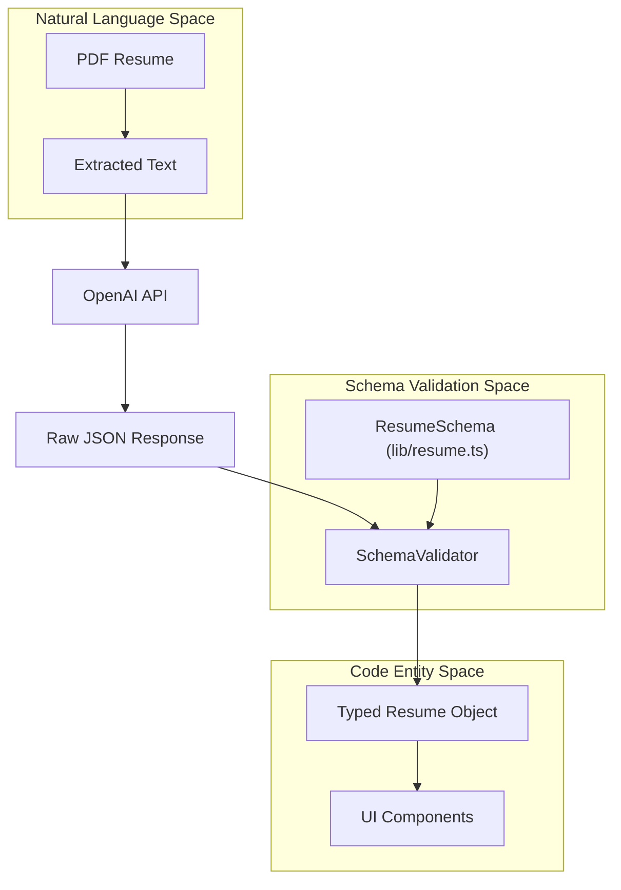
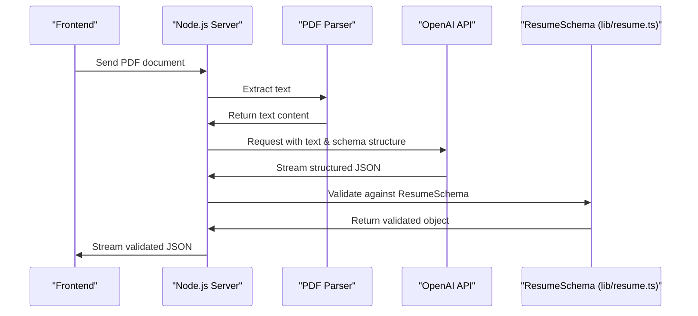
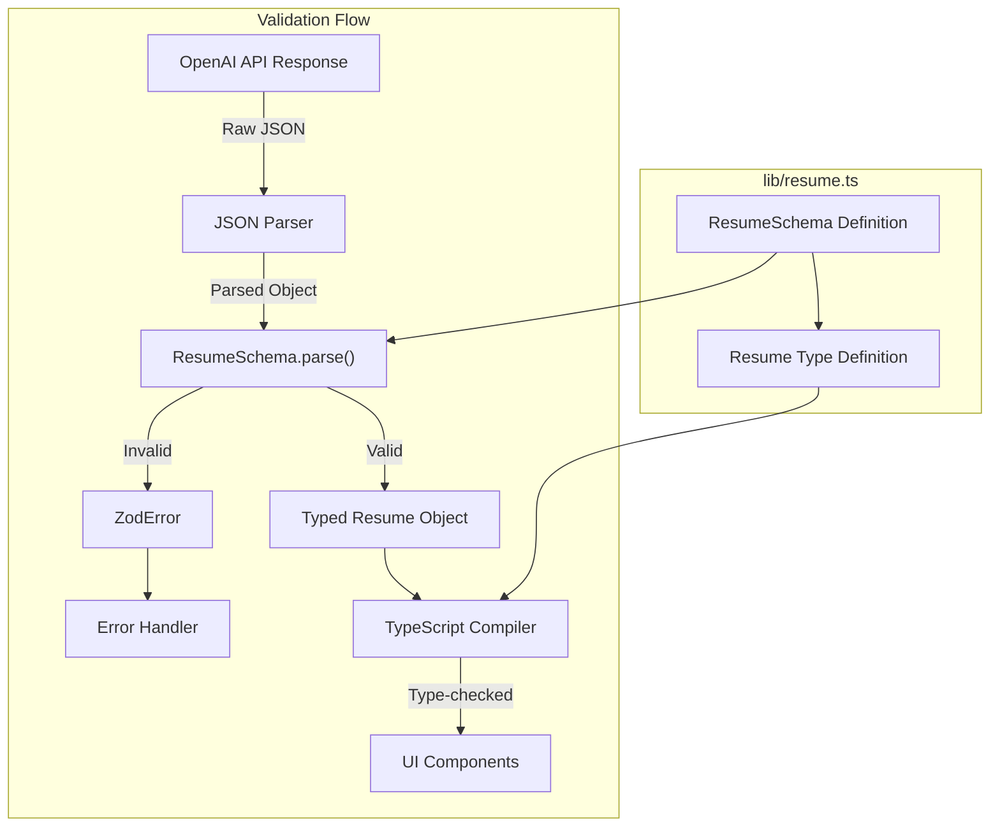
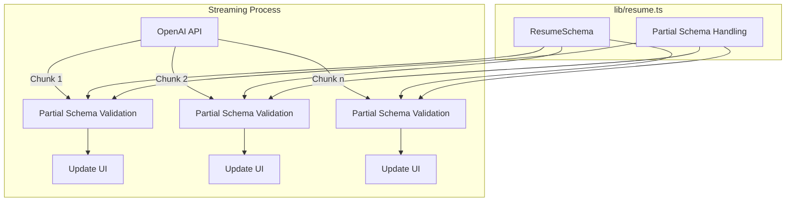

<!-- source: DeepWiki mcp.deepwiki.com · repo openai/openai-structured-outputs-samples · page 2.4 Zod Schema Implementation · fetched 2026-10-26 -->

# Zod Schema Implementation

Relevant source files

The following files were used as context for generating this wiki page:

- [resume-extraction/README.md](resume-extraction/README.md)
- [resume-extraction/package.json](resume-extraction/package.json)

This document explains how the Zod schema is implemented and used in the resume extraction demo to structure and validate the output from the OpenAI API. It focuses specifically on the schema definition, validation process, and integration with the overall system. For information about the entire resume extraction process, see [Resume Extraction Demo](#2).

## Overview of Zod in the Resume Extraction System

Zod is a TypeScript-first schema validation library that enables type-safe data validation. In this resume extraction demo, Zod serves as the cornerstone for ensuring that the unstructured data extracted from resumes by the OpenAI API is transformed into a consistent, predictable JSON structure.

The schema definition exists in the `lib/resume.ts` file and plays several crucial roles:

1. Defines the exact structure that extracted resume data must follow
2. Validates the data returned by OpenAI against this structure
3. Provides TypeScript type definitions for the extracted data
4. Guides the OpenAI API to produce outputs matching the expected format
5. Creates a deterministic interface between the API and the frontend display

Sources: resume-extraction/README.md, resume-extraction/package.json

## Schema Structure and Definition

The resume extraction demo uses a Zod schema defined in `lib/resume.ts` to specify the expected structure of extracted resume data. While the exact schema definition isn't available in the provided files, based on the system's purpose, we can infer that it defines a structured representation of common resume elements.

The schema likely follows a hierarchical structure with fields for personal information, work experience, education, skills, and other common resume sections. Each field would have specified types and validation rules, such as required vs. optional fields.

A typical Zod schema implementation would use the `z.object()` method to define the structure, with nested objects and arrays for more complex data like work experience entries.

| Schema Component | Description | Typical Structure |
|-----------------|-------------|-------------------|
| Personal Information | Contact details, name, location | Object with string fields |
| Work Experience | Employment history with companies, roles, dates | Array of objects |
| Education | Academic background, degrees, institutions | Array of objects |
| Skills | Technical and soft skills | Array of strings or categorized objects |
| Projects | Notable projects completed | Array of objects |
| Certifications | Professional certifications | Array of objects |

The schema also leverages Zod's type inference capabilities, likely exporting a `Resume` type that's derived from the schema using `z.infer<typeof ResumeSchema>`.

Sources: resume-extraction/README.md

## Integration with OpenAI API

The Zod schema plays a critical role in guiding the OpenAI API to produce structured outputs. This integration works through several mechanisms:

The schema structure is used to:

1. **Define the expected output format** - The API is instructed to produce output conforming to the schema structure
2. **Validate returned data** - As JSON is streamed from the API, it's validated against the schema
3. **Transform unstructured text** - Guide the conversion from raw resume text to structured fields

The README notes that modifying the fields extracted by the model can be done by editing the Zod schema in `lib/resume.ts`, indicating a tight coupling between the schema definition and the OpenAI API's output.

Sources: resume-extraction/README.md

## Type Safety and Validation Process

One of the primary benefits of using Zod in this application is the seamless integration of runtime validation with static TypeScript type checking.

This process ensures:

1. **Runtime validation** - Confirms that the data matches the expected structure before it's used
2. **Type checking** - Provides TypeScript type safety throughout the application
3. **Predictable interfaces** - Creates a reliable contract between different parts of the system
4. **Error handling** - Provides detailed error information when validation fails

The package.json file includes Zod as a dependency (`"zod": "^3.23.8"`), and the README file emphasizes the creation of "Type-Safe Interfaces" that simplify downstream processing with predictable JSON responses.

Sources: resume-extraction/package.json, resume-extraction/README.md

## Streaming Implementation with Schema Validation

A notable feature of the resume extraction demo is its ability to stream validated JSON responses to the UI. This involves validating the data against the Zod schema as it's streamed from the OpenAI API.

The package.json file includes a dependency on `partial-json` (`"partial-json": "^0.1.7"`), which likely helps with parsing incomplete JSON during streaming. This allows the application to validate and display partial results as they become available, rather than waiting for the complete response.

Sources: resume-extraction/package.json, resume-extraction/README.md

## Customizing the Schema

The README explicitly mentions that the fields extracted by the model can be customized by editing the Zod schema in the `lib/resume.ts` file. This flexibility allows developers to:

1. Add or remove fields to be extracted from resumes
2. Modify the structure of the extracted data
3. Change validation rules (e.g., making fields required or optional)
4. Add custom validation logic for specific fields

Making changes to the schema affects both:
- The structure of data that the OpenAI API is instructed to produce
- The validation rules applied to the API's output
- The TypeScript types used throughout the application

Customizing the schema is a central way to adapt the resume extraction demo to different use cases and requirements.

Sources: resume-extraction/README.md

## Conclusion

The Zod schema implementation in the resume extraction demo acts as the critical bridge between unstructured resume text and structured, type-safe data that can be reliably used by the application. It defines the expected data structure, guides the OpenAI API to produce compatible output, validates the returned data, and provides TypeScript types for the application.

This approach showcases how to build deterministic interfaces with AI systems, ensuring that even as the underlying AI model processes information in complex ways, the output remains consistent and predictable - a crucial requirement for building reliable applications with AI components.

Sources: resume-extraction/README.md

---

