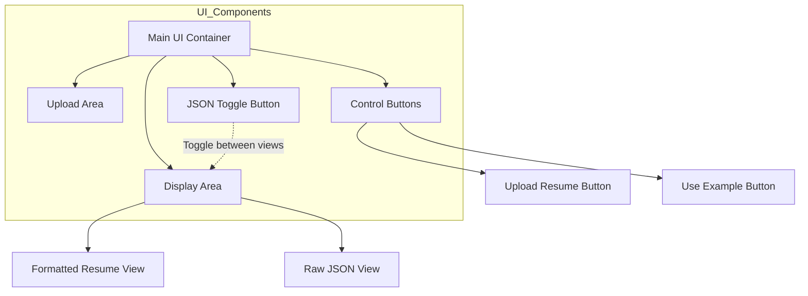
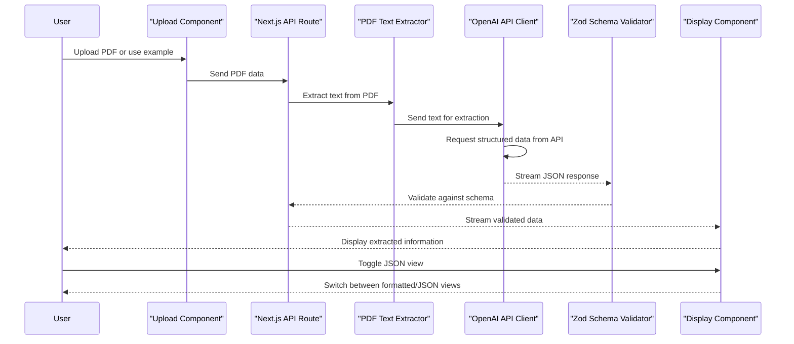
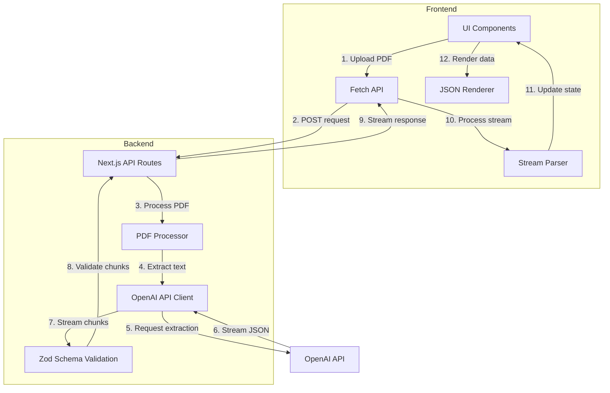
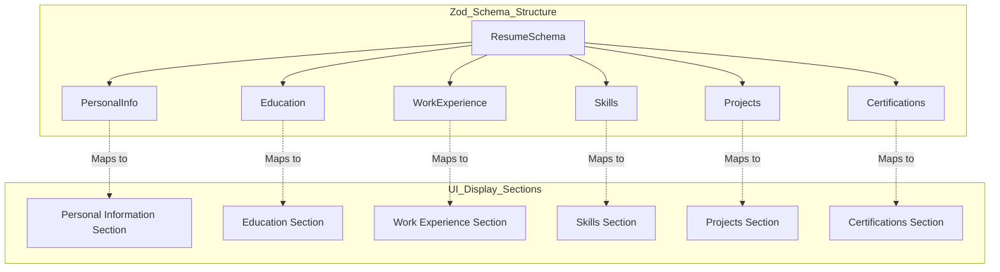

<!-- source: DeepWiki mcp.deepwiki.com · repo openai/openai-structured-outputs-samples · page 2.5 User Interface · fetched 2026-10-26 -->

# User Interface

Relevant source files

The following files were used as context for generating this wiki page:

- [resume-extraction/README.md](resume-extraction/README.md)
- [resume-extraction/package.json](resume-extraction/package.json)
- [resume-extraction/public/screenshot-json.jpg](resume-extraction/public/screenshot-json.jpg)
- [resume-extraction/public/screenshot-streaming.jpg](resume-extraction/public/screenshot-streaming.jpg)

This document describes the user interface components and interactions for the Resume Extraction Demo application in the openai-structured-outputs-samples repository. The UI provides a web-based interface that allows users to upload PDF resumes, view the structured data extracted by the OpenAI API, and toggle between different views of the extracted information.

For information about how the extracted data is validated against schema definitions, see [Zod Schema Implementation](#2.4). For details on how PDF processing works, see [PDF Processing](#3.1).

## UI Overview

The Resume Extraction Demo features a clean, functional interface that enables users to upload PDF resumes or use a provided example, then view the structured information extracted by the OpenAI API as it streams in real-time.

### UI Component Structure

Sources:
- resume-extraction/README.md
- resume-extraction/public/screenshot-streaming.jpg
- resume-extraction/public/screenshot-json.jpg

## UI Components

### Upload Area

The upload area provides a way for users to upload their own PDF resumes for processing. It leverages `react-dropzone` to enable a drag-and-drop interface with the following features:

- Drag-and-drop file upload functionality
- File type validation (PDF only)
- Visual feedback during upload process

### Control Buttons

Two primary control buttons are displayed prominently in the interface:

1. **Upload Resume Button** - Allows users to select a PDF file from their device
2. **Use Example Button** - Loads the built-in example resume (`example_resume.pdf`) for demonstration

These buttons provide easy entry points for using the application without requiring users to have their own resumes ready.

### JSON Toggle Button

The JSON toggle button, represented by the "{}" icon in the top right corner of the interface, allows users to switch between:

- **Formatted View** - A structured, human-readable display of the extracted resume information
- **Raw JSON View** - The complete JSON response showing all extracted fields

This toggle demonstrates the dual-purpose nature of structured outputs - both human-readable and machine-processable.

### Display Area

The display area is the main section of the UI where extracted resume information is presented. It features:

- Real-time updates as data streams from the API
- Clearly formatted sections for personal information, education, experience, skills, etc.
- Syntax highlighting for the JSON view using `react-syntax-highlighter`
- Responsive layout that adapts to different screen sizes

Sources:
- resume-extraction/README.md
- resume-extraction/package.json (react-dropzone, react-syntax-highlighter dependencies)

## User Interaction Flow

The following diagram illustrates the typical user interaction flow within the application:

Sources:
- resume-extraction/README.md (streaming responses feature)

## Implementation Details

### UI Technology Stack

The user interface is built using the following technologies:

| Technology | Purpose |
|------------|---------|
| React | UI component library |
| Next.js | React framework for server-rendered pages and API routes |
| TailwindCSS | Utility-first CSS framework for styling |
| react-dropzone | File upload component |
| react-syntax-highlighter | JSON syntax highlighting |
| zod | Schema validation for structured data |

### UI-Backend Communication

Sources:
- resume-extraction/package.json
- resume-extraction/README.md

## Streaming Implementation

One of the key features of the UI is its ability to display structured data as it streams from the OpenAI API, providing a responsive experience even when processing large documents.

### Streaming Process

1. The UI initiates a fetch request to the Next.js API route when a resume is uploaded or the example is selected
2. The API route processes the PDF and sends the text to the OpenAI API
3. As the OpenAI API generates structured data, it streams the response back
4. Each chunk of the response is validated against the Zod schema
5. Validated chunks are streamed to the frontend
6. The UI updates incrementally, displaying data as it becomes available

This approach provides significant UX benefits:
- Immediate feedback about extraction progress
- Faster time to first meaningful display
- Clear indication that the system is working during longer extractions

Sources:
- resume-extraction/README.md (streaming responses feature)

## UI Appearance

The Resume Extraction Demo UI features a clean, minimalist design focused on functionality:

1. **Initial State**: Upload area with clearly visible control buttons
2. **Processing State**: Visual indicators showing extraction progress
3. **Results State**: Two viewing options:
   - Formatted view with organized resume sections
   - Raw JSON view showing the complete structured output

The UI transforms the complex JSON output from the OpenAI API into an easily digestible format, while still providing access to the raw structured data for users who want to see the complete extraction results.

Sources:
- resume-extraction/public/screenshot-streaming.jpg
- resume-extraction/public/screenshot-json.jpg
- resume-extraction/README.md

## UI-Schema Integration

The UI directly reflects the structure defined in the Zod schema (`lib/resume.ts`). Each section of the displayed resume corresponds to fields in the schema:

This tight integration between schema definition and UI display ensures that the interface accurately represents the structured data extracted by the OpenAI API.

Sources:
- resume-extraction/README.md
- resume-extraction/lib/resume.ts (mentioned in README)

## Summary

The Resume Extraction Demo UI provides a practical, user-friendly interface for demonstrating OpenAI's structured outputs capabilities. By combining intuitive controls, real-time streaming, and flexible viewing options, the interface showcases how AI-extracted structured data can be effectively presented to users while maintaining the technical integrity of the JSON schema.

The UI demonstrates two critical aspects of working with AI-generated structured data:
1. The ability to present complex structured information in a human-readable format
2. The power of streaming responses for providing immediate feedback and enhancing user experience

Sources:
- resume-extraction/README.md
- resume-extraction/package.json

---

