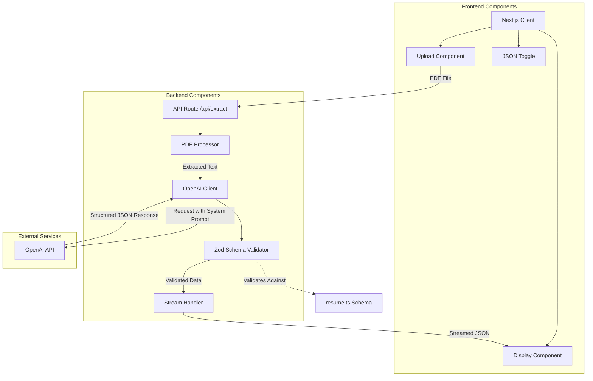
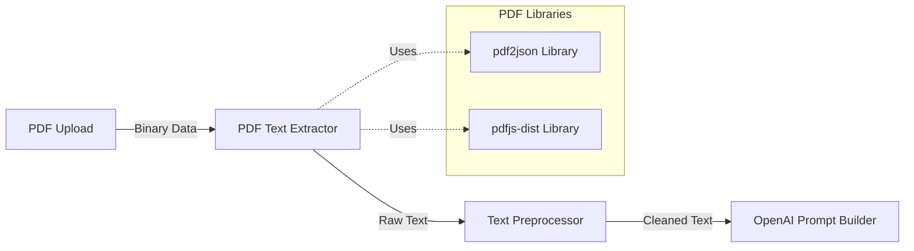
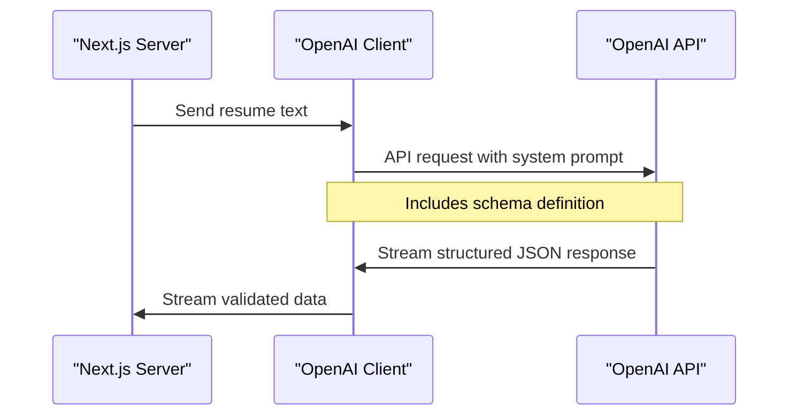
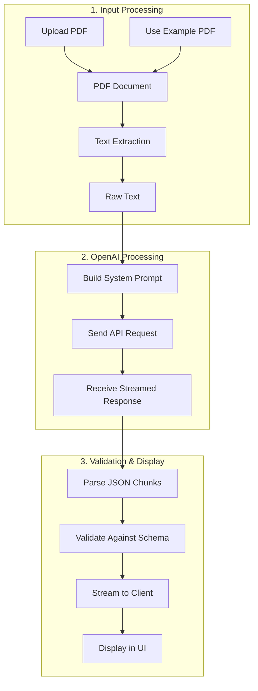
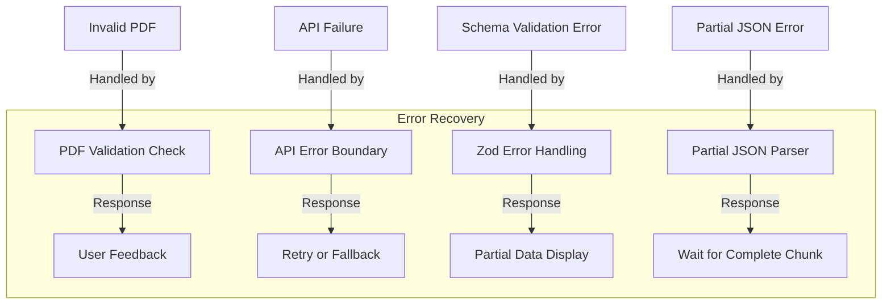

<!-- source: DeepWiki mcp.deepwiki.com · repo openai/openai-structured-outputs-samples · page 3 Technical Deep Dive · fetched 2026-10-26 -->

# Technical Deep Dive

Relevant source files

The following files were used as context for generating this wiki page:

- [resume-extraction/README.md](resume-extraction/README.md)
- [resume-extraction/package.json](resume-extraction/package.json)

This document provides a comprehensive technical exploration of the resume extraction system implemented in the openai-structured-outputs-samples repository. It covers the core architecture, data flow, key components, and technical implementation details of the system. For specific details about individual subsystems, see the child pages on [PDF Processing](#3.1), [OpenAI Integration](#3.2), [Streaming Implementation](#3.3), and [Type Safety and Validation](#3.4).

## System Architecture Overview

The resume extraction demo demonstrates how to create deterministic interfaces using OpenAI's structured outputs capability, with a specific focus on extracting structured data from resume PDFs. The system follows a client-server architecture with multiple components working together.

Sources: [resume-extraction/README.md:1-60]()

## Core Technical Components

### 1. Next.js Framework

The application is built using Next.js, a React framework that provides server-side rendering, API routes, and a streamlined development experience. The application structure follows Next.js conventions, with API routes handling the backend logic and React components handling the frontend UI.

### 2. PDF Processing Pipeline

The system uses multiple PDF processing libraries including pdf2json and pdfjs-dist to extract text content from uploaded PDF files. For detailed implementation of PDF processing, see [PDF Processing](#3.1).

Sources: [resume-extraction/package.json:19-20]()

### 3. OpenAI Integration

The application uses the OpenAI API to transform unstructured resume text into structured JSON data. It sends the extracted text from PDFs to the OpenAI API with a system prompt that instructs the model to extract specific information based on the schema. For detailed implementation of the OpenAI integration, see [OpenAI Integration](#3.2).

Sources: [resume-extraction/package.json:17]()

### 4. Zod Schema Definition

The core of the structured output capability is the Zod schema defined in `lib/resume.ts`. This schema:
- Defines the exact structure that the extracted resume data must conform to
- Provides type safety through TypeScript integration
- Enables runtime validation of the data received from OpenAI
- Creates a deterministic interface for downstream processing

The schema defines fields like personal information, work experience, education, skills, and certifications that should be extracted from resumes. For detailed information about schema implementation, see [Type Safety and Validation](#3.4).

Sources: [resume-extraction/README.md:60]()

### 5. Streaming Implementation

The system implements streaming to provide real-time feedback to users. Instead of waiting for the entire extraction process to complete, extracted data is streamed to the UI as it becomes available. This is implemented using:
- Server-side streaming with Next.js API routes
- OpenAI SDK's streaming capabilities
- Client-side handling of streaming responses

For detailed implementation of streaming, see [Streaming Implementation](#3.3).

## Data Flow and Processing Pipeline

The resume extraction system follows a clear data flow from PDF upload to displayed structured data:

### Detailed Processing Steps:

1. **PDF Handling**:
   - User uploads a PDF or selects the example resume
   - PDF is sent to the server via a form submission or fetch request
   - Server extracts text from the PDF using pdf extraction libraries

2. **OpenAI API Integration**:
   - Extracted text is incorporated into a system prompt
   - Prompt includes instructions for the model to extract specific fields
   - Request is sent to OpenAI API with streaming enabled
   - API begins returning structured JSON data in chunks

3. **Response Processing**:
   - JSON chunks are parsed and validated against the Zod schema
   - Invalid or incomplete data is handled appropriately
   - Validated data is streamed back to the client
   - UI updates in real-time as data becomes available

4. **Display and Interaction**:
   - Structured data is rendered in a user-friendly format
   - User can toggle between formatted view and raw JSON view
   - UI provides feedback during extraction process

Sources: [resume-extraction/README.md:5-15](), [resume-extraction/package.json:17-20]()

## Technical Implementation Details

### Key Technical Features

| Feature | Implementation | Purpose |
|---------|----------------|---------|
| Schema Definition | Zod library | Defines structure for OpenAI output and provides validation |
| PDF Processing | pdf2json, pdfjs-dist | Extracts text content from uploaded PDF resumes |
| API Integration | OpenAI Node.js SDK | Communicates with OpenAI API to process resume text |
| Response Streaming | Server-sent events | Provides real-time updates to the UI as data is processed |
| JSON Parsing | partial-json | Handles incomplete JSON chunks during streaming |
| UI Components | React, Tailwind CSS | Creates responsive interface for user interaction |

Sources: [resume-extraction/package.json:11-30]()

### Error Handling and Edge Cases

The system implements several error handling mechanisms:

The system handles several potential error conditions:

1. **PDF Processing Errors**: 
   - Invalid PDF format
   - Empty or unreadable PDF content
   - PDF with image-only content (no extractable text)

2. **API Errors**:
   - OpenAI API rate limiting or quota exceeded
   - Network failures during API communication
   - Timeout issues for large documents

3. **Schema Validation Errors**:
   - Mismatched data types from API response
   - Missing required fields
   - Unexpected data structures

4. **Streaming Errors**:
   - Incomplete JSON chunks
   - Connection interruptions
   - Client-side rendering issues

Sources: [resume-extraction/README.md:13-15](), [resume-extraction/package.json:18]()

## Performance Considerations

The resume extraction system is designed with several performance considerations:

1. **Streaming Implementation**: 
   - Reduces perceived latency by showing partial results as they arrive
   - Improves user experience for large resumes
   - Allows processing to begin before complete extraction

2. **PDF Processing Optimization**:
   - Uses efficient text extraction libraries
   - Handles different PDF formats and structures

3. **API Usage Efficiency**:
   - Proper prompt engineering to reduce token usage
   - Schema-guided extraction to focus on relevant information

4. **UI Rendering Optimization**:
   - Efficient React component rendering
   - Progressive display of extracted information

## Conclusion

The technical implementation of the resume extraction system demonstrates several advanced techniques for working with OpenAI's structured outputs:

1. **Schema-First Design**: Using Zod to define the expected structure before making API calls
2. **Streaming Architecture**: Implementing real-time data flow from API to UI
3. **Error Resilience**: Handling various failure modes gracefully
4. **Type Safety**: Ensuring consistent data structures throughout the application

For more detailed information about specific aspects of the system, refer to the child pages on [PDF Processing](#3.1), [OpenAI Integration](#3.2), [Streaming Implementation](#3.3), and [Type Safety and Validation](#3.4).

Sources: [resume-extraction/README.md:1-60](), [resume-extraction/package.json:1-43]()

---

