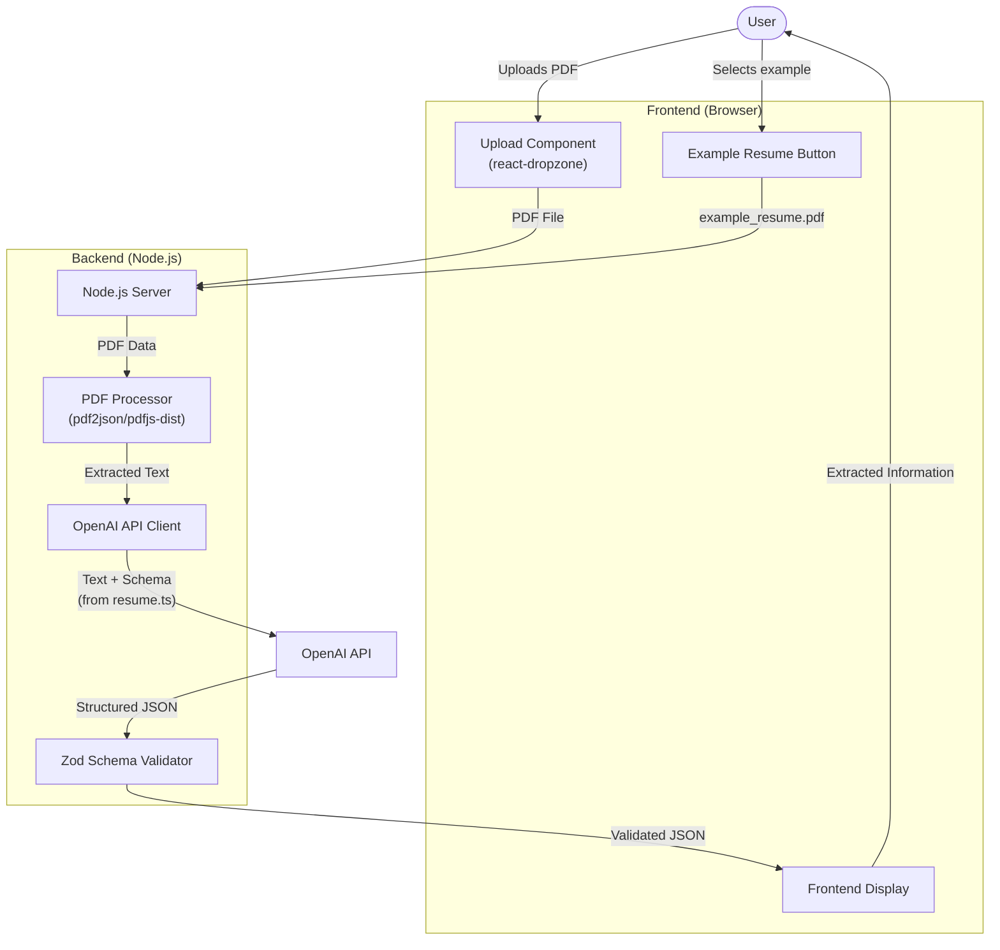
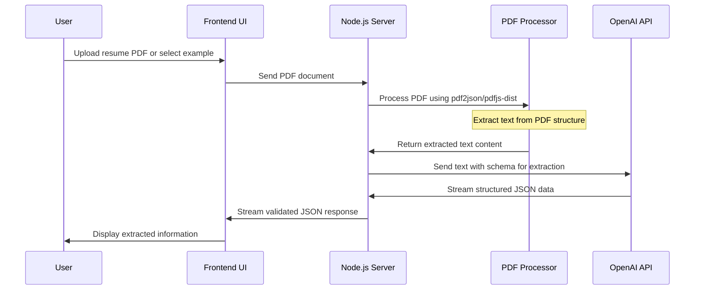
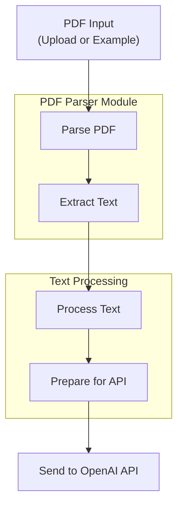

<!-- source: DeepWiki mcp.deepwiki.com · repo openai/openai-structured-outputs-samples · page 3.1 PDF Processing · fetched 2026-10-26 -->

# PDF Processing

Relevant source files

The following files were used as context for generating this wiki page:

- [resume-extraction/package-lock.json](resume-extraction/package-lock.json)
- [resume-extraction/package.json](resume-extraction/package.json)

This document covers the PDF processing subsystem in the resume extraction demo, explaining how PDF resumes are handled, parsed, and converted to text for structured data extraction by the OpenAI API.

## Purpose and Scope

The PDF Processing component is responsible for:
- Converting uploaded PDF resumes into text format
- Extracting text content from the example resume
- Preparing the extracted text for submission to the OpenAI API
- Supporting PDF preview functionality in the user interface

For information about how the extracted text is processed by the OpenAI API, see [OpenAI Integration](#3.2), and for details on the streaming implementation, see [Streaming Implementation](#3.3).

Sources: [resume-extraction/package.json:18-20]()

## PDF Processing Libraries

The resume extraction demo uses the following PDF-related libraries:

| Library | Version | Purpose |
|---------|---------|---------|
| pdf2json | 3.1.4 | Converts PDF documents to JSON format, facilitating text extraction |
| pdfjs-dist | 4.10.38 | Mozilla's PDF.js library for PDF rendering and text extraction |
| react-pdf | 9.1.1 | React component for displaying PDFs in the browser |
| react-dropzone | 14.2.3 | Handles file uploads, including PDFs |

Each library has a specific role in the PDF processing workflow:

- **pdf2json**: Used for server-side PDF parsing and text extraction
- **pdfjs-dist**: Provides the core PDF handling capabilities
- **react-pdf**: Enables PDF previewing in the browser
- **react-dropzone**: Facilitates the PDF upload interface

Sources: [resume-extraction/package.json:18-25]()

## PDF Processing Architecture

The following diagram illustrates how the PDF processing component fits into the overall system architecture:

Sources: [resume-extraction/package.json:18-20]()

## PDF Processing Workflow

The PDF processing workflow in the resume extraction demo follows these steps:

Sources: [resume-extraction/package.json:18-20]()

## PDF Text Extraction Process

The PDF text extraction process involves several stages:

1. **PDF Acquisition**: The system receives a PDF file through user upload or example selection
2. **PDF Parsing**: The server processes the PDF using pdf2json or pdfjs-dist
3. **Text Extraction**: The library extracts text content from the PDF structure
4. **Text Processing**: The extracted text is cleaned and formatted for optimal processing
5. **API Preparation**: The processed text is prepared for submission to the OpenAI API

### Frontend PDF Handling

On the frontend, the system implements:

- A file upload area using react-dropzone for PDF selection
- PDF preview functionality using react-pdf to display uploaded documents
- An option to use the example resume provided with the application

### Backend PDF Processing

The backend handles the core PDF processing:

Sources: [resume-extraction/package.json:18-20]()

## Technical Considerations

PDF processing in resume extraction presents several challenges:

1. **Format Variability**: Resumes come in diverse formats and layouts, requiring robust parsing capabilities
2. **Text Extraction Quality**: The accuracy of text extraction directly impacts structured data extraction quality
3. **Structure Preservation**: Maintaining the logical flow and relationships in the resume data
4. **Performance Optimization**: Processing PDFs efficiently to minimize latency
5. **Error Handling**: Gracefully handling malformed PDFs and extraction failures

The system addresses these challenges through its use of established PDF processing libraries and a structured workflow that prepares the extracted text for optimal processing by the OpenAI API.

Sources: [resume-extraction/package.json:18-20]()

## Example Resume

The system includes an example resume (example_resume.pdf) in the public directory, which can be used to demonstrate the PDF processing and information extraction capabilities without requiring users to upload their own documents.

Sources: [resume-extraction/package.json:18-20]()

---

