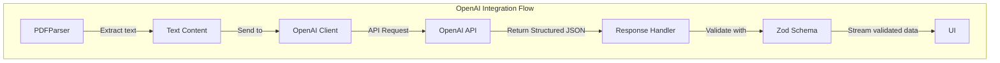
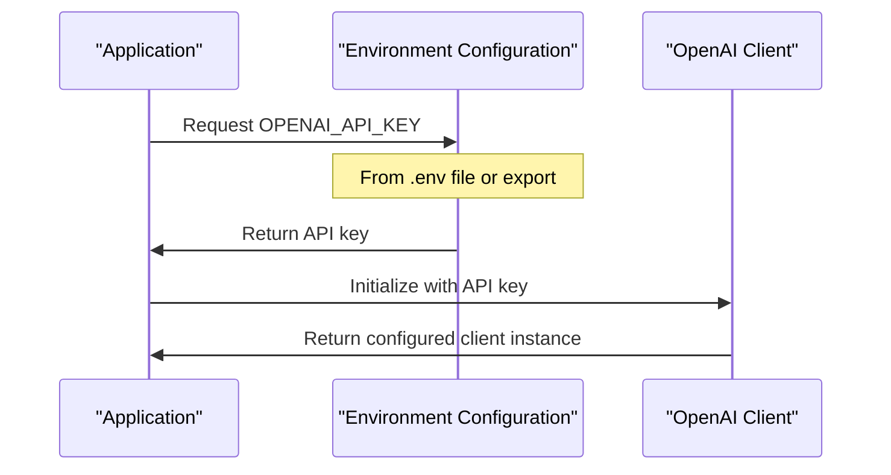
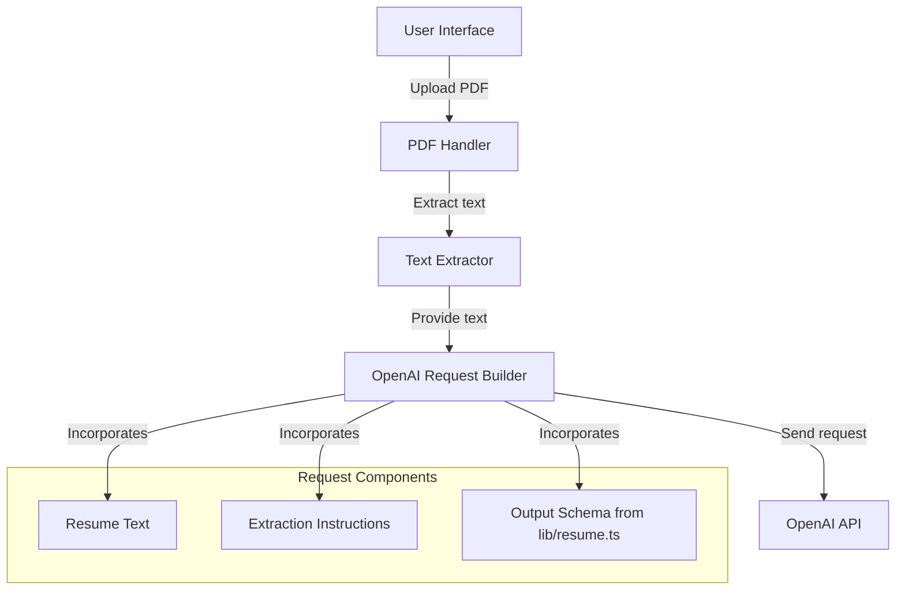
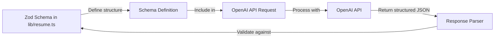
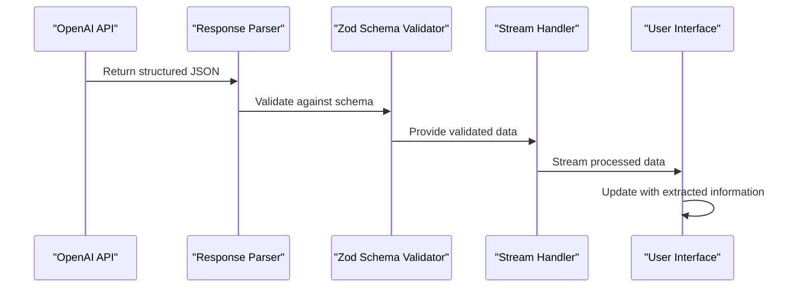
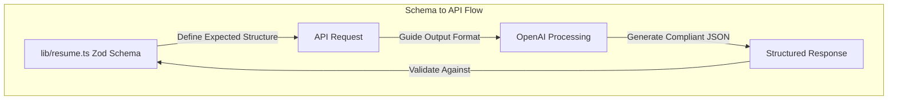

<!-- source: DeepWiki mcp.deepwiki.com · repo openai/openai-structured-outputs-samples · page 3.2 OpenAI Integration · fetched 2026-10-26 -->

# OpenAI Integration

Relevant source files

The following files were used as context for generating this wiki page:

- [resume-extraction/README.md](resume-extraction/README.md)
- [resume-extraction/package.json](resume-extraction/package.json)

This page documents how the resume extraction demo integrates with the OpenAI API to extract structured data from PDF resumes. It covers the setup of the API client, request construction, structured output implementation, and response handling. For information about streaming implementation details, see [Streaming Implementation](#3.3). For information about PDF processing that happens before the OpenAI API call, see [PDF Processing](#3.1).

## Integration Overview

The resume extraction demo leverages the OpenAI API to transform unstructured resume text into structured JSON data that adheres to a predefined schema. This integration forms the core functionality of the application, enabling the extraction of specific resume details like contact information, education, work experience, and skills.

Sources: resume-extraction/README.md

## API Client Configuration

The application uses the official OpenAI Node.js SDK (version 4.61.0) to interact with the API. The client is initialized with an API key that must be provided through environment variables.

Sources: resume-extraction/package.json, resume-extraction/README.md

## Request Construction

When a user uploads a resume or selects the example resume, the application constructs a request to the OpenAI API after extracting text from the PDF. The request includes:

1. The extracted resume text content
2. Instructions for the model on what information to extract
3. The output structure defined by the Zod schema in `lib/resume.ts`

Sources: resume-extraction/README.md

## Structured Output Implementation

The key feature of this integration is the use of OpenAI's structured output capabilities, which ensures that the API response strictly conforms to the predefined schema.

The application implements structured outputs by:

1. Defining a detailed schema using Zod in `lib/resume.ts`
2. Passing this schema to the OpenAI API as part of the request
3. Receiving a response that follows the exact schema structure
4. Validating the response against the same schema

Sources: resume-extraction/README.md

## Response Processing

After receiving the structured data from the OpenAI API, the application:

1. Parses the JSON response
2. Validates it against the Zod schema to ensure type safety
3. Streams the validated data to the frontend for display

Sources: resume-extraction/README.md

## Error Handling

The integration includes robust error handling for various scenarios:

| Error Type | Handling Strategy |
|------------|-------------------|
| API Connection Errors | Retry logic or user notification |
| Schema Validation Errors | Detailed logging and user feedback |
| Parsing Errors | Recovery attempts or graceful degradation |
| Rate Limiting | Backoff strategies and user notification |

The error handling ensures a smooth user experience even when issues occur with the OpenAI API integration.

Sources: resume-extraction/README.md, resume-extraction/package.json

## Example Schema Usage

The application uses a Zod schema defined in `lib/resume.ts` to specify the structure that the OpenAI API should return. This schema defines the shape of resume data including personal information, education history, work experience, skills, and more.

When the OpenAI API processes the resume text, it uses this schema as a guide to structure its output, ensuring that all required fields are present and properly formatted.

Sources: resume-extraction/README.md

## Integration Summary

The OpenAI integration in the resume extraction demo showcases a pattern for creating deterministic interfaces with AI. By defining a strict schema and ensuring the API response adheres to it, the application creates a reliable, type-safe pipeline for extracting structured data from unstructured text.

Key components in the integration:

| Component | Purpose |
|-----------|---------|
| OpenAI Node.js SDK | Provides the client interface to the OpenAI API |
| Zod Schema | Defines the structure of the expected output |
| API Request Builder | Constructs properly formatted API requests |
| Response Validator | Ensures responses conform to the schema |
| Stream Handler | Processes and delivers validated data to the UI |

The integration demonstrates how to leverage OpenAI's structured output capabilities to build reliable, predictable applications that can extract specific information from unstructured text while maintaining type safety throughout the system.

Sources: resume-extraction/README.md, resume-extraction/package.json

---

