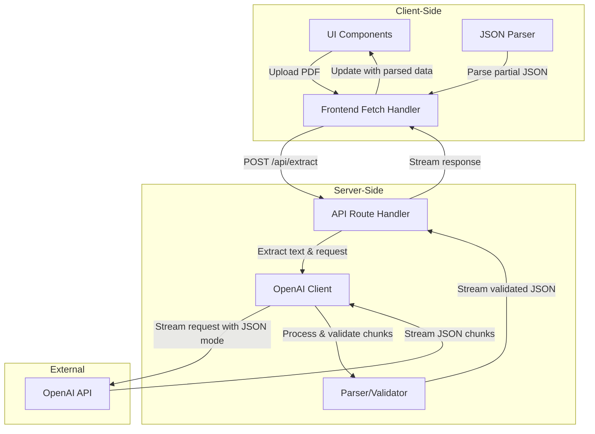
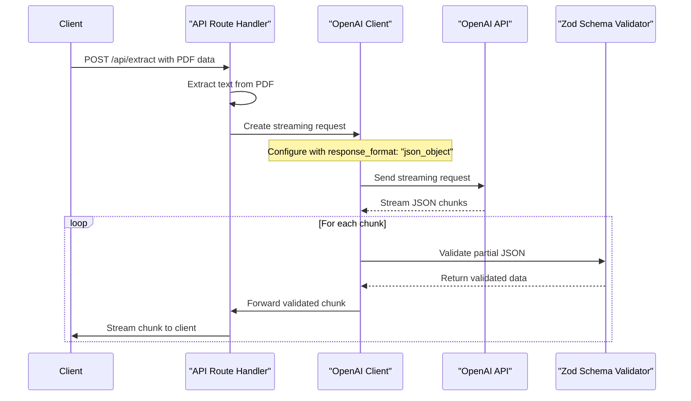
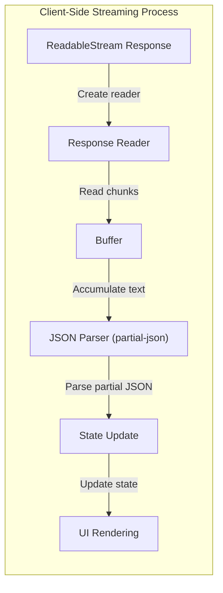
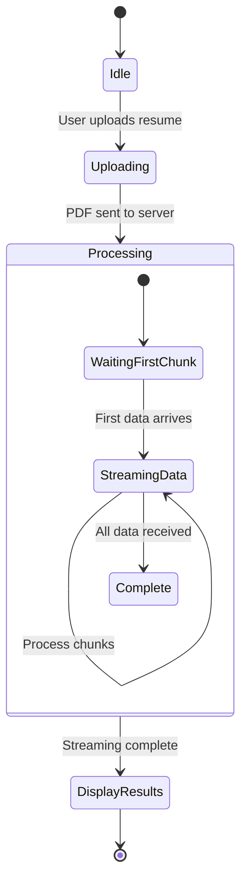
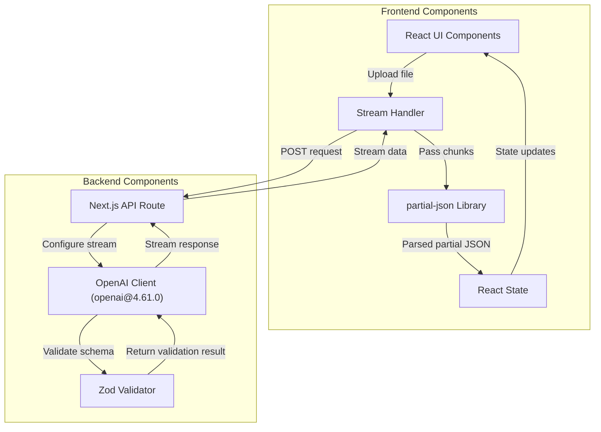

<!-- source: DeepWiki mcp.deepwiki.com · repo openai/openai-structured-outputs-samples · page 3.3 Streaming Implementation · fetched 2026-10-26 -->

# Streaming Implementation

Relevant source files

The following files were used as context for generating this wiki page:

- [resume-extraction/README.md](resume-extraction/README.md)
- [resume-extraction/package.json](resume-extraction/package.json)
- [resume-extraction/public/screenshot-streaming.jpg](resume-extraction/public/screenshot-streaming.jpg)

This document explains how the resume extraction demo implements real-time streaming of structured JSON data from the OpenAI API to the user interface. Streaming allows extracted resume information to appear progressively in the UI as it's processed, rather than waiting for the entire response to complete. For information about the schema that structures this data, see [Zod Schema Implementation](#2.4).

## Overview of Streaming Architecture

The streaming implementation in this application serves a critical role: it allows users to see extracted resume information immediately as it becomes available, creating a more responsive user experience. This is especially valuable for longer resumes where complete extraction might take several seconds.

Sources: resume-extraction/README.md:5, resume-extraction/package.json:17-19

## Server-Side Streaming Implementation

The server-side implementation handles the connection to OpenAI's API and initiates the streaming process. It needs to:
1. Receive the PDF content from the client
2. Extract text from the PDF
3. Set up a streaming connection to OpenAI
4. Process the streaming response
5. Validate chunks against the schema
6. Stream the processed data back to the client

Sources: resume-extraction/package.json:17-19, resume-extraction/package.json:28-30

### OpenAI API Configuration

The application uses the OpenAI Node.js SDK (v4.61.0) to handle the API connection. The streaming implementation likely uses the following key configuration:

1. Setting `response_format` to `"json_object"` to ensure the response is in JSON format
2. Enabling streaming via the `stream: true` parameter
3. Using the Zod schema to guide the structured output

## Client-Side Streaming Implementation

The client-side implementation must handle:
1. Sending the PDF to the server
2. Establishing a connection to receive the streamed response
3. Parsing partial JSON as it arrives
4. Updating the UI in real-time

### Handling Partial JSON

A key challenge in streaming JSON is that the data arrives in chunks that might not be valid JSON on their own. The application uses the `partial-json` library to handle parsing incomplete JSON objects as they stream in.

Sources: resume-extraction/package.json:18

### Implementation Pattern

The client-side implementation likely follows this pattern:

1. A fetch request to the API route with appropriate headers for streaming
2. A reader to process the streaming response
3. A state management approach to update the UI as new data arrives

## UI Updates During Streaming

The UI is designed to display the streamed data as it arrives, giving users immediate feedback. Based on the screenshots and description, the application:

1. Shows a loading state initially
2. Progressively fills in extracted fields as they become available
3. Provides a toggle to view the full JSON response

Sources: resume-extraction/README.md:9, resume-extraction/README.md:56-58

## Best Practices for JSON Streaming

The implementation demonstrates several best practices for streaming JSON:

1. **Early Validation**: Validating JSON chunks as they arrive using Zod
2. **Partial JSON Parsing**: Using specialized libraries to handle incomplete JSON
3. **Progressive UI Updates**: Updating the UI as soon as valid data is available
4. **Type Safety**: Maintaining type safety throughout the streaming process

## Technical Components Interaction

This diagram shows how the different technical components interact during the streaming process:

Sources: resume-extraction/package.json:17-19, resume-extraction/package.json:28-30

## Streaming Performance Considerations

Implementing streaming in this manner provides several performance benefits:

1. **Perceived Speed**: Users see results immediately as they become available
2. **Reduced Wait Times**: No need to wait for the entire processing to complete
3. **Error Handling**: Early error detection if parts of the response fail validation
4. **Resource Efficiency**: Processing can begin as soon as the first chunks arrive

## Conclusion

The streaming implementation in the resume extraction demo showcases an effective approach to handling real-time structured data from the OpenAI API. By combining server-side streaming, client-side partial JSON parsing, and reactive UI updates, the application provides a responsive user experience while maintaining the benefits of structured, validated outputs.

The implementation leverages technologies such as:
- OpenAI API's streaming capabilities
- Next.js API routes for server-side handling
- partial-json for processing incomplete JSON
- Zod for validation during streaming
- React for reactive UI updates

This architecture ensures that users get immediate feedback while maintaining the type safety and structural guarantees provided by the Zod schema.

Sources: resume-extraction/README.md:5-15, resume-extraction/package.json:17-30

---

