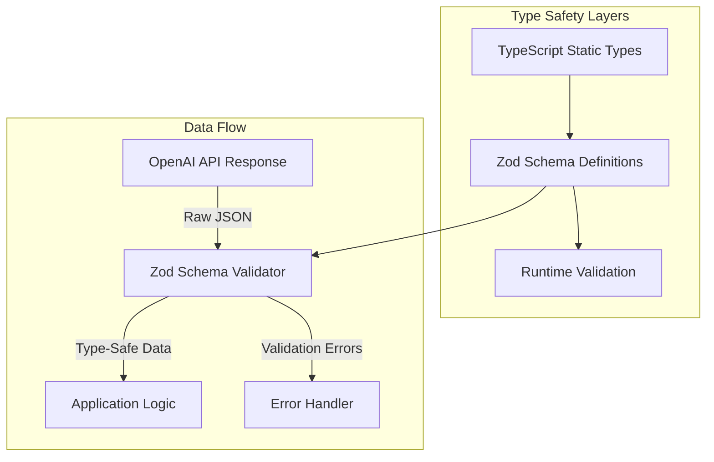
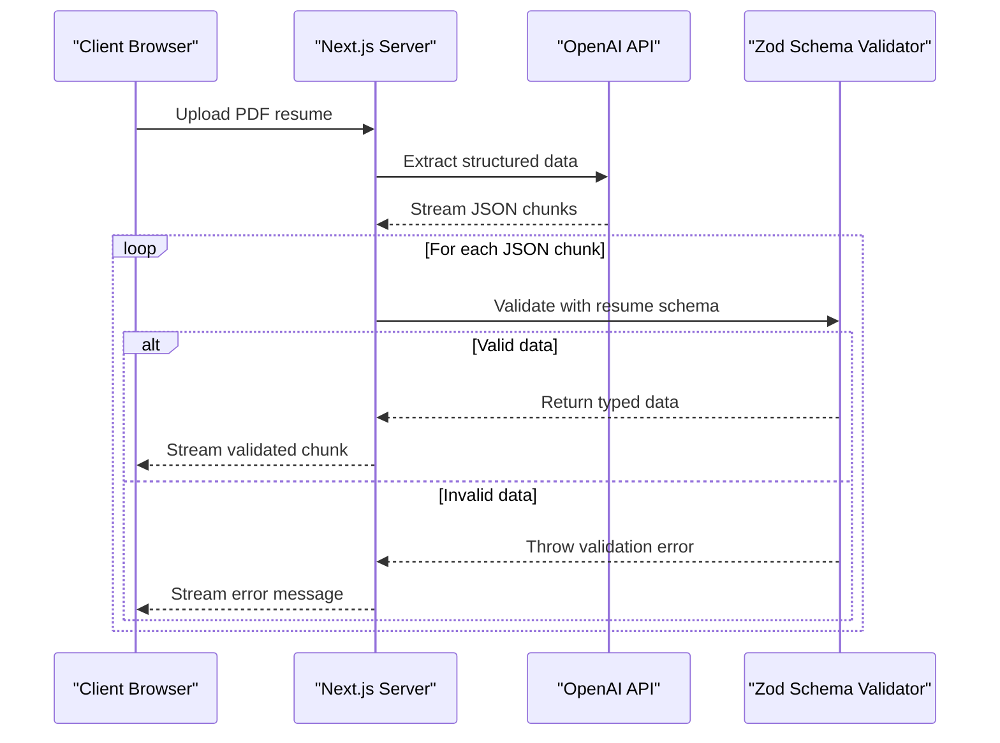
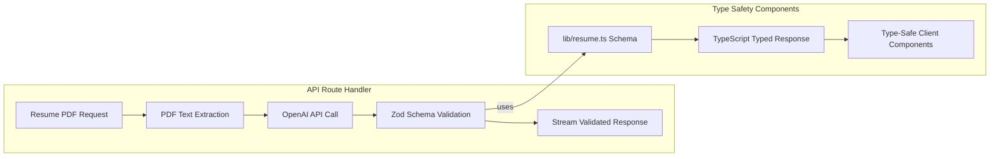
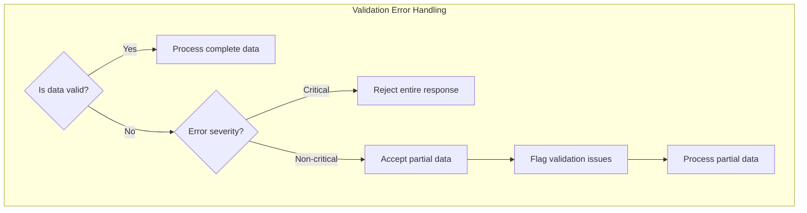
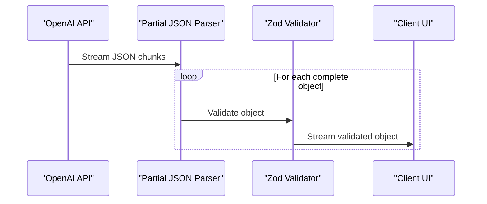
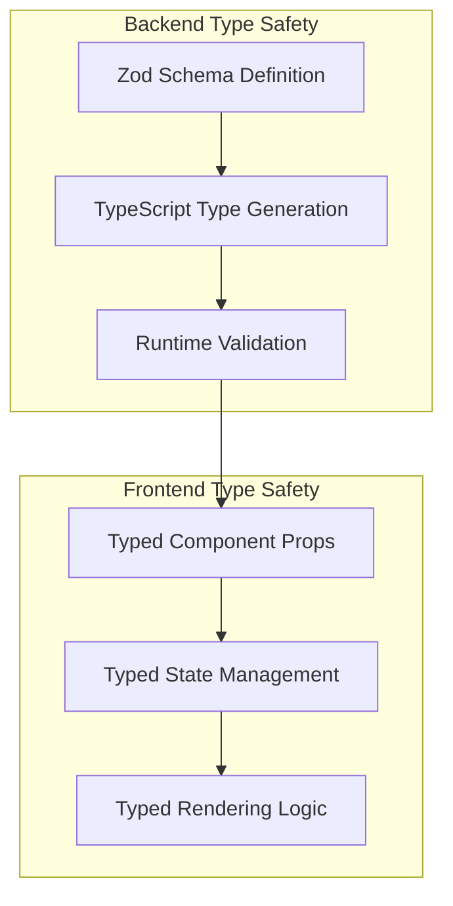

<!-- source: DeepWiki mcp.deepwiki.com · repo openai/openai-structured-outputs-samples · page 3.4 Type Safety and Validation · fetched 2026-10-26 -->

# Type Safety and Validation

<details>
<summary>Relevant source files</summary>

The following files were used as context for generating this wiki page:

- [resume-extraction/README.md](resume-extraction/README.md)
- [resume-extraction/package.json](resume-extraction/package.json)

</details>


This document explains how the resume extraction system ensures data integrity through type safety and validation mechanisms. The system uses TypeScript and Zod to create a robust pipeline that validates the structured data coming from the OpenAI API against a predefined schema before presenting it to users. For information about the OpenAI integration itself, see [OpenAI Integration](#3.2), and for details on how validated data is streamed to the frontend, see [Streaming Implementation](#3.3).

## Schema-Based Type Safety Architecture

The resume extraction system employs a layered approach to type safety and validation, combining static type checking with runtime validation to ensure data consistency.



Sources: resume-extraction/README.md, resume-extraction/package.json

## Resume Schema Definition

At the core of the type safety system is the Zod schema defined in `lib/resume.ts`. This schema establishes a contract that all resume data must follow, enforcing structure and data types for extracted information.

```mermaid
classDiagram
    class "ResumeSchema" {
        +name: string
        +email: string
        +phone: string?
        +education: Education[]
        +experience: WorkExperience[]
        +skills: string[]
        +validate(data): TypedResume
    }
    
    class "Education" {
        +institution: string
        +degree: string
        +dates: DateRange
    }
    
    class "WorkExperience" {
        +company: string
        +position: string
        +dates: DateRange
        +responsibilities: string[]
    }
    
    class "DateRange" {
        +start: string
        +end: string?
    }
    
    ResumeSchema --> Education: contains
    ResumeSchema --> WorkExperience: contains
    Education --> DateRange: has
    WorkExperience --> DateRange: has
```

Sources: resume-extraction/README.md

## Validation Workflow

The validation process ensures that data received from the OpenAI API conforms to the expected schema before it's presented to users or used in application logic.



Sources: resume-extraction/README.md

## Implementation Details

### Zod Schema Definition

The Zod schema in `lib/resume.ts` defines the structure that the OpenAI API must follow when extracting information from resumes. This schema serves both as a runtime validator and as a TypeScript type generator.

The README mentions that users can modify what fields are extracted by editing this schema file:

> To update the fields extracted by the model, you can edit the zod schema in `lib/resume.ts` file.

This indicates that the schema directly influences what information the OpenAI model extracts, highlighting the tight integration between the schema definition and model behavior.

Sources: resume-extraction/README.md

### Type Safety Benefits

The type safety approach in this system offers several key benefits:

1. **Compile-time checking**: TypeScript prevents type errors during development
2. **Runtime validation**: Zod ensures data received at runtime conforms to the expected structure
3. **Self-documenting API**: The schema serves as documentation for the data structure
4. **Improved developer experience**: Autocomplete and type hints make working with the extracted data easier
5. **Reliable downstream processing**: Components consuming the data can rely on its structure

Sources: resume-extraction/README.md

## Validation in API Routes



Sources: resume-extraction/README.md, resume-extraction/package.json

### Integration with OpenAI Structured Output

The validation system works in conjunction with OpenAI's structured output capabilities. The API request to OpenAI includes the schema, instructing the model to generate JSON that conforms to the defined structure.

Even though the OpenAI model attempts to follow the schema, the Zod validation step is still necessary to:

1. Ensure complete type safety
2. Handle edge cases where the model might produce non-conforming output
3. Provide consistent error handling
4. Enable TypeScript type inference for the extracted data

Sources: resume-extraction/README.md

## Error Handling and Partial Data

When validation errors occur, the system must decide how to handle them based on the context:



Sources: resume-extraction/README.md, resume-extraction/package.json

## JSON Streaming with Validation

A key feature of the system is its ability to stream validated JSON responses to the frontend. This requires special handling since validation typically operates on complete JSON objects.



The system likely uses the `partial-json` package (listed in package.json) to parse incomplete JSON chunks while streaming, and then validates each complete object before sending it to the client.

Sources: resume-extraction/package.json

## Schema Extension and Customization

The schema design allows for easy extension and customization, enabling users to adapt the extraction process to their specific needs:

| Customization | Implementation Method | Effect on Output |
|---------------|------------------------|------------------|
| Add new fields | Add properties to schema | OpenAI extracts additional data |
| Modify validation rules | Update field validators | Changes acceptance criteria |
| Make fields optional | Use `.optional()` | Fields not always required |
| Add nested structures | Define nested schemas | Extract hierarchical data |
| Custom validation | Add `.refine()` rules | Apply domain-specific validation |

Sources: resume-extraction/README.md

## Type Safety Best Practices

Based on the implementation in this repository, here are some best practices for ensuring type safety and validation in similar applications:

1. Define a single source of truth for data schemas
2. Use Zod (or similar libraries) to generate TypeScript types from schemas
3. Validate data as close to the source as possible
4. Handle validation errors gracefully
5. Provide meaningful error messages when validation fails
6. Design schemas to be extensible and maintainable
7. Balance validation strictness with practicality

Sources: resume-extraction/README.md

## Integration with Frontend

The type safety system extends to the frontend components, enabling them to work with the validated data in a type-safe manner:



The frontend components can display the validation status, showing users whether extraction was successful or if there were validation errors. The JSON view toggle mentioned in the README allows users to see the complete validated response.

Sources: resume-extraction/README.md

## Conclusion

The type safety and validation system in the resume extraction demo forms a critical layer of the application architecture. By combining TypeScript's static type checking with Zod's runtime validation, the system ensures that data extracted from resumes by the OpenAI API conforms to the expected structure, providing a reliable and predictable interface for both developers and users.

This approach not only improves code quality and developer experience but also enhances user experience by ensuring consistent and reliable data extraction.