# Page: Overview

# Overview

<details>
<summary>Relevant source files</summary>

The following files were used as context for generating this wiki page:

- [resume-extraction/README.md](resume-extraction/README.md)
- [resume-extraction/package.json](resume-extraction/package.json)

</details>


This document provides an introduction to the OpenAI Structured Outputs Samples repository, which demonstrates practical implementations of OpenAI's structured outputs capabilities. The repository contains demonstrations that showcase how to create deterministic, type-safe interfaces between the OpenAI API and applications.

For detailed information about the resume extraction demo specifically, see [Resume Extraction Demo](#2).

Sources: [resume-extraction/README.md:1-7]()

## Repository Purpose

The OpenAI Structured Outputs Samples repository serves as a practical guide and reference implementation for developers looking to integrate OpenAI's structured output capabilities into their applications. The samples demonstrate how to:

1. Define structured schemas to ensure consistent AI-generated outputs
2. Stream AI responses for improved user experience
3. Validate responses against predefined schemas
4. Create type-safe interfaces between AI and application code

The primary demonstration is a resume extraction application that processes PDF resumes and extracts structured information in a consistent format.

Sources: [resume-extraction/README.md:3-7](), [resume-extraction/README.md:11-15]()

## Repository Structure

The repository is organized around individual demonstration applications, with the resume extraction demo being the primary example.

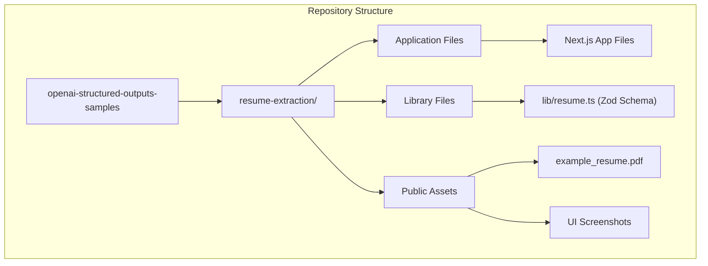

Sources: [resume-extraction/README.md:1-7]()

## Core Technologies

The repository leverages several key technologies to demonstrate structured outputs:

| Technology | Purpose | Implementation |
|------------|---------|----------------|
| OpenAI API | AI-based information extraction | Integration via OpenAI Node.js SDK |
| Zod | Schema validation and type safety | Schema definition in lib/resume.ts |
| Next.js | Full-stack web framework | Server and frontend implementation |
| PDF Processing | Extract text from PDF documents | pdf2json and pdfjs-dist libraries |
| Streaming Responses | Real-time UI updates | Server-sent events / response streaming |

Sources: [resume-extraction/package.json:11-30]()

## Resume Extraction Demo Overview

The primary demonstration in the repository is a resume extraction application that:

1. Accepts PDF resumes through file upload
2. Extracts text from the PDFs
3. Uses OpenAI's API to analyze and extract structured information
4. Validates the extracted data against a predefined schema
5. Streams the results back to the UI in real-time

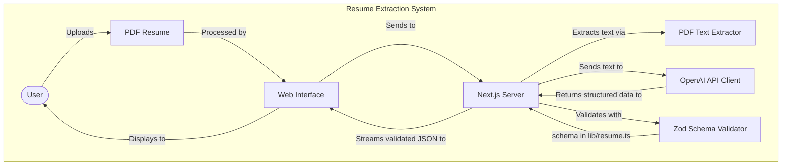

Sources: [resume-extraction/README.md:3-7](), [resume-extraction/README.md:52-56]()

## Key Features

The repository, particularly the resume extraction demo, showcases several key features that demonstrate the power of structured outputs:

### 1. Reliable Parsing

The system ensures that all outputs from the OpenAI API adhere to a predefined JSON schema, making the extracted information reliable and consistent across different inputs.

### 2. Streaming Responses

Instead of waiting for the complete processing to finish, the system streams the structured outputs as they become available, providing a dynamic user experience.

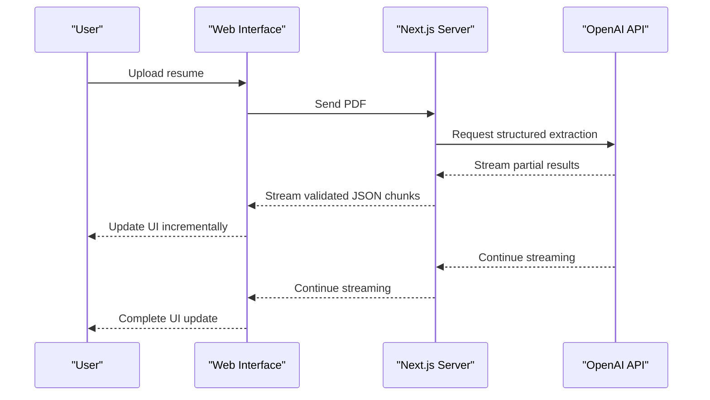

### 3. Type-Safe Interfaces

By defining a schema using Zod (`lib/resume.ts`), the system creates type-safe interfaces that simplify downstream processing with predictable JSON responses.

Sources: [resume-extraction/README.md:11-15]()

## Getting Started

To explore the repository and run the demonstrations:

1. Clone the repository
2. Navigate to the desired demo directory (e.g., `resume-extraction`)
3. Install dependencies with `npm i`
4. Set up your OpenAI API key
5. Run the demo with `npm run dev`

For specific setup instructions for each demo, refer to their respective documentation:
- For the resume extraction demo, see [Installation and Setup](#2.2)

Sources: [resume-extraction/README.md:17-50]()

## Core Components

The repository demonstrates several core components that work together to enable structured outputs:

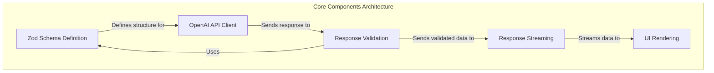

These components demonstrate a pattern that can be applied to various use cases requiring structured outputs from AI.

Sources: [resume-extraction/README.md:11-15](), [resume-extraction/package.json:11-30]()

## Technical Implementation

The technical implementation of the structured outputs approach involves:

1. **Schema Definition**: Using Zod to define the expected output structure
2. **OpenAI Integration**: Configuring the OpenAI API to generate outputs matching the schema
3. **Validation Logic**: Ensuring responses conform to the defined schema
4. **Streaming Implementation**: Processing partial responses while maintaining schema integrity
5. **UI Integration**: Displaying structured data in a user-friendly format

For a deeper technical exploration of these aspects, see [Technical Deep Dive](#3).

Sources: [resume-extraction/README.md:11-15](), [resume-extraction/package.json:11-30]()

## Conclusion

The OpenAI Structured Outputs Samples repository provides practical demonstrations of how to implement structured outputs with OpenAI's API. Through examples like the resume extraction demo, it showcases techniques for creating reliable, type-safe interfaces between AI and applications.

By leveraging schemas, validation, and streaming, developers can build robust AI-powered applications that produce consistent, structured results while providing a responsive user experience.

Sources: [resume-extraction/README.md:3-15]()

---

# Page: Repository Structure

# Repository Structure

<details>
<summary>Relevant source files</summary>

The following files were used as context for generating this wiki page:

- [resume-extraction/README.md](resume-extraction/README.md)
- [resume-extraction/package-lock.json](resume-extraction/package-lock.json)
- [resume-extraction/package.json](resume-extraction/package.json)

</details>


This document outlines the organization and file structure of the `openai-structured-outputs-samples` repository. It provides a technical overview of how the codebase is arranged, focusing on directories, key files, and their relationships. For information about the system architecture and data flow, see [Architecture](#2.1).

## Repository Organization

The repository demonstrates OpenAI's structured outputs capabilities with a primary focus on the resume extraction demo application.

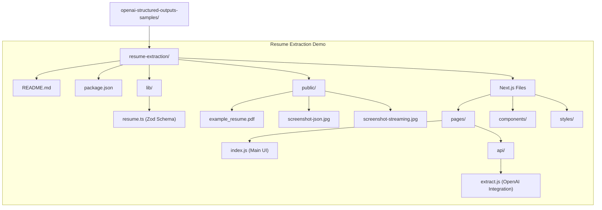

Sources:
- [resume-extraction/README.md]()
- [resume-extraction/package.json]()

## Core Files and Their Functions

The repository contains several critical files that form the foundation of the resume extraction demo:

| File | Function |
|------|----------|
| `lib/resume.ts` | Contains the Zod schema that defines the structure for extracted resume data |
| `public/example_resume.pdf` | Sample resume provided for demonstration purposes |
| `public/screenshot-*.jpg` | UI screenshots used in documentation |
| `README.md` | Contains usage instructions and feature overview |
| `package.json` | Defines project dependencies and npm scripts |

The most important file is `lib/resume.ts`, which defines the schema structure that OpenAI's API output must conform to.

Sources:
- [resume-extraction/README.md]()
- [resume-extraction/package.json]()

## Technology Stack and Dependencies

The resume extraction demo is built using a modern JavaScript/TypeScript stack with specific dependencies to handle PDF processing, OpenAI API integration, and UI components.

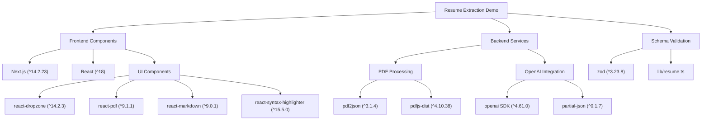

Sources:
- [resume-extraction/package.json]()

### Key Dependencies

#### Core API and Processing Libraries

| Dependency | Version | Purpose |
|------------|---------|---------|
| `openai` | ^4.61.0 | Client library for interacting with OpenAI API |
| `pdf2json` | ^3.1.4 | Extracts text from PDF documents |
| `pdfjs-dist` | ^4.10.38 | PDF.js for PDF processing |
| `zod` | ^3.23.8 | Schema validation and type definition |
| `partial-json` | ^0.1.7 | Handles partial/streaming JSON responses |

#### Frontend Framework and Components

| Dependency | Version | Purpose |
|------------|---------|---------|
| `next` | ^14.2.23 | React framework for server-side rendering and API routes |
| `react` | ^18 | UI library |
| `react-dom` | ^18 | React DOM manipulation |
| `react-dropzone` | ^14.2.3 | File upload component for PDF files |
| `react-pdf` | ^9.1.1 | PDF rendering component |
| `tailwind-merge` | ^2.5.2 | Utility for merging Tailwind CSS classes |
| `class-variance-authority` | ^0.7.0 | Build component variant utilities |
| `lucide-react` | ^0.441.0 | Icon components library |

Sources:
- [resume-extraction/package.json]()

## Development Tools and Environment

The project uses TypeScript for type safety and includes several development tools:

| Tool | Version | Purpose |
|------|---------|---------|
| `typescript` | ^5.6.2 | Static type checking |
| `@types/node` | ^20.16.10 | TypeScript definitions for Node.js |
| `@types/react` | ^18.3.10 | TypeScript definitions for React |
| `eslint` | ^8.57.1 | Code linting |
| `tailwindcss` | ^3.4.1 | CSS framework |
| `postcss` | ^8 | CSS transformation tool |

Sources:
- [resume-extraction/package.json]()

## Application Structure and Data Flow

The resume extraction demo follows a structured data flow that connects various components:

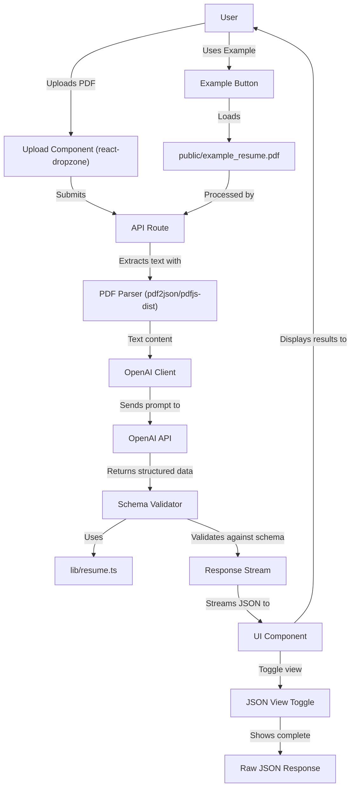

Sources:
- [resume-extraction/README.md]()
- [resume-extraction/package.json]()

## Setup and Configuration

The resume extraction demo uses the following npm scripts defined in `package.json`:

| Script | Command | Purpose |
|--------|---------|---------|
| `dev` | `next dev` | Start development server |
| `build` | `next build` | Build for production |
| `start` | `next start` | Run production server |
| `lint` | `next lint` | Run linting |

To run the application:

1. Clone the repository
2. Navigate to the `resume-extraction` directory
3. Install dependencies with `npm i`
4. Set up an OpenAI API key in an `.env` file or as an environment variable
5. Run `npm run dev`
6. Access the application at `http://localhost:3000`

Sources:
- [resume-extraction/README.md]()
- [resume-extraction/package.json]()

## Relationship to Other Components

The repository structure enables a clear separation of concerns:

1. **Schema Definition** (`lib/resume.ts`): Defines the expected structure of the data extracted from resumes
2. **Frontend Components**: Handle user interactions and display results
3. **API Integration**: Connects to OpenAI and applies schema validation
4. **PDF Processing**: Extracts text from PDF files for processing

This organization facilitates the demonstration of OpenAI's structured outputs capability by showing how to enforce a schema on AI-generated content.

Sources:
- [resume-extraction/README.md]()
- [resume-extraction/package.json]()

---

# Page: Resume Extraction Demo

# Resume Extraction Demo

<details>
<summary>Relevant source files</summary>

The following files were used as context for generating this wiki page:

- [resume-extraction/README.md](resume-extraction/README.md)
- [resume-extraction/package.json](resume-extraction/package.json)

</details>


This document provides a high-level overview of the Resume Extraction Demo application in the repository. The demo showcases how to use OpenAI's structured outputs capabilities to extract information from PDF resumes in a reliable, type-safe manner. For detailed information about the architecture, see [Architecture](#2.1), and for setup instructions, see [Installation and Setup](#2.2).

## Purpose

The Resume Extraction Demo is a web application that:
- Extracts structured information from PDF resumes using OpenAI's API
- Ensures output conforms to a predefined schema using Zod
- Streams the extracted JSON data in real-time to the UI
- Provides a simple interface for uploading resumes or using an example

It serves as a practical example of building deterministic interfaces with OpenAI's structured outputs feature, demonstrating how to create reliable parsing systems for unstructured documents.

Sources: [resume-extraction/README.md:1-7]()

## System Overview

The application allows users to upload a PDF resume or use a provided example resume. The system then processes the PDF, extracts the text content, and uses OpenAI's API to convert that unstructured text into a structured JSON format based on a predefined schema. The extracted information is streamed back to the UI as it becomes available, providing immediate feedback to the user.

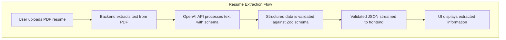

Sources: [resume-extraction/README.md:3-15]()

## Key Components

The Resume Extraction Demo consists of several interconnected components:

| Component | Description | Implementation |
|-----------|-------------|----------------|
| Frontend UI | Web interface for uploading resumes and viewing results | React-based Next.js application |
| Backend Server | Processes PDFs and communicates with OpenAI API | Next.js API routes |
| PDF Processing | Extracts text from PDF documents | Uses pdf2json and pdfjs-dist libraries |
| OpenAI Integration | Sends text to API and receives structured data | Uses OpenAI Node.js SDK |
| Schema Definition | Defines the structure of extracted data | Zod schema in lib/resume.ts |
| Streaming Handler | Streams partial JSON responses to UI | Uses partial-json parser |

Sources: [resume-extraction/package.json:11-30](), [resume-extraction/README.md:11-15]()

## Code Architecture

The following diagram illustrates the code-level architecture of the Resume Extraction Demo:

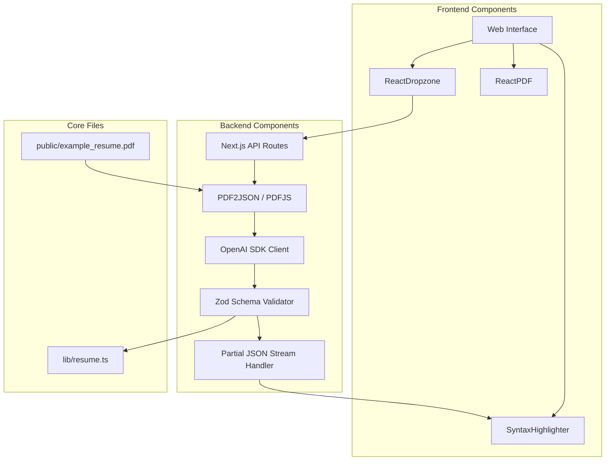

Sources: [resume-extraction/package.json:11-30]()

## Data Flow

The following sequence diagram shows the detailed flow of data through the system:

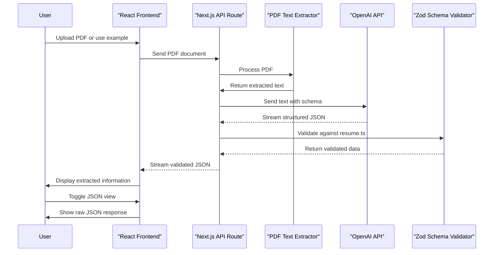

Sources: [resume-extraction/README.md:52-58]()

## Key Features

### Reliable Parsing with Schema Validation

The demo uses a Zod schema defined in `lib/resume.ts` to ensure that the output from OpenAI's API conforms to a specific structure. This creates a deterministic interface that simplifies downstream processing and provides type safety.

### Streaming Responses

Instead of waiting for the entire extraction process to complete, the application streams the structured JSON data back to the UI as it becomes available, providing a more responsive user experience.

### Type-Safe Interfaces

By defining a schema that both TypeScript and the OpenAI API understand, the application ensures predictable JSON responses that are properly typed throughout the application.

### User Interface

The demo provides a clean user interface with:
- File upload functionality using React Dropzone
- Option to use an example resume
- Real-time display of extracted information
- Toggle for viewing the raw JSON response

Sources: [resume-extraction/README.md:11-15](), [resume-extraction/README.md:52-58]()

## Usage Example

The typical usage flow of the Resume Extraction Demo is:

1. User navigates to the web application (localhost:3000)
2. User either uploads a PDF resume or clicks "Use the example" button
3. The system processes the PDF and sends the text to OpenAI
4. Extracted information streams into the UI in real-time
5. User can toggle between the formatted view and raw JSON view

The application extracts key resume information such as:
- Personal details (name, contact information)
- Work experience
- Education
- Skills
- Projects

Sources: [resume-extraction/README.md:52-58]()

## Implementation Highlights

The demo showcases several important concepts for developers:

1. **Structured Output Definition**: Using Zod schemas to define the expected structure of AI-generated content
2. **Error Handling**: Validating AI outputs against the schema to ensure they match expected formats
3. **Streaming Interface**: Implementing streaming responses for better UX with large extraction tasks
4. **PDF Processing**: Extracting text content from PDF documents for AI processing
5. **Type Safety**: Maintaining type safety throughout the application using TypeScript and Zod

To modify the fields extracted by the model, developers can edit the Zod schema in the `lib/resume.ts` file.

Sources: [resume-extraction/README.md:60-60]()

## Related Resources

For more detailed information about specific aspects of the Resume Extraction Demo, please refer to:

- [Architecture](#2.1) - Detailed system architecture and component relationships
- [Installation and Setup](#2.2) - Instructions for installing and setting up the demo
- [Usage Guide](#2.3) - Comprehensive guide on using the application
- [Zod Schema Implementation](#2.4) - In-depth explanation of the schema definition
- [User Interface](#2.5) - Detailed description of the UI components

---

# Page: Architecture

# Architecture

<details>
<summary>Relevant source files</summary>

The following files were used as context for generating this wiki page:

- [resume-extraction/README.md](resume-extraction/README.md)
- [resume-extraction/package.json](resume-extraction/package.json)

</details>


This page documents the architectural design of the resume extraction demo in the OpenAI structured outputs samples repository. It covers the system components, their interactions, data flow patterns, and key technical implementation details. For installation instructions, see [Installation and Setup](#2.2), and for usage information, see [Usage Guide](#2.3).

## System Overview

The resume extraction demo is a web application that demonstrates how to use OpenAI's structured outputs capability to extract information from PDF resumes. The system follows a client-server architecture with Next.js providing both frontend and backend functionality.

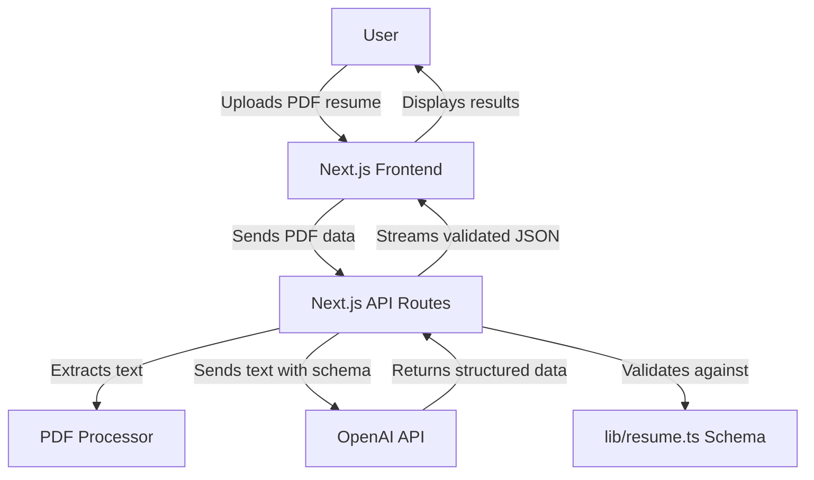

Sources: [resume-extraction/README.md:3-7](), [resume-extraction/README.md:11-15]()

## Component Architecture

The resume extraction system consists of several distinct components that work together to process PDF resumes and extract structured information.

### Frontend Components

The browser-based frontend provides a simple interface for uploading PDFs and viewing the extracted data.

| Component | Purpose |
|-----------|---------|
| Upload Button | Allows users to upload a PDF resume |
| Example Button | Loads the provided example resume |
| JSON Toggle | Switches between formatted view and raw JSON view |
| Display Area | Shows the extracted information in a readable format |

Sources: [resume-extraction/README.md:53-58]()

### Backend Components

The Next.js server handles PDF processing, AI integration, and data validation.

| Component | Purpose |
|-----------|---------|
| API Routes | Handle HTTP requests and coordinate processing |
| PDF Processor | Extracts text content from PDF documents |
| OpenAI Client | Interfaces with the OpenAI API |
| Schema Validator | Ensures data conforms to the defined structure |
| Stream Handler | Manages streaming partial results to the client |

Sources: [resume-extraction/package.json:11-30]()

### Core Files

The system relies on several key files that define its structure and behavior:

| File | Purpose |
|------|---------|
| `lib/resume.ts` | Defines the Zod schema that structures OpenAI's output |
| `public/example_resume.pdf` | Provides a sample resume for demonstration |

Sources: [resume-extraction/README.md:60](), [resume-extraction/README.md:54]()

## Component Relationships

The following diagram illustrates how the different components interact within the system:

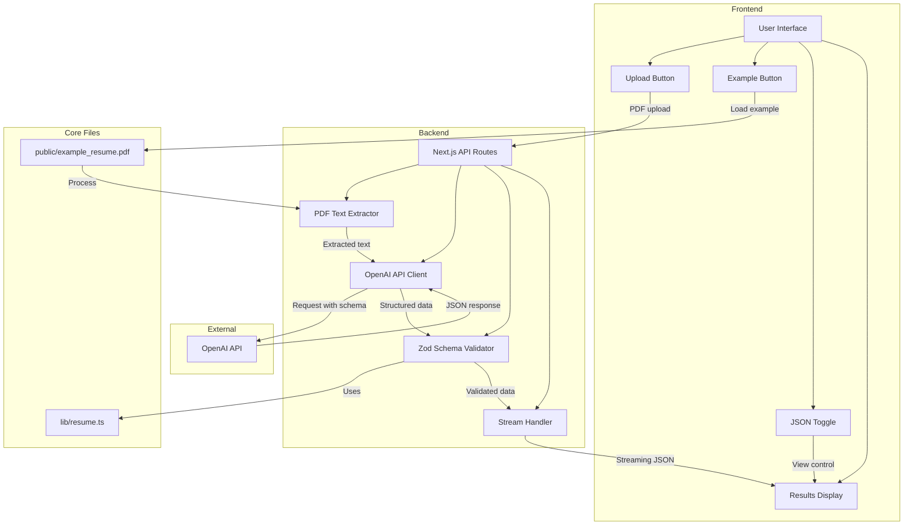

Sources: [resume-extraction/README.md:11-15](), [resume-extraction/package.json:17-20](), [resume-extraction/package.json:30]()

## Data Flow

The following sequence diagram illustrates the flow of data through the system from the initial user action to the final display of extracted information.

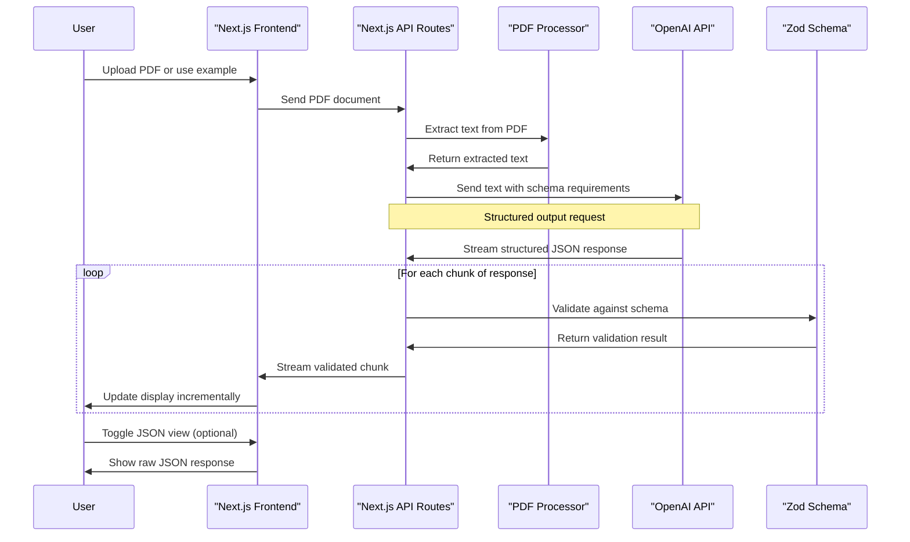

Sources: [resume-extraction/README.md:13-15](), [resume-extraction/README.md:53-58]()

## Technical Implementation

### PDF Processing

The system uses two libraries to handle PDF processing:

1. `pdf2json` - Provides core PDF parsing functionality
2. `pdfjs-dist` - Mozilla's PDF.js library for broader PDF support

These libraries extract the text content from PDF resumes, which is then sent to the OpenAI API for information extraction.

Sources: [resume-extraction/package.json:19-20]()

### OpenAI Integration

The application integrates with the OpenAI API using the official Node.js client library (`openai`). The key aspects of this integration are:

1. Sending the extracted PDF text to the API
2. Including the Zod schema as part of the request to enforce structure
3. Processing the streamed response from the API

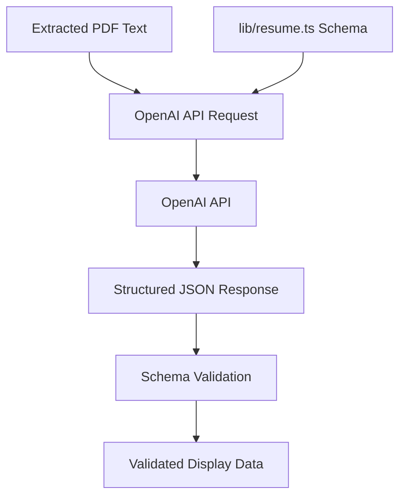

Sources: [resume-extraction/package.json:17](), [resume-extraction/README.md:13]()

### Streaming Implementation

A key feature of the architecture is the streaming capability, which provides real-time updates as the model extracts information:

1. The OpenAI API streams the JSON response as it's generated
2. The backend uses `partial-json` to parse incomplete JSON fragments
3. Each valid fragment is validated against the schema
4. Validated fragments are streamed to the frontend
5. The UI updates incrementally as new information arrives

This approach provides a more responsive user experience compared to waiting for the full response.

Sources: [resume-extraction/package.json:18](), [resume-extraction/README.md:14]()

### Schema Validation

The Zod schema defined in `lib/resume.ts` serves multiple critical functions:

1. It defines the structure that OpenAI should follow when generating output
2. It validates the response to ensure it matches the expected format
3. It provides TypeScript type definitions for type safety throughout the application

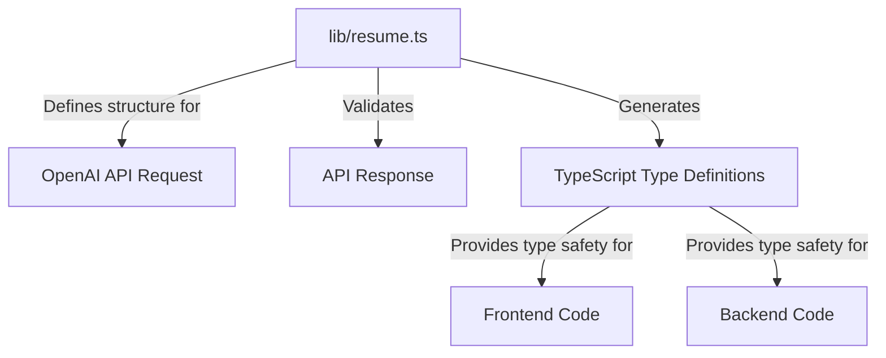

The schema ensures that the extracted information is consistent and reliable, making it easier to process and display.

Sources: [resume-extraction/README.md:15](), [resume-extraction/README.md:60](), [resume-extraction/package.json:30]()

## System Boundaries and Integration Points

The architecture has several key integration points and system boundaries:

1. **User Interface ↔ API Routes**: HTTP requests transfer PDF data and receive structured results
2. **API Routes ↔ PDF Libraries**: Text extraction from PDF documents
3. **API Routes ↔ OpenAI API**: AI-powered information extraction with structured outputs
4. **API Routes ↔ Zod Schema**: Validation and type enforcement for response data

These integration points enable the seamless flow from PDF upload to structured data display, with validation and streaming enhancing the user experience.

Sources: [resume-extraction/README.md:11-15]()

---

# Page: Installation and Setup

# Installation and Setup

<details>
<summary>Relevant source files</summary>

The following files were used as context for generating this wiki page:

- [resume-extraction/README.md](resume-extraction/README.md)
- [resume-extraction/package-lock.json](resume-extraction/package-lock.json)
- [resume-extraction/package.json](resume-extraction/package.json)

</details>


This document provides instructions for installing and setting up the Resume Extraction demo from the openai-structured-outputs-samples repository. For information about using the application once installed, see [Usage Guide](#2.3), and for details about the system architecture, see [Architecture](#2.1).

## Prerequisites

Before installing the Resume Extraction demo, ensure you have the following:

- Node.js (version 16 or higher) and npm installed
- An OpenAI API key with access to the required models
- Git for cloning the repository
- Command-line interface (terminal/command prompt)

Sources: [resume-extraction/package.json:1-43]()

## Installation Steps

### Repository Setup Flow

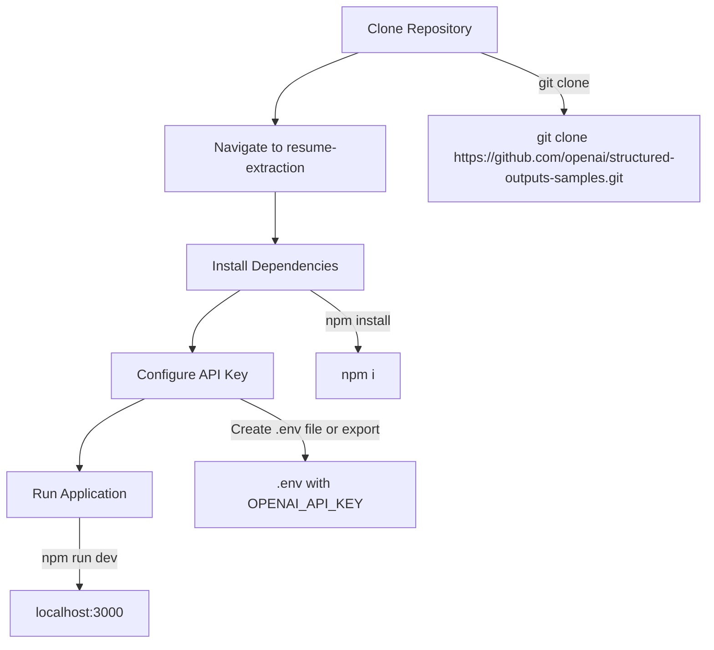

Sources: [resume-extraction/README.md:19-50]()

### 1. Clone the Repository

Clone the repository and navigate to the resume-extraction directory:

```bash
git clone https://github.com/openai/structured-outputs-samples.git
cd resume-extraction
```

Sources: [resume-extraction/README.md:19-24]()

### 2. Install Dependencies

Install all required dependencies using npm:

```bash
npm i
```

This command installs all dependencies specified in the package.json file:

| Category | Key Dependencies |
|----------|-------------|
| AI Integration | openai |
| PDF Processing | pdf2json, pdfjs-dist |
| Frontend Framework | react, react-dom, next |
| File Handling | react-dropzone |
| Schema Validation | zod |
| UI Components | class-variance-authority, clsx, tailwind-merge |

Sources: [resume-extraction/package.json:11-31](), [resume-extraction/README.md:25-30]()

### 3. Configure Environment

Set up your OpenAI API key using one of these methods:

1. Create a `.env` file in the `resume-extraction` folder:
   ```
   OPENAI_API_KEY=your-api-key
   ```

2. Or set the environment variable in your terminal:
   ```bash
   export OPENAI_API_KEY=your-api-key
   ```

Sources: [resume-extraction/README.md:32-42]()

## Running the Application

### Application Startup Architecture

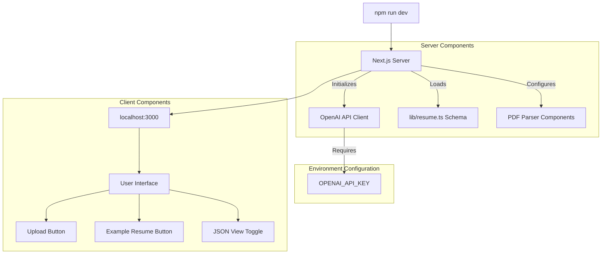

Sources: [resume-extraction/package.json:6-9](), [resume-extraction/README.md:43-50]()

### Development Mode

Run the application in development mode with hot reloading:

```bash
npm run dev
```

This starts the Next.js development server at http://localhost:3000.

Sources: [resume-extraction/package.json:6](), [resume-extraction/README.md:43-50]()

### Production Build

For a production build:

```bash
npm run build
npm start
```

Sources: [resume-extraction/package.json:7-8]()

## Dependency Structure

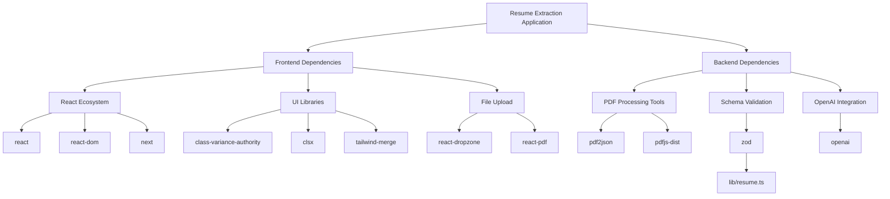

Sources: [resume-extraction/package.json:11-31]()

## Troubleshooting

### Common Issues and Solutions

#### API Key Issues
- **Problem**: Application fails to connect to OpenAI API
- **Solution**: Verify your API key is correctly set in the .env file or as an environment variable
- **Check**: Ensure your API key has sufficient permissions and quota

#### Dependency Issues
- **Problem**: Missing dependencies or conflicts
- **Solution**: Try removing node_modules folder and package-lock.json, then run `npm install` again
- **Check**: Ensure you're using a Node.js version compatible with the dependencies

#### PDF Processing Issues
- **Problem**: PDF uploads not processing correctly
- **Solution**: Verify PDF processing libraries are installed properly
- **Check**: Test with the example PDF provided in the repository at `public/example_resume.pdf`

Sources: [resume-extraction/README.md:32-42](), [resume-extraction/README.md:52-58]()

## Environment Variables Reference

| Variable Name | Required | Description |
|---------------|----------|-------------|
| OPENAI_API_KEY | Yes | Your OpenAI API key for accessing the OpenAI API |

Sources: [resume-extraction/README.md:32-42]()

---

# Page: Usage Guide

# Usage Guide

<details>
<summary>Relevant source files</summary>

The following files were used as context for generating this wiki page:

- [resume-extraction/README.md](resume-extraction/README.md)
- [resume-extraction/public/screenshot-json.jpg](resume-extraction/public/screenshot-json.jpg)
- [resume-extraction/public/screenshot-streaming.jpg](resume-extraction/public/screenshot-streaming.jpg)

</details>


This guide explains how to use the Resume Extraction Demo application after you have completed the installation. It covers uploading resumes, using the example document, viewing extracted information, and toggling between different display modes. For installation instructions, see [Installation and Setup](#2.2).

## Accessing the Application

After completing the installation and starting the development server, access the Resume Extraction Demo by opening your web browser and navigating to `http://localhost:3000`.

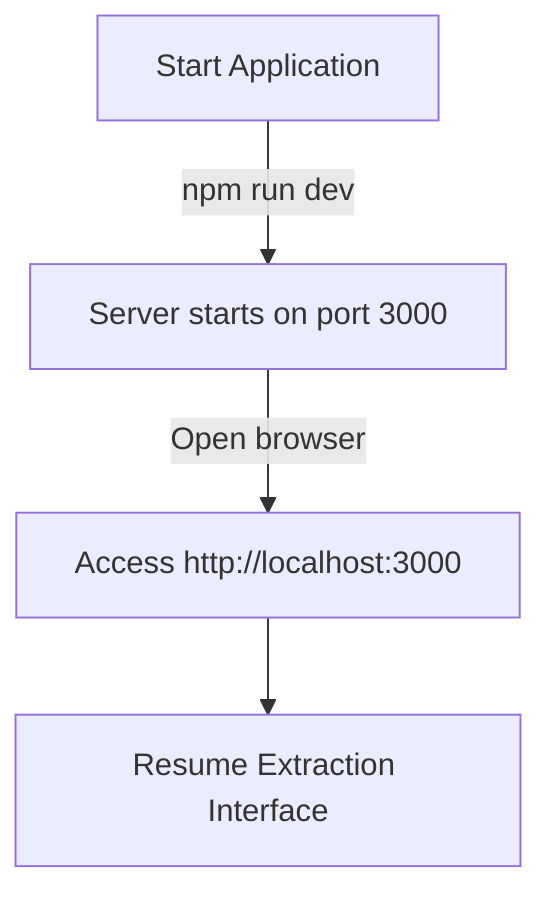

Sources: [resume-extraction/README.md:44-50]()

## Application Interface

When you first access the application, you'll see a simple interface with:

1. An upload button for submitting your own PDF resume
2. An "Use the example" button to test with the provided sample resume
3. A display area where extracted information will appear
4. A JSON toggle button in the top right corner

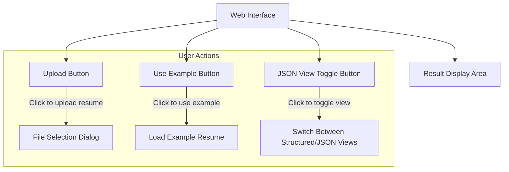

Sources: [resume-extraction/README.md:52-58]()

## Uploading Your Resume

To process your own resume:

1. Click the "Upload" button in the interface
2. Select a PDF resume file from your local file system
3. The application will automatically begin processing once the file is selected
4. Watch as extracted information streams into the display area in real-time

```mermaid
sequenceDiagram
    participant User as "User"
    participant UI as "Web Interface"
    participant Server as "Backend Server"
    participant OpenAI as "OpenAI API"
    
    User->>UI: Click "Upload" button
    UI->>User: Show file selection dialog
    User->>UI: Select PDF resume file
    UI->>Server: Send PDF document
    Server->>Server: Extract text from PDF
    Server->>OpenAI: Request structured extraction
    OpenAI-->>Server: Stream structured data
    Server-->>UI: Stream validated results
    UI-->>User: Display extracted information
```

Sources: [resume-extraction/README.md:52-56]()

## Using the Example Resume

To test the application without uploading your own file:

1. Click the "Use the example" button
2. The application will load the provided example resume (`example_resume.pdf`)
3. Processing will begin automatically
4. Watch as information is extracted and displayed

This option is useful for quickly testing the application's functionality or understanding what kind of information the system can extract.

Sources: [resume-extraction/README.md:54]()

## Viewing Extracted Information

As the system processes the resume, you'll see information appear in the display area in a structured format. The extraction happens in real-time, with fields appearing progressively as they are processed and validated.

The extracted information typically includes:

- Personal details (name, contact information)
- Education history
- Work experience
- Skills
- Other sections as defined in the resume schema

```mermaid
graph TD
    subgraph "Resume Data Flow"
        PDF["PDF Resume"] -->|"Text extraction"| RawText["Raw Text"]
        RawText -->|"OpenAI processing"| StructuredData["Structured Data"]
        StructuredData -->|"Schema validation"| ValidatedData["Validated JSON"]
        ValidatedData -->|"UI rendering"| DisplayedInfo["Displayed Information"]
    end

    subgraph "Displayed Fields"
        DisplayedInfo --> PersonalInfo["Personal Information"]
        DisplayedInfo --> Education["Education History"]
        DisplayedInfo --> Experience["Work Experience"]
        DisplayedInfo --> Skills["Skills & Competencies"]
        DisplayedInfo --> Other["Other Sections"]
    end
```

Sources: [resume-extraction/README.md:7-9](), [resume-extraction/README.md:13-15]()

## Toggling JSON View

To see the complete raw JSON output:

1. Click the "{}" icon in the top right corner of the interface
2. The display will switch from the structured view to showing the full JSON response
3. Click the icon again to return to the structured view

The JSON view provides a complete representation of all extracted data, which can be useful for developers to understand the exact structure of the data or for debugging purposes.

```mermaid
sequenceDiagram
    participant User as "User"
    participant UI as "Web Interface"
    participant DataStore as "Extracted Data"
    
    User->>UI: Click "{}" toggle button
    alt Currently showing structured view
        UI->>DataStore: Retrieve raw JSON data
        DataStore->>UI: Return complete JSON
        UI->>User: Display JSON format
    else Currently showing JSON view
        UI->>DataStore: Retrieve formatted data
        DataStore->>UI: Return structured data
        UI->>User: Display structured format
    end
```

Sources: [resume-extraction/README.md:56-58]()

## Best Practices and Tips

For optimal results when using the Resume Extraction Demo:

1. **PDF Quality**: Use clearly formatted PDF resumes for best extraction results
2. **Resume Complexity**: Be aware that very complex resume layouts may affect extraction precision
3. **Field Customization**: To modify which fields are extracted, edit the schema in `lib/resume.ts`
4. **Streaming Behavior**: Note that fields appear progressively as they're processed, which is normal behavior
5. **Resume Size**: Very large resumes may take longer to process

```mermaid
graph TD
    subgraph "Resume Processing Workflow"
        Upload["Upload Resume"] --> Process["Process Document"]
        Process --> Extract["Extract Information"]
        Extract --> Display["View Results"]
    end
    
    subgraph "Best Practices"
        Quality["Use Clear PDF Format"] -.-> Upload
        Size["Consider Resume Size"] -.-> Process
        Layout["Simple Layout Preferred"] -.-> Extract
        SchemaEdit["Customize Fields in Schema"] -.-> Extract
    end
```

Sources: [resume-extraction/README.md:60]()

## Troubleshooting Common Issues

If you encounter issues while using the application:

1. **No Response After Upload**: Ensure your API key is correctly set in the environment variables
2. **Missing Fields**: Check if your resume format matches the expected structure
3. **Slow Processing**: Large or complex PDFs may require more processing time
4. **Incorrect Information**: The extraction accuracy depends on the clarity and structure of the input resume

Sources: [resume-extraction/README.md:32-42]()

---

# Page: Zod Schema Implementation

# Zod Schema Implementation

<details>
<summary>Relevant source files</summary>

The following files were used as context for generating this wiki page:

- [resume-extraction/README.md](resume-extraction/README.md)
- [resume-extraction/package.json](resume-extraction/package.json)

</details>


This document explains how the Zod schema is implemented and used in the resume extraction demo to structure and validate the output from the OpenAI API. It focuses specifically on the schema definition, validation process, and integration with the overall system. For information about the entire resume extraction process, see [Resume Extraction Demo](#2).

## Overview of Zod in the Resume Extraction System

Zod is a TypeScript-first schema validation library that enables type-safe data validation. In this resume extraction demo, Zod serves as the cornerstone for ensuring that the unstructured data extracted from resumes by the OpenAI API is transformed into a consistent, predictable JSON structure.

The schema definition exists in the `lib/resume.ts` file and plays several crucial roles:

1. Defines the exact structure that extracted resume data must follow
2. Validates the data returned by OpenAI against this structure
3. Provides TypeScript type definitions for the extracted data
4. Guides the OpenAI API to produce outputs matching the expected format
5. Creates a deterministic interface between the API and the frontend display

```mermaid
graph TD
    subgraph "Natural Language Space"
        PDF["PDF Resume"]
        Text["Extracted Text"]
    end
    
    subgraph "Schema Validation Space"
        Schema["ResumeSchema (lib/resume.ts)"]
        Validator["SchemaValidator"]
    end
    
    subgraph "Code Entity Space"
        TypedObj["Typed Resume Object"]
        UI["UI Components"]
    end

    PDF --> Text
    Text --> OpenAI["OpenAI API"]
    OpenAI --> RawJSON["Raw JSON Response"]
    RawJSON --> Validator
    Schema --> Validator
    Validator --> TypedObj
    TypedObj --> UI
```

Sources: resume-extraction/README.md, resume-extraction/package.json

## Schema Structure and Definition

The resume extraction demo uses a Zod schema defined in `lib/resume.ts` to specify the expected structure of extracted resume data. While the exact schema definition isn't available in the provided files, based on the system's purpose, we can infer that it defines a structured representation of common resume elements.

The schema likely follows a hierarchical structure with fields for personal information, work experience, education, skills, and other common resume sections. Each field would have specified types and validation rules, such as required vs. optional fields.

A typical Zod schema implementation would use the `z.object()` method to define the structure, with nested objects and arrays for more complex data like work experience entries.

| Schema Component | Description | Typical Structure |
|-----------------|-------------|-------------------|
| Personal Information | Contact details, name, location | Object with string fields |
| Work Experience | Employment history with companies, roles, dates | Array of objects |
| Education | Academic background, degrees, institutions | Array of objects |
| Skills | Technical and soft skills | Array of strings or categorized objects |
| Projects | Notable projects completed | Array of objects |
| Certifications | Professional certifications | Array of objects |

The schema also leverages Zod's type inference capabilities, likely exporting a `Resume` type that's derived from the schema using `z.infer<typeof ResumeSchema>`.

Sources: resume-extraction/README.md

## Integration with OpenAI API

The Zod schema plays a critical role in guiding the OpenAI API to produce structured outputs. This integration works through several mechanisms:

```mermaid
sequenceDiagram
    participant Client as "Frontend"
    participant Server as "Node.js Server"
    participant Parser as "PDF Parser"
    participant OpenAI as "OpenAI API"
    participant Schema as "ResumeSchema (lib/resume.ts)"
    
    Client->>Server: Send PDF document
    Server->>Parser: Extract text
    Parser->>Server: Return text content
    Server->>OpenAI: Request with text & schema structure
    OpenAI->>Server: Stream structured JSON
    Server->>Schema: Validate against ResumeSchema
    Schema->>Server: Return validated object
    Server->>Client: Stream validated JSON
```

The schema structure is used to:

1. **Define the expected output format** - The API is instructed to produce output conforming to the schema structure
2. **Validate returned data** - As JSON is streamed from the API, it's validated against the schema
3. **Transform unstructured text** - Guide the conversion from raw resume text to structured fields

The README notes that modifying the fields extracted by the model can be done by editing the Zod schema in `lib/resume.ts`, indicating a tight coupling between the schema definition and the OpenAI API's output.

Sources: resume-extraction/README.md

## Type Safety and Validation Process

One of the primary benefits of using Zod in this application is the seamless integration of runtime validation with static TypeScript type checking.

```mermaid
graph TD
    subgraph "Validation Flow"
        OpenAI["OpenAI API Response"] --> |Raw JSON| Parser["JSON Parser"]
        Parser --> |Parsed Object| Validator["ResumeSchema.parse()"]
        Validator --> |Valid| ValidObj["Typed Resume Object"]
        Validator --> |Invalid| Error["ZodError"]
        Error --> ErrorHandler["Error Handler"]
        
        ValidObj --> TypeScript["TypeScript Compiler"]
        TypeScript --> |Type-checked| UI["UI Components"]
    end
    
    subgraph "lib/resume.ts"
        SchemaDefn["ResumeSchema Definition"]
        TypeDefn["Resume Type Definition"]
        
        SchemaDefn --> Validator
        SchemaDefn --> TypeDefn
        TypeDefn --> TypeScript
    end
```

This process ensures:

1. **Runtime validation** - Confirms that the data matches the expected structure before it's used
2. **Type checking** - Provides TypeScript type safety throughout the application
3. **Predictable interfaces** - Creates a reliable contract between different parts of the system
4. **Error handling** - Provides detailed error information when validation fails

The package.json file includes Zod as a dependency (`"zod": "^3.23.8"`), and the README file emphasizes the creation of "Type-Safe Interfaces" that simplify downstream processing with predictable JSON responses.

Sources: resume-extraction/package.json, resume-extraction/README.md

## Streaming Implementation with Schema Validation

A notable feature of the resume extraction demo is its ability to stream validated JSON responses to the UI. This involves validating the data against the Zod schema as it's streamed from the OpenAI API.

```mermaid
graph TD
    subgraph "Streaming Process"
        OpenAI["OpenAI API"] -->|Chunk 1| Validator1["Partial Schema Validation"]
        OpenAI -->|Chunk 2| Validator2["Partial Schema Validation"]
        OpenAI -->|Chunk n| ValidatorN["Partial Schema Validation"]
        
        Validator1 --> UI1["Update UI"]
        Validator2 --> UI2["Update UI"]
        ValidatorN --> UI3["Update UI"]
    end
    
    subgraph "lib/resume.ts"
        ResumeSchema["ResumeSchema"]
        PartialSchema["Partial Schema Handling"]
        
        ResumeSchema --> Validator1
        ResumeSchema --> Validator2
        ResumeSchema --> ValidatorN
        PartialSchema --> Validator1
        PartialSchema --> Validator2
        PartialSchema --> ValidatorN
    end
```

The package.json file includes a dependency on `partial-json` (`"partial-json": "^0.1.7"`), which likely helps with parsing incomplete JSON during streaming. This allows the application to validate and display partial results as they become available, rather than waiting for the complete response.

Sources: resume-extraction/package.json, resume-extraction/README.md

## Customizing the Schema

The README explicitly mentions that the fields extracted by the model can be customized by editing the Zod schema in the `lib/resume.ts` file. This flexibility allows developers to:

1. Add or remove fields to be extracted from resumes
2. Modify the structure of the extracted data
3. Change validation rules (e.g., making fields required or optional)
4. Add custom validation logic for specific fields

Making changes to the schema affects both:
- The structure of data that the OpenAI API is instructed to produce
- The validation rules applied to the API's output
- The TypeScript types used throughout the application

Customizing the schema is a central way to adapt the resume extraction demo to different use cases and requirements.

Sources: resume-extraction/README.md

## Conclusion

The Zod schema implementation in the resume extraction demo acts as the critical bridge between unstructured resume text and structured, type-safe data that can be reliably used by the application. It defines the expected data structure, guides the OpenAI API to produce compatible output, validates the returned data, and provides TypeScript types for the application.

This approach showcases how to build deterministic interfaces with AI systems, ensuring that even as the underlying AI model processes information in complex ways, the output remains consistent and predictable - a crucial requirement for building reliable applications with AI components.

Sources: resume-extraction/README.md

---

# Page: User Interface

# User Interface

<details>
<summary>Relevant source files</summary>

The following files were used as context for generating this wiki page:

- [resume-extraction/README.md](resume-extraction/README.md)
- [resume-extraction/package.json](resume-extraction/package.json)
- [resume-extraction/public/screenshot-json.jpg](resume-extraction/public/screenshot-json.jpg)
- [resume-extraction/public/screenshot-streaming.jpg](resume-extraction/public/screenshot-streaming.jpg)

</details>


This document describes the user interface components and interactions for the Resume Extraction Demo application in the openai-structured-outputs-samples repository. The UI provides a web-based interface that allows users to upload PDF resumes, view the structured data extracted by the OpenAI API, and toggle between different views of the extracted information.

For information about how the extracted data is validated against schema definitions, see [Zod Schema Implementation](#2.4). For details on how PDF processing works, see [PDF Processing](#3.1).

## UI Overview

The Resume Extraction Demo features a clean, functional interface that enables users to upload PDF resumes or use a provided example, then view the structured information extracted by the OpenAI API as it streams in real-time.

### UI Component Structure

```mermaid
graph TD
    subgraph "UI_Components"
        MainUI["Main UI Container"]
        UploadZone["Upload Area"]
        ButtonControls["Control Buttons"]
        DisplaySection["Display Area"]
        JSONToggleBtn["JSON Toggle Button"]
    end
    
    MainUI --> UploadZone
    MainUI --> ButtonControls
    MainUI --> DisplaySection
    MainUI --> JSONToggleBtn
    
    ButtonControls --> UploadBtn["Upload Resume Button"]
    ButtonControls --> ExampleBtn["Use Example Button"]
    
    DisplaySection --> FormattedView["Formatted Resume View"]
    DisplaySection --> JSONView["Raw JSON View"]
    
    JSONToggleBtn -.->|"Toggle between views"| DisplaySection
```

Sources:
- resume-extraction/README.md
- resume-extraction/public/screenshot-streaming.jpg
- resume-extraction/public/screenshot-json.jpg

## UI Components

### Upload Area

The upload area provides a way for users to upload their own PDF resumes for processing. It leverages `react-dropzone` to enable a drag-and-drop interface with the following features:

- Drag-and-drop file upload functionality
- File type validation (PDF only)
- Visual feedback during upload process

### Control Buttons

Two primary control buttons are displayed prominently in the interface:

1. **Upload Resume Button** - Allows users to select a PDF file from their device
2. **Use Example Button** - Loads the built-in example resume (`example_resume.pdf`) for demonstration

These buttons provide easy entry points for using the application without requiring users to have their own resumes ready.

### JSON Toggle Button

The JSON toggle button, represented by the "{}" icon in the top right corner of the interface, allows users to switch between:

- **Formatted View** - A structured, human-readable display of the extracted resume information
- **Raw JSON View** - The complete JSON response showing all extracted fields

This toggle demonstrates the dual-purpose nature of structured outputs - both human-readable and machine-processable.

### Display Area

The display area is the main section of the UI where extracted resume information is presented. It features:

- Real-time updates as data streams from the API
- Clearly formatted sections for personal information, education, experience, skills, etc.
- Syntax highlighting for the JSON view using `react-syntax-highlighter`
- Responsive layout that adapts to different screen sizes

Sources:
- resume-extraction/README.md
- resume-extraction/package.json (react-dropzone, react-syntax-highlighter dependencies)

## User Interaction Flow

The following diagram illustrates the typical user interaction flow within the application:

```mermaid
sequenceDiagram
    participant User
    participant UploadComponent as "Upload Component"
    participant APIRoute as "Next.js API Route"
    participant PDFExtractor as "PDF Text Extractor"
    participant OpenAIClient as "OpenAI API Client"
    participant ZodValidator as "Zod Schema Validator"
    participant DisplayComponent as "Display Component"
    
    User->>UploadComponent: Upload PDF or use example
    UploadComponent->>APIRoute: Send PDF data
    APIRoute->>PDFExtractor: Extract text from PDF
    PDFExtractor->>OpenAIClient: Send text for extraction
    OpenAIClient->>OpenAIClient: Request structured data from API
    OpenAIClient-->>ZodValidator: Stream JSON response
    ZodValidator-->>APIRoute: Validate against schema
    APIRoute-->>DisplayComponent: Stream validated data
    DisplayComponent-->>User: Display extracted information
    User->>DisplayComponent: Toggle JSON view
    DisplayComponent-->>User: Switch between formatted/JSON views
```

Sources:
- resume-extraction/README.md (streaming responses feature)

## Implementation Details

### UI Technology Stack

The user interface is built using the following technologies:

| Technology | Purpose |
|------------|---------|
| React | UI component library |
| Next.js | React framework for server-rendered pages and API routes |
| TailwindCSS | Utility-first CSS framework for styling |
| react-dropzone | File upload component |
| react-syntax-highlighter | JSON syntax highlighting |
| zod | Schema validation for structured data |

### UI-Backend Communication

```mermaid
graph TD
    subgraph "Frontend"
        UIComponents["UI Components"]
        FetchAPI["Fetch API"]
        StreamParser["Stream Parser"]
        JSONRenderer["JSON Renderer"]
    end
    
    subgraph "Backend"
        NextAPIRoutes["Next.js API Routes"]
        PDFProcessor["PDF Processor"]
        OpenAIAPIClient["OpenAI API Client"]
        SchemaValidation["Zod Schema Validation"]
    end
    
    UIComponents -->|"1. Upload PDF"| FetchAPI
    FetchAPI -->|"2. POST request"| NextAPIRoutes
    NextAPIRoutes -->|"3. Process PDF"| PDFProcessor
    PDFProcessor -->|"4. Extract text"| OpenAIAPIClient
    OpenAIAPIClient -->|"5. Request extraction"| ExternalAPI["OpenAI API"]
    ExternalAPI -->|"6. Stream JSON"| OpenAIAPIClient
    OpenAIAPIClient -->|"7. Stream chunks"| SchemaValidation
    SchemaValidation -->|"8. Validate chunks"| NextAPIRoutes
    NextAPIRoutes -->|"9. Stream response"| FetchAPI
    FetchAPI -->|"10. Process stream"| StreamParser
    StreamParser -->|"11. Update state"| UIComponents
    UIComponents -->|"12. Render data"| JSONRenderer
```

Sources:
- resume-extraction/package.json
- resume-extraction/README.md

## Streaming Implementation

One of the key features of the UI is its ability to display structured data as it streams from the OpenAI API, providing a responsive experience even when processing large documents.

### Streaming Process

1. The UI initiates a fetch request to the Next.js API route when a resume is uploaded or the example is selected
2. The API route processes the PDF and sends the text to the OpenAI API
3. As the OpenAI API generates structured data, it streams the response back
4. Each chunk of the response is validated against the Zod schema
5. Validated chunks are streamed to the frontend
6. The UI updates incrementally, displaying data as it becomes available

This approach provides significant UX benefits:
- Immediate feedback about extraction progress
- Faster time to first meaningful display
- Clear indication that the system is working during longer extractions

Sources:
- resume-extraction/README.md (streaming responses feature)

## UI Appearance

The Resume Extraction Demo UI features a clean, minimalist design focused on functionality:

1. **Initial State**: Upload area with clearly visible control buttons
2. **Processing State**: Visual indicators showing extraction progress
3. **Results State**: Two viewing options:
   - Formatted view with organized resume sections
   - Raw JSON view showing the complete structured output

The UI transforms the complex JSON output from the OpenAI API into an easily digestible format, while still providing access to the raw structured data for users who want to see the complete extraction results.

Sources:
- resume-extraction/public/screenshot-streaming.jpg
- resume-extraction/public/screenshot-json.jpg
- resume-extraction/README.md

## UI-Schema Integration

The UI directly reflects the structure defined in the Zod schema (`lib/resume.ts`). Each section of the displayed resume corresponds to fields in the schema:

```mermaid
graph TD
    subgraph "Zod_Schema_Structure"
        ResumeSchema["ResumeSchema"]
        PersonalInfo["PersonalInfo"]
        Education["Education"]
        WorkExperience["WorkExperience"]
        Skills["Skills"]
        Projects["Projects"]
        Certifications["Certifications"]
    end
    
    subgraph "UI_Display_Sections"
        PersonalSection["Personal Information Section"]
        EducationSection["Education Section"]
        ExperienceSection["Work Experience Section"]
        SkillsSection["Skills Section"]
        ProjectsSection["Projects Section"]
        CertificationsSection["Certifications Section"]
    end
    
    ResumeSchema --> PersonalInfo
    ResumeSchema --> Education
    ResumeSchema --> WorkExperience
    ResumeSchema --> Skills
    ResumeSchema --> Projects
    ResumeSchema --> Certifications
    
    PersonalInfo -.->|"Maps to"| PersonalSection
    Education -.->|"Maps to"| EducationSection
    WorkExperience -.->|"Maps to"| ExperienceSection
    Skills -.->|"Maps to"| SkillsSection
    Projects -.->|"Maps to"| ProjectsSection
    Certifications -.->|"Maps to"| CertificationsSection
```

This tight integration between schema definition and UI display ensures that the interface accurately represents the structured data extracted by the OpenAI API.

Sources:
- resume-extraction/README.md
- resume-extraction/lib/resume.ts (mentioned in README)

## Summary

The Resume Extraction Demo UI provides a practical, user-friendly interface for demonstrating OpenAI's structured outputs capabilities. By combining intuitive controls, real-time streaming, and flexible viewing options, the interface showcases how AI-extracted structured data can be effectively presented to users while maintaining the technical integrity of the JSON schema.

The UI demonstrates two critical aspects of working with AI-generated structured data:
1. The ability to present complex structured information in a human-readable format
2. The power of streaming responses for providing immediate feedback and enhancing user experience

Sources:
- resume-extraction/README.md
- resume-extraction/package.json

---

# Page: Technical Deep Dive

# Technical Deep Dive

<details>
<summary>Relevant source files</summary>

The following files were used as context for generating this wiki page:

- [resume-extraction/README.md](resume-extraction/README.md)
- [resume-extraction/package.json](resume-extraction/package.json)

</details>


This document provides a comprehensive technical exploration of the resume extraction system implemented in the openai-structured-outputs-samples repository. It covers the core architecture, data flow, key components, and technical implementation details of the system. For specific details about individual subsystems, see the child pages on [PDF Processing](#3.1), [OpenAI Integration](#3.2), [Streaming Implementation](#3.3), and [Type Safety and Validation](#3.4).

## System Architecture Overview

The resume extraction demo demonstrates how to create deterministic interfaces using OpenAI's structured outputs capability, with a specific focus on extracting structured data from resume PDFs. The system follows a client-server architecture with multiple components working together.

```mermaid
flowchart TD
    subgraph "Frontend Components"
        client["Next.js Client"]
        uploadComponent["Upload Component"]
        displayComponent["Display Component"]
        jsonToggle["JSON Toggle"]
    end

    subgraph "Backend Components"
        apiRoute["API Route /api/extract"]
        pdfProcessor["PDF Processor"]
        openaiClient["OpenAI Client"]
        schemaValidator["Zod Schema Validator"]
        streamHandler["Stream Handler"]
    end

    subgraph "External Services"
        openaiAPI["OpenAI API"]
    end

    client --> uploadComponent
    client --> displayComponent
    client --> jsonToggle
    
    uploadComponent -->|"PDF File"| apiRoute
    apiRoute --> pdfProcessor
    pdfProcessor -->|"Extracted Text"| openaiClient
    openaiClient -->|"Request with System Prompt"| openaiAPI
    openaiAPI -->|"Structured JSON Response"| openaiClient
    openaiClient --> schemaValidator
    schemaValidator -->|"Validated Data"| streamHandler
    streamHandler -->|"Streamed JSON"| displayComponent
    
    schemaValidator -.->|"Validates Against"| zodSchema["resume.ts Schema"]
```

Sources: [resume-extraction/README.md:1-60]()

## Core Technical Components

### 1. Next.js Framework

The application is built using Next.js, a React framework that provides server-side rendering, API routes, and a streamlined development experience. The application structure follows Next.js conventions, with API routes handling the backend logic and React components handling the frontend UI.

### 2. PDF Processing Pipeline

```mermaid
flowchart LR
    pdfUpload["PDF Upload"] -->|"Binary Data"| pdfExtractor["PDF Text Extractor"]
    pdfExtractor -->|"Raw Text"| textPreprocessor["Text Preprocessor"]
    textPreprocessor -->|"Cleaned Text"| openaiPrompt["OpenAI Prompt Builder"]
    
    subgraph "PDF Libraries"
        pdf2json["pdf2json Library"]
        pdfjsDist["pdfjs-dist Library"]
    end
    
    pdfExtractor -.->|"Uses"| pdf2json
    pdfExtractor -.->|"Uses"| pdfjsDist
```

The system uses multiple PDF processing libraries including pdf2json and pdfjs-dist to extract text content from uploaded PDF files. For detailed implementation of PDF processing, see [PDF Processing](#3.1).

Sources: [resume-extraction/package.json:19-20]()

### 3. OpenAI Integration

The application uses the OpenAI API to transform unstructured resume text into structured JSON data. It sends the extracted text from PDFs to the OpenAI API with a system prompt that instructs the model to extract specific information based on the schema. For detailed implementation of the OpenAI integration, see [OpenAI Integration](#3.2).

```mermaid
sequenceDiagram
    participant Server as "Next.js Server"
    participant Client as "OpenAI Client"
    participant API as "OpenAI API"
    
    Server->>Client: Send resume text
    Client->>API: API request with system prompt
    Note over Client,API: Includes schema definition
    API->>Client: Stream structured JSON response
    Client->>Server: Stream validated data
```

Sources: [resume-extraction/package.json:17]()

### 4. Zod Schema Definition

The core of the structured output capability is the Zod schema defined in `lib/resume.ts`. This schema:
- Defines the exact structure that the extracted resume data must conform to
- Provides type safety through TypeScript integration
- Enables runtime validation of the data received from OpenAI
- Creates a deterministic interface for downstream processing

The schema defines fields like personal information, work experience, education, skills, and certifications that should be extracted from resumes. For detailed information about schema implementation, see [Type Safety and Validation](#3.4).

Sources: [resume-extraction/README.md:60]()

### 5. Streaming Implementation

The system implements streaming to provide real-time feedback to users. Instead of waiting for the entire extraction process to complete, extracted data is streamed to the UI as it becomes available. This is implemented using:
- Server-side streaming with Next.js API routes
- OpenAI SDK's streaming capabilities
- Client-side handling of streaming responses

For detailed implementation of streaming, see [Streaming Implementation](#3.3).

## Data Flow and Processing Pipeline

The resume extraction system follows a clear data flow from PDF upload to displayed structured data:

```mermaid
flowchart TD
    subgraph "1. Input Processing"
        upload["Upload PDF"]
        example["Use Example PDF"]
        pdf["PDF Document"]
        extraction["Text Extraction"]
        text["Raw Text"]
    end
    
    subgraph "2. OpenAI Processing"
        prompt["Build System Prompt"]
        apiRequest["Send API Request"]
        apiResponse["Receive Streamed Response"]
    end
    
    subgraph "3. Validation & Display"
        parsing["Parse JSON Chunks"]
        validation["Validate Against Schema"]
        streaming["Stream to Client"]
        display["Display in UI"]
    end
    
    upload --> pdf
    example --> pdf
    pdf --> extraction
    extraction --> text
    
    text --> prompt
    prompt --> apiRequest
    apiRequest --> apiResponse
    
    apiResponse --> parsing
    parsing --> validation
    validation --> streaming
    streaming --> display
```

### Detailed Processing Steps:

1. **PDF Handling**:
   - User uploads a PDF or selects the example resume
   - PDF is sent to the server via a form submission or fetch request
   - Server extracts text from the PDF using pdf extraction libraries

2. **OpenAI API Integration**:
   - Extracted text is incorporated into a system prompt
   - Prompt includes instructions for the model to extract specific fields
   - Request is sent to OpenAI API with streaming enabled
   - API begins returning structured JSON data in chunks

3. **Response Processing**:
   - JSON chunks are parsed and validated against the Zod schema
   - Invalid or incomplete data is handled appropriately
   - Validated data is streamed back to the client
   - UI updates in real-time as data becomes available

4. **Display and Interaction**:
   - Structured data is rendered in a user-friendly format
   - User can toggle between formatted view and raw JSON view
   - UI provides feedback during extraction process

Sources: [resume-extraction/README.md:5-15](), [resume-extraction/package.json:17-20]()

## Technical Implementation Details

### Key Technical Features

| Feature | Implementation | Purpose |
|---------|----------------|---------|
| Schema Definition | Zod library | Defines structure for OpenAI output and provides validation |
| PDF Processing | pdf2json, pdfjs-dist | Extracts text content from uploaded PDF resumes |
| API Integration | OpenAI Node.js SDK | Communicates with OpenAI API to process resume text |
| Response Streaming | Server-sent events | Provides real-time updates to the UI as data is processed |
| JSON Parsing | partial-json | Handles incomplete JSON chunks during streaming |
| UI Components | React, Tailwind CSS | Creates responsive interface for user interaction |

Sources: [resume-extraction/package.json:11-30]()

### Error Handling and Edge Cases

The system implements several error handling mechanisms:

```mermaid
flowchart TD
    error1["Invalid PDF"]
    error2["API Failure"]
    error3["Schema Validation Error"]
    error4["Partial JSON Error"]
    
    error1 -->|"Handled by"| handler1["PDF Validation Check"]
    error2 -->|"Handled by"| handler2["API Error Boundary"]
    error3 -->|"Handled by"| handler3["Zod Error Handling"]
    error4 -->|"Handled by"| handler4["Partial JSON Parser"]
    
    subgraph "Error Recovery"
        handler1 -->|"Response"| response1["User Feedback"]
        handler2 -->|"Response"| response2["Retry or Fallback"]
        handler3 -->|"Response"| response3["Partial Data Display"]
        handler4 -->|"Response"| response4["Wait for Complete Chunk"]
    end
```

The system handles several potential error conditions:

1. **PDF Processing Errors**: 
   - Invalid PDF format
   - Empty or unreadable PDF content
   - PDF with image-only content (no extractable text)

2. **API Errors**:
   - OpenAI API rate limiting or quota exceeded
   - Network failures during API communication
   - Timeout issues for large documents

3. **Schema Validation Errors**:
   - Mismatched data types from API response
   - Missing required fields
   - Unexpected data structures

4. **Streaming Errors**:
   - Incomplete JSON chunks
   - Connection interruptions
   - Client-side rendering issues

Sources: [resume-extraction/README.md:13-15](), [resume-extraction/package.json:18]()

## Performance Considerations

The resume extraction system is designed with several performance considerations:

1. **Streaming Implementation**: 
   - Reduces perceived latency by showing partial results as they arrive
   - Improves user experience for large resumes
   - Allows processing to begin before complete extraction

2. **PDF Processing Optimization**:
   - Uses efficient text extraction libraries
   - Handles different PDF formats and structures

3. **API Usage Efficiency**:
   - Proper prompt engineering to reduce token usage
   - Schema-guided extraction to focus on relevant information

4. **UI Rendering Optimization**:
   - Efficient React component rendering
   - Progressive display of extracted information

## Conclusion

The technical implementation of the resume extraction system demonstrates several advanced techniques for working with OpenAI's structured outputs:

1. **Schema-First Design**: Using Zod to define the expected structure before making API calls
2. **Streaming Architecture**: Implementing real-time data flow from API to UI
3. **Error Resilience**: Handling various failure modes gracefully
4. **Type Safety**: Ensuring consistent data structures throughout the application

For more detailed information about specific aspects of the system, refer to the child pages on [PDF Processing](#3.1), [OpenAI Integration](#3.2), [Streaming Implementation](#3.3), and [Type Safety and Validation](#3.4).

Sources: [resume-extraction/README.md:1-60](), [resume-extraction/package.json:1-43]()

---

# Page: PDF Processing

# PDF Processing

<details>
<summary>Relevant source files</summary>

The following files were used as context for generating this wiki page:

- [resume-extraction/package-lock.json](resume-extraction/package-lock.json)
- [resume-extraction/package.json](resume-extraction/package.json)

</details>


This document covers the PDF processing subsystem in the resume extraction demo, explaining how PDF resumes are handled, parsed, and converted to text for structured data extraction by the OpenAI API.

## Purpose and Scope

The PDF Processing component is responsible for:
- Converting uploaded PDF resumes into text format
- Extracting text content from the example resume
- Preparing the extracted text for submission to the OpenAI API
- Supporting PDF preview functionality in the user interface

For information about how the extracted text is processed by the OpenAI API, see [OpenAI Integration](#3.2), and for details on the streaming implementation, see [Streaming Implementation](#3.3).

Sources: [resume-extraction/package.json:18-20]()

## PDF Processing Libraries

The resume extraction demo uses the following PDF-related libraries:

| Library | Version | Purpose |
|---------|---------|---------|
| pdf2json | 3.1.4 | Converts PDF documents to JSON format, facilitating text extraction |
| pdfjs-dist | 4.10.38 | Mozilla's PDF.js library for PDF rendering and text extraction |
| react-pdf | 9.1.1 | React component for displaying PDFs in the browser |
| react-dropzone | 14.2.3 | Handles file uploads, including PDFs |

Each library has a specific role in the PDF processing workflow:

- **pdf2json**: Used for server-side PDF parsing and text extraction
- **pdfjs-dist**: Provides the core PDF handling capabilities
- **react-pdf**: Enables PDF previewing in the browser
- **react-dropzone**: Facilitates the PDF upload interface

Sources: [resume-extraction/package.json:18-25]()

## PDF Processing Architecture

The following diagram illustrates how the PDF processing component fits into the overall system architecture:

```mermaid
graph TD
    User(["User"]) -->|"Uploads PDF"| UploadComponent["Upload Component\n(react-dropzone)"]
    User -->|"Selects example"| ExampleButton["Example Resume Button"]
    UploadComponent -->|"PDF File"| Server["Node.js Server"]
    ExampleButton -->|"example_resume.pdf"| Server
    Server -->|"PDF Data"| PDFProcessor["PDF Processor\n(pdf2json/pdfjs-dist)"]
    PDFProcessor -->|"Extracted Text"| APIClient["OpenAI API Client"]
    APIClient -->|"Text + Schema\n(from resume.ts)"| OpenAI["OpenAI API"]
    OpenAI -->|"Structured JSON"| Validator["Zod Schema Validator"]
    Validator -->|"Validated JSON"| Frontend["Frontend Display"]
    Frontend -->|"Extracted Information"| User
    
    subgraph "Frontend (Browser)"
        UploadComponent
        ExampleButton
        Frontend
    end
    
    subgraph "Backend (Node.js)"
        Server
        PDFProcessor
        APIClient
        Validator
    end
```

Sources: [resume-extraction/package.json:18-20]()

## PDF Processing Workflow

The PDF processing workflow in the resume extraction demo follows these steps:

```mermaid
sequenceDiagram
    participant User
    participant UI as Frontend UI
    participant Server as Node.js Server
    participant PDFProcessor as PDF Processor
    participant OpenAI as OpenAI API
    
    User->>UI: Upload resume PDF or select example
    UI->>Server: Send PDF document
    Server->>PDFProcessor: Process PDF using pdf2json/pdfjs-dist
    Note over PDFProcessor: Extract text from PDF structure
    PDFProcessor->>Server: Return extracted text content
    Server->>OpenAI: Send text with schema for extraction
    OpenAI->>Server: Stream structured JSON data
    Server->>UI: Stream validated JSON response
    UI->>User: Display extracted information
```

Sources: [resume-extraction/package.json:18-20]()

## PDF Text Extraction Process

The PDF text extraction process involves several stages:

1. **PDF Acquisition**: The system receives a PDF file through user upload or example selection
2. **PDF Parsing**: The server processes the PDF using pdf2json or pdfjs-dist
3. **Text Extraction**: The library extracts text content from the PDF structure
4. **Text Processing**: The extracted text is cleaned and formatted for optimal processing
5. **API Preparation**: The processed text is prepared for submission to the OpenAI API

### Frontend PDF Handling

On the frontend, the system implements:

- A file upload area using react-dropzone for PDF selection
- PDF preview functionality using react-pdf to display uploaded documents
- An option to use the example resume provided with the application

### Backend PDF Processing

The backend handles the core PDF processing:

```mermaid
graph TD
    PDFInput["PDF Input\n(Upload or Example)"] --> Parse["Parse PDF"]
    Parse --> Extract["Extract Text"]
    Extract --> Process["Process Text"]
    Process --> Prepare["Prepare for API"]
    Prepare --> Send["Send to OpenAI API"]
    
    subgraph "PDF Parser Module"
        Parse
        Extract
    end
    
    subgraph "Text Processing"
        Process
        Prepare
    end
```

Sources: [resume-extraction/package.json:18-20]()

## Technical Considerations

PDF processing in resume extraction presents several challenges:

1. **Format Variability**: Resumes come in diverse formats and layouts, requiring robust parsing capabilities
2. **Text Extraction Quality**: The accuracy of text extraction directly impacts structured data extraction quality
3. **Structure Preservation**: Maintaining the logical flow and relationships in the resume data
4. **Performance Optimization**: Processing PDFs efficiently to minimize latency
5. **Error Handling**: Gracefully handling malformed PDFs and extraction failures

The system addresses these challenges through its use of established PDF processing libraries and a structured workflow that prepares the extracted text for optimal processing by the OpenAI API.

Sources: [resume-extraction/package.json:18-20]()

## Example Resume

The system includes an example resume (example_resume.pdf) in the public directory, which can be used to demonstrate the PDF processing and information extraction capabilities without requiring users to upload their own documents.

Sources: [resume-extraction/package.json:18-20]()

---

# Page: OpenAI Integration

# OpenAI Integration

<details>
<summary>Relevant source files</summary>

The following files were used as context for generating this wiki page:

- [resume-extraction/README.md](resume-extraction/README.md)
- [resume-extraction/package.json](resume-extraction/package.json)

</details>


This page documents how the resume extraction demo integrates with the OpenAI API to extract structured data from PDF resumes. It covers the setup of the API client, request construction, structured output implementation, and response handling. For information about streaming implementation details, see [Streaming Implementation](#3.3). For information about PDF processing that happens before the OpenAI API call, see [PDF Processing](#3.1).

## Integration Overview

The resume extraction demo leverages the OpenAI API to transform unstructured resume text into structured JSON data that adheres to a predefined schema. This integration forms the core functionality of the application, enabling the extraction of specific resume details like contact information, education, work experience, and skills.

```mermaid
graph TD
    subgraph "OpenAI Integration Flow"
        A["PDFParser"] -->|"Extract text"| B["Text Content"]
        B -->|"Send to"| C["OpenAI Client"]
        C -->|"API Request"| D["OpenAI API"]
        D -->|"Return Structured JSON"| E["Response Handler"]
        E -->|"Validate with"| F["Zod Schema"]
        F -->|"Stream validated data"| G["UI"]
    end
```

Sources: resume-extraction/README.md

## API Client Configuration

The application uses the official OpenAI Node.js SDK (version 4.61.0) to interact with the API. The client is initialized with an API key that must be provided through environment variables.

```mermaid
sequenceDiagram
    participant App as "Application"
    participant EnvConfig as "Environment Configuration"
    participant OpenAIClient as "OpenAI Client"
    
    App->>EnvConfig: Request OPENAI_API_KEY
    Note over EnvConfig: From .env file or export
    EnvConfig->>App: Return API key
    App->>OpenAIClient: Initialize with API key
    OpenAIClient->>App: Return configured client instance
```

Sources: resume-extraction/package.json, resume-extraction/README.md

## Request Construction

When a user uploads a resume or selects the example resume, the application constructs a request to the OpenAI API after extracting text from the PDF. The request includes:

1. The extracted resume text content
2. Instructions for the model on what information to extract
3. The output structure defined by the Zod schema in `lib/resume.ts`

```mermaid
graph TD
    A["User Interface"] -->|"Upload PDF"| B["PDF Handler"]
    B -->|"Extract text"| C["Text Extractor"]
    C -->|"Provide text"| D["OpenAI Request Builder"]
    
    subgraph "Request Components"
        E["Resume Text"]
        F["Extraction Instructions"]
        G["Output Schema from lib/resume.ts"]
    end
    
    D -->|"Incorporates"| E
    D -->|"Incorporates"| F
    D -->|"Incorporates"| G
    D -->|"Send request"| H["OpenAI API"]
```

Sources: resume-extraction/README.md

## Structured Output Implementation

The key feature of this integration is the use of OpenAI's structured output capabilities, which ensures that the API response strictly conforms to the predefined schema.

The application implements structured outputs by:

1. Defining a detailed schema using Zod in `lib/resume.ts`
2. Passing this schema to the OpenAI API as part of the request
3. Receiving a response that follows the exact schema structure
4. Validating the response against the same schema

```mermaid
graph LR
    A["Zod Schema in lib/resume.ts"] -->|"Define structure"| B["Schema Definition"]
    B -->|"Include in"| C["OpenAI API Request"]
    C -->|"Process with"| D["OpenAI API"]
    D -->|"Return structured JSON"| E["Response Parser"]
    E -->|"Validate against"| A
```

Sources: resume-extraction/README.md

## Response Processing

After receiving the structured data from the OpenAI API, the application:

1. Parses the JSON response
2. Validates it against the Zod schema to ensure type safety
3. Streams the validated data to the frontend for display

```mermaid
sequenceDiagram
    participant API as "OpenAI API"
    participant Parser as "Response Parser"
    participant Validator as "Zod Schema Validator"
    participant Stream as "Stream Handler"
    participant UI as "User Interface"
    
    API->>Parser: Return structured JSON
    Parser->>Validator: Validate against schema
    Validator->>Stream: Provide validated data
    Stream->>UI: Stream processed data
    UI->>UI: Update with extracted information
```

Sources: resume-extraction/README.md

## Error Handling

The integration includes robust error handling for various scenarios:

| Error Type | Handling Strategy |
|------------|-------------------|
| API Connection Errors | Retry logic or user notification |
| Schema Validation Errors | Detailed logging and user feedback |
| Parsing Errors | Recovery attempts or graceful degradation |
| Rate Limiting | Backoff strategies and user notification |

The error handling ensures a smooth user experience even when issues occur with the OpenAI API integration.

Sources: resume-extraction/README.md, resume-extraction/package.json

## Example Schema Usage

The application uses a Zod schema defined in `lib/resume.ts` to specify the structure that the OpenAI API should return. This schema defines the shape of resume data including personal information, education history, work experience, skills, and more.

When the OpenAI API processes the resume text, it uses this schema as a guide to structure its output, ensuring that all required fields are present and properly formatted.

```mermaid
graph TD
    subgraph "Schema to API Flow"
        A["lib/resume.ts Zod Schema"] -->|"Define Expected Structure"| B["API Request"]
        B -->|"Guide Output Format"| C["OpenAI Processing"]
        C -->|"Generate Compliant JSON"| D["Structured Response"]
        D -->|"Validate Against"| A
    end
```

Sources: resume-extraction/README.md

## Integration Summary

The OpenAI integration in the resume extraction demo showcases a pattern for creating deterministic interfaces with AI. By defining a strict schema and ensuring the API response adheres to it, the application creates a reliable, type-safe pipeline for extracting structured data from unstructured text.

Key components in the integration:

| Component | Purpose |
|-----------|---------|
| OpenAI Node.js SDK | Provides the client interface to the OpenAI API |
| Zod Schema | Defines the structure of the expected output |
| API Request Builder | Constructs properly formatted API requests |
| Response Validator | Ensures responses conform to the schema |
| Stream Handler | Processes and delivers validated data to the UI |

The integration demonstrates how to leverage OpenAI's structured output capabilities to build reliable, predictable applications that can extract specific information from unstructured text while maintaining type safety throughout the system.

Sources: resume-extraction/README.md, resume-extraction/package.json

---

# Page: Streaming Implementation

# Streaming Implementation

<details>
<summary>Relevant source files</summary>

The following files were used as context for generating this wiki page:

- [resume-extraction/README.md](resume-extraction/README.md)
- [resume-extraction/package.json](resume-extraction/package.json)
- [resume-extraction/public/screenshot-streaming.jpg](resume-extraction/public/screenshot-streaming.jpg)

</details>


This document explains how the resume extraction demo implements real-time streaming of structured JSON data from the OpenAI API to the user interface. Streaming allows extracted resume information to appear progressively in the UI as it's processed, rather than waiting for the entire response to complete. For information about the schema that structures this data, see [Zod Schema Implementation](#2.4).

## Overview of Streaming Architecture

The streaming implementation in this application serves a critical role: it allows users to see extracted resume information immediately as it becomes available, creating a more responsive user experience. This is especially valuable for longer resumes where complete extraction might take several seconds.

```mermaid
flowchart TD
    subgraph "Client-Side"
        UI["UI Components"]
        FE["Frontend Fetch Handler"]
        JP["JSON Parser"]
    end
    
    subgraph "Server-Side"
        AR["API Route Handler"]
        OC["OpenAI Client"]
        PV["Parser/Validator"]
    end
    
    subgraph "External"
        OA["OpenAI API"]
    end

    UI -->|"Upload PDF"| FE
    FE -->|"POST /api/extract"| AR
    AR -->|"Extract text & request"| OC
    OC -->|"Stream request with JSON mode"| OA
    OA -->|"Stream JSON chunks"| OC
    OC -->|"Process & validate chunks"| PV
    PV -->|"Stream validated JSON"| AR
    AR -->|"Stream response"| FE
    JP -->|"Parse partial JSON"| FE
    FE -->|"Update with parsed data"| UI
```

Sources: resume-extraction/README.md:5, resume-extraction/package.json:17-19

## Server-Side Streaming Implementation

The server-side implementation handles the connection to OpenAI's API and initiates the streaming process. It needs to:
1. Receive the PDF content from the client
2. Extract text from the PDF
3. Set up a streaming connection to OpenAI
4. Process the streaming response
5. Validate chunks against the schema
6. Stream the processed data back to the client

```mermaid
sequenceDiagram
    participant Client
    participant APIRoute as "API Route Handler"
    participant OpenAIClient as "OpenAI Client"
    participant OpenAIAPI as "OpenAI API"
    participant ZodValidator as "Zod Schema Validator"
    
    Client->>APIRoute: POST /api/extract with PDF data
    APIRoute->>APIRoute: Extract text from PDF
    APIRoute->>OpenAIClient: Create streaming request
    
    Note over OpenAIClient: Configure with response_format: "json_object"

    OpenAIClient->>OpenAIAPI: Send streaming request
    OpenAIAPI-->>OpenAIClient: Stream JSON chunks
    
    loop For each chunk
        OpenAIClient->>ZodValidator: Validate partial JSON
        ZodValidator-->>OpenAIClient: Return validated data
        OpenAIClient->>APIRoute: Forward validated chunk
        APIRoute->>Client: Stream chunk to client
    end
```

Sources: resume-extraction/package.json:17-19, resume-extraction/package.json:28-30

### OpenAI API Configuration

The application uses the OpenAI Node.js SDK (v4.61.0) to handle the API connection. The streaming implementation likely uses the following key configuration:

1. Setting `response_format` to `"json_object"` to ensure the response is in JSON format
2. Enabling streaming via the `stream: true` parameter
3. Using the Zod schema to guide the structured output

## Client-Side Streaming Implementation

The client-side implementation must handle:
1. Sending the PDF to the server
2. Establishing a connection to receive the streamed response
3. Parsing partial JSON as it arrives
4. Updating the UI in real-time

### Handling Partial JSON

A key challenge in streaming JSON is that the data arrives in chunks that might not be valid JSON on their own. The application uses the `partial-json` library to handle parsing incomplete JSON objects as they stream in.

```mermaid
flowchart LR
    subgraph "Client-Side Streaming Process"
        R["ReadableStream Response"]
        RR["Response Reader"]
        B["Buffer"]
        JP["JSON Parser (partial-json)"]
        S["State Update"]
        UI["UI Rendering"]
    end
    
    R -->|"Create reader"| RR
    RR -->|"Read chunks"| B
    B -->|"Accumulate text"| JP
    JP -->|"Parse partial JSON"| S
    S -->|"Update state"| UI
```

Sources: resume-extraction/package.json:18

### Implementation Pattern

The client-side implementation likely follows this pattern:

1. A fetch request to the API route with appropriate headers for streaming
2. A reader to process the streaming response
3. A state management approach to update the UI as new data arrives

## UI Updates During Streaming

The UI is designed to display the streamed data as it arrives, giving users immediate feedback. Based on the screenshots and description, the application:

1. Shows a loading state initially
2. Progressively fills in extracted fields as they become available
3. Provides a toggle to view the full JSON response

```mermaid
stateDiagram-v2
    [*] --> Idle
    Idle --> Uploading: User uploads resume
    Uploading --> Processing: PDF sent to server
    
    state Processing {
        [*] --> WaitingFirstChunk
        WaitingFirstChunk --> StreamingData: First data arrives
        StreamingData --> StreamingData: Process chunks
        StreamingData --> Complete: All data received
    }
    
    Processing --> DisplayResults: Streaming complete
    DisplayResults --> [*]
```

Sources: resume-extraction/README.md:9, resume-extraction/README.md:56-58

## Best Practices for JSON Streaming

The implementation demonstrates several best practices for streaming JSON:

1. **Early Validation**: Validating JSON chunks as they arrive using Zod
2. **Partial JSON Parsing**: Using specialized libraries to handle incomplete JSON
3. **Progressive UI Updates**: Updating the UI as soon as valid data is available
4. **Type Safety**: Maintaining type safety throughout the streaming process

## Technical Components Interaction

This diagram shows how the different technical components interact during the streaming process:

```mermaid
flowchart TD
    subgraph "Frontend Components"
        UI["React UI Components"]
        SH["Stream Handler"]
        JPL["partial-json Library"]
        RS["React State"]
    end
    
    subgraph "Backend Components"
        AR["Next.js API Route"]
        OC["OpenAI Client (openai@4.61.0)"]
        ZV["Zod Validator"]
    end
    
    UI -->|"Upload file"| SH
    SH -->|"POST request"| AR
    AR -->|"Configure stream"| OC
    OC -->|"Stream response"| AR
    AR -->|"Stream data"| SH
    SH -->|"Pass chunks"| JPL
    JPL -->|"Parsed partial JSON"| RS
    RS -->|"State updates"| UI
    OC -->|"Validate schema"| ZV
    ZV -->|"Return validation result"| OC
```

Sources: resume-extraction/package.json:17-19, resume-extraction/package.json:28-30

## Streaming Performance Considerations

Implementing streaming in this manner provides several performance benefits:

1. **Perceived Speed**: Users see results immediately as they become available
2. **Reduced Wait Times**: No need to wait for the entire processing to complete
3. **Error Handling**: Early error detection if parts of the response fail validation
4. **Resource Efficiency**: Processing can begin as soon as the first chunks arrive

## Conclusion

The streaming implementation in the resume extraction demo showcases an effective approach to handling real-time structured data from the OpenAI API. By combining server-side streaming, client-side partial JSON parsing, and reactive UI updates, the application provides a responsive user experience while maintaining the benefits of structured, validated outputs.

The implementation leverages technologies such as:
- OpenAI API's streaming capabilities
- Next.js API routes for server-side handling
- partial-json for processing incomplete JSON
- Zod for validation during streaming
- React for reactive UI updates

This architecture ensures that users get immediate feedback while maintaining the type safety and structural guarantees provided by the Zod schema.

Sources: resume-extraction/README.md:5-15, resume-extraction/package.json:17-30

---

# Page: Type Safety and Validation

# Type Safety and Validation

<details>
<summary>Relevant source files</summary>

The following files were used as context for generating this wiki page:

- [resume-extraction/README.md](resume-extraction/README.md)
- [resume-extraction/package.json](resume-extraction/package.json)

</details>


This document explains how the resume extraction system ensures data integrity through type safety and validation mechanisms. The system uses TypeScript and Zod to create a robust pipeline that validates the structured data coming from the OpenAI API against a predefined schema before presenting it to users. For information about the OpenAI integration itself, see [OpenAI Integration](#3.2), and for details on how validated data is streamed to the frontend, see [Streaming Implementation](#3.3).

## Schema-Based Type Safety Architecture

The resume extraction system employs a layered approach to type safety and validation, combining static type checking with runtime validation to ensure data consistency.

```mermaid
flowchart TD
    subgraph "Type Safety Layers"
        direction TB
        TS["TypeScript Static Types"] --> Zod["Zod Schema Definitions"]
        Zod --> Runtime["Runtime Validation"]
    end
    
    subgraph "Data Flow"
        direction LR
        OpenAI["OpenAI API Response"] --> |"Raw JSON"| Validator["Zod Schema Validator"]
        Validator --> |"Type-Safe Data"| App["Application Logic"]
        Validator --> |"Validation Errors"| ErrorHandler["Error Handler"]
    end
    
    Zod --> Validator
```

Sources: resume-extraction/README.md, resume-extraction/package.json

## Resume Schema Definition

At the core of the type safety system is the Zod schema defined in `lib/resume.ts`. This schema establishes a contract that all resume data must follow, enforcing structure and data types for extracted information.

```mermaid
classDiagram
    class "ResumeSchema" {
        +name: string
        +email: string
        +phone: string?
        +education: Education[]
        +experience: WorkExperience[]
        +skills: string[]
        +validate(data): TypedResume
    }
    
    class "Education" {
        +institution: string
        +degree: string
        +dates: DateRange
    }
    
    class "WorkExperience" {
        +company: string
        +position: string
        +dates: DateRange
        +responsibilities: string[]
    }
    
    class "DateRange" {
        +start: string
        +end: string?
    }
    
    ResumeSchema --> Education: contains
    ResumeSchema --> WorkExperience: contains
    Education --> DateRange: has
    WorkExperience --> DateRange: has
```

Sources: resume-extraction/README.md

## Validation Workflow

The validation process ensures that data received from the OpenAI API conforms to the expected schema before it's presented to users or used in application logic.

```mermaid
sequenceDiagram
    participant Client as "Client Browser"
    participant Server as "Next.js Server"
    participant OpenAI as "OpenAI API"
    participant SchemaValidator as "Zod Schema Validator"
    
    Client->>Server: Upload PDF resume
    Server->>OpenAI: Extract structured data
    OpenAI-->>Server: Stream JSON chunks
    loop For each JSON chunk
        Server->>SchemaValidator: Validate with resume schema
        alt Valid data
            SchemaValidator-->>Server: Return typed data
            Server-->>Client: Stream validated chunk
        else Invalid data
            SchemaValidator-->>Server: Throw validation error
            Server-->>Client: Stream error message
        end
    end
```

Sources: resume-extraction/README.md

## Implementation Details

### Zod Schema Definition

The Zod schema in `lib/resume.ts` defines the structure that the OpenAI API must follow when extracting information from resumes. This schema serves both as a runtime validator and as a TypeScript type generator.

The README mentions that users can modify what fields are extracted by editing this schema file:

> To update the fields extracted by the model, you can edit the zod schema in `lib/resume.ts` file.

This indicates that the schema directly influences what information the OpenAI model extracts, highlighting the tight integration between the schema definition and model behavior.

Sources: resume-extraction/README.md

### Type Safety Benefits

The type safety approach in this system offers several key benefits:

1. **Compile-time checking**: TypeScript prevents type errors during development
2. **Runtime validation**: Zod ensures data received at runtime conforms to the expected structure
3. **Self-documenting API**: The schema serves as documentation for the data structure
4. **Improved developer experience**: Autocomplete and type hints make working with the extracted data easier
5. **Reliable downstream processing**: Components consuming the data can rely on its structure

Sources: resume-extraction/README.md

## Validation in API Routes

```mermaid
flowchart LR
    subgraph "API Route Handler"
        direction TB
        Request["Resume PDF Request"] --> TextExtraction["PDF Text Extraction"]
        TextExtraction --> OpenAICall["OpenAI API Call"]
        OpenAICall --> SchemaValidation["Zod Schema Validation"]
        SchemaValidation --> ResponseStreaming["Stream Validated Response"]
    end
    
    subgraph "Type Safety Components"
        direction TB
        ResumeSchema["lib/resume.ts Schema"] --> TypedResponse["TypeScript Typed Response"]
        TypedResponse --> ClientComponents["Type-Safe Client Components"]
    end
    
    SchemaValidation --> |"uses"| ResumeSchema
```

Sources: resume-extraction/README.md, resume-extraction/package.json

### Integration with OpenAI Structured Output

The validation system works in conjunction with OpenAI's structured output capabilities. The API request to OpenAI includes the schema, instructing the model to generate JSON that conforms to the defined structure.

Even though the OpenAI model attempts to follow the schema, the Zod validation step is still necessary to:

1. Ensure complete type safety
2. Handle edge cases where the model might produce non-conforming output
3. Provide consistent error handling
4. Enable TypeScript type inference for the extracted data

Sources: resume-extraction/README.md

## Error Handling and Partial Data

When validation errors occur, the system must decide how to handle them based on the context:

```mermaid
flowchart TD
    subgraph "Validation Error Handling"
        ValidationResult{"Is data valid?"}
        ValidationResult -->|"Yes"| ProcessData["Process complete data"]
        ValidationResult -->|"No"| ErrorCheck{"Error severity?"}
        
        ErrorCheck -->|"Critical"| RejectData["Reject entire response"]
        ErrorCheck -->|"Non-critical"| PartialData["Accept partial data"]
        
        PartialData --> FlagIssues["Flag validation issues"]
        FlagIssues --> ProcessPartial["Process partial data"]
    end
```

Sources: resume-extraction/README.md, resume-extraction/package.json

## JSON Streaming with Validation

A key feature of the system is its ability to stream validated JSON responses to the frontend. This requires special handling since validation typically operates on complete JSON objects.

```mermaid
sequenceDiagram
    participant OpenAI as "OpenAI API"
    participant Parser as "Partial JSON Parser"
    participant Validator as "Zod Validator"
    participant Client as "Client UI"
    
    OpenAI->>Parser: Stream JSON chunks
    loop For each complete object
        Parser->>Validator: Validate object
        Validator->>Client: Stream validated object
    end
```

The system likely uses the `partial-json` package (listed in package.json) to parse incomplete JSON chunks while streaming, and then validates each complete object before sending it to the client.

Sources: resume-extraction/package.json

## Schema Extension and Customization

The schema design allows for easy extension and customization, enabling users to adapt the extraction process to their specific needs:

| Customization | Implementation Method | Effect on Output |
|---------------|------------------------|------------------|
| Add new fields | Add properties to schema | OpenAI extracts additional data |
| Modify validation rules | Update field validators | Changes acceptance criteria |
| Make fields optional | Use `.optional()` | Fields not always required |
| Add nested structures | Define nested schemas | Extract hierarchical data |
| Custom validation | Add `.refine()` rules | Apply domain-specific validation |

Sources: resume-extraction/README.md

## Type Safety Best Practices

Based on the implementation in this repository, here are some best practices for ensuring type safety and validation in similar applications:

1. Define a single source of truth for data schemas
2. Use Zod (or similar libraries) to generate TypeScript types from schemas
3. Validate data as close to the source as possible
4. Handle validation errors gracefully
5. Provide meaningful error messages when validation fails
6. Design schemas to be extensible and maintainable
7. Balance validation strictness with practicality

Sources: resume-extraction/README.md

## Integration with Frontend

The type safety system extends to the frontend components, enabling them to work with the validated data in a type-safe manner:

```mermaid
flowchart TD
    subgraph "Backend Type Safety"
        ZodSchema["Zod Schema Definition"]
        TypeGeneration["TypeScript Type Generation"]
        RuntimeValidation["Runtime Validation"]
    end
    
    subgraph "Frontend Type Safety"
        TypedProps["Typed Component Props"]
        TypedState["Typed State Management"]
        TypedRendering["Typed Rendering Logic"]
    end
    
    ZodSchema --> TypeGeneration
    TypeGeneration --> RuntimeValidation
    
    RuntimeValidation --> TypedProps
    TypedProps --> TypedState
    TypedState --> TypedRendering
```

The frontend components can display the validation status, showing users whether extraction was successful or if there were validation errors. The JSON view toggle mentioned in the README allows users to see the complete validated response.

Sources: resume-extraction/README.md

## Conclusion

The type safety and validation system in the resume extraction demo forms a critical layer of the application architecture. By combining TypeScript's static type checking with Zod's runtime validation, the system ensures that data extracted from resumes by the OpenAI API conforms to the expected structure, providing a reliable and predictable interface for both developers and users.

This approach not only improves code quality and developer experience but also enhances user experience by ensuring consistent and reliable data extraction.