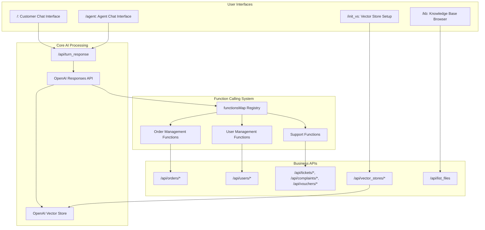
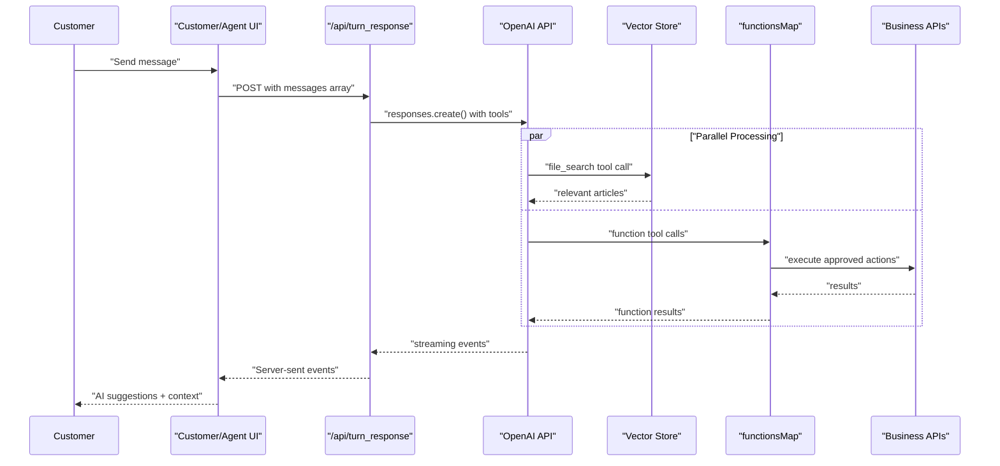
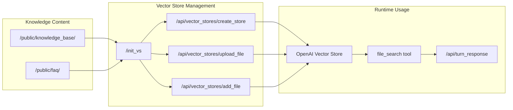

<!-- source: DeepWiki mcp.deepwiki.com · repo openai/openai-support-agent-demo · page 1 Overview · fetched 2026-10-26 -->

# Overview

Relevant source files

The following files were used as context for generating this wiki page:

- [.env.example](.env.example)
- [LICENSE](LICENSE)
- [README.md](README.md)

This document provides a comprehensive overview of the OpenAI Customer Support Agent Demo, a NextJS application that demonstrates human-in-the-loop AI customer service capabilities. The system combines OpenAI's Responses API with file search tools, vector stores, and function calling to create an assisted customer support experience where AI suggestions are reviewed and approved by human agents.

For detailed information about specific subsystems, see [Architecture Overview](#1.1) for system design details, [Core Systems](#2) for vector store and tool functions documentation, and [Configuration and Customization](#5) for deployment and customization guidance.

## System Purpose and Capabilities

The demo implements a dual-interface chat system where customers interact through one interface while human agents use a separate interface to review, edit, and approve AI-generated responses and actions. The system demonstrates several key capabilities:

| Feature | Description | Implementation |
|---------|-------------|----------------|
| Multi-turn conversations | Persistent chat history across interactions | Stored in component state and passed to `/api/turn_response` |
| File search integration | AI retrieval from knowledge base documents | OpenAI vector store with `file_search` tool |
| Function calling | AI-suggested customer service actions | Registry in `config/functions.ts` with approval workflow |
| Streaming responses | Real-time AI response generation | Server-sent events from OpenAI Responses API |
| Human oversight | Agent approval required for all responses | Separate `/agent` interface with edit capabilities |

**Sources:** [README.md:1-129](), [.env.example:1]()

## High-Level System Architecture

The system follows a modular architecture with clear separation between AI processing, business logic, and user interfaces:

**Sources:** [README.md:7-24]()

## Core System Components

### AI Response Processing Pipeline

The central processing occurs through the `/api/turn_response` endpoint, which orchestrates interactions between the OpenAI API, vector search, and function calling:

**Sources:** [README.md:7-8](), [README.md:16-23]()

### Tool Functions Registry

The system implements a centralized function registry that maps OpenAI function calls to business logic:

| Function Category | Functions | API Endpoints |
|------------------|-----------|---------------|
| Order Management | `get_order`, `cancel_order`, `create_refund`, `send_replacement`, `create_return` | `/api/orders/*` |
| User Management | `get_order_history`, `reset_password`, `update_info` | `/api/users/*` |
| Support Services | `issue_voucher`, `create_complaint`, `create_ticket` | `/api/vouchers/*`, `/api/complaints/*`, `/api/tickets/*` |

The registry is defined in `config/functions.ts` and mapped through `config/tools-list.ts` to enable OpenAI function calling.

**Sources:** [README.md:20](), [README.md:114-116]()

### Vector Store and Knowledge Management

The system uses OpenAI vector stores to enable file search capabilities:

**Sources:** [README.md:17-18](), [README.md:67-69]()

## Demonstration Workflow

The system includes predefined demo scenarios that showcase its capabilities:

### Example Customer Service Flow

1. **Information Request**: Customer asks "What is the return policy?"
   - Triggers `file_search` against vector store
   - Returns relevant policy documents
   - Agent reviews and approves response

2. **Action Request**: Customer asks "Help me cancel order ORD1001"
   - Triggers `cancel_order` function suggestion
   - Agent approves action execution
   - System calls `/api/orders/cancel` endpoint
   - Confirmation response generated

3. **Data Retrieval**: Customer asks "Give me my past orders"
   - Automatically executes `get_order_history` (non-sensitive)
   - Calls `/api/users/order_history` endpoint
   - Returns formatted order list

**Sources:** [README.md:73-103]()

## Technology Stack and Configuration

The system is built on a modern web stack with extensive configuration options:

| Component | Technology | Configuration File |
|-----------|------------|-------------------|
| Frontend Framework | NextJS | Standard NextJS configuration |
| AI Integration | OpenAI Responses API | `config/constants.ts` |
| Function Definitions | Custom registry | `config/tools-list.ts`, `config/functions.ts` |
| Demo Data | Static JSON objects | `config/demoData.ts` |
| Knowledge Base | File system + Vector Store | `/public/knowledge_base/`, `/public/faq/` |

Key configuration points include:
- `MODEL`: OpenAI model selection in `config/constants.ts`
- `VECTOR_STORE_ID`: Vector store identifier for file search
- `KB_FOLDERS`: Knowledge base folder structure definition

**Sources:** [README.md:113-117](), [.env.example:1]()

## Limitations and Production Considerations

The demo system includes several important limitations:

- **Simulated Actions**: Function calls like `cancel_order` do not modify actual data
- **No Authentication**: No user authentication or session management
- **Mock Data**: Uses static demo data instead of real customer information  
- **No Input Validation**: Lacks production-grade input sanitization and guardrails

For production deployment, the system requires implementation of authentication, data persistence, input validation, and integration with real customer service backends.

**Sources:** [README.md:105-121]()

---

