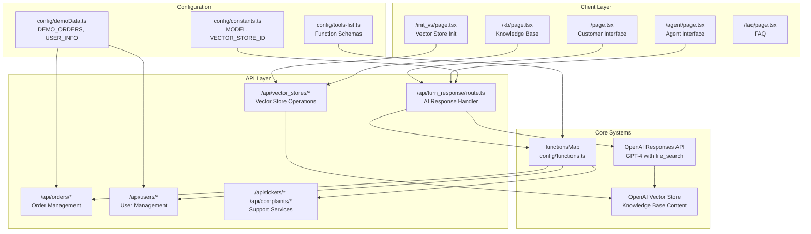
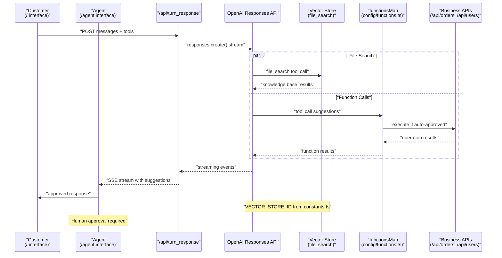
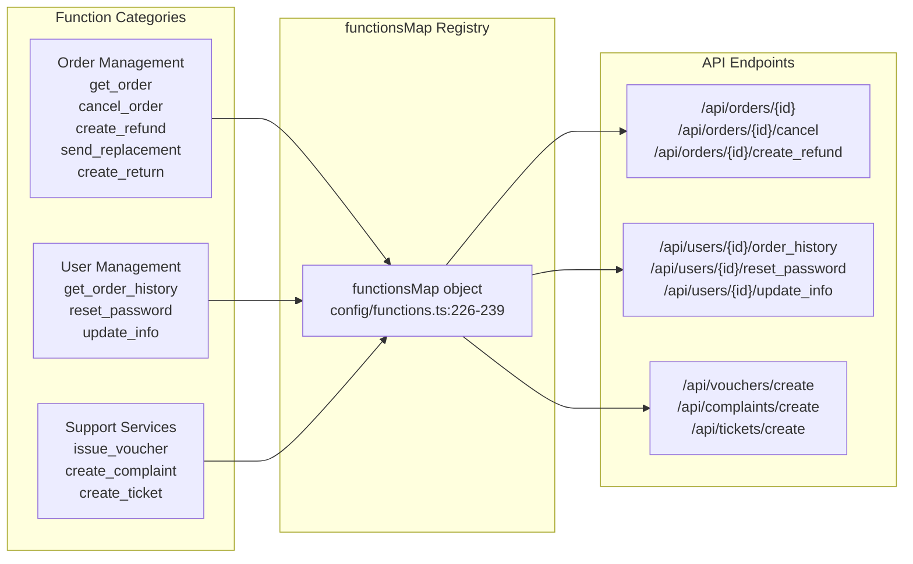
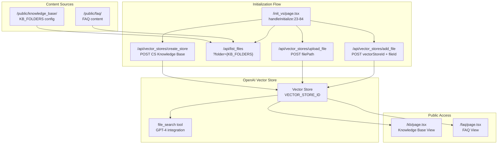
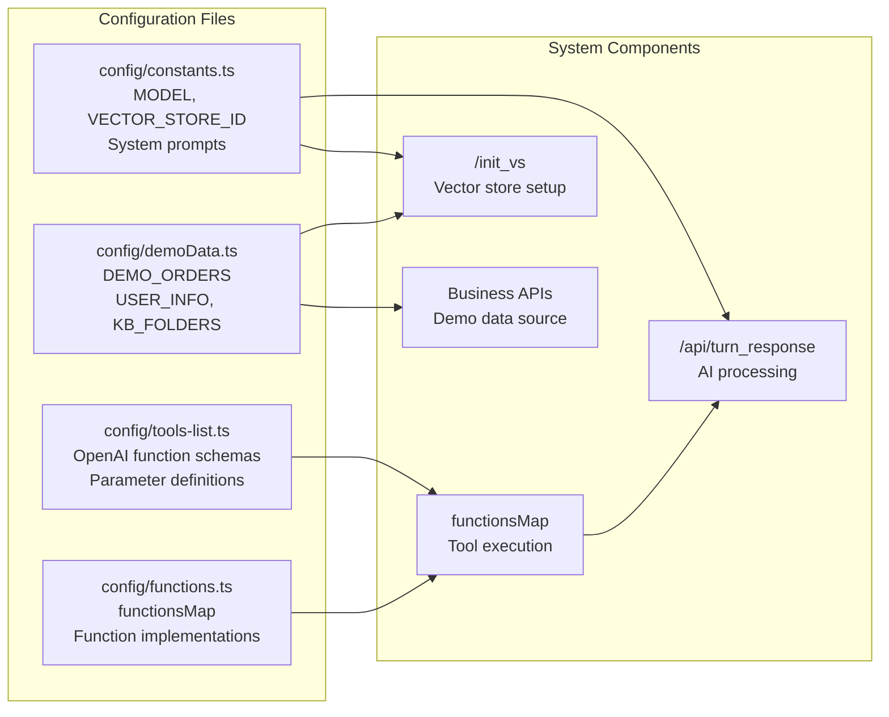

<!-- source: DeepWiki mcp.deepwiki.com · repo openai/openai-support-agent-demo · page 1.1 Architecture Overview · fetched 2026-10-26 -->

# Architecture Overview

Relevant source files

The following files were used as context for generating this wiki page:

- [README.md](README.md)
- [app/init_vs/page.tsx](app/init_vs/page.tsx)
- [config/functions.ts](config/functions.ts)

This document provides a comprehensive overview of the OpenAI Customer Support Agent Demo system architecture, explaining how the vector store management, tool functions registry, API layer, and user interfaces work together to create a human-in-the-loop AI customer service system.

For detailed setup instructions and environment configuration, see [Getting Started](#1.2). For in-depth documentation of individual systems, see [Core Systems](#2). For API endpoint specifications, see [API Reference](#3).

## System Overview

The OpenAI Customer Support Agent Demo is built as a Next.js application with a modular architecture centered around two primary systems: a vector store for knowledge retrieval and a tool functions registry for action execution. The system enables AI-powered customer service with human oversight through dual interfaces and streaming real-time updates.

## High-Level Component Architecture

**Sources:** [app/init_vs/page.tsx:1-157](), [config/functions.ts:1-240](), [README.md:1-129]()

## AI Response Processing Flow

The core AI processing system handles streaming responses from OpenAI's GPT-4 model with integrated file search and tool calling capabilities. The system maintains human oversight through suggested responses and actions.

**Sources:** [config/functions.ts:226-239](), [README.md:7-11](), [README.md:16-24]()

## Tool Functions Registry System

The tool functions system provides a clean abstraction layer between OpenAI's function calling and the business API layer. Each function in `functionsMap` corresponds to a customer service operation.

**Sources:** [config/functions.ts:5-224](), [config/functions.ts:226-239]()

## Vector Store Management Architecture

The vector store system handles knowledge base content initialization, file upload, and retrieval operations through OpenAI's Vector Store API.

**Sources:** [app/init_vs/page.tsx:23-84](), [app/init_vs/page.tsx:36-48](), [app/init_vs/page.tsx:50-76]()

## Configuration System Architecture

The system uses a centralized configuration approach with separate files for different concerns, enabling easy customization without code changes.

| Configuration File | Purpose | Key Exports |
|-------------------|---------|-------------|
| `config/constants.ts` | Core system settings | `MODEL`, `VECTOR_STORE_ID`, system prompts |
| `config/tools-list.ts` | Function schemas | OpenAI tool definitions for function calling |
| `config/functions.ts` | Function implementations | `functionsMap`, individual function handlers |
| `config/demoData.ts` | Demo data | `DEMO_ORDERS`, `USER_INFO`, `KB_FOLDERS` |

**Sources:** [config/functions.ts:1-4](), [README.md:113-117](), [app/init_vs/page.tsx:2]()

## Data Flow and Integration Points

The system architecture enables a complete customer service workflow through three primary integration points:

1. **OpenAI Integration**: The `/api/turn_response` endpoint manages streaming responses from OpenAI's GPT-4 model with file search and function calling capabilities
2. **Vector Store Integration**: Knowledge base content from `/public/knowledge_base` and `/public/faq` folders is processed through the vector store initialization system
3. **Business Logic Integration**: The `functionsMap` registry connects AI function calls to business operations through dedicated API endpoints

The human-in-the-loop design ensures that while AI provides intelligent suggestions and context, human agents maintain control over sensitive operations and final customer communications.

**Sources:** [README.md:7-11](), [README.md:96-108](), [config/functions.ts:226-239]()

---

