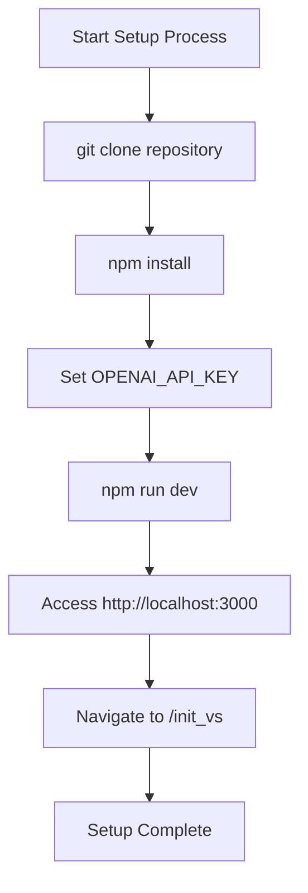
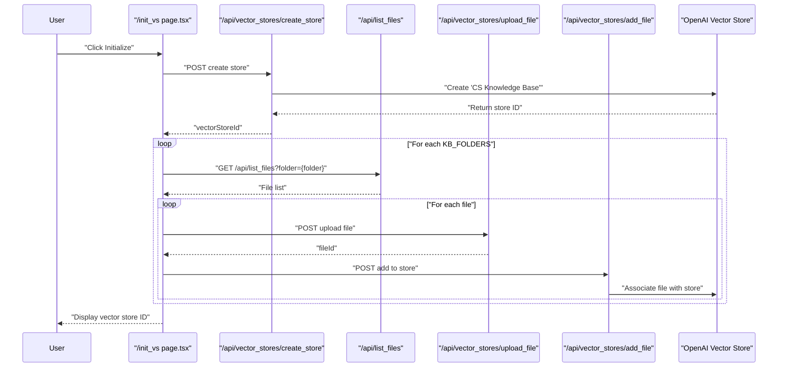

<!-- source: DeepWiki mcp.deepwiki.com · repo openai/openai-support-agent-demo · page 1.2 Getting Started · fetched 2026-10-26 -->

# Getting Started

<details>
<summary>Relevant source files</summary>

The following files were used as context for generating this wiki page:

- [.env.example](.env.example)
- [README.md](README.md)
- [app/init_vs/page.tsx](app/init_vs/page.tsx)

</details>


This page covers the essential setup steps required to run the OpenAI Customer Support Agent Demo locally. It includes environment configuration, dependency installation, and the critical vector store initialization process that enables the AI system's knowledge base functionality.

For detailed information about the system architecture and component relationships, see [Architecture Overview](#1.1). For configuration and customization options, see [Configuration Files](#5.1).

## Prerequisites

Before setting up the demo, ensure you have the following requirements:

| Requirement | Purpose |
|-------------|---------|
| Node.js and npm | NextJS application runtime and package management |
| OpenAI API Account | Required for AI responses and vector store operations |
| Git | Repository cloning |

The system requires an active OpenAI API key with access to the Responses API and vector store functionality.

**Sources:** [README.md:29-33]()

## Environment Setup

### OpenAI API Key Configuration

The application requires an `OPENAI_API_KEY` environment variable. Configure this using one of two methods:

**Method 1: Global Environment Variable**
Set the API key globally in your system environment.

**Method 2: Local Project Configuration**
Create a `.env` file in the project root directory:

```
OPENAI_API_KEY=<your_api_key>
```

The `.env.example` file provides a template for local configuration.

**Sources:** [README.md:40-49](), [.env.example:1]()

## Installation and Running

### Setup Flow



**Install Dependencies**

```bash
npm install
```

This installs all required NextJS dependencies and OpenAI SDK components.

**Start Development Server**

```bash
npm run dev
```

The application will be available at `http://localhost:3000` with the following routes:

| Route | Component | Purpose |
|-------|-----------|---------|
| `/` | Customer Interface | Customer chat interface |
| `/agent` | Agent Interface | Human agent interface |
| `/init_vs` | Vector Store Init | Admin vector store setup |
| `/kb` | Knowledge Base | Public knowledge articles |
| `/faq` | FAQ | Frequently asked questions |

**Sources:** [README.md:51-65]()

## Vector Store Initialization

The vector store initialization is critical for the File Search tool functionality. This process uploads knowledge base content to OpenAI's vector store service.

### Initialization Process Flow



### Knowledge Base Content Structure

The initialization process loads content from these default directories:

- `/public/knowledge_base/` - Main knowledge articles
- `/public/faq/` - Frequently asked questions

The `KB_FOLDERS` constant in `demoData.ts` defines which folders are processed during initialization.

### Vector Store Setup Steps

1. **Navigate to Initialization Page**
   
   Access `http://localhost:3000/init_vs` to open the `InitVS` component.

2. **Execute Initialization**

   The `handleInitialize` function performs these operations:
   - Creates a new vector store named "CS Knowledge Base"
   - Fetches file lists from configured folders using `KB_FOLDERS`
   - Uploads each file via `/api/vector_stores/upload_file`
   - Associates files with the vector store via `/api/vector_stores/add_file`

3. **Retrieve Vector Store ID**

   Upon successful completion, the system displays the new vector store ID. Copy this ID for configuration.

4. **Update Configuration**

   Add the vector store ID to `config/constants.ts`:
   ```typescript
   export const VECTOR_STORE_ID = "vs_your_new_id_here";
   ```

**Sources:** [app/init_vs/page.tsx:23-84](), [README.md:67-69]()

## Verification and Next Steps

### Testing the Setup

After completing initialization, verify the system works by testing these example queries:

| Query Type | Example Question | Expected Behavior |
|------------|-----------------|-------------------|
| Knowledge Base Search | "What is the return policy?" | Triggers file search, returns policy information |
| Order Management | "Help me cancel order ORD1001" | Suggests `cancel_order` function call |
| User Management | "Help me reset my password" | Suggests `reset_password` function call |
| Order History | "Give me a list of my past orders" | Auto-executes `get_order_history` function |

### Interface Access

- **Customer Interface**: `http://localhost:3000/` - For customer interactions
- **Agent Interface**: `http://localhost:3000/agent` - For human agent oversight
- **Knowledge Base**: `http://localhost:3000/kb` - View uploaded articles
- **FAQ**: `http://localhost:3000/faq` - View FAQ content

The demo implements a human-in-the-loop workflow where the agent interface shows AI-generated suggestions that human agents can approve, edit, or reject before sending to customers.

**Sources:** [README.md:73-104]()

---

