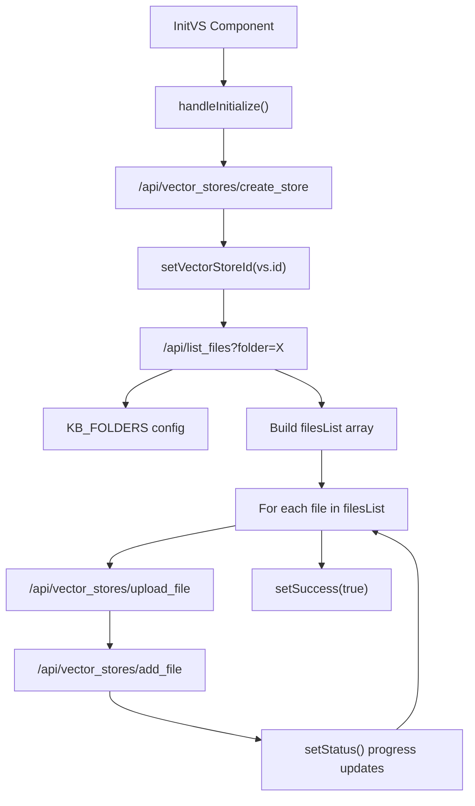
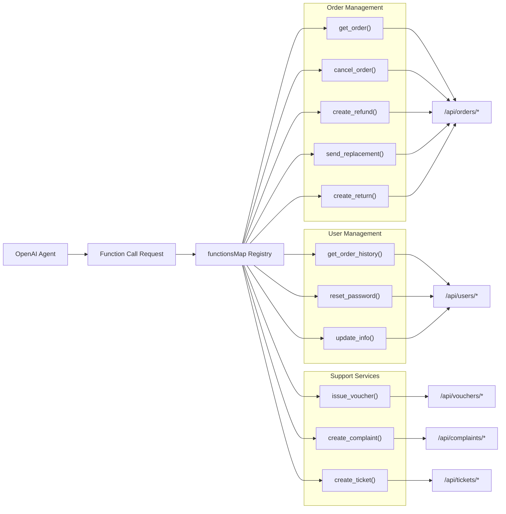

<!-- source: DeepWiki mcp.deepwiki.com · repo openai/openai-support-agent-demo · page 2 Core Systems · fetched 2026-10-26 -->

# Core Systems

<details>
<summary>Relevant source files</summary>

The following files were used as context for generating this wiki page:

- [app/init_vs/page.tsx](app/init_vs/page.tsx)
- [config/functions.ts](config/functions.ts)

</details>


This document covers the two most critical systems that enable the OpenAI Support Agent Demo: the Vector Store Management System and the Tool Functions System. These systems work together to provide the AI agent with both knowledge retrieval capabilities and action execution powers under human supervision.

For information about the specific API endpoints these systems use, see [API Reference](#3). For details about the user interfaces that interact with these systems, see [User Interfaces](#4).

## Vector Store Management System

The Vector Store Management System handles initialization, file upload, and management of knowledge base content that the AI agent uses for contextual responses. The system processes content from the `/public/knowledge_base/` and `/public/faq/` directories and uploads it to OpenAI's vector store service.

### Initialization Process

The vector store initialization is handled by the `InitVS` component in [app/init_vs/page.tsx:12-157](). The initialization follows a sequential workflow:



**Sources:** [app/init_vs/page.tsx:23-84]()

### File Processing Workflow

The system processes knowledge base files through a structured approach:

| Step | API Endpoint | Purpose | Data Structure |
|------|-------------|---------|----------------|
| 1 | `/api/vector_stores/create_store` | Create new vector store | `{ name: "CS Knowledge Base" }` |
| 2 | `/api/list_files?folder=${folder}` | List files in KB folders | Array of filenames |
| 3 | `/api/vector_stores/upload_file` | Upload file to OpenAI | `{ filePath: file.filepath }` |
| 4 | `/api/vector_stores/add_file` | Associate file with store | `{ vectorStoreId, fileId, attributes }` |

The `KBFile` interface defines the structure for processed files:

```typescript
interface KBFile {
  type: string;
  filename: string;
  filepath: string;
}
```

**Sources:** [app/init_vs/page.tsx:6-10](), [app/init_vs/page.tsx:35-77]()

### File Attributes and Metadata

Each uploaded file includes metadata attributes that enable categorization and retrieval:

- `type`: Folder category (from `KB_FOLDERS` config)
- `filename`: Base filename without extension 
- `filepath`: Full path to the file in `/public/` directory

The system processes files from folders defined in the `KB_FOLDERS` configuration and builds file objects with these attributes for the vector store association.

**Sources:** [app/init_vs/page.tsx:59-66]()

## Tool Functions System

The Tool Functions System provides the AI agent with executable customer service capabilities through a centralized registry pattern. The system maps OpenAI function calls to TypeScript functions that interact with the business API layer.

### Functions Registry Architecture



**Sources:** [config/functions.ts:226-239]()

### Function Implementation Pattern

All tool functions follow a consistent async/await pattern with error handling:

```typescript
export const function_name = async ({ param1, param2 }: { param1: type; param2: type }) => {
  try {
    const res = await fetch(`/api/endpoint`, {
      method: "POST",
      headers: { "Content-Type": "application/json" },
      body: JSON.stringify({ param1, param2 })
    }).then((res) => res.json());
    return res;
  } catch (error) {
    console.error(error);
    return { error: "Failed to perform action" };
  }
};
```

Each function is then registered in the `functionsMap` object, which serves as the central registry for all available tool functions.

**Sources:** [config/functions.ts:5-15](), [config/functions.ts:226-239]()

### Order Management Functions

The order management functions provide comprehensive order lifecycle operations:

| Function | Parameters | API Endpoint | Purpose |
|----------|------------|--------------|---------|
| `get_order` | `order_id: string` | `/api/orders/${order_id}` | Retrieve order details |
| `cancel_order` | `order_id: string` | `/api/orders/${order_id}/cancel` | Cancel existing order |
| `create_refund` | `order_id, amount, reason` | `/api/orders/${order_id}/create_refund` | Process refund |
| `send_replacement` | `product_id, order_id` | `/api/orders/${order_id}/send_replacement` | Send replacement item |
| `create_return` | `order_id, product_ids[]` | `/api/orders/${order_id}/create_return` | Initialize return process |

**Sources:** [config/functions.ts:5-15](), [config/functions.ts:29-42](), [config/functions.ts:82-104](), [config/functions.ts:60-80](), [config/functions.ts:130-150]()

### User Management Functions

User management functions handle account-related operations:

| Function | Parameters | API Endpoint | Purpose |
|----------|------------|--------------|---------|
| `get_order_history` | `user_id: string` | `/api/users/${user_id}/order_history` | Retrieve user's order history |
| `reset_password` | `user_id: string` | `/api/users/${user_id}/reset_password` | Reset user password |
| `update_info` | `user_id, info: {field, value}` | `/api/users/${user_id}/update_info` | Update user information |

**Sources:** [config/functions.ts:17-27](), [config/functions.ts:44-58](), [config/functions.ts:204-224]()

### Support Services Functions

Support functions create tickets, complaints, and issue vouchers:

| Function | Parameters | API Endpoint | Purpose |
|----------|------------|--------------|---------|
| `issue_voucher` | `user_id, amount, reason` | `/api/vouchers/create` | Issue customer voucher |
| `create_complaint` | `user_id, type, details, order_id` | `/api/complaints/create` | File customer complaint |
| `create_ticket` | `user_id, type, details, order_id` | `/api/tickets/create` | Create support ticket |

**Sources:** [config/functions.ts:106-128](), [config/functions.ts:152-176](), [config/functions.ts:178-202]()

## System Integration

The Vector Store and Tool Functions systems integrate through the main AI response pipeline. The vector store provides contextual knowledge while the tool functions enable actions. This integration occurs in the `/api/turn_response` endpoint where:

1. Vector store content is retrieved via file search
2. Tool functions are made available to the AI agent
3. The AI combines knowledge and actions to provide comprehensive responses

Both systems are essential for the human-in-the-loop workflow, where the AI agent suggests responses and actions based on vector store knowledge, and human agents approve or modify these suggestions before execution.

**Sources:** [config/functions.ts:1-4](), [app/init_vs/page.tsx:92-121]()

---

