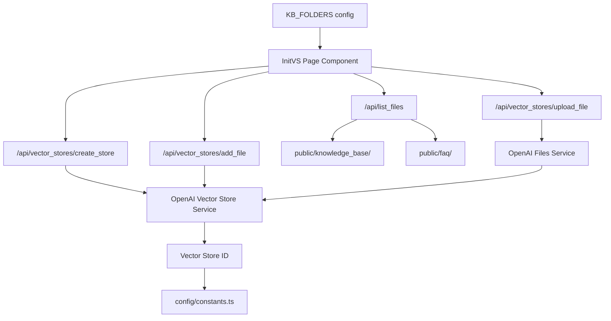
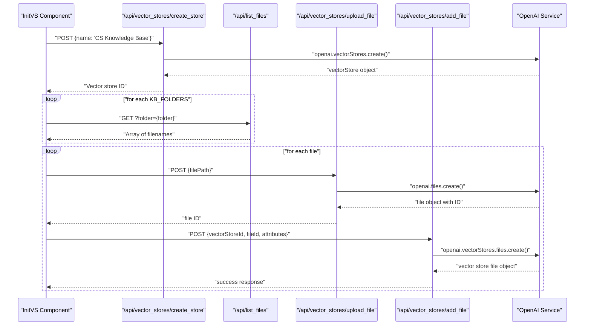
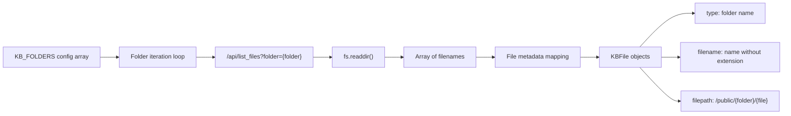
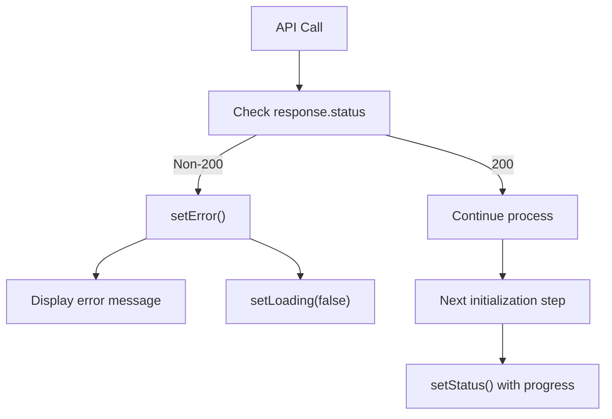

<!-- source: DeepWiki mcp.deepwiki.com · repo openai/openai-support-agent-demo · page 2.1 Vector Store Management · fetched 2026-10-26 -->

# Vector Store Management

<details>
<summary>Relevant source files</summary>

The following files were used as context for generating this wiki page:

- [app/api/list_files/route.ts](app/api/list_files/route.ts)
- [app/api/vector_stores/add_file/route.ts](app/api/vector_stores/add_file/route.ts)
- [app/api/vector_stores/create_store/route.ts](app/api/vector_stores/create_store/route.ts)
- [app/api/vector_stores/upload_file/route.ts](app/api/vector_stores/upload_file/route.ts)
- [app/init_vs/page.tsx](app/init_vs/page.tsx)

</details>


## Purpose and Scope

The Vector Store Management system handles the initialization, population, and management of OpenAI vector stores for knowledge retrieval in the customer support agent. This system processes knowledge base content from the file system, uploads it to OpenAI's vector store service, and maintains metadata for efficient retrieval during AI-powered customer interactions.

For the complete API reference of vector store endpoints, see [Vector Store APIs](#3.4). For file management operations beyond vector stores, see [File Management APIs](#3.5). For UI documentation of the initialization interface, see [Vector Store Initialization Interface](#4.3). For understanding the knowledge base content structure, see [Demo Data and Content](#5.2).

## System Architecture

The vector store management system consists of four main components: file discovery, vector store creation, file upload, and metadata management.



Sources: [app/init_vs/page.tsx:1-157](), [app/api/list_files/route.ts:1-16](), [app/api/vector_stores/create_store/route.ts:1-17](), [app/api/vector_stores/upload_file/route.ts:1-21](), [app/api/vector_stores/add_file/route.ts:1-20]()

## Vector Store Initialization Process

The initialization process follows a sequential workflow managed by the `InitVS` component, which orchestrates multiple API calls to build a complete vector store from local knowledge base files.

### Initialization Workflow



Sources: [app/init_vs/page.tsx:23-84]()

### State Management

The `InitVS` component manages initialization state through several React state variables:

| State Variable | Type | Purpose |
|----------------|------|---------|
| `loading` | `boolean` | Controls UI loading state and button availability |
| `vectorStoreId` | `string \| null` | Stores the created vector store ID for display |
| `status` | `string` | Provides real-time progress updates to user |
| `error` | `string \| null` | Captures and displays error messages |
| `success` | `boolean` | Indicates successful completion |

Sources: [app/init_vs/page.tsx:13-17]()

## File Discovery and Processing

The system discovers knowledge base content by scanning configured directories and processing files with metadata attributes.

### File Discovery Process

The `handleInitialize` function iterates through folders defined in `KB_FOLDERS` configuration to build a comprehensive file list:



Sources: [app/init_vs/page.tsx:36-48](), [app/api/list_files/route.ts:4-16]()

### File Metadata Structure

Each discovered file is mapped to a `KBFile` interface with standardized metadata:

```typescript
interface KBFile {
  type: string;      // Source folder name (e.g., "knowledge_base", "faq")
  filename: string;  // Filename without extension
  filepath: string;  // Full path for file access
}
```

Sources: [app/init_vs/page.tsx:6-10]()

## API Endpoints

The vector store management system exposes four specialized API endpoints that handle different aspects of the initialization process.

### Vector Store Creation

**Endpoint**: `/api/vector_stores/create_store`

Creates a new OpenAI vector store with the specified name.

| Parameter | Type | Description |
|-----------|------|-------------|
| `name` | `string` | Display name for the vector store |

**Response**: OpenAI vector store object with `id` field

Sources: [app/api/vector_stores/create_store/route.ts:5-17]()

### File Upload

**Endpoint**: `/api/vector_stores/upload_file` 

Uploads a local file to OpenAI's file service for vector store usage.

| Parameter | Type | Description |
|-----------|------|-------------|
| `filePath` | `string` | Relative path from project root |

**Process**: Creates `fs.ReadStream` from local file and uploads with `purpose: "assistants"`

Sources: [app/api/vector_stores/upload_file/route.ts:5-21]()

### File Association

**Endpoint**: `/api/vector_stores/add_file`

Associates an uploaded file with a vector store and attaches metadata attributes.

| Parameter | Type | Description |
|-----------|------|-------------|
| `vectorStoreId` | `string` | Target vector store ID |
| `fileId` | `string` | OpenAI file ID from upload |
| `attributes` | `object` | Metadata for file organization |

Sources: [app/api/vector_stores/add_file/route.ts:5-20]()

### File Listing

**Endpoint**: `/api/list_files`

Lists files within a specified public directory folder.

| Parameter | Type | Description |
|-----------|------|-------------|
| `folder` | `string` | Directory name under `/public/` |

**Implementation**: Uses Node.js `fs.readdir()` to scan filesystem

Sources: [app/api/list_files/route.ts:4-16]()

## Error Handling and Status Updates

The system provides comprehensive error handling and real-time status updates throughout the initialization process.

### Error Management



Sources: [app/init_vs/page.tsx:31-83]()

### Status Progression

The initialization process provides granular status updates:

1. **"Creating vector store..."** - Initial vector store creation
2. **"Fetching files..."** - Directory scanning phase  
3. **"Uploading {count} files to vector store..."** - Batch upload start
4. **"Uploaded {type}/{filename}"** - Individual file completion
5. **"Uploaded all files to vector store."** - Process completion

Sources: [app/init_vs/page.tsx:26-77]()

## Configuration Integration

The vector store management system integrates with the broader application configuration through specific constants and data structures.

### Required Configuration

| Configuration | Location | Purpose |
|---------------|----------|---------|
| `KB_FOLDERS` | `config/demoData.ts` | Defines source directories for content |
| `VECTOR_STORE_ID` | `config/constants.ts` | Stores active vector store ID |
| OpenAI API Key | Environment variables | Authenticates API requests |

The completed vector store ID must be manually copied from the initialization interface to `config/constants.ts` to enable AI agent file search functionality.

Sources: [app/init_vs/page.tsx:2](), [app/init_vs/page.tsx:116-121]()

---

