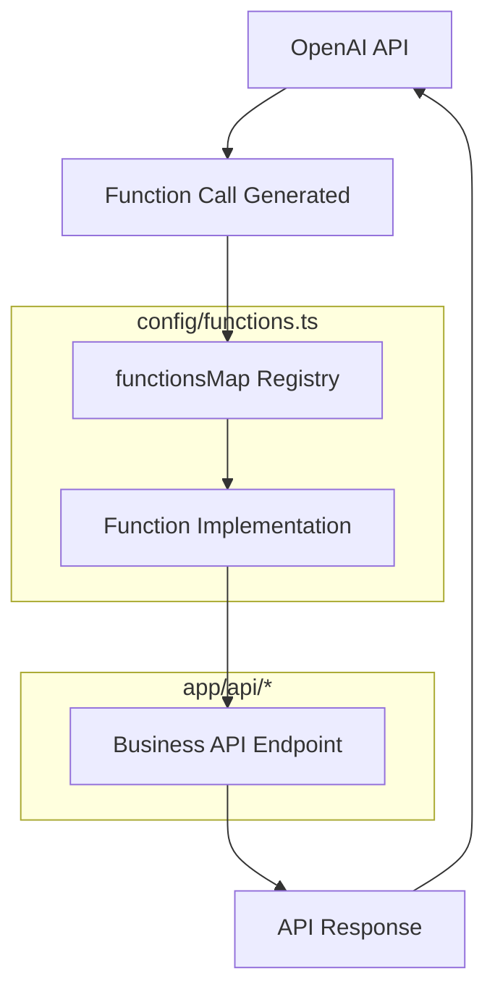
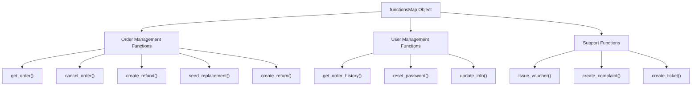
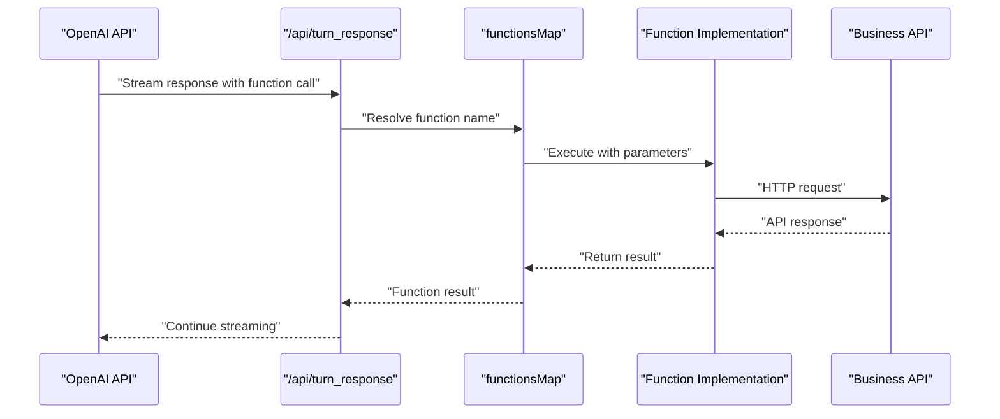

<!-- source: DeepWiki mcp.deepwiki.com · repo openai/openai-support-agent-demo · page 2.2 Tool Functions System · fetched 2026-10-26 -->

# Tool Functions System

Relevant source files

The following files were used as context for generating this wiki page:

- [app/api/turn_response/route.ts](app/api/turn_response/route.ts)
- [config/functions.ts](config/functions.ts)

## Purpose and Scope

The Tool Functions System provides the mechanism for OpenAI agents to execute business actions within the customer support demo. This system translates AI-generated function calls into concrete API operations like canceling orders, issuing refunds, or creating support tickets.

This document covers the function implementation layer and registry system. For information about the underlying API endpoints that these functions call, see [API Reference](#3). For details about how these functions integrate with the AI response system, see [AI Response APIs](#3.6).

## System Architecture

The Tool Functions System acts as an abstraction layer between OpenAI's function calling capabilities and the application's business logic APIs. When the AI agent determines that an action should be taken, it generates a function call which is resolved through this system.

### Function Call Flow

*Sources: [config/functions.ts:226-239](), [app/api/turn_response/route.ts:12-19]()*

### Function Registry Architecture

The system uses a centralized registry pattern where all available functions are mapped in the `functionsMap` object. This provides a clean interface for the AI system to discover and execute available actions.

*Sources: [config/functions.ts:226-239]()*

## Function Categories

The system organizes functions into three main categories based on their business purpose:

| Category | Functions | Purpose |
|----------|-----------|---------|
| Order Management | `get_order`, `cancel_order`, `create_refund`, `send_replacement`, `create_return` | Handle order-related operations |
| User Management | `get_order_history`, `reset_password`, `update_info` | Manage user account operations |
| Support Services | `issue_voucher`, `create_complaint`, `create_ticket` | Create support records and compensations |

### Order Management Functions

These functions handle the core e-commerce operations:

- **`get_order`** - Retrieves order details by order ID
- **`cancel_order`** - Cancels an existing order
- **`create_refund`** - Processes refunds with amount and reason
- **`send_replacement`** - Initiates replacement shipments
- **`create_return`** - Creates return requests for products

*Sources: [config/functions.ts:5-15](), [config/functions.ts:29-42](), [config/functions.ts:82-104](), [config/functions.ts:60-80](), [config/functions.ts:130-150]()*

### User Management Functions

These functions manage customer account operations:

- **`get_order_history`** - Retrieves complete order history for a user
- **`reset_password`** - Initiates password reset process
- **`update_info`** - Updates user profile information

*Sources: [config/functions.ts:17-27](), [config/functions.ts:44-58](), [config/functions.ts:204-224]()*

### Support Services Functions

These functions create support records and handle customer service escalations:

- **`issue_voucher`** - Creates compensation vouchers
- **`create_complaint`** - Logs formal complaints
- **`create_ticket`** - Creates support tickets for tracking

*Sources: [config/functions.ts:106-128](), [config/functions.ts:152-176](), [config/functions.ts:178-202]()*

## Integration with OpenAI API

The Tool Functions System integrates with OpenAI's function calling through the `/api/turn_response` endpoint. The system handles streaming responses and processes function calls as they are generated.

### Function Call Processing Flow

*Sources: [app/api/turn_response/route.ts:12-19]()*

## Function Implementation Pattern

All functions follow a consistent implementation pattern for error handling and API communication:

1. **Parameter destructuring** - Extract typed parameters from the function call
2. **API request** - Make HTTP request to corresponding business API endpoint
3. **Response handling** - Parse JSON response
4. **Error handling** - Catch and return standardized error messages

Each function returns either the successful API response or an error object with a descriptive message.

*Sources: [config/functions.ts:5-15](), [config/functions.ts:29-42]()*

## Error Handling Strategy

The system implements consistent error handling across all functions:

- **Try-catch blocks** wrap all API calls
- **Standardized error format** returns `{ error: "description" }`
- **Console logging** captures errors for debugging
- **Graceful degradation** ensures the AI system continues operating even when individual functions fail

*Sources: [config/functions.ts:11-14](), [config/functions.ts:38-41]()*

## Adding New Functions

To extend the system with new capabilities:

1. **Implement the function** in `config/functions.ts` following the established pattern
2. **Add to functionsMap** registry at the bottom of the file
3. **Ensure corresponding API endpoint** exists in the `app/api/` directory
4. **Update tool schemas** in the configuration if needed

The modular design makes it straightforward to add new customer service capabilities without modifying existing functions.

*Sources: [config/functions.ts:226-239]()*

---

