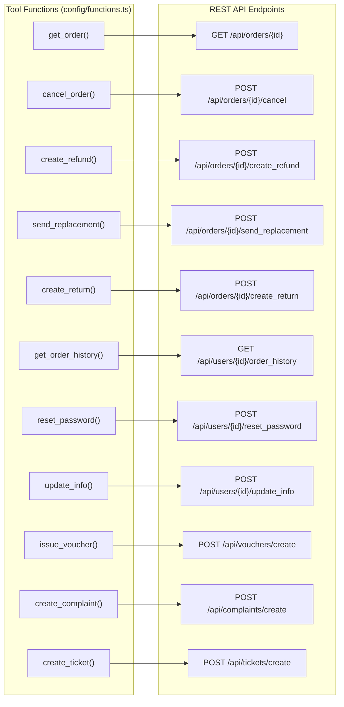

<!-- source: DeepWiki mcp.deepwiki.com · repo openai/openai-support-agent-demo · page 3 API Reference · fetched 2026-10-26 -->

# API Reference

<details>
<summary>Relevant source files</summary>

The following files were used as context for generating this wiki page:

- [config/functions.ts](config/functions.ts)

</details>


This document provides a complete reference for all REST API endpoints in the OpenAI Customer Support Agent Demo system. These APIs enable customer service operations including order management, user account management, support ticket creation, and vector store operations for knowledge base functionality.

The APIs are organized into functional areas that correspond to the main business operations of the customer support system. For information about the tool functions that wrap these APIs, see [Tool Functions System](#2.2). For details about the AI response handling system, see [AI Response APIs](#3.6).

## API Architecture Overview

The system's REST APIs are organized into distinct functional areas, each handling specific aspects of customer support operations:

```mermaid
graph TB
    subgraph "Client Applications"
        CustomerUI["Customer Interface"]
        AgentUI["Agent Interface"]  
        InitUI["Vector Store Init"]
    end
    
    subgraph "API Gateway Layer"
        TurnResponse["/api/turn_response"]
    end
    
    subgraph "Order Management APIs"
        GetOrder["/api/orders/{id}"]
        CancelOrder["/api/orders/{id}/cancel"]
        CreateRefund["/api/orders/{id}/create_refund"]
        SendReplacement["/api/orders/{id}/send_replacement"]
        CreateReturn["/api/orders/{id}/create_return"]
    end
    
    subgraph "User Management APIs"
        GetOrderHistory["/api/users/{id}/order_history"]
        ResetPassword["/api/users/{id}/reset_password"]
        UpdateInfo["/api/users/{id}/update_info"]
    end
    
    subgraph "Support Services APIs"
        CreateVoucher["/api/vouchers/create"]
        CreateComplaint["/api/complaints/create"]
        CreateTicket["/api/tickets/create"]
    end
    
    subgraph "Vector Store APIs"
        CreateStore["/api/vector_stores/create_store"]
        RetrieveStore["/api/vector_stores/retrieve_store"]
        UploadFile["/api/vector_stores/upload_file"]
        AddFile["/api/vector_stores/add_file"]
        ListFiles["/api/vector_stores/list_files"]
        GetFile["/api/vector_stores/get_file"]
    end
    
    subgraph "File Management APIs"
        ListDirectoryFiles["/api/list_files"]
    end
    
    CustomerUI --> TurnResponse
    AgentUI --> TurnResponse
    InitUI --> CreateStore
    InitUI --> ListDirectoryFiles
    
    TurnResponse --> GetOrder
    TurnResponse --> CancelOrder
    TurnResponse --> CreateRefund
    TurnResponse --> SendReplacement
    TurnResponse --> CreateReturn
    TurnResponse --> GetOrderHistory
    TurnResponse --> ResetPassword
    TurnResponse --> UpdateInfo
    TurnResponse --> CreateVoucher
    TurnResponse --> CreateComplaint
    TurnResponse --> CreateTicket
    
    InitUI --> UploadFile
    InitUI --> AddFile
    
    CreateStore --> RetrieveStore
    UploadFile --> ListFiles
    AddFile --> GetFile
```



Sources: [config/functions.ts:1-240]()

## Function to API Endpoint Mapping

The system uses a clean separation between tool functions and API endpoints. Each function in the `functionsMap` corresponds to one or more API calls:



Sources: [config/functions.ts:226-239]()

## Common Response Patterns

All API endpoints follow consistent response patterns:

| Response Type | Structure | Description |
|---------------|-----------|-------------|
| Success | `{ success: true, data: {...} }` | Successful operation with result data |
| Error | `{ error: "Error message" }` | Failed operation with error description |
| Validation Error | `{ error: "Invalid parameters", details: [...] }` | Parameter validation failures |

## Authentication and Headers

All API requests use standard HTTP headers:

| Header | Value | Required |
|--------|-------|----------|
| `Content-Type` | `application/json` | For POST requests |
| `Accept` | `application/json` | All requests |

Sources: [config/functions.ts:33-35](), [config/functions.ts:48-50]()

## Error Handling

The system implements consistent error handling across all endpoints. Functions catch errors and return standardized error responses:

```javascript
// Standard error handling pattern used across all functions
try {
  const res = await fetch(`/api/endpoint`).then((res) => res.json());
  return res;
} catch (error) {
  console.error(error);
  return { error: "Failed to perform operation" };
}
```

Sources: [config/functions.ts:6-14](), [config/functions.ts:38-42]()

---

