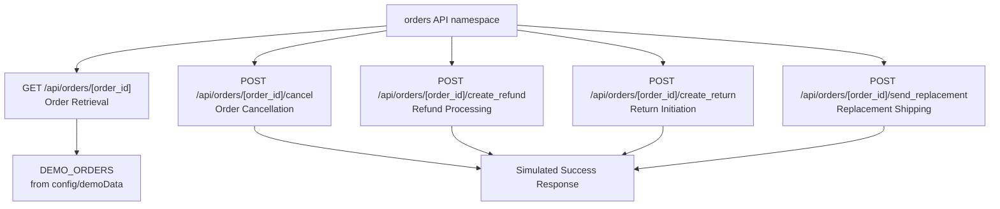
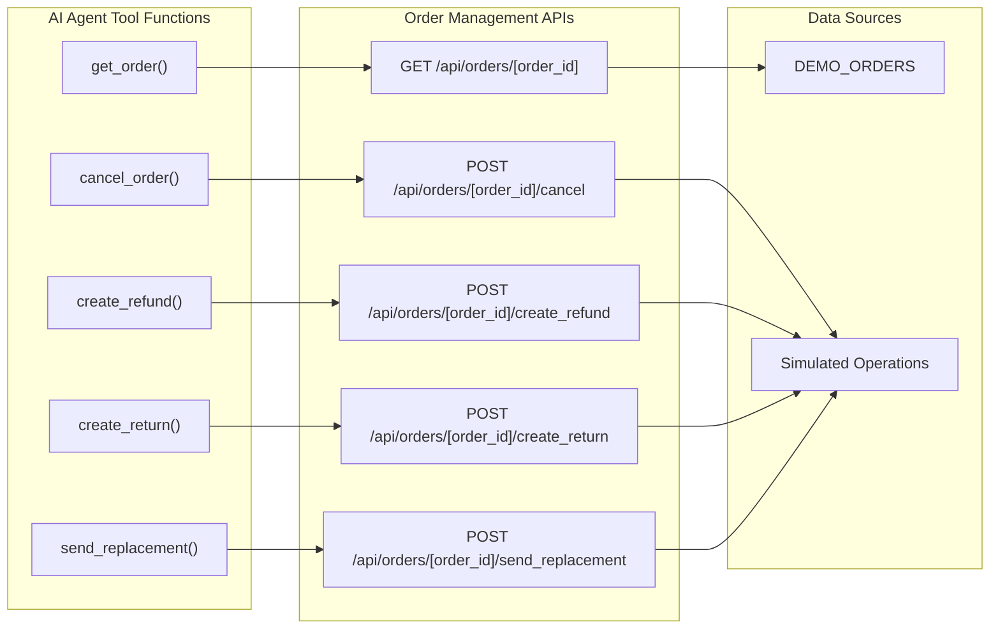

<!-- source: DeepWiki mcp.deepwiki.com · repo openai/openai-support-agent-demo · page 3.1 Order Management APIs · fetched 2026-10-26 -->

# Order Management APIs

<details>
<summary>Relevant source files</summary>

The following files were used as context for generating this wiki page:

- [app/api/orders/[order_id]/cancel/route.ts](app/api/orders/[order_id]/cancel/route.ts)
- [app/api/orders/[order_id]/create_refund/route.ts](app/api/orders/[order_id]/create_refund/route.ts)
- [app/api/orders/[order_id]/create_return/route.ts](app/api/orders/[order_id]/create_return/route.ts)
- [app/api/orders/[order_id]/route.ts](app/api/orders/[order_id]/route.ts)
- [app/api/orders/[order_id]/send_replacement/route.ts](app/api/orders/[order_id]/send_replacement/route.ts)

</details>


## Purpose and Scope

This section documents the REST API endpoints for order management operations. These APIs handle retrieving order details, canceling orders, processing refunds, initiating returns, and sending replacements. For user-specific order history retrieval, see [User Management APIs](#3.2). For information about how these APIs are called by AI agents through tool functions, see [Tool Functions System](#2.2).

All order management APIs follow the Next.js API routes pattern with dynamic `order_id` parameters and simulate real e-commerce operations using demo data.

## API Endpoints Overview

The order management system provides five core API endpoints, all following the REST pattern with the order ID as a path parameter:



Sources: [app/api/orders/[order_id]/route.ts:1-21](), [app/api/orders/[order_id]/cancel/route.ts:1-18](), [app/api/orders/[order_id]/create_refund/route.ts:1-21](), [app/api/orders/[order_id]/create_return/route.ts:1-21](), [app/api/orders/[order_id]/send_replacement/route.ts:1-20]()

## Order Retrieval

### GET /api/orders/[order_id]

Retrieves detailed information for a specific order using the order ID.

**Parameters:**
- `order_id` (path parameter): Unique identifier for the order

**Response Format:**
- **200 OK**: Returns complete order object from `DEMO_ORDERS`
- **404 Not Found**: `{"error": "Order not found"}`
- **500 Internal Server Error**: "Error retrieving order"

**Implementation Details:**
The endpoint searches through the `DEMO_ORDERS` array to find a matching order by ID [app/api/orders/[order_id]/route.ts:9](), returning the complete order object if found.

Sources: [app/api/orders/[order_id]/route.ts:1-21]()

## Order Modification Operations

### POST /api/orders/[order_id]/cancel

Cancels an existing order.

**Parameters:**
- `order_id` (path parameter): Order to cancel

**Response Format:**
```json
{
  "message": "Order {order_id} cancelled successfully"
}
```

**Implementation:**
This endpoint simulates order cancellation and always returns success [app/api/orders/[order_id]/cancel/route.ts:9-12]().

Sources: [app/api/orders/[order_id]/cancel/route.ts:1-18]()

### POST /api/orders/[order_id]/create_refund

Processes a refund for an order.

**Request Body:**
- `amount` (number): Refund amount
- `reason` (string): Reason for refund

**Response Format:**
```json
{
  "message": "Refund of ${amount} for order {order_id} is processing",
  "reason": "customer provided reason"
}
```

**Implementation:**
Accepts refund parameters and simulates refund processing [app/api/orders/[order_id]/create_refund/route.ts:7-14]().

Sources: [app/api/orders/[order_id]/create_refund/route.ts:1-21]()

### POST /api/orders/[order_id]/create_return

Initiates a return process for order items.

**Request Body:**
- `product_ids` (array): List of product IDs to return

**Response Format:**
```json
{
  "message": "Return initiated for order {order_id}",
  "product_ids": ["array of product IDs"]
}
```

**Implementation:**
Processes return initiation for specified products [app/api/orders/[order_id]/create_return/route.ts:7-14]().

Sources: [app/api/orders/[order_id]/create_return/route.ts:1-21]()

### POST /api/orders/[order_id]/send_replacement

Sends replacement items for defective products.

**Request Body:**
- `product_id` (string): ID of product requiring replacement

**Response Format:**
```json
{
  "message": "Replacement for product {product_id} in order {order_id} sent successfully"
}
```

**Implementation:**
Simulates replacement shipping process [app/api/orders/[order_id]/send_replacement/route.ts:7-13]().

Sources: [app/api/orders/[order_id]/send_replacement/route.ts:1-20]()

## Error Handling

All order management endpoints implement consistent error handling patterns:

| Error Type | HTTP Status | Response |
|------------|-------------|----------|
| Order Not Found | 404 | `{"error": "Order not found"}` |
| Request Processing Error | 500 | Plain text error message |
| Invalid JSON | 500 | "Error [operation] order" |

Each endpoint includes try-catch blocks with console error logging [app/api/orders/[order_id]/route.ts:17]() and returns appropriate HTTP status codes.

Sources: [app/api/orders/[order_id]/route.ts:11-18](), [app/api/orders/[order_id]/cancel/route.ts:14-16](), [app/api/orders/[order_id]/create_refund/route.ts:16-19]()

## Integration with Tool Functions System

The order management APIs are designed to be called by AI agent tool functions. The following diagram shows how tool functions interact with these APIs:



Each tool function corresponds directly to an API endpoint, allowing the AI agent to perform order management operations through the `functionsMap` registry defined in the tool functions system.

Sources: [app/api/orders/[order_id]/route.ts:1](), [app/api/orders/[order_id]/cancel/route.ts:8](), [app/api/orders/[order_id]/create_refund/route.ts:8](), [app/api/orders/[order_id]/create_return/route.ts:8](), [app/api/orders/[order_id]/send_replacement/route.ts:8]()

---

