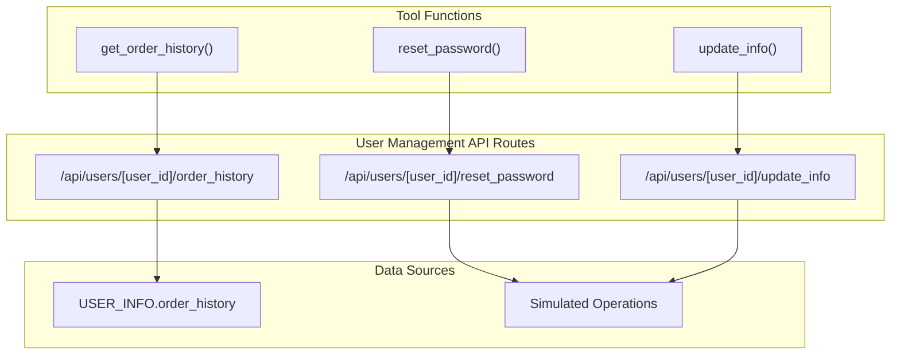
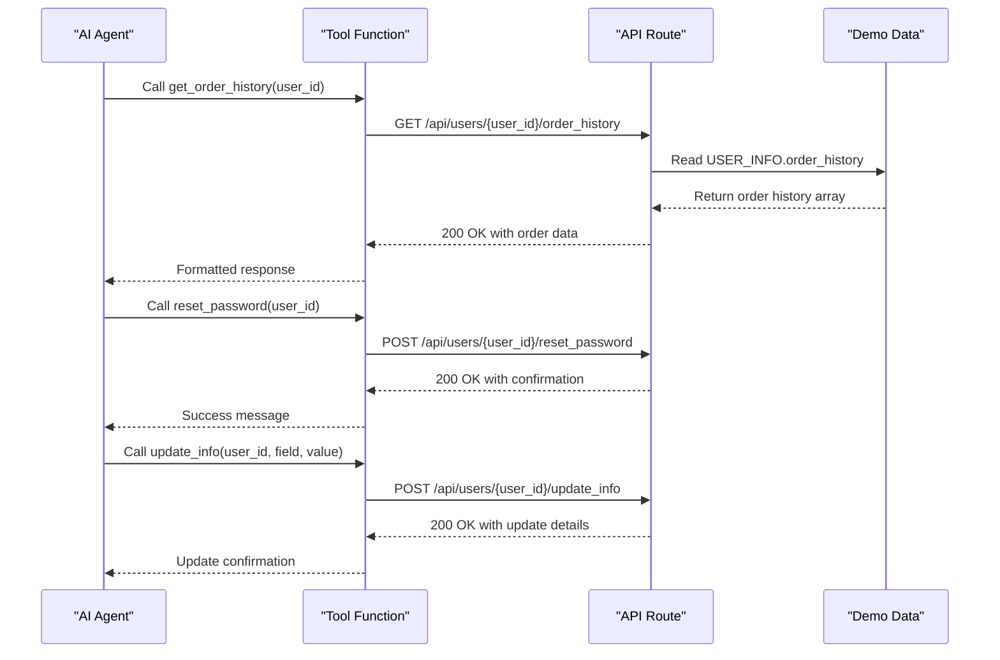

<!-- source: DeepWiki mcp.deepwiki.com · repo openai/openai-support-agent-demo · page 3.2 User Management APIs · fetched 2026-10-26 -->

# User Management APIs

<details>
<summary>Relevant source files</summary>

The following files were used as context for generating this wiki page:

- [app/api/users/[user_id]/order_history/route.ts](app/api/users/[user_id]/order_history/route.ts)
- [app/api/users/[user_id]/reset_password/route.ts](app/api/users/[user_id]/reset_password/route.ts)
- [app/api/users/[user_id]/update_info/route.ts](app/api/users/[user_id]/update_info/route.ts)

</details>


This document covers the User Management APIs that handle user account operations, profile management, and user-specific data retrieval. These APIs provide functionality for retrieving order history, resetting passwords, and updating user information.

For order-related operations like cancellations and refunds, see [Order Management APIs](#3.1). For support tickets and complaints, see [Support Services APIs](#3.3).

## API Overview

The User Management APIs consist of three main endpoints that handle user account operations. All endpoints follow the pattern `/api/users/[user_id]/{operation}` and are designed to work with the AI agent's tool function system.



**Sources:** [app/api/users/[user_id]/order_history/route.ts:1-18](), [app/api/users/[user_id]/reset_password/route.ts:1-19](), [app/api/users/[user_id]/update_info/route.ts:1-22]()

## Order History Retrieval

### GET /api/users/[user_id]/order_history

Retrieves the complete order history for a specified user. This endpoint returns static demo data from the `USER_INFO` configuration.

**Route Handler:** `GET` method in [app/api/users/[user_id]/order_history/route.ts:3-17]()

**Parameters:**
- `user_id` (string): User identifier from the URL path

**Response:**
- **200 OK**: Returns the user's order history as JSON array
- **500 Internal Server Error**: Error retrieving order history

**Implementation Details:**
- Imports `USER_INFO` from demo data configuration [app/api/users/[user_id]/order_history/route.ts:1]()
- Returns `USER_INFO.order_history` directly [app/api/users/[user_id]/order_history/route.ts:10]()
- Includes console logging for debugging [app/api/users/[user_id]/order_history/route.ts:9]()

**Sources:** [app/api/users/[user_id]/order_history/route.ts:1-18]()

## Password Reset

### POST /api/users/[user_id]/reset_password

Simulates sending a password reset email to the specified user. This endpoint provides a realistic simulation for demonstration purposes.

**Route Handler:** `POST` method in [app/api/users/[user_id]/reset_password/route.ts:1-18]()

**Parameters:**
- `user_id` (string): User identifier from the URL path

**Request Body:** None required

**Response:**
- **200 OK**: Confirmation message with user ID
- **500 Internal Server Error**: Error resetting password

**Response Format:**
```json
{
  "message": "Password reset email sent to user {user_id}"
}
```

**Implementation Details:**
- Pure simulation - no actual email is sent [app/api/users/[user_id]/reset_password/route.ts:7-8]()
- Returns formatted confirmation message [app/api/users/[user_id]/reset_password/route.ts:9-11]()

**Sources:** [app/api/users/[user_id]/reset_password/route.ts:1-19]()

## User Information Update

### POST /api/users/[user_id]/update_info

Updates user profile information with the provided field and value. This endpoint simulates profile updates for demonstration purposes.

**Route Handler:** `POST` method in [app/api/users/[user_id]/update_info/route.ts:1-21]()

**Parameters:**
- `user_id` (string): User identifier from the URL path

**Request Body:**
```json
{
  "info": {
    "field": "string",
    "value": "string"
  }
}
```

**Response:**
- **200 OK**: Update confirmation with details
- **500 Internal Server Error**: Error updating user info

**Response Format:**
```json
{
  "message": "User {user_id} info updated",
  "updatedField": "field_name",
  "newValue": "new_value"
}
```

**Implementation Details:**
- Extracts `info` object from request body [app/api/users/[user_id]/update_info/route.ts:7]()
- Returns confirmation with updated field details [app/api/users/[user_id]/update_info/route.ts:9-14]()
- Simulates database update operation [app/api/users/[user_id]/update_info/route.ts:8]()

**Sources:** [app/api/users/[user_id]/update_info/route.ts:1-22]()

## Integration with Tool Functions

These APIs are designed to be called by the AI agent through the tool functions system. The following diagram shows the relationship between tool functions and API endpoints:



**Sources:** [app/api/users/[user_id]/order_history/route.ts:1-18](), [app/api/users/[user_id]/reset_password/route.ts:1-19](), [app/api/users/[user_id]/update_info/route.ts:1-22]()

## Error Handling

All User Management APIs implement consistent error handling patterns:

| Error Type | Status Code | Response | Implementation |
|------------|-------------|----------|----------------|
| Server Error | 500 | "Error retrieving order history" | [app/api/users/[user_id]/order_history/route.ts:15]() |
| Server Error | 500 | "Error resetting password" | [app/api/users/[user_id]/reset_password/route.ts:16]() |
| Server Error | 500 | "Error updating user info" | [app/api/users/[user_id]/update_info/route.ts:19]() |

Each endpoint includes try-catch blocks with console error logging and appropriate HTTP status codes.

**Sources:** [app/api/users/[user_id]/order_history/route.ts:13-16](), [app/api/users/[user_id]/reset_password/route.ts:14-17](), [app/api/users/[user_id]/update_info/route.ts:17-20]()

## Demo Data Dependencies

The User Management APIs rely on demo data for realistic simulation:

- **Order History**: Uses `USER_INFO.order_history` from the demo data configuration
- **Password Reset**: Pure simulation with no external dependencies  
- **Info Updates**: Simulated operations that return confirmation without persistence

For details on configuring demo data, see [Demo Data and Content](#5.2).

**Sources:** [app/api/users/[user_id]/order_history/route.ts:1](), [app/api/users/[user_id]/order_history/route.ts:10]()

---

