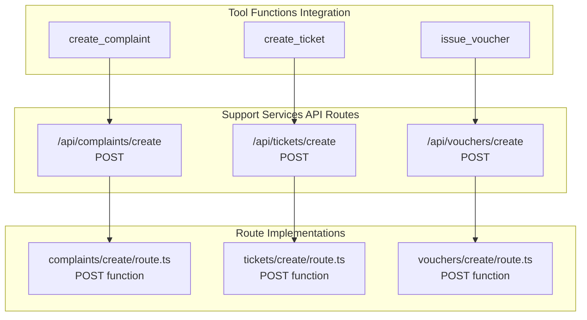
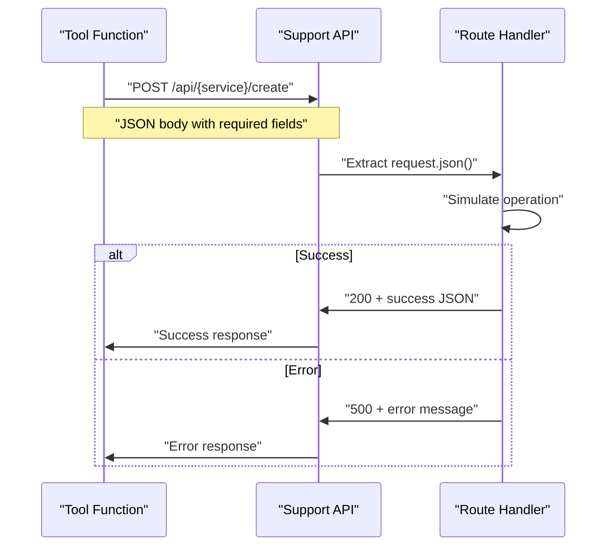

<!-- source: DeepWiki mcp.deepwiki.com · repo openai/openai-support-agent-demo · page 3.3 Support Services APIs · fetched 2026-10-26 -->

# Support Services APIs

<details>
<summary>Relevant source files</summary>

The following files were used as context for generating this wiki page:

- [app/api/complaints/create/route.ts](app/api/complaints/create/route.ts)
- [app/api/tickets/create/route.ts](app/api/tickets/create/route.ts)
- [app/api/vouchers/create/route.ts](app/api/vouchers/create/route.ts)

</details>


This document covers the REST API endpoints for customer support services including complaint creation, ticket creation, and voucher issuance. These APIs provide the backend functionality for support agents and AI tools to handle customer service requests that require escalation or compensation.

For order-related operations like cancellations and refunds, see [Order Management APIs](#3.1). For user account management, see [User Management APIs](#3.2).

## Overview

The support services APIs consist of three primary endpoints that simulate backend operations for customer service workflows:

- **Complaints API** - Creates formal complaints for customer issues
- **Tickets API** - Creates support tickets for tracking customer requests  
- **Vouchers API** - Issues vouchers as compensation for customer problems

All endpoints are designed as simulation layers that return success responses without persistent storage, making them suitable for demonstration and development purposes.

## API Endpoints Structure



Sources: [app/api/complaints/create/route.ts:1-18](), [app/api/tickets/create/route.ts:1-18](), [app/api/vouchers/create/route.ts:1-15]()

## Complaints API

### Create Complaint

**Endpoint:** `POST /api/complaints/create`

Creates a formal complaint record for customer issues requiring escalation or documentation.

#### Request Body

| Field | Type | Required | Description |
|-------|------|----------|-------------|
| `user_id` | string | Yes | Unique identifier for the user |
| `type` | string | Yes | Category or type of complaint |
| `details` | string | Yes | Detailed description of the complaint |
| `order_id` | string | No | Associated order ID if complaint is order-related |

#### Response

**Success (200):**
```json
{
  "message": "Complaint created for user {user_id}",
  "type": "{type}",
  "details": "{details}",
  "order_id": "{order_id}"
}
```

**Error (500):**
```
Error creating complaint
```

#### Implementation

The `POST` function in [app/api/complaints/create/route.ts:1-18]() extracts the request body parameters and returns a simulated success response. Error handling catches any exceptions and returns a 500 status code.

Sources: [app/api/complaints/create/route.ts:1-18]()

## Tickets API

### Create Ticket

**Endpoint:** `POST /api/tickets/create`

Creates a support ticket for tracking customer service requests and their resolution status.

#### Request Body

| Field | Type | Required | Description |
|-------|------|----------|-------------|
| `user_id` | string | Yes | Unique identifier for the user |
| `type` | string | Yes | Category or type of support request |
| `details` | string | Yes | Detailed description of the request |
| `order_id` | string | No | Associated order ID if ticket is order-related |

#### Response

**Success (200):**
```json
{
  "message": "Ticket created for user {user_id}",
  "type": "{type}",
  "details": "{details}",
  "order_id": "{order_id}"
}
```

**Error (500):**
```
Error creating ticket
```

#### Implementation

The `POST` function in [app/api/tickets/create/route.ts:1-18]() follows the same pattern as the complaints API, providing simulated ticket creation with identical request/response structure.

Sources: [app/api/tickets/create/route.ts:1-18]()

## Vouchers API

### Issue Voucher

**Endpoint:** `POST /api/vouchers/create`

Issues a voucher to a customer as compensation for service issues or as part of customer retention efforts.

#### Request Body

| Field | Type | Required | Description |
|-------|------|----------|-------------|
| `user_id` | string | Yes | Unique identifier for the user |
| `amount` | number | Yes | Monetary value of the voucher |
| `reason` | string | Yes | Reason for issuing the voucher |

#### Response

**Success (200):**
```json
{
  "message": "Voucher of ${amount} issued to user {user_id} for: {reason}"
}
```

**Error (500):**
```
Error issuing voucher
```

#### Implementation

The `POST` function in [app/api/vouchers/create/route.ts:1-15]() processes voucher issuance requests with a simpler response format that includes the amount and reason in the success message.

Sources: [app/api/vouchers/create/route.ts:1-15]()

## Request Processing Flow



Sources: [app/api/complaints/create/route.ts:2-13](), [app/api/tickets/create/route.ts:2-13](), [app/api/vouchers/create/route.ts:2-10]()

## Error Handling

All support services APIs implement consistent error handling:

1. **Request Extraction Errors** - If `request.json()` fails, the catch block returns a 500 status
2. **Console Logging** - Errors are logged to console for debugging: `console.error("Error creating {service}:", error)`
3. **Generic Error Response** - Users receive a simple error message without exposing internal details

The error handling pattern is identical across all three endpoints, using try-catch blocks around the main processing logic.

Sources: [app/api/complaints/create/route.ts:14-17](), [app/api/tickets/create/route.ts:14-17](), [app/api/vouchers/create/route.ts:11-14]()

## Integration Notes

These APIs are designed to be called by tool functions in the AI agent system. The consistent request/response patterns make them suitable for automated invocation while providing human-readable success messages for agent interfaces.

All endpoints are implemented as simulation layers without persistent storage, making them ideal for demonstration environments while maintaining realistic API contracts that could be extended with actual backend integration.

---

