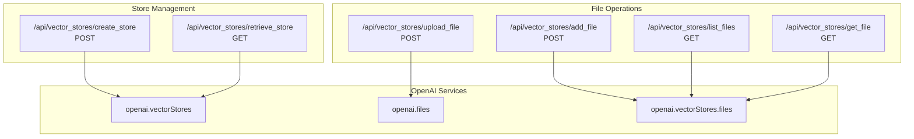
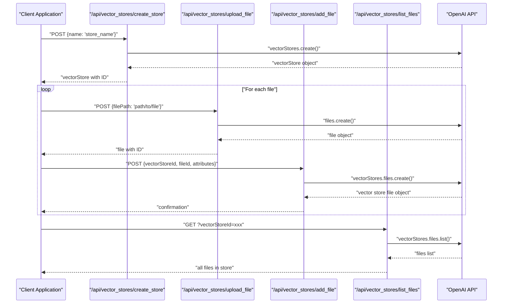
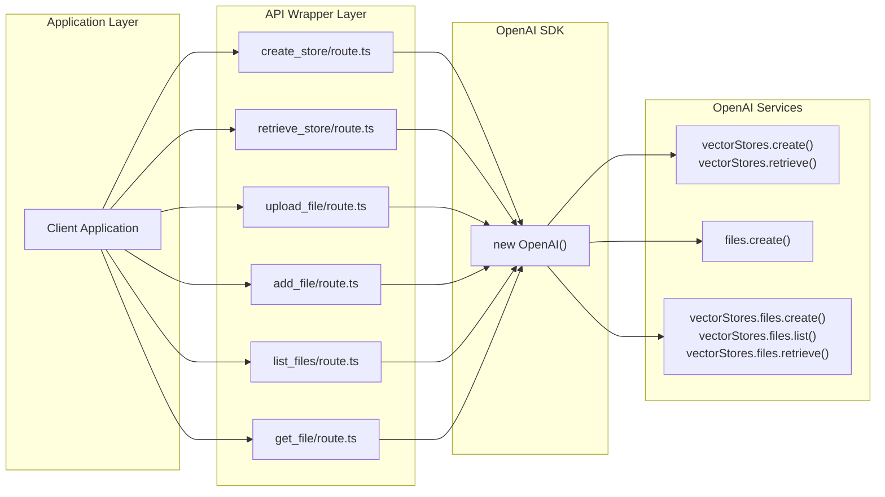

<!-- source: DeepWiki mcp.deepwiki.com · repo openai/openai-support-agent-demo · page 3.4 Vector Store APIs · fetched 2026-10-26 -->

# Vector Store APIs

<details>
<summary>Relevant source files</summary>

The following files were used as context for generating this wiki page:

- [app/api/vector_stores/add_file/route.ts](app/api/vector_stores/add_file/route.ts)
- [app/api/vector_stores/create_store/route.ts](app/api/vector_stores/create_store/route.ts)
- [app/api/vector_stores/get_file/route.ts](app/api/vector_stores/get_file/route.ts)
- [app/api/vector_stores/list_files/route.ts](app/api/vector_stores/list_files/route.ts)
- [app/api/vector_stores/retrieve_store/route.ts](app/api/vector_stores/retrieve_store/route.ts)
- [app/api/vector_stores/upload_file/route.ts](app/api/vector_stores/upload_file/route.ts)

</details>


## Purpose and Scope

The Vector Store APIs provide REST endpoints for managing OpenAI vector stores and their associated files. These APIs serve as a wrapper layer around the OpenAI Assistants API, enabling the creation, configuration, and management of vector stores used for file search capabilities in the AI support agent system.

For information about the higher-level vector store management system, see [Vector Store Management](#2.1). For the administrative interface that uses these APIs, see [Vector Store Initialization Interface](#4.3). For general file listing operations, see [File Management APIs](#3.5).

## API Architecture

The vector store APIs are organized into two main categories: store management and file operations.



Sources: [app/api/vector_stores/create_store/route.ts:1-17](), [app/api/vector_stores/retrieve_store/route.ts:1-17](), [app/api/vector_stores/upload_file/route.ts:1-21](), [app/api/vector_stores/add_file/route.ts:1-20](), [app/api/vector_stores/list_files/route.ts:1-18](), [app/api/vector_stores/get_file/route.ts:1-19]()

## Vector Store Lifecycle Workflow

The typical workflow for setting up a vector store involves multiple API calls in sequence.



Sources: [app/api/vector_stores/create_store/route.ts:5-17](), [app/api/vector_stores/upload_file/route.ts:5-21](), [app/api/vector_stores/add_file/route.ts:5-20](), [app/api/vector_stores/list_files/route.ts:5-18]()

## Store Management Endpoints

### Create Vector Store

Creates a new OpenAI vector store with the specified name.

**Endpoint:** `POST /api/vector_stores/create_store`

**Request Body:**
```json
{
  "name": "string"
}
```

**Response:** OpenAI vector store object with generated ID

**Implementation:** Uses `openai.vectorStores.create()` at [app/api/vector_stores/create_store/route.ts:8-10]()

Sources: [app/api/vector_stores/create_store/route.ts:5-17]()

### Retrieve Vector Store

Retrieves metadata for an existing vector store.

**Endpoint:** `GET /api/vector_stores/retrieve_store`

**Query Parameters:**
| Parameter | Type | Description |
|-----------|------|-------------|
| `vector_store_id` | string | ID of the vector store to retrieve |

**Response:** OpenAI vector store object

**Implementation:** Uses `openai.vectorStores.retrieve()` at [app/api/vector_stores/retrieve_store/route.ts:9-11]()

Sources: [app/api/vector_stores/retrieve_store/route.ts:5-17]()

## File Operations Endpoints

### Upload File

Uploads a file from the local filesystem to OpenAI for use with assistants.

**Endpoint:** `POST /api/vector_stores/upload_file`

**Request Body:**
```json
{
  "filePath": "string"
}
```

**Response:** OpenAI file object with generated ID

**Implementation:** 
- Creates file stream from `process.cwd()` + `filePath` at [app/api/vector_stores/upload_file/route.ts:9-10]()
- Uses `openai.files.create()` with purpose "assistants" at [app/api/vector_stores/upload_file/route.ts:11-14]()

Sources: [app/api/vector_stores/upload_file/route.ts:5-21]()

### Add File to Vector Store

Associates an uploaded file with a vector store, enabling it for file search operations.

**Endpoint:** `POST /api/vector_stores/add_file`

**Request Body:**
```json
{
  "vectorStoreId": "string",
  "fileId": "string", 
  "attributes": "object"
}
```

**Response:** OpenAI vector store file object

**Implementation:** Uses `openai.vectorStores.files.create()` at [app/api/vector_stores/add_file/route.ts:11-14]()

Sources: [app/api/vector_stores/add_file/route.ts:5-20]()

### List Vector Store Files

Retrieves all files associated with a vector store.

**Endpoint:** `GET /api/vector_stores/list_files`

**Query Parameters:**
| Parameter | Type | Description |
|-----------|------|-------------|
| `vectorStoreId` | string | ID of the vector store |

**Response:** List of OpenAI vector store file objects

**Implementation:** Uses `openai.vectorStores.files.list()` at [app/api/vector_stores/list_files/route.ts:10-12]()

Sources: [app/api/vector_stores/list_files/route.ts:5-18]()

### Get Vector Store File

Retrieves metadata for a specific file within a vector store.

**Endpoint:** `GET /api/vector_stores/get_file`

**Query Parameters:**
| Parameter | Type | Description |
|-----------|------|-------------|
| `vectorStoreId` | string | ID of the vector store |
| `fileId` | string | ID of the file |

**Response:** OpenAI vector store file object

**Implementation:** Uses `openai.vectorStores.files.retrieve()` at [app/api/vector_stores/get_file/route.ts:10-13]()

Sources: [app/api/vector_stores/get_file/route.ts:5-19]()

## OpenAI API Integration

All vector store APIs serve as thin wrapper layers around the OpenAI API, providing consistent error handling and request/response formatting.



Sources: [app/api/vector_stores/create_store/route.ts:1-3](), [app/api/vector_stores/upload_file/route.ts:1-2](), [app/api/vector_stores/add_file/route.ts:1-3](), [app/api/vector_stores/list_files/route.ts:1-3](), [app/api/vector_stores/get_file/route.ts:1-3](), [app/api/vector_stores/retrieve_store/route.ts:1-3]()

## Error Handling

All endpoints implement consistent error handling patterns:

- Errors are logged to console with descriptive messages
- HTTP 500 status returned for all errors
- Generic error messages returned to client to avoid exposing internal details

| Endpoint | Error Log Message | Error Response |
|----------|------------------|----------------|
| create_store | "Error creating vector store" | "Error creating vector store" |
| upload_file | "Error uploading file" | "Error uploading file" |
| add_file | "Error adding file" | "Error adding file" |
| list_files | "Error fetching files" | "Error fetching files" |
| get_file | "Error retrieving file" | "Error retrieving file" |
| retrieve_store | "Error fetching vector store" | "Error fetching vector store" |

Sources: [app/api/vector_stores/create_store/route.ts:13-16](), [app/api/vector_stores/upload_file/route.ts:17-20](), [app/api/vector_stores/add_file/route.ts:16-19](), [app/api/vector_stores/list_files/route.ts:14-17](), [app/api/vector_stores/get_file/route.ts:15-18](), [app/api/vector_stores/retrieve_store/route.ts:13-16]()

---

