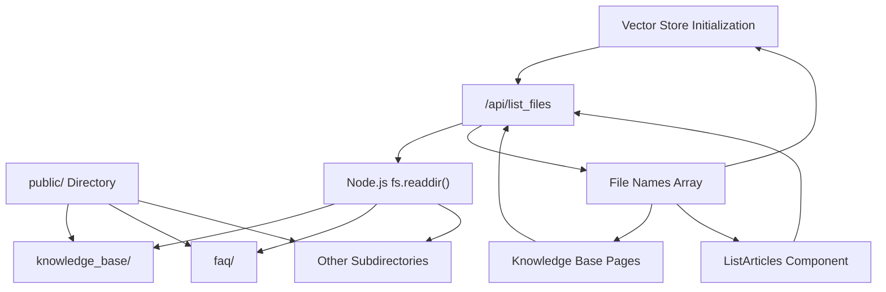
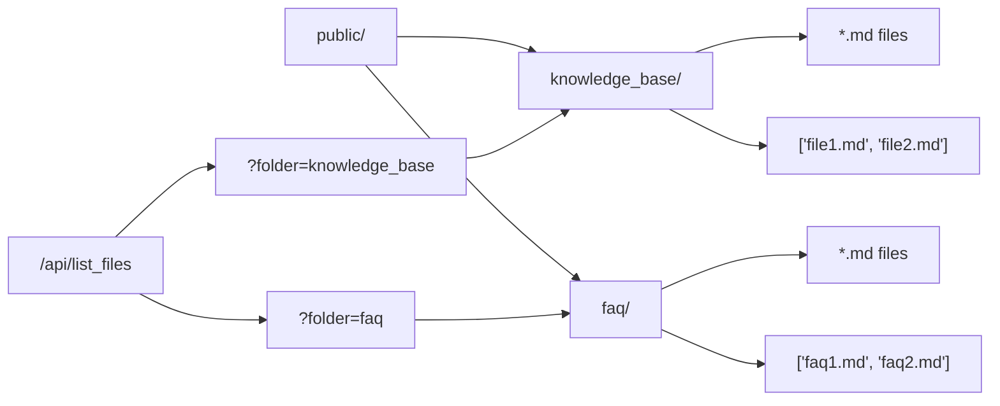

<!-- source: DeepWiki mcp.deepwiki.com · repo openai/openai-support-agent-demo · page 3.5 File Management APIs · fetched 2026-10-26 -->

# File Management APIs

<details>
<summary>Relevant source files</summary>

The following files were used as context for generating this wiki page:

- [app/api/list_files/route.ts](app/api/list_files/route.ts)

</details>


## Purpose and Scope

The File Management APIs provide endpoints for listing and accessing files within the public directory structure of the OpenAI Customer Support Agent Demo. These APIs enable the system to dynamically discover and serve knowledge base content, FAQ files, and other static assets stored in the `public/` directory.

This page covers file listing and directory traversal APIs. For managing files within OpenAI vector stores, see [Vector Store APIs](#3.4). For the overall API architecture, see [API Reference](#3).

## Overview

The file management system provides a simple but essential service: dynamically listing files in specified public directories. This capability supports the knowledge base initialization process and enables the system to discover available content without hardcoding file names.

### File Listing Endpoint

The primary file management endpoint is `/api/list_files`, which provides directory listing functionality for the public folder structure.

**Sources:** [app/api/list_files/route.ts:1-16]()

## API Endpoints

### GET /api/list_files

Lists all files in a specified subdirectory of the `public/` folder.

#### Parameters

| Parameter | Type | Required | Description |
|-----------|------|----------|-------------|
| `folder` | string | Yes | Subdirectory name within `public/` to list |

#### Request Example

```
GET /api/list_files?folder=knowledge_base
```

#### Response Format

Returns a JSON array of file names as strings.

```json
[
  "account_management.md",
  "billing_policies.md",
  "shipping_info.md"
]
```

#### Error Responses

| Status Code | Description |
|-------------|-------------|
| 500 | Error accessing the specified directory |

#### Implementation Details

The endpoint implementation follows a straightforward pattern:

1. Extracts the `folder` parameter from the query string
2. Constructs the full path using `path.join(process.cwd(), 'public/${folder}')`
3. Uses Node.js `fs.readdir()` to list directory contents
4. Returns the file list as JSON or an error response

**Sources:** [app/api/list_files/route.ts:4-16]()

## System Integration

### File Discovery Flow

The file management API integrates with several system components to enable dynamic content discovery:



**Sources:** [app/api/list_files/route.ts:1-16]()

### Directory Structure Support

The API is designed to work with the public directory structure that contains knowledge base content:



**Sources:** [app/api/list_files/route.ts:8-11]()

## Error Handling and Logging

The API includes basic error handling and logging mechanisms:

- **Directory Access Errors**: Returns HTTP 500 status when unable to read the specified directory
- **Console Logging**: Logs successful file discovery for debugging and monitoring
- **Error Logging**: Logs detailed error information when directory access fails

The logging output includes both the requested folder name and the discovered files, making it easier to troubleshoot content discovery issues.

**Sources:** [app/api/list_files/route.ts:10-14]()

## Usage Patterns

### Knowledge Base Content Discovery

The most common usage pattern involves discovering markdown files in knowledge base directories:

1. Vector store initialization calls `/api/list_files?folder=knowledge_base`
2. The API returns an array of `.md` file names
3. The initialization process then uploads these files to the OpenAI vector store

### Dynamic Content Loading

The knowledge base pages use this API to dynamically load available content without hardcoding file names, enabling easy addition of new content files.

**Sources:** [app/api/list_files/route.ts:1-16]()

## Security Considerations

The current implementation has several security characteristics:

- **Path Restriction**: Only allows access to subdirectories within the `public/` folder
- **No Path Traversal Protection**: Does not explicitly validate against path traversal attacks
- **Public Directory Exposure**: All files in the specified public subdirectories are listable

For production use, additional validation should be considered to prevent unauthorized directory access.

**Sources:** [app/api/list_files/route.ts:8]()

---

