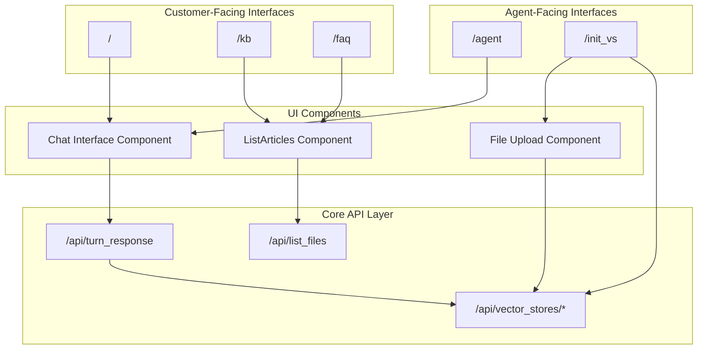
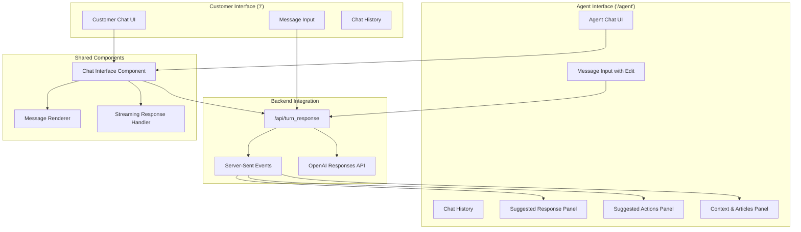
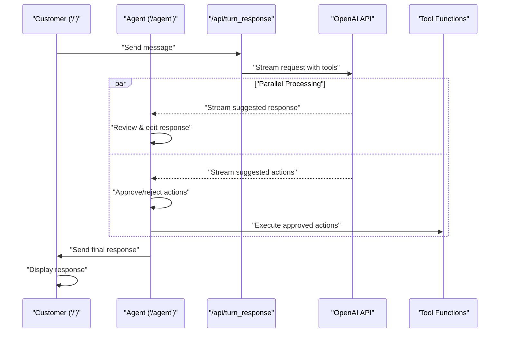
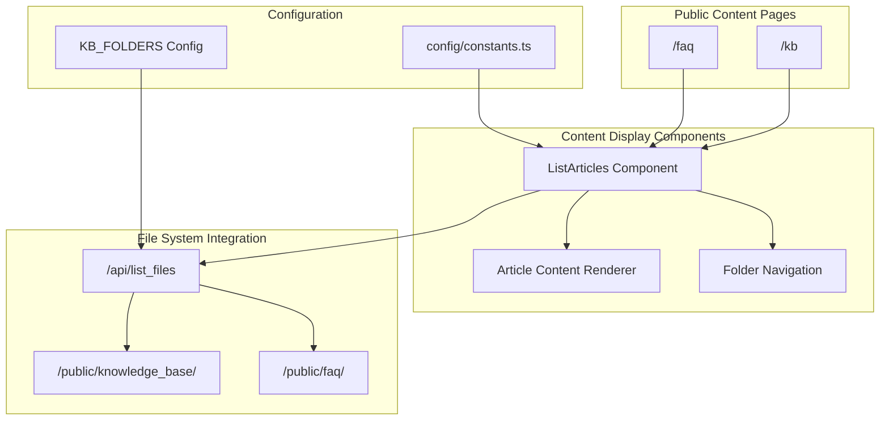
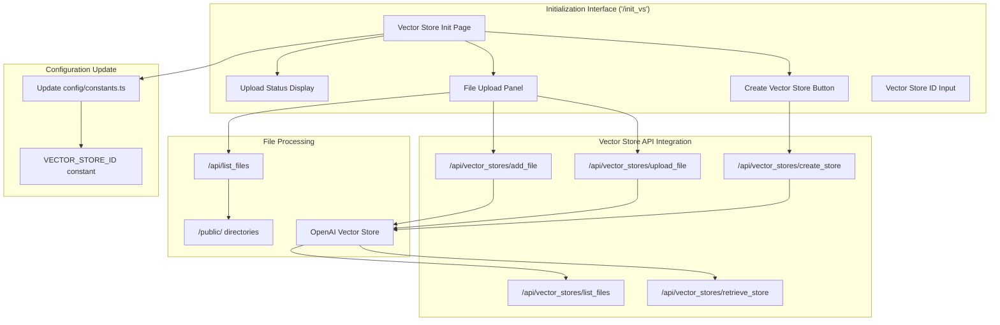
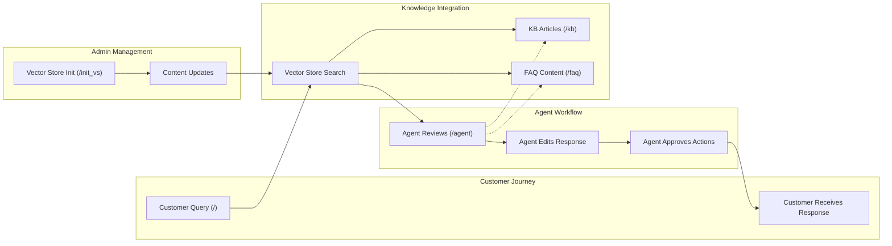

<!-- source: DeepWiki mcp.deepwiki.com · repo openai/openai-support-agent-demo · page 4 User Interfaces · fetched 2026-10-26 -->

# User Interfaces

Relevant source files

The following files were used as context for generating this wiki page:

- [README.md](README.md)

This document covers all user-facing interfaces in the OpenAI Customer Support Agent Demo system. It describes the five main interface types: customer chat, agent chat, knowledge base browsing, FAQ viewing, and vector store initialization. These interfaces work together to provide a complete human-in-the-loop customer service experience.

For information about the underlying API endpoints that power these interfaces, see [API Reference](#3). For configuration of interface behavior and styling, see [Configuration and Customization](#5).

## Interface Architecture Overview

The system provides five distinct user interfaces, each serving different user roles and workflows:

**Interface Types:**

| Interface | Route | Purpose | User Type |
|-----------|-------|---------|-----------|
| Customer Chat | `/` | Main customer service chat | End customers |
| Agent Chat | `/agent` | Human agent oversight interface | Support agents |
| Knowledge Base | `/kb` | Browse support articles | Public/customers |
| FAQ | `/faq` | Browse frequently asked questions | Public/customers |
| Vector Store Init | `/init_vs` | Initialize AI knowledge base | Administrators |

Sources: [README.md:1-129]()

## Customer and Agent Chat Interfaces

The core chat functionality is implemented through two parallel interfaces that share the same underlying chat components but provide different user experiences.

### Chat Interface Architecture

### Interface Differences

**Customer Interface (`/`):**
- Simple chat interface for end customers
- Direct message sending and receiving
- No editing capabilities for AI responses
- Focused on conversation flow

**Agent Interface (`/agent`):**
- Enhanced interface for human agents
- Streaming suggested responses from AI
- Ability to edit responses before sending
- Action suggestion panel for tool calls
- Context panel showing relevant knowledge base articles
- Human oversight controls for sensitive actions

### Chat Flow Integration

Sources: [README.md:7-11](), [README.md:16-24](), [README.md:81-86]()

## Knowledge Base and FAQ Pages

The system provides public-facing interfaces for browsing the knowledge base content that powers the AI's contextual responses.

### Knowledge Base Interface Structure

### Content Organization

**Knowledge Base (`/kb`):**
- Displays structured support articles
- Organized by folders defined in `KB_FOLDERS` configuration
- Direct access to files in `/public/knowledge_base/`
- Used by AI for contextual responses via vector store

**FAQ (`/faq`):**
- Displays frequently asked questions
- Organized by folders defined in `KB_FOLDERS` configuration  
- Direct access to files in `/public/faq/`
- Provides quick answers to common questions

### Article Display Features

| Feature | Description | Implementation |
|---------|-------------|----------------|
| Folder Navigation | Browse articles by category | `FolderNavigation` component |
| Article Rendering | Display markdown/text content | `ArticleRenderer` component |
| File Listing | Dynamic file discovery | `/api/list_files` endpoint |
| Cross-Reference | Link articles to chat responses | Vector store integration |

Sources: [README.md:18-19](), [README.md:84-85]()

## Vector Store Initialization Interface

The `/init_vs` interface provides administrative functionality for setting up and managing the AI's knowledge base through OpenAI's vector store system.

### Vector Store Management Flow

### Initialization Workflow

**Step 1: Vector Store Creation**
- Click "Create Vector Store" to establish new vector store via `/api/vector_stores/create_store`
- Receives vector store ID from OpenAI
- Updates local configuration with new ID

**Step 2: Content Upload**
- Scans `/public/knowledge_base/` and `/public/faq/` directories
- Uploads files through `/api/vector_stores/upload_file`
- Associates files with vector store via `/api/vector_stores/add_file`

**Step 3: Configuration Update**
- Manual update of `config/constants.ts` with new `VECTOR_STORE_ID`
- Enables AI to use uploaded content for contextual responses

### Administrative Features

| Feature | API Endpoint | Purpose |
|---------|-------------|---------|
| Store Creation | `/api/vector_stores/create_store` | Initialize new vector store |
| File Upload | `/api/vector_stores/upload_file` | Upload individual files |
| File Association | `/api/vector_stores/add_file` | Link files to store |
| Store Retrieval | `/api/vector_stores/retrieve_store` | Get store metadata |
| File Listing | `/api/vector_stores/list_files` | View store contents |

Sources: [README.md:67-69](), [README.md:18]()

## Interface Integration and Data Flow

The interfaces work together to provide a complete customer service ecosystem, with data flowing between customer interactions, agent oversight, and knowledge management.

### Cross-Interface Data Flow

### State Management Across Interfaces

**Shared State Elements:**
- Chat conversation history
- Vector store ID and content
- Tool function availability
- Configuration settings from `config/constants.ts`

**Interface-Specific State:**
- Customer interface: Simple message history
- Agent interface: Suggested responses, pending actions, context articles
- Knowledge interfaces: File listings, folder navigation
- Admin interface: Upload progress, store status

Sources: [README.md:96-104](), [README.md:110-118]()

---

