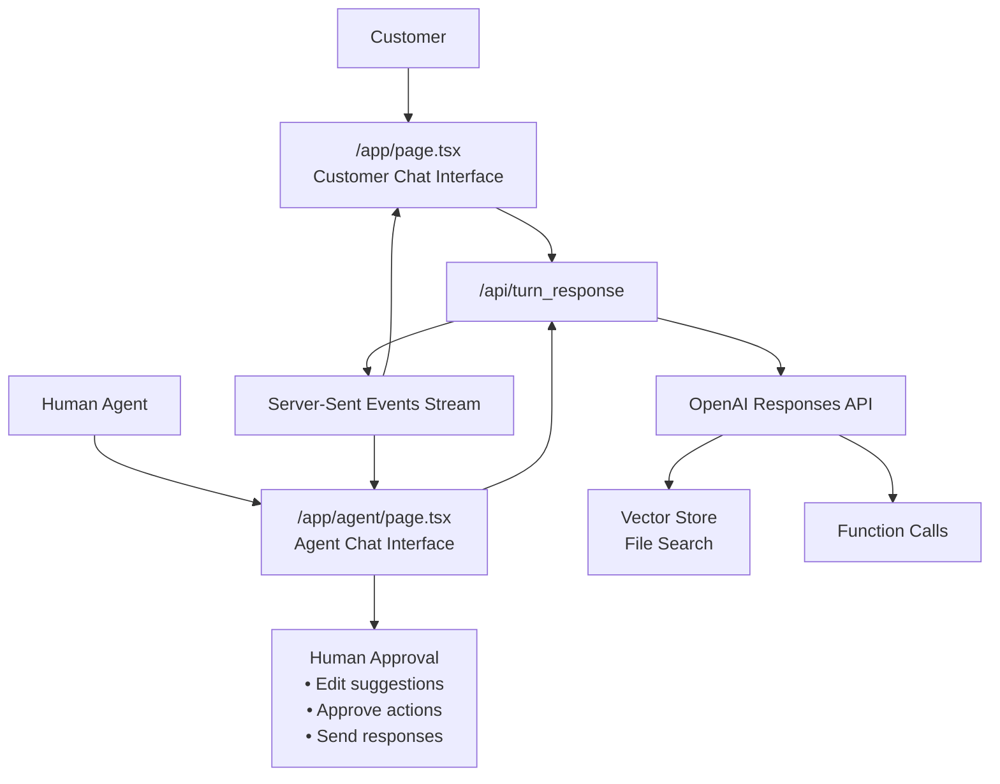
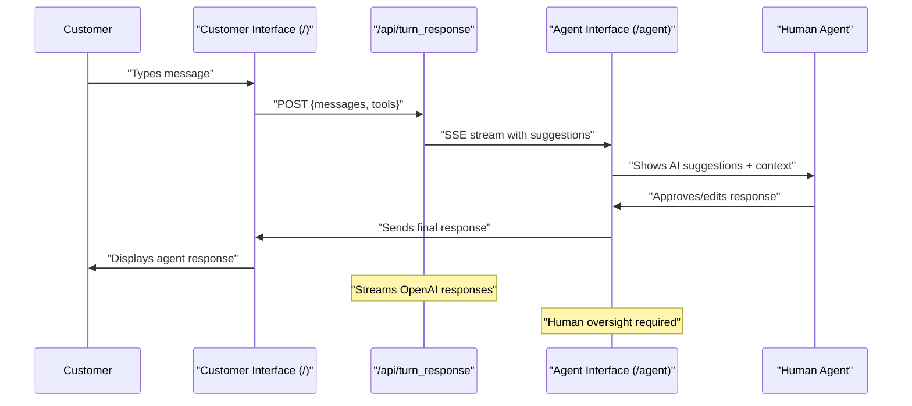
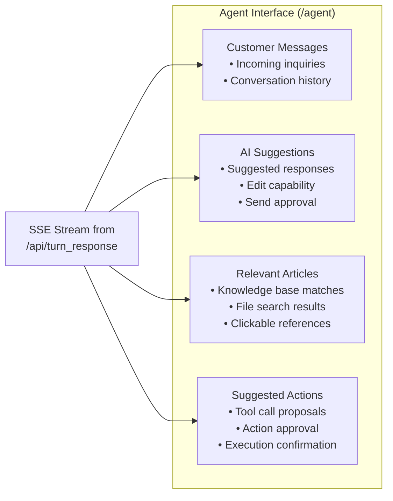
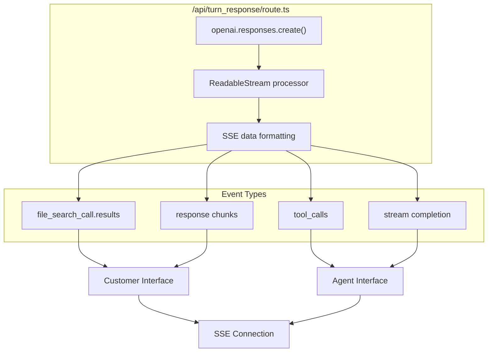

<!-- source: DeepWiki mcp.deepwiki.com · repo openai/openai-support-agent-demo · page 4.1 Customer and Agent Interfaces · fetched 2026-10-26 -->

# Customer and Agent Interfaces

Relevant source files

The following files were used as context for generating this wiki page:

- [README.md](README.md)
- [app/api/turn_response/route.ts](app/api/turn_response/route.ts)

This document covers the primary user-facing interfaces of the OpenAI Customer Support Agent Demo: the customer chat interface and the human agent interface. These interfaces form the core of the human-in-the-loop customer service system, enabling AI-assisted conversations with human oversight.

For information about the knowledge base and FAQ public pages, see [Knowledge Base Pages](#4.2). For details about the AI response processing and tool execution, see [Tool Functions System](#2.2) and [AI Response APIs](#3.6).

## Interface Overview

The system provides two distinct chat interfaces that work together to enable human-supervised AI customer service:

**Dual Interface Architecture**
- **Customer Interface** (`/`): Receives customer inquiries and displays agent responses
- **Agent Interface** (`/agent`): Shows AI suggestions, relevant context, and enables human approval workflow

Sources: [README.md:8-10](), [README.md:21-23]()

## Customer Chat Interface

The customer interface provides a standard chat experience where customers can ask questions and receive responses from human agents assisted by AI.

### Customer Interface Features

| Feature | Description | Technical Implementation |
|---------|-------------|-------------------------|
| Message Input | Text input for customer inquiries | Standard chat UI components |
| Response Display | Shows agent responses in real-time | SSE streaming from `/api/turn_response` |
| Conversation History | Maintains chat history | Client-side message state management |
| Real-time Updates | Immediate response streaming | Server-Sent Events connection |

### Customer Interaction Flow

Sources: [README.md:73-86](), [app/api/turn_response/route.ts:12-19]()

## Agent Chat Interface

The agent interface provides human agents with AI-generated suggestions, relevant context, and tools to efficiently handle customer inquiries while maintaining control over all responses and actions.

### Agent Interface Components

### Agent Workflow Features

| Component | Purpose | Human Control |
|-----------|---------|---------------|
| **Suggested Responses** | AI-generated replies based on context | Agent can edit or reject before sending |
| **Relevant Articles** | Knowledge base matches from file search | Agent can reference and link articles |
| **Tool Call Suggestions** | Proposed actions (cancel order, reset password) | Agent must approve sensitive actions |
| **Auto-Execution** | Non-sensitive actions execute automatically | Sensitive actions require approval |

Sources: [README.md:81-84](), [README.md:21-23]()

## Technical Implementation

### Server-Sent Events Streaming

Both interfaces receive real-time updates through Server-Sent Events (SSE) streaming from the `/api/turn_response` endpoint:

### API Integration Details

The core `/api/turn_response` endpoint handles all chat processing:

**Request Format:**
- `messages`: Array of conversation messages
- `tools`: Available function calling tools

**Response Stream:**
- **Content-Type**: `text/event-stream`
- **Events**: JSON-formatted OpenAI response events
- **Includes**: File search results via `include: ["file_search_call.results"]`

**Streaming Configuration:**
- `stream: true` enables real-time responses
- `parallel_tool_calls: false` ensures sequential tool execution
- SSE format with `data: ${JSON.stringify(event)}\n\n`

Sources: [app/api/turn_response/route.ts:5-19](), [app/api/turn_response/route.ts:42-49]()

## Example Usage Flows

### Basic Question-Answer Flow

1. **Customer asks**: "What is the return policy?"
2. **System processes**: File search retrieves relevant articles
3. **Agent sees**: AI-suggested response with relevant articles
4. **Agent sends**: Approved response to customer

### Action-Required Flow

1. **Customer asks**: "Help me cancel order ORD1001"
2. **System suggests**: `cancel_order` function call
3. **Agent approves**: Tool execution after verification
4. **System executes**: Order cancellation function
5. **Agent sends**: Confirmation response to customer

Sources: [README.md:88-103]()

## Configuration and Customization

Both interfaces can be customized through configuration files:

- **Model and prompts**: Modified in `config/constants.ts`
- **Available functions**: Defined in `config/tools-list.ts`
- **Function implementations**: Located in `config/functions.ts`
- **Demo data**: Configured in `config/demoData.ts`

The interfaces automatically adapt to configuration changes without requiring code modifications to the UI components themselves.

Sources: [README.md:113-116]()

---

