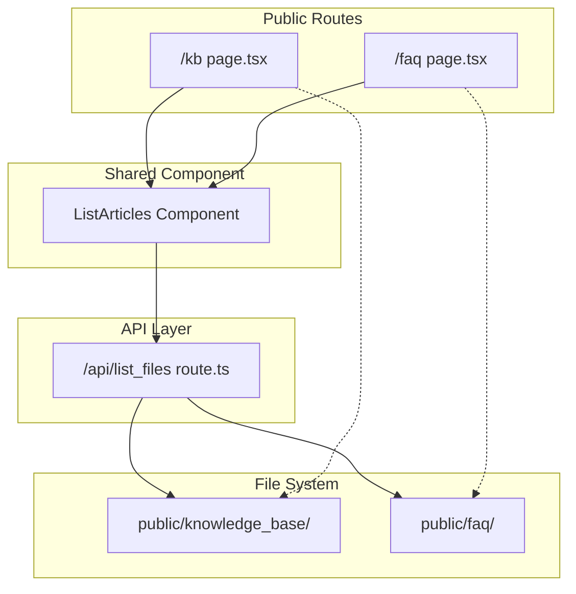
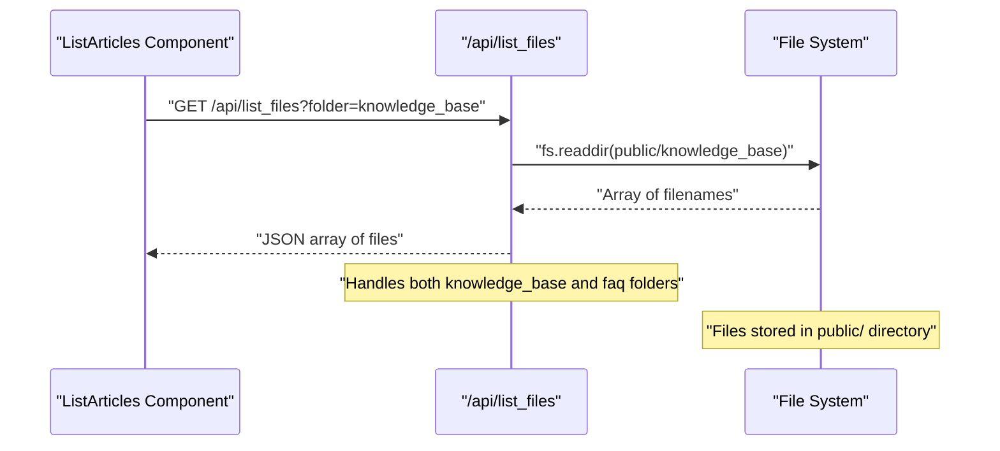
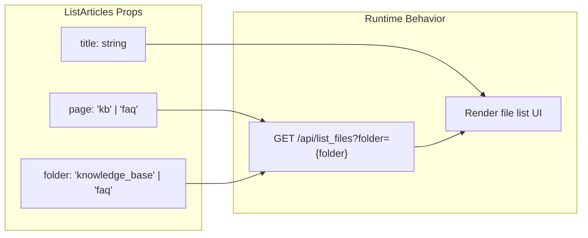

<!-- source: DeepWiki mcp.deepwiki.com · repo openai/openai-support-agent-demo · page 4.2 Knowledge Base Pages · fetched 2026-10-26 -->

# Knowledge Base Pages

<details>
<summary>Relevant source files</summary>

The following files were used as context for generating this wiki page:

- [app/api/list_files/route.ts](app/api/list_files/route.ts)
- [app/faq/page.tsx](app/faq/page.tsx)
- [app/kb/page.tsx](app/kb/page.tsx)

</details>


This document covers the public-facing knowledge base and FAQ pages that allow users to browse and access documentation content. These pages provide read-only access to articles stored in the file system, serving as the front-end interface for knowledge base content before it gets indexed into the vector store system.

For information about vector store initialization and content indexing, see [Vector Store Management](#2.1). For the underlying file management APIs, see [File Management APIs](#3.5).

## System Architecture

The knowledge base pages consist of two main public interfaces that share common functionality through a reusable component architecture:



Sources: [app/kb/page.tsx:1-16](), [app/faq/page.tsx:1-12](), [app/api/list_files/route.ts:1-17]()

## Knowledge Base Page (`/kb`)

The internal knowledge base page displays articles from the `knowledge_base` directory. This page is designed for internal documentation and more detailed technical content.

| Property | Value |
|----------|-------|
| Route | `/kb` |
| Component | `KnowledgeBasePage` |
| Folder | `knowledge_base` |
| Title | "Internal Knowledge Base" |
| Page Parameter | `kb` |

The page implementation is minimal, delegating all functionality to the `ListArticles` component:

```typescript
// From app/kb/page.tsx
export default function KnowledgeBasePage() {
  return (
    <div>
      <ListArticles
        page="kb"
        folder="knowledge_base"
        title="Internal Knowledge Base"
      />
    </div>
  );
}
```

Sources: [app/kb/page.tsx:5-15]()

## FAQ Page (`/faq`)

The public FAQ page displays articles from the `faq` directory. This page serves as the customer-facing documentation interface with frequently asked questions and basic help content.

| Property | Value |
|----------|-------|
| Route | `/faq` |
| Component | `KnowledgeBasePage` |
| Folder | `faq` |
| Title | "Public FAQ" |
| Page Parameter | `faq` |

The implementation follows the same pattern as the knowledge base page:

```typescript
// From app/faq/page.tsx
export default function KnowledgeBasePage() {
  return (
    <div>
      <ListArticles page="faq" folder="faq" title="Public FAQ" />
    </div>
  );
}
```

Sources: [app/faq/page.tsx:5-11]()

## File Listing API

The knowledge base pages rely on the `/api/list_files` endpoint to dynamically fetch available articles from the file system. This API provides the backend functionality for the `ListArticles` component.



### API Implementation Details

The `list_files` route accepts a `folder` query parameter and returns an array of filenames:

| Parameter | Type | Description |
|-----------|------|-------------|
| `folder` | string | Target folder name (`knowledge_base` or `faq`) |

**Response Format:**
- Success: JSON array of filenames with 200 status
- Error: Error message string with 500 status

The API constructs file paths using [app/api/list_files/route.ts:8]():
```typescript
const faqDir = path.join(process.cwd(), `public/${folder}`);
```

Sources: [app/api/list_files/route.ts:4-16]()

## Component Architecture

Both knowledge base pages use the same `ListArticles` component with different configuration parameters. This creates a consistent user experience across both sections while maintaining separation of content types.



### Configuration Mapping

| Page | `page` prop | `folder` prop | `title` prop |
|------|-------------|---------------|--------------|
| `/kb` | `"kb"` | `"knowledge_base"` | `"Internal Knowledge Base"` |
| `/faq` | `"faq"` | `"faq"` | `"Public FAQ"` |

Sources: [app/kb/page.tsx:8-12](), [app/faq/page.tsx:8]()

## Content Organization

The knowledge base system organizes content into two distinct directories within the `public/` folder:

- **`public/knowledge_base/`** - Internal documentation and detailed technical content
- **`public/faq/`** - Public-facing FAQ and basic help articles

This separation allows for different access patterns and content types while using the same underlying infrastructure. Files in these directories are automatically discovered by the file listing API and made available through the respective pages.

Sources: [app/api/list_files/route.ts:8]()

---

