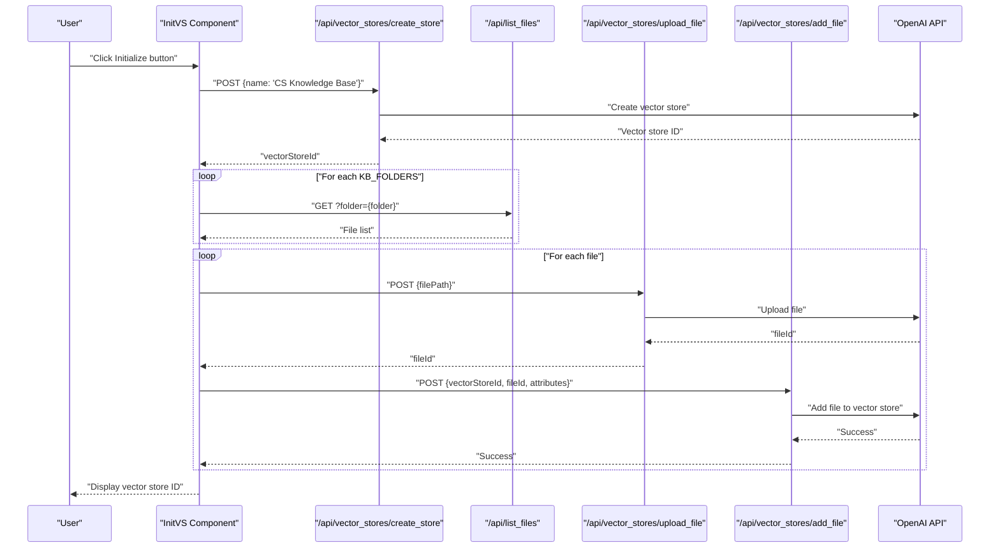
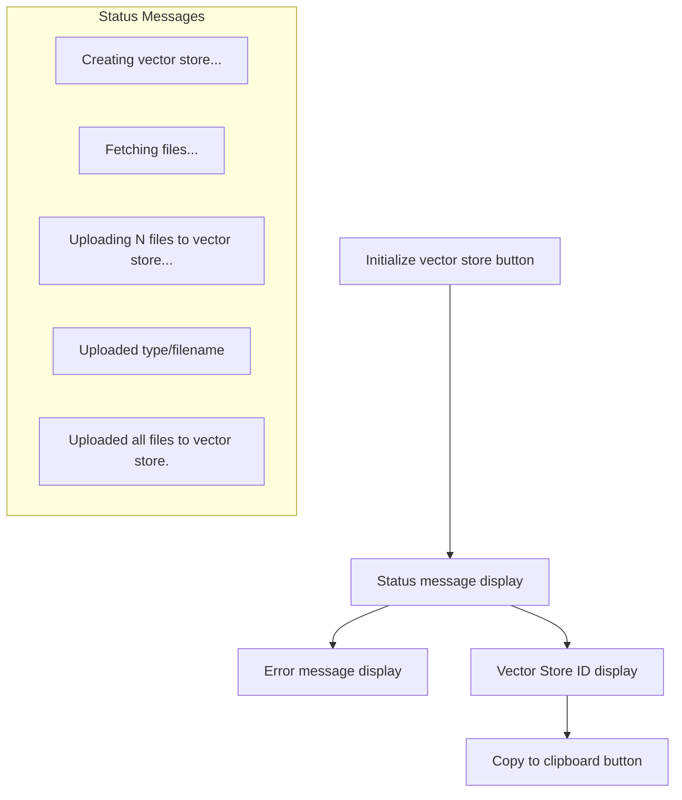
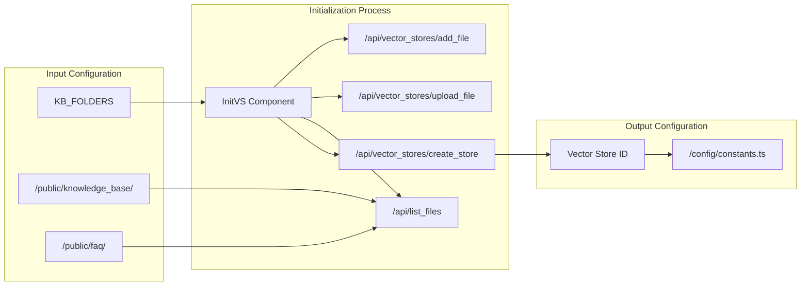
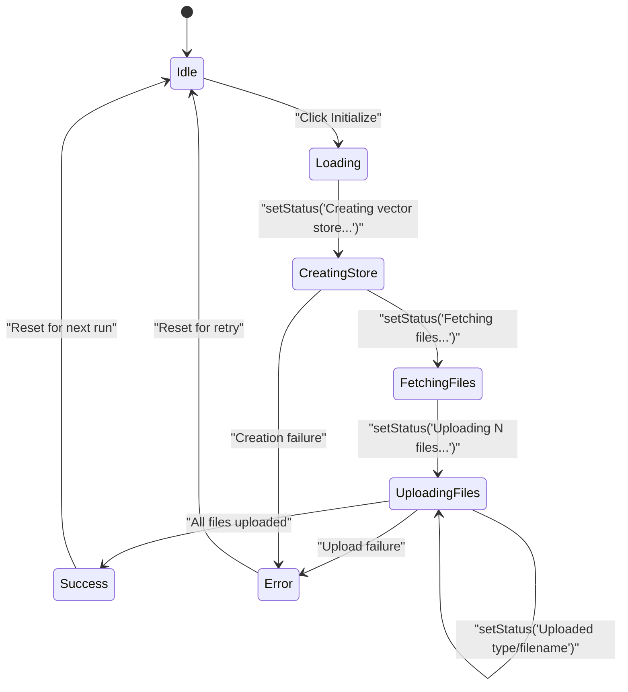

<!-- source: DeepWiki mcp.deepwiki.com · repo openai/openai-support-agent-demo · page 4.3 Vector Store Initialization Interface · fetched 2026-10-26 -->

# Vector Store Initialization Interface

<details>
<summary>Relevant source files</summary>

The following files were used as context for generating this wiki page:

- [app/init_vs/page.tsx](app/init_vs/page.tsx)

</details>


## Purpose and Scope

The Vector Store Initialization Interface provides an administrative web interface for setting up OpenAI vector stores with knowledge base content. This interface automates the process of creating a vector store, uploading files from predefined directories, and generating the vector store ID needed for configuration.

This page covers the initialization UI component and its integration with vector store APIs. For detailed API reference of vector store operations, see [Vector Store APIs](#3.4). For information about configuring the generated vector store ID, see [Configuration Files](#5.1).

## Interface Overview

The Vector Store Initialization Interface is implemented as a Next.js page component located at [app/init_vs/page.tsx:1-157](). The interface provides a single-button workflow that orchestrates multiple API calls to establish a fully configured vector store.

### Core Functionality

| Feature | Description | API Endpoint |
|---------|-------------|--------------|
| Vector Store Creation | Creates new OpenAI vector store | `/api/vector_stores/create_store` |
| File Discovery | Lists files in knowledge base folders | `/api/list_files` |
| File Upload | Uploads files to OpenAI | `/api/vector_stores/upload_file` |
| File Association | Adds files to vector store with metadata | `/api/vector_stores/add_file` |

The interface operates on files within the directories specified by `KB_FOLDERS` configuration, which typically includes `knowledge_base` and `faq` folders under `/public/`.

**Sources:** [app/init_vs/page.tsx:1-157]()

## Initialization Process Flow

### Vector Store Creation Workflow



### File Processing Logic

The initialization process iterates through folders defined in `KB_FOLDERS` and processes each file with the following metadata structure:

```typescript
interface KBFile {
  type: string;        // Folder name (e.g., "knowledge_base", "faq")
  filename: string;    // File name without extension
  filepath: string;    // Full path to file
}
```

Files are processed sequentially, with each file upload followed immediately by its addition to the vector store with metadata attributes [app/init_vs/page.tsx:59-66]().

**Sources:** [app/init_vs/page.tsx:23-84]()

## User Interface Components

### State Management

The `InitVS` component maintains several state variables to track the initialization process:

| State Variable | Type | Purpose |
|----------------|------|---------|
| `loading` | `boolean` | Controls button state and loading indicator |
| `vectorStoreId` | `string \| null` | Stores the created vector store ID |
| `status` | `string` | Current operation status message |
| `error` | `string \| null` | Error message display |
| `success` | `boolean` | Success state indicator |

### Interface Elements



The interface provides real-time feedback through status updates [app/init_vs/page.tsx:26-79]() and includes a copy-to-clipboard function for the generated vector store ID [app/init_vs/page.tsx:19-21]().

**Sources:** [app/init_vs/page.tsx:13-17](), [app/init_vs/page.tsx:86-156]()

## Integration with Configuration System

### Knowledge Base Folder Configuration

The interface reads from `KB_FOLDERS` imported from `@/config/demoData` [app/init_vs/page.tsx:2]() to determine which directories contain files for upload [app/init_vs/page.tsx:36]().

### Configuration Workflow



After successful initialization, users must manually copy the generated vector store ID into `/config/constants.ts` to enable the File Search tool functionality [app/init_vs/page.tsx:116-121]().

**Sources:** [app/init_vs/page.tsx:2](), [app/init_vs/page.tsx:36](), [app/init_vs/page.tsx:116-121]()

## Error Handling and User Feedback

### Error States

The interface handles multiple error conditions:

- Vector store creation failure [app/init_vs/page.tsx:80-83]()
- File upload failures [app/init_vs/page.tsx:71-75]()
- File addition to vector store failures [app/init_vs/page.tsx:69-73]()

### User Feedback System



The interface provides granular status updates throughout the process, showing progress for individual file uploads [app/init_vs/page.tsx:69]() and maintaining error state for troubleshooting failed operations.

**Sources:** [app/init_vs/page.tsx:15-16](), [app/init_vs/page.tsx:69-75](), [app/init_vs/page.tsx:80-83]()

---

