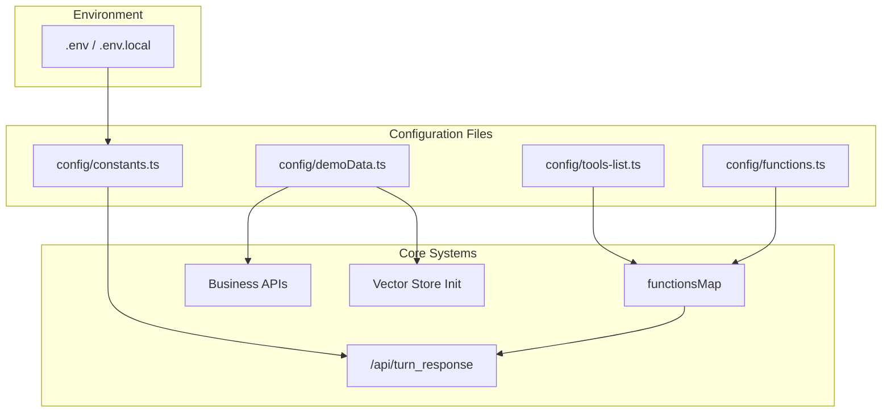
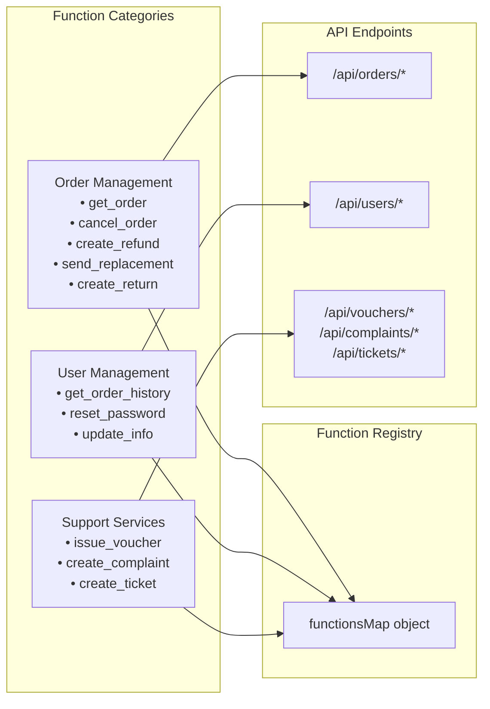
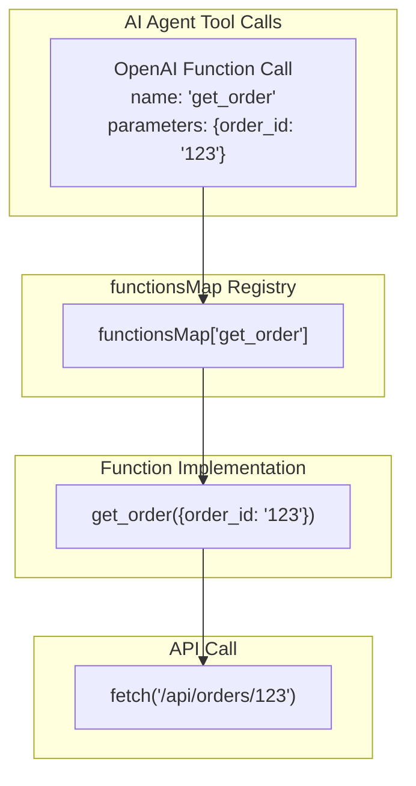
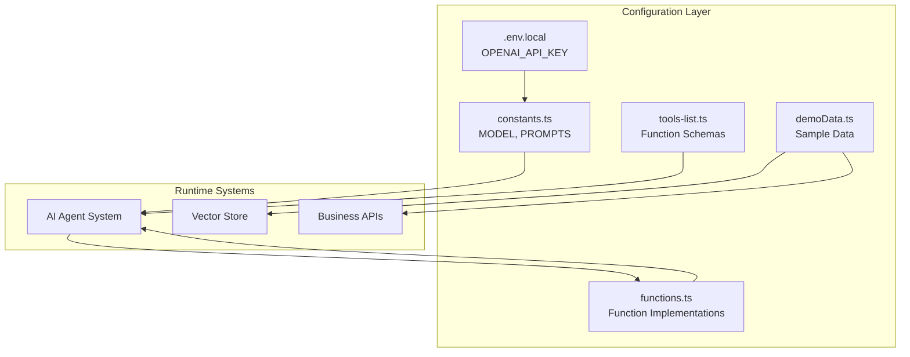

<!-- source: DeepWiki mcp.deepwiki.com · repo openai/openai-support-agent-demo · page 5.1 Configuration Files · fetched 2026-10-26 -->

# Configuration Files

Relevant source files

The following files were used as context for generating this wiki page:

- [.env.example](.env.example)
- [config/functions.ts](config/functions.ts)

This page documents the configuration files that control the behavior of the OpenAI Customer Support Agent Demo system. These files define AI models, tool functions, demo data, and system constants that can be customized without modifying core application logic.

For information about customizing demo data content and knowledge base materials, see [Demo Data and Content](#5.2).

## Configuration Architecture

The system uses a modular configuration approach where different aspects of functionality are separated into distinct files. This allows for easy customization and deployment-specific configurations.

### Configuration Flow Diagram

**Sources:** Architecture diagrams from system overview, [config/functions.ts:226-239](), [.env.example:1]()

## Environment Configuration

### Environment Variables

The system requires OpenAI API credentials and other environment-specific settings defined in environment files.

| File | Purpose | Required |
|------|---------|----------|
| `.env.local` | Local development environment variables | Yes |
| `.env.example` | Template showing required environment variables | Reference |

#### Required Environment Variables

- `OPENAI_API_KEY`: Your OpenAI API key for accessing GPT models and vector stores

**Sources:** [.env.example:1]()

## Tool Functions Configuration

### config/functions.ts

This file contains the actual implementation of all tool functions that the AI agent can execute. Each function corresponds to a customer service action and makes API calls to the appropriate endpoints.

#### Function Implementation Pattern

All functions follow a consistent pattern:
1. Accept typed parameters matching the tool schema
2. Make HTTP requests to internal API endpoints
3. Return structured responses or error objects
4. Include proper error handling

#### Key Functions

| Function | Purpose | API Endpoint |
|----------|---------|--------------|
| `get_order` | Retrieve order details | `/api/orders/{order_id}` |
| `cancel_order` | Cancel an existing order | `/api/orders/{order_id}/cancel` |
| `create_refund` | Process refund requests | `/api/orders/{order_id}/create_refund` |
| `get_order_history` | Get user's order history | `/api/users/{user_id}/order_history` |
| `reset_password` | Reset user password | `/api/users/{user_id}/reset_password` |
| `issue_voucher` | Create customer vouchers | `/api/vouchers/create` |

#### functionsMap Registry

The `functionsMap` object at the end of the file creates a registry that maps function names to their implementations:

**Sources:** [config/functions.ts:1-240]()

## System Constants Configuration

### config/constants.ts

This file contains core system configuration including AI model settings, prompts, and vector store configurations. While not directly visible in the provided files, it is referenced throughout the system architecture.

Expected contents based on system architecture:
- `MODEL`: OpenAI model specification (likely GPT-4)
- System prompts for AI agent behavior
- `VECTOR_STORE_ID`: Default vector store identifier
- API configuration constants

**Sources:** Architecture diagrams from system overview

## Tool Schema Configuration  

### config/tools-list.ts

This file defines the OpenAI function schemas that describe available tools to the AI agent. It specifies the function signatures, parameter types, and descriptions that the AI uses to decide when and how to call functions.

The schemas in this file must match the function implementations in `config/functions.ts` to ensure proper tool execution.

**Sources:** Architecture diagrams from system overview

## Demo Data Configuration

### config/demoData.ts

Contains sample data used throughout the system for demonstration purposes, including:
- `DEMO_ORDERS`: Sample order data with various statuses
- `USER_INFO`: Sample user profiles and account information  
- `KB_FOLDERS`: Knowledge base folder structure for vector store initialization

This file enables the system to work with realistic data without requiring external databases or live customer data.

**Sources:** Architecture diagrams from system overview

## Configuration Dependencies

### Inter-file Dependencies

### Validation Requirements

- Function names in `tools-list.ts` must match keys in `functionsMap`
- Parameter schemas must match function parameter types
- Environment variables must be set before system startup
- Demo data structure must match API endpoint expectations

**Sources:** [config/functions.ts:226-239](), Architecture diagrams from system overview

---

