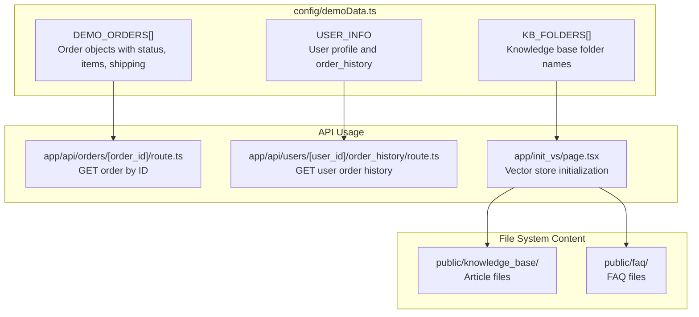
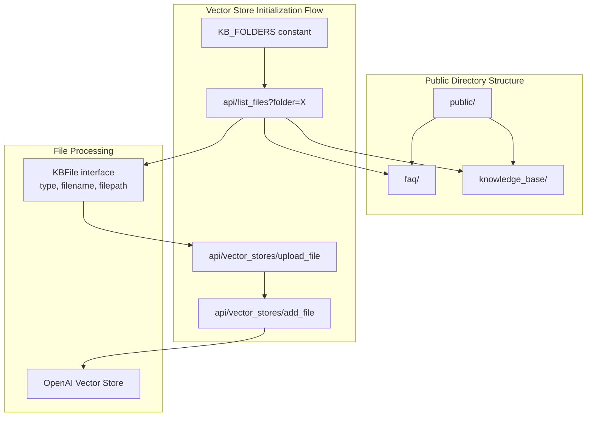

<!-- source: DeepWiki mcp.deepwiki.com · repo openai/openai-support-agent-demo · page 5.2 Demo Data and Content · fetched 2026-10-26 -->

# Demo Data and Content

<details>
<summary>Relevant source files</summary>

The following files were used as context for generating this wiki page:

- [app/api/orders/[order_id]/route.ts](app/api/orders/[order_id]/route.ts)
- [app/api/users/[user_id]/order_history/route.ts](app/api/users/[user_id]/order_history/route.ts)
- [app/init_vs/page.tsx](app/init_vs/page.tsx)

</details>


This document covers the demo data structures and knowledge base content that power the OpenAI Customer Support Agent Demo. It explains how to understand, customize, and extend the pre-built content for different use cases.

For information about configuration files and system constants, see [Configuration Files](#5.1). For details about the vector store initialization process, see [Vector Store Management](#2.1).

## Demo Data Overview

The system uses structured demo data to simulate a realistic customer service environment without requiring external databases or services. All demo data is centralized in the configuration layer and imported throughout the application.

### Demo Data Structure



**Sources:** [app/api/orders/[order_id]/route.ts:1](), [app/api/users/[user_id]/order_history/route.ts:1](), [app/init_vs/page.tsx:2]()

### Data Import Pattern

All demo data follows a consistent import pattern across the application:

| Data Structure | Import Source | Usage Context |
|----------------|---------------|---------------|
| `DEMO_ORDERS` | `@/config/demoData` | Order management APIs |
| `USER_INFO` | `@/config/demoData` | User management APIs |
| `KB_FOLDERS` | `@/config/demoData` | Vector store initialization |

**Sources:** [app/api/orders/[order_id]/route.ts:1](), [app/api/users/[user_id]/order_history/route.ts:1](), [app/init_vs/page.tsx:2]()

## Knowledge Base Content Structure

The knowledge base content is organized in a two-tier structure that supports both customer-facing documentation and internal knowledge articles.

### Knowledge Base File Organization



**Sources:** [app/init_vs/page.tsx:36-48](), [app/init_vs/page.tsx:100-106]()

### File Processing Workflow

The vector store initialization processes knowledge base files through a structured workflow:

1. **Folder Discovery**: The `KB_FOLDERS` array defines which directories to scan
2. **File Enumeration**: Each folder is queried via `/api/list_files?folder=${folder}`
3. **Metadata Generation**: Files are converted to `KBFile` objects with structured attributes
4. **Upload Process**: Files are uploaded to OpenAI's vector store via `/api/vector_stores/upload_file`
5. **Registration**: Files are registered with the vector store via `/api/vector_stores/add_file`

**Sources:** [app/init_vs/page.tsx:36-76]()

### KBFile Interface Structure

The system uses a standardized interface for processing knowledge base files:

```typescript
interface KBFile {
  type: string;      // Folder name (e.g., "knowledge_base", "faq")
  filename: string;  // File name without extension
  filepath: string;  // Full path for API access
}
```

**Sources:** [app/init_vs/page.tsx:6-10](), [app/init_vs/page.tsx:42-46]()

## Order and User Demo Data

The demo data includes realistic customer service scenarios with orders, user profiles, and interaction history.

### DEMO_ORDERS Structure

The `DEMO_ORDERS` array provides sample order data that supports various customer service scenarios:

- Order lookup by ID via `/api/orders/[order_id]`
- Order status tracking and updates
- Product information and pricing
- Shipping and fulfillment details

**Sources:** [app/api/orders/[order_id]/route.ts:9-14]()

### USER_INFO Structure

The `USER_INFO` object contains customer profile information and order history:

- User profile data for account management
- Order history for customer service context
- Historical interaction data

The order history is accessed via `/api/users/[user_id]/order_history` and returns `USER_INFO.order_history`.

**Sources:** [app/api/users/[user_id]/order_history/route.ts:10]()

## Content Customization Guidelines

### Modifying Knowledge Base Content

To customize the knowledge base content for your use case:

1. **Update File Content**: Modify files in `/public/knowledge_base/` and `/public/faq/` directories
2. **Maintain File Structure**: Keep the existing directory structure or update `KB_FOLDERS` accordingly
3. **Re-initialize Vector Store**: Use the `/init_vs` interface to reload content into the vector store
4. **Update Configuration**: Set the new vector store ID in `/config/constants.ts`

**Sources:** [app/init_vs/page.tsx:109-121]()

### Extending Demo Data

To customize the demo data for different scenarios:

1. **Modify config/demoData.ts**: Update `DEMO_ORDERS`, `USER_INFO`, and `KB_FOLDERS` as needed
2. **Maintain Data Structure**: Keep the existing object structures to ensure API compatibility
3. **Test API Endpoints**: Verify that modified data works with existing API endpoints
4. **Update Tool Functions**: Ensure tool functions can handle the new data structures

### Adding New Knowledge Base Folders

To add new knowledge base categories:

1. **Create Directory**: Add new directory under `/public/`
2. **Update KB_FOLDERS**: Add the new folder name to the `KB_FOLDERS` array
3. **Re-initialize**: Run vector store initialization to include new content
4. **Verify Access**: Test that new content appears in search results

**Sources:** [app/init_vs/page.tsx:110-112]()

### Vector Store Reinitializtion Process

When content changes, the vector store must be reinitialized:

1. Access the initialization interface at `/init_vs`
2. Click "Initialize vector store" to create a new vector store
3. The system will process all files in `KB_FOLDERS` directories
4. Copy the generated vector store ID
5. Update `VECTOR_STORE_ID` in `/config/constants.ts`

The initialization process provides real-time status updates during file processing and upload.

**Sources:** [app/init_vs/page.tsx:23-84](), [app/init_vs/page.tsx:115-121]()

---

