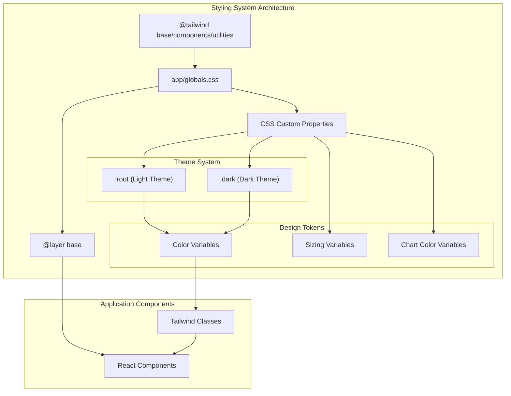
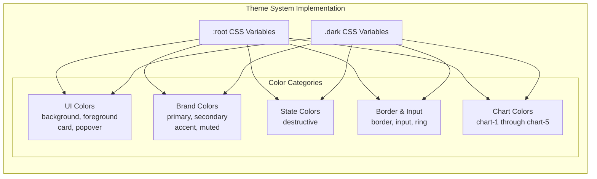
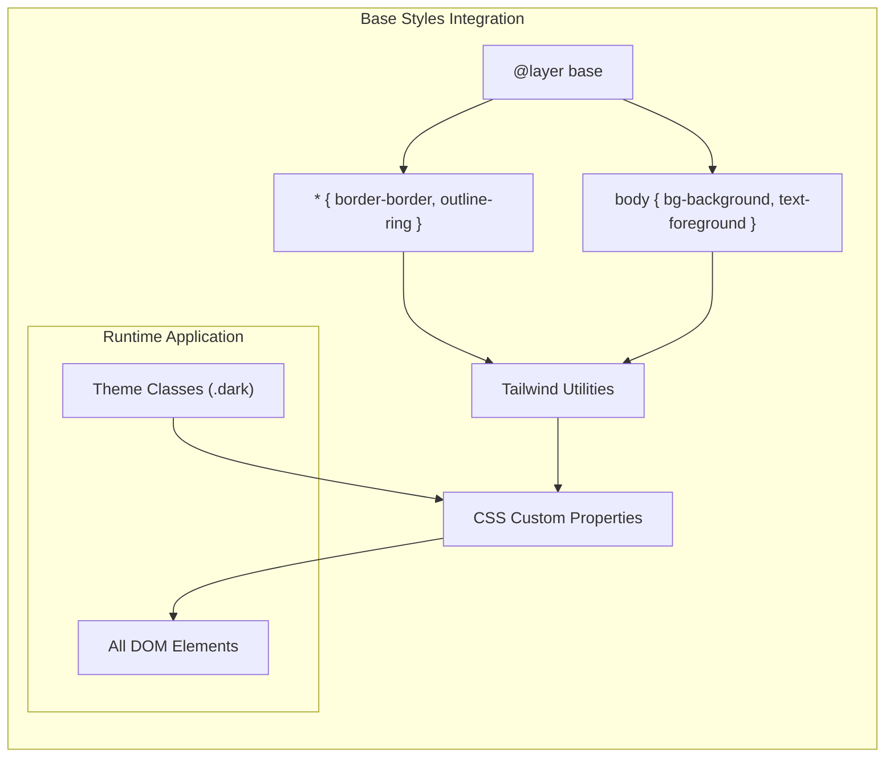

<!-- source: DeepWiki mcp.deepwiki.com · repo openai/openai-support-agent-demo · page 5.3 Styling and Assets · fetched 2026-10-26 -->

# Styling and Assets

<details>
<summary>Relevant source files</summary>

The following files were used as context for generating this wiki page:

- [app/fonts/GeistMonoVF.woff](app/fonts/GeistMonoVF.woff)
- [app/fonts/GeistVF.woff](app/fonts/GeistVF.woff)
- [app/globals.css](app/globals.css)

</details>


This document covers the visual styling system and static assets used throughout the OpenAI Customer Support Agent Demo. This includes the CSS architecture, theming system, typography, and color design tokens.

For information about UI components and interfaces, see [User Interfaces](#4). For configuration of demo content and data, see [Demo Data and Content](#5.2).

## Styling Architecture

The application uses a modern CSS architecture built on Tailwind CSS with CSS custom properties for theming. The styling system is centralized in a single global stylesheet that establishes design tokens and base styles.



**Tailwind CSS Integration**

The application imports Tailwind's three main layers in [app/globals.css:1-3]():

- `@tailwind base` - Normalizes default styles
- `@tailwind components` - Component-level utilities  
- `@tailwind utilities` - Utility classes for styling

**CSS Custom Properties System**

All design tokens are defined as CSS custom properties (CSS variables) within the `:root` selector for light theme and `.dark` class for dark theme [app/globals.css:6-105](). This approach enables:

- Consistent theming across all components
- Runtime theme switching capability
- Easy maintenance of design system values

Sources: [app/globals.css:1-116]()

## Theme System

The application implements a comprehensive dual-theme system supporting both light and dark modes through CSS custom properties.

### Light Theme Configuration

The default light theme is defined in the `:root` selector [app/globals.css:6-56]():

| Token | Value | Purpose |
|-------|--------|---------|
| `--background` | `0 0% 100%` | Primary background color |
| `--foreground` | `224 71.4% 4.1%` | Primary text color |
| `--primary` | `220.9 39.3% 11%` | Primary brand color |
| `--secondary` | `220 14.3% 95.9%` | Secondary backgrounds |
| `--muted` | `220 14.3% 95.9%` | Muted text/backgrounds |
| `--border` | `220 13% 91%` | Border colors |
| `--destructive` | `0 84.2% 60.2%` | Error/danger states |

### Dark Theme Configuration

The dark theme overrides are defined in the `.dark` class [app/globals.css:57-105]():



The dark theme inverts the color relationships while maintaining contrast ratios and accessibility standards.

Sources: [app/globals.css:6-105]()

## Typography

The application uses the Geist Mono variable font for monospace text elements, providing a modern, technical aesthetic appropriate for a developer-focused support tool.

### Font Assets

The primary font asset is located at [app/fonts/GeistMonoVF.woff](). The "VF" suffix indicates this is a variable font, allowing for multiple weights and styles within a single file.

**Font Characteristics:**
- **Format**: WOFF (Web Open Font Format)
- **Type**: Variable font with multiple axes
- **Purpose**: Monospace display for code, technical content
- **Loading**: Optimized for web delivery

### Typography Implementation

While the font file is available, the actual font-family declarations and usage would typically be configured in:
- Tailwind CSS configuration
- Component-level styling
- CSS font-face declarations

The monospace nature of Geist Mono makes it particularly suitable for:
- Code snippets and technical documentation
- Fixed-width layouts in the knowledge base
- Console-style interfaces in the agent tools

Sources: [app/fonts/GeistMonoVF.woff]()

## Design Tokens

The styling system defines comprehensive design tokens through CSS custom properties, organized into logical categories.

### Color System Architecture

```mermaid
graph TB
    subgraph "Color Token Categories"
        CoreColors["Core UI Colors"]
        BrandColors["Brand Colors"] 
        StateColors["State Colors"]
        DataVizColors["Data Visualization"]
    end
    
    subgraph "Core UI Colors"
        Background["--background"]
        Foreground["--foreground"]
        Card["--card / --card-foreground"]
        Popover["--popover / --popover-foreground"]
    end
    
    subgraph "Brand Colors"
        Primary["--primary / --primary-foreground"]
        Secondary["--secondary / --secondary-foreground"]
        Muted["--muted / --muted-foreground"]
        Accent["--accent / --accent-foreground"]
    end
    
    subgraph "State Colors"
        Destructive["--destructive / --destructive-foreground"]
    end
    
    subgraph "Form & Interface"
        Border["--border"]
        Input["--input"]
        Ring["--ring"]
    end
    
    subgraph "Chart Colors"
        Chart1["--chart-1: 12 76% 61%"]
        Chart2["--chart-2: 173 58% 39%"]
        Chart3["--chart-3: 197 37% 24%"]
        Chart4["--chart-4: 43 74% 66%"]
        Chart5["--chart-5: 27 87% 67%"]
    end
    
    CoreColors --> Background
    CoreColors --> Foreground
    CoreColors --> Card
    CoreColors --> Popover
    
    BrandColors --> Primary
    BrandColors --> Secondary
    BrandColors --> Muted
    BrandColors --> Accent
    
    StateColors --> Destructive
    
    DataVizColors --> Chart1
    DataVizColors --> Chart2
    DataVizColors --> Chart3
    DataVizColors --> Chart4
    DataVizColors --> Chart5
```



### Color Value Format

All color values are defined in HSL (Hue, Saturation, Lightness) format without the `hsl()` wrapper [app/globals.css:7-54](). This format enables:

- Easy manipulation of individual color components
- Consistent color relationships across themes
- Better integration with Tailwind CSS color system

### Sizing Tokens

The system defines a border radius token [app/globals.css:55]():
- `--radius: 0.5rem` - Standard border radius for UI elements

Sources: [app/globals.css:6-105]()

## Base Styles

The application establishes foundational styles through Tailwind's `@layer base` directive, ensuring consistent behavior across all elements.

### Global Element Styles

Base layer styles [app/globals.css:108-115]() apply:

```css
* {
  @apply border-border outline-ring/50;
}
body {
  @apply bg-background text-foreground;
}
```

**Universal Element Styling (`*` selector):**
- `border-border` - Applies consistent border color using CSS custom property
- `outline-ring/50` - Sets focus outline using ring color at 50% opacity

**Body Element Styling:**
- `bg-background` - Applies background color from theme variables
- `text-foreground` - Applies text color from theme variables

### Integration with Theme System

The base styles create seamless integration between Tailwind utilities and the CSS custom property system:



This architecture ensures that theme changes propagate automatically throughout the application without requiring component-level modifications.

Sources: [app/globals.css:108-115]()

---

