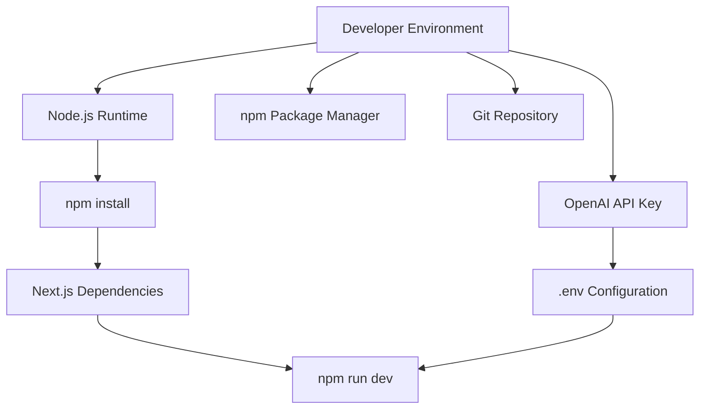
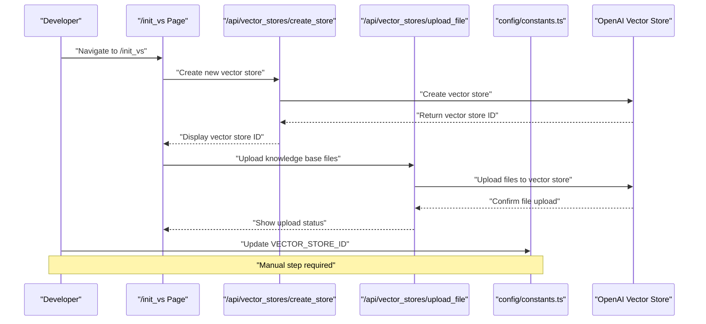
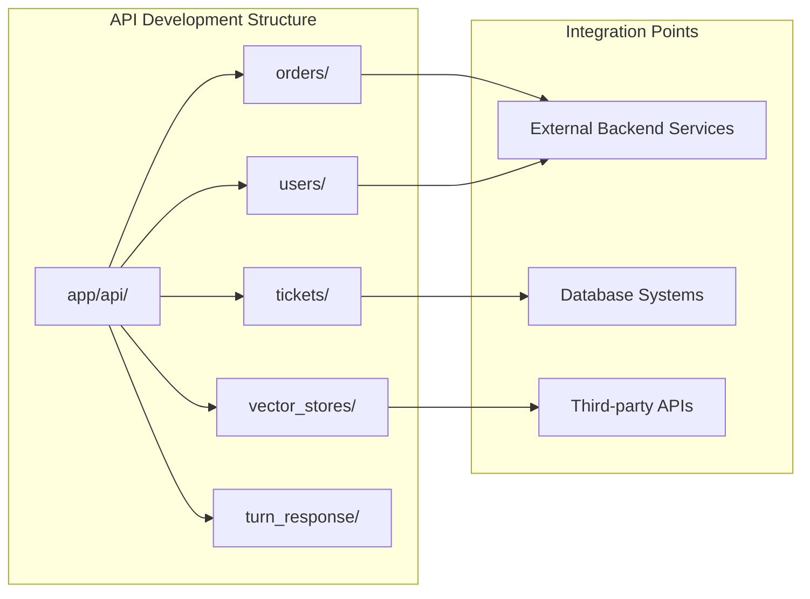

<!-- source: DeepWiki mcp.deepwiki.com · repo openai/openai-support-agent-demo · page 6 Development and Deployment · fetched 2026-10-26 -->

# Development and Deployment

<details>
<summary>Relevant source files</summary>

The following files were used as context for generating this wiki page:

- [.gitignore](.gitignore)
- [LICENSE](LICENSE)
- [README.md](README.md)

</details>


This document provides comprehensive information for developers working on or deploying the OpenAI Customer Support Agent Demo system. It covers environment setup, development workflow, build processes, and deployment considerations.

For information about configuring the system and customizing behavior, see [Configuration and Customization](#5). For details about the API endpoints and their implementation, see [API Reference](#3).

## Development Environment Setup

### Prerequisites and Dependencies

The system is built on Next.js and requires Node.js and npm for development. The primary external dependency is the OpenAI API for AI functionality.



**Development Environment Setup Process**

Sources: [README.md:29-66]()

### Environment Configuration

The system requires an `OPENAI_API_KEY` environment variable for API access. Two configuration approaches are supported:

| Configuration Method | Implementation | Location |
|---------------------|----------------|----------|
| Global System Variable | Set `OPENAI_API_KEY` in system environment | System-wide |
| Project-Specific Variable | Create `.env` file with `OPENAI_API_KEY=<key>` | Project root |

The `.env.example` file provides a template for local environment setup, while `.gitignore` ensures sensitive environment files are excluded from version control.

Sources: [README.md:40-49](), [.gitignore:33-35]()

### Initial Setup Commands

```bash
# 1. Clone repository
git clone https://github.com/openai/openai-support-agent-demo.git

# 2. Install dependencies
npm install

# 3. Start development server
npm run dev

# 4. Initialize vector store (browser)
# Navigate to http://localhost:3000/init_vs
```

The development server runs on `http://localhost:3000` by default.

Sources: [README.md:34-66]()

## Project Structure and Development Workflow

### Core Development Components

```mermaid
graph TB
    subgraph "Development Source Files"
        ConfigFiles["config/ Directory"]
        APIRoutes["app/api/ Routes"]
        UIPages["app/ Pages"]
        PublicAssets["public/ Assets"]
    end
    
    subgraph "Configuration Layer"
        Constants["config/constants.ts"]
        ToolsList["config/tools-list.ts"]
        Functions["config/functions.ts"]
        DemoData["config/demoData.ts"]
    end
    
    subgraph "API Implementation"
        TurnResponse["api/turn_response"]
        VectorStoreAPIs["api/vector_stores/*"]
        BusinessAPIs["api/orders, users, etc"]
    end
    
    subgraph "User Interface Layer"
        CustomerUI["app/page.tsx"]
        AgentUI["app/agent/page.tsx"]
        InitVS["app/init_vs/page.tsx"]
        KBUI["app/kb, faq pages"]
    end
    
    ConfigFiles --> Constants
    ConfigFiles --> ToolsList
    ConfigFiles --> Functions
    ConfigFiles --> DemoData
    
    APIRoutes --> TurnResponse
    APIRoutes --> VectorStoreAPIs
    APIRoutes --> BusinessAPIs
    
    UIPages --> CustomerUI
    UIPages --> AgentUI
    UIPages --> InitVS
    UIPages --> KBUI
```



**Development Architecture Components**

Sources: Based on system architecture analysis from diagrams

### Vector Store Initialization Workflow

A critical development step involves initializing the vector store with knowledge base content:



**Vector Store Development Setup Process**

After creating a vector store through the `/init_vs` interface, developers must manually update the `VECTOR_STORE_ID` constant in `config/constants.ts`.

Sources: [README.md:67-69]()

## Build Process and Dependencies

### Package Management

The system uses npm for dependency management with standard Next.js development and build processes. The `.gitignore` file excludes common development artifacts:

| Excluded Directory/File | Purpose |
|------------------------|---------|
| `node_modules/` | Package dependencies |
| `/.next/` | Next.js build cache |
| `/build/` | Production build output |
| `.env*` | Environment variables |
| `*.tsbuildinfo` | TypeScript build cache |

Sources: [.gitignore:1-42]()

### Development vs Production Considerations

The system is explicitly designed as a demo and is **not production-ready**. Key development considerations include:

- **Security**: No input guardrails implemented
- **Authentication**: No user authentication system
- **Data Persistence**: Functions use placeholder implementations
- **Error Handling**: Limited production-grade error handling

Sources: [README.md:105-121]()

## Configuration Management for Development

### Customization Points

Developers can modify system behavior through four primary configuration files:

| Configuration File | Purpose | Development Impact |
|-------------------|---------|-------------------|
| `config/constants.ts` | Model settings, prompts, vector store ID | Core system behavior |
| `config/tools-list.ts` | Available AI functions | Function calling capabilities |
| `config/functions.ts` | Function implementations | Business logic execution |
| `config/demoData.ts` | Sample data | Testing and demonstration |

Sources: [README.md:110-117]()

### API Endpoint Customization

The `/api` folder structure allows developers to customize backend integrations:



**API Development Integration Points**

Developers can replace demo implementations with production backend integrations by modifying the API route handlers.

Sources: [README.md:118-119]()

## Testing and Debugging

### Demo Flow Testing

The system provides specific test scenarios for development validation:

**Knowledge Base Testing Queries:**
- "What is the return policy?"
- "How do I return a product?"
- "How can I cancel an order?"

**Function Calling Testing Queries:**
- "Help me cancel order ORD1001" → Should suggest `cancel_order` action
- "Help me reset my password" → Should suggest `reset_password` action
- "Give me a list of my past orders" → Should execute `get_order_history`

**End-to-End Test Flow:**
1. Ask: "How can I cancel my order?"
2. Confirm suggested response
3. Ask: "Help me cancel order ORD1001"
4. Confirm suggested response
5. Confirm suggested action
6. Confirm final response

Sources: [README.md:71-103]()

### Development Limitations

Function executions are placeholder implementations that don't modify actual data. The `cancel_order` function, for example, doesn't change order status in any persistent storage.

Sources: [README.md:105-107]()

## Deployment Considerations

### Production Readiness Requirements

For production deployment, developers must implement additional safety measures:

- **Input Guardrails**: Validate and sanitize user inputs
- **User Authentication**: Implement proper user authentication system
- **Data Persistence**: Replace placeholder functions with real backend operations
- **Error Handling**: Add comprehensive error handling and logging
- **Security Headers**: Implement appropriate security headers and CORS policies
- **Rate Limiting**: Add API rate limiting and abuse prevention

Sources: [README.md:120-121]()

### Licensing Considerations

The project uses MIT License for the main codebase and includes SIL Open Font License for Geist fonts. Both licenses permit commercial use with attribution requirements.

Sources: [LICENSE:1-19](), [LICENSE:21-116]()

## Contributing and Development Guidelines

### Contribution Process

The project accepts issues and pull requests with the caveat that not all suggestions may be reviewed. Developers should follow standard GitHub workflow practices for contributions.

### Code Customization Guidelines

When extending the system, developers should:

1. **Maintain Configuration-Driven Architecture**: Use existing configuration files rather than hardcoding values
2. **Follow API Route Patterns**: Implement new endpoints following existing `/api` structure
3. **Preserve Function Registry Pattern**: Add new AI functions through `config/tools-list.ts` and `config/functions.ts`
4. **Maintain Demo Data Structure**: Keep `config/demoData.ts` structure for testing compatibility

Sources: [README.md:122-125](), [README.md:109-119]()