# Page: Overview

# Overview

<details>
<summary>Relevant source files</summary>

The following files were used as context for generating this wiki page:

- [.env.example](.env.example)
- [LICENSE](LICENSE)
- [README.md](README.md)

</details>


This document provides a comprehensive overview of the OpenAI Customer Support Agent Demo, a NextJS application that demonstrates human-in-the-loop AI customer service capabilities. The system combines OpenAI's Responses API with file search tools, vector stores, and function calling to create an assisted customer support experience where AI suggestions are reviewed and approved by human agents.

For detailed information about specific subsystems, see [Architecture Overview](#1.1) for system design details, [Core Systems](#2) for vector store and tool functions documentation, and [Configuration and Customization](#5) for deployment and customization guidance.

## System Purpose and Capabilities

The demo implements a dual-interface chat system where customers interact through one interface while human agents use a separate interface to review, edit, and approve AI-generated responses and actions. The system demonstrates several key capabilities:

| Feature | Description | Implementation |
|---------|-------------|----------------|
| Multi-turn conversations | Persistent chat history across interactions | Stored in component state and passed to `/api/turn_response` |
| File search integration | AI retrieval from knowledge base documents | OpenAI vector store with `file_search` tool |
| Function calling | AI-suggested customer service actions | Registry in `config/functions.ts` with approval workflow |
| Streaming responses | Real-time AI response generation | Server-sent events from OpenAI Responses API |
| Human oversight | Agent approval required for all responses | Separate `/agent` interface with edit capabilities |

**Sources:** [README.md:1-129](), [.env.example:1]()

## High-Level System Architecture

The system follows a modular architecture with clear separation between AI processing, business logic, and user interfaces:

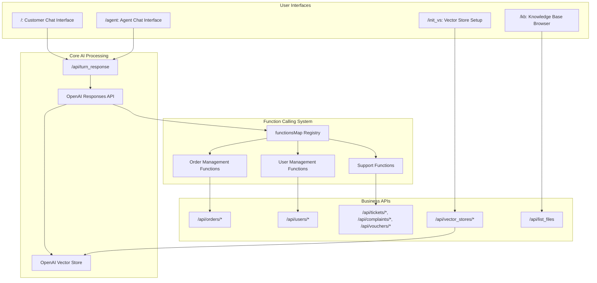

**Sources:** [README.md:7-24]()

## Core System Components

### AI Response Processing Pipeline

The central processing occurs through the `/api/turn_response` endpoint, which orchestrates interactions between the OpenAI API, vector search, and function calling:

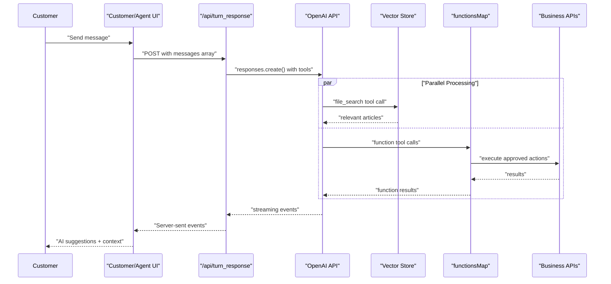

**Sources:** [README.md:7-8](), [README.md:16-23]()

### Tool Functions Registry

The system implements a centralized function registry that maps OpenAI function calls to business logic:

| Function Category | Functions | API Endpoints |
|------------------|-----------|---------------|
| Order Management | `get_order`, `cancel_order`, `create_refund`, `send_replacement`, `create_return` | `/api/orders/*` |
| User Management | `get_order_history`, `reset_password`, `update_info` | `/api/users/*` |
| Support Services | `issue_voucher`, `create_complaint`, `create_ticket` | `/api/vouchers/*`, `/api/complaints/*`, `/api/tickets/*` |

The registry is defined in `config/functions.ts` and mapped through `config/tools-list.ts` to enable OpenAI function calling.

**Sources:** [README.md:20](), [README.md:114-116]()

### Vector Store and Knowledge Management

The system uses OpenAI vector stores to enable file search capabilities:

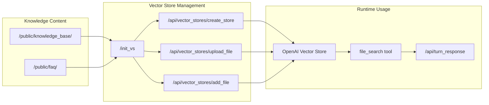

**Sources:** [README.md:17-18](), [README.md:67-69]()

## Demonstration Workflow

The system includes predefined demo scenarios that showcase its capabilities:

### Example Customer Service Flow

1. **Information Request**: Customer asks "What is the return policy?"
   - Triggers `file_search` against vector store
   - Returns relevant policy documents
   - Agent reviews and approves response

2. **Action Request**: Customer asks "Help me cancel order ORD1001"
   - Triggers `cancel_order` function suggestion
   - Agent approves action execution
   - System calls `/api/orders/cancel` endpoint
   - Confirmation response generated

3. **Data Retrieval**: Customer asks "Give me my past orders"
   - Automatically executes `get_order_history` (non-sensitive)
   - Calls `/api/users/order_history` endpoint
   - Returns formatted order list

**Sources:** [README.md:73-103]()

## Technology Stack and Configuration

The system is built on a modern web stack with extensive configuration options:

| Component | Technology | Configuration File |
|-----------|------------|-------------------|
| Frontend Framework | NextJS | Standard NextJS configuration |
| AI Integration | OpenAI Responses API | `config/constants.ts` |
| Function Definitions | Custom registry | `config/tools-list.ts`, `config/functions.ts` |
| Demo Data | Static JSON objects | `config/demoData.ts` |
| Knowledge Base | File system + Vector Store | `/public/knowledge_base/`, `/public/faq/` |

Key configuration points include:
- `MODEL`: OpenAI model selection in `config/constants.ts`
- `VECTOR_STORE_ID`: Vector store identifier for file search
- `KB_FOLDERS`: Knowledge base folder structure definition

**Sources:** [README.md:113-117](), [.env.example:1]()

## Limitations and Production Considerations

The demo system includes several important limitations:

- **Simulated Actions**: Function calls like `cancel_order` do not modify actual data
- **No Authentication**: No user authentication or session management
- **Mock Data**: Uses static demo data instead of real customer information  
- **No Input Validation**: Lacks production-grade input sanitization and guardrails

For production deployment, the system requires implementation of authentication, data persistence, input validation, and integration with real customer service backends.

**Sources:** [README.md:105-121]()

---

# Page: Architecture Overview

# Architecture Overview

<details>
<summary>Relevant source files</summary>

The following files were used as context for generating this wiki page:

- [README.md](README.md)
- [app/init_vs/page.tsx](app/init_vs/page.tsx)
- [config/functions.ts](config/functions.ts)

</details>


This document provides a comprehensive overview of the OpenAI Customer Support Agent Demo system architecture, explaining how the vector store management, tool functions registry, API layer, and user interfaces work together to create a human-in-the-loop AI customer service system.

For detailed setup instructions and environment configuration, see [Getting Started](#1.2). For in-depth documentation of individual systems, see [Core Systems](#2). For API endpoint specifications, see [API Reference](#3).

## System Overview

The OpenAI Customer Support Agent Demo is built as a Next.js application with a modular architecture centered around two primary systems: a vector store for knowledge retrieval and a tool functions registry for action execution. The system enables AI-powered customer service with human oversight through dual interfaces and streaming real-time updates.

## High-Level Component Architecture

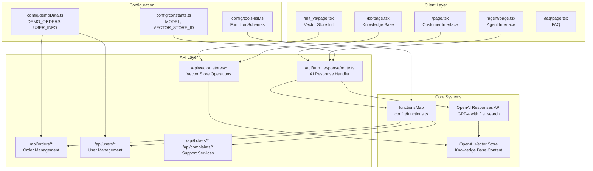

**Sources:** [app/init_vs/page.tsx:1-157](), [config/functions.ts:1-240](), [README.md:1-129]()

## AI Response Processing Flow

The core AI processing system handles streaming responses from OpenAI's GPT-4 model with integrated file search and tool calling capabilities. The system maintains human oversight through suggested responses and actions.

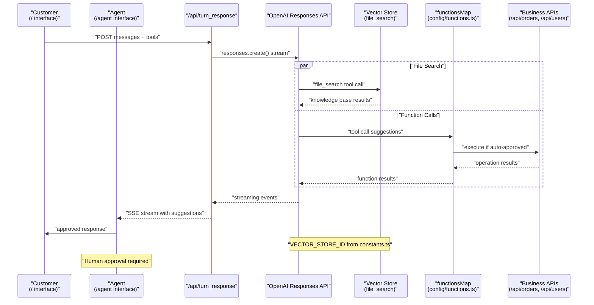

**Sources:** [config/functions.ts:226-239](), [README.md:7-11](), [README.md:16-24]()

## Tool Functions Registry System

The tool functions system provides a clean abstraction layer between OpenAI's function calling and the business API layer. Each function in `functionsMap` corresponds to a customer service operation.

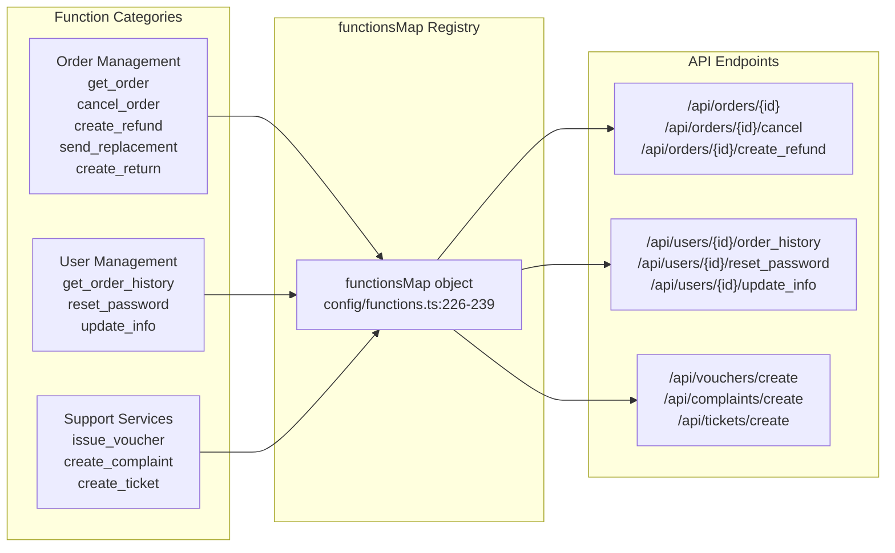

**Sources:** [config/functions.ts:5-224](), [config/functions.ts:226-239]()

## Vector Store Management Architecture

The vector store system handles knowledge base content initialization, file upload, and retrieval operations through OpenAI's Vector Store API.

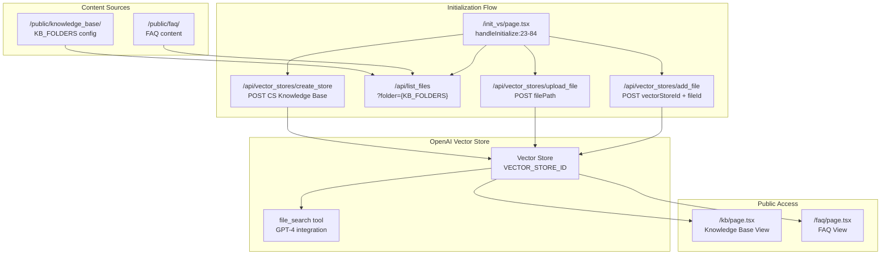

**Sources:** [app/init_vs/page.tsx:23-84](), [app/init_vs/page.tsx:36-48](), [app/init_vs/page.tsx:50-76]()

## Configuration System Architecture

The system uses a centralized configuration approach with separate files for different concerns, enabling easy customization without code changes.

| Configuration File | Purpose | Key Exports |
|-------------------|---------|-------------|
| `config/constants.ts` | Core system settings | `MODEL`, `VECTOR_STORE_ID`, system prompts |
| `config/tools-list.ts` | Function schemas | OpenAI tool definitions for function calling |
| `config/functions.ts` | Function implementations | `functionsMap`, individual function handlers |
| `config/demoData.ts` | Demo data | `DEMO_ORDERS`, `USER_INFO`, `KB_FOLDERS` |

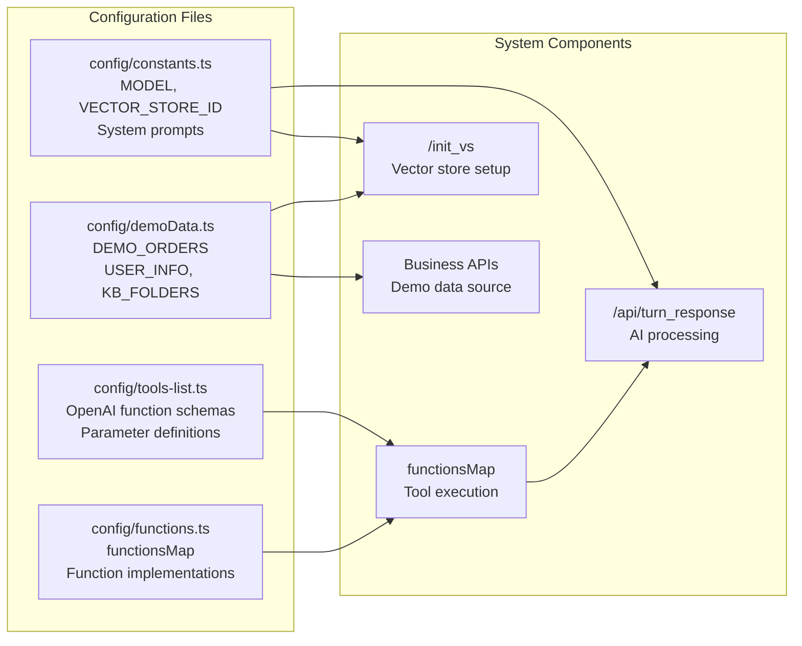

**Sources:** [config/functions.ts:1-4](), [README.md:113-117](), [app/init_vs/page.tsx:2]()

## Data Flow and Integration Points

The system architecture enables a complete customer service workflow through three primary integration points:

1. **OpenAI Integration**: The `/api/turn_response` endpoint manages streaming responses from OpenAI's GPT-4 model with file search and function calling capabilities
2. **Vector Store Integration**: Knowledge base content from `/public/knowledge_base` and `/public/faq` folders is processed through the vector store initialization system
3. **Business Logic Integration**: The `functionsMap` registry connects AI function calls to business operations through dedicated API endpoints

The human-in-the-loop design ensures that while AI provides intelligent suggestions and context, human agents maintain control over sensitive operations and final customer communications.

**Sources:** [README.md:7-11](), [README.md:96-108](), [config/functions.ts:226-239]()

---

# Page: Getting Started

# Getting Started

<details>
<summary>Relevant source files</summary>

The following files were used as context for generating this wiki page:

- [.env.example](.env.example)
- [README.md](README.md)
- [app/init_vs/page.tsx](app/init_vs/page.tsx)

</details>


This page covers the essential setup steps required to run the OpenAI Customer Support Agent Demo locally. It includes environment configuration, dependency installation, and the critical vector store initialization process that enables the AI system's knowledge base functionality.

For detailed information about the system architecture and component relationships, see [Architecture Overview](#1.1). For configuration and customization options, see [Configuration Files](#5.1).

## Prerequisites

Before setting up the demo, ensure you have the following requirements:

| Requirement | Purpose |
|-------------|---------|
| Node.js and npm | NextJS application runtime and package management |
| OpenAI API Account | Required for AI responses and vector store operations |
| Git | Repository cloning |

The system requires an active OpenAI API key with access to the Responses API and vector store functionality.

**Sources:** [README.md:29-33]()

## Environment Setup

### OpenAI API Key Configuration

The application requires an `OPENAI_API_KEY` environment variable. Configure this using one of two methods:

**Method 1: Global Environment Variable**
Set the API key globally in your system environment.

**Method 2: Local Project Configuration**
Create a `.env` file in the project root directory:

```
OPENAI_API_KEY=<your_api_key>
```

The `.env.example` file provides a template for local configuration.

**Sources:** [README.md:40-49](), [.env.example:1]()

## Installation and Running

### Setup Flow

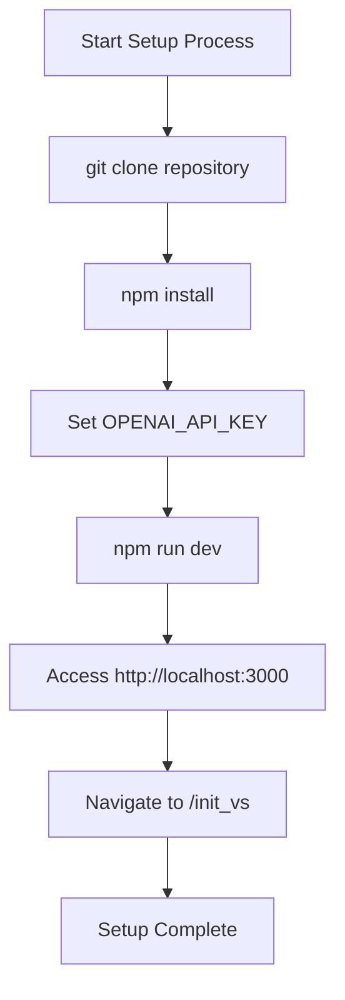

**Install Dependencies**

```bash
npm install
```

This installs all required NextJS dependencies and OpenAI SDK components.

**Start Development Server**

```bash
npm run dev
```

The application will be available at `http://localhost:3000` with the following routes:

| Route | Component | Purpose |
|-------|-----------|---------|
| `/` | Customer Interface | Customer chat interface |
| `/agent` | Agent Interface | Human agent interface |
| `/init_vs` | Vector Store Init | Admin vector store setup |
| `/kb` | Knowledge Base | Public knowledge articles |
| `/faq` | FAQ | Frequently asked questions |

**Sources:** [README.md:51-65]()

## Vector Store Initialization

The vector store initialization is critical for the File Search tool functionality. This process uploads knowledge base content to OpenAI's vector store service.

### Initialization Process Flow

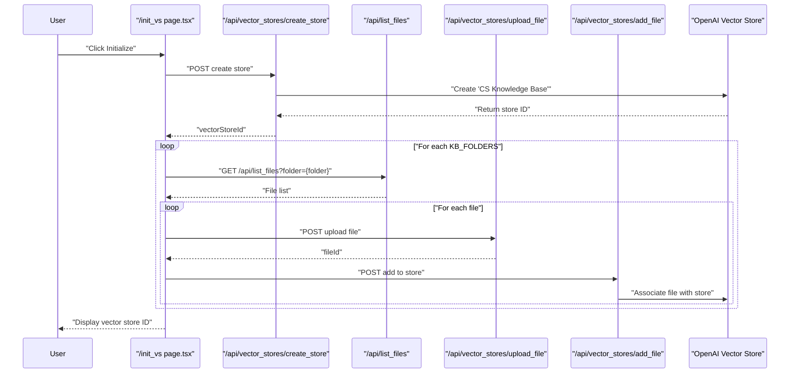

### Knowledge Base Content Structure

The initialization process loads content from these default directories:

- `/public/knowledge_base/` - Main knowledge articles
- `/public/faq/` - Frequently asked questions

The `KB_FOLDERS` constant in `demoData.ts` defines which folders are processed during initialization.

### Vector Store Setup Steps

1. **Navigate to Initialization Page**
   
   Access `http://localhost:3000/init_vs` to open the `InitVS` component.

2. **Execute Initialization**

   The `handleInitialize` function performs these operations:
   - Creates a new vector store named "CS Knowledge Base"
   - Fetches file lists from configured folders using `KB_FOLDERS`
   - Uploads each file via `/api/vector_stores/upload_file`
   - Associates files with the vector store via `/api/vector_stores/add_file`

3. **Retrieve Vector Store ID**

   Upon successful completion, the system displays the new vector store ID. Copy this ID for configuration.

4. **Update Configuration**

   Add the vector store ID to `config/constants.ts`:
   ```typescript
   export const VECTOR_STORE_ID = "vs_your_new_id_here";
   ```

**Sources:** [app/init_vs/page.tsx:23-84](), [README.md:67-69]()

## Verification and Next Steps

### Testing the Setup

After completing initialization, verify the system works by testing these example queries:

| Query Type | Example Question | Expected Behavior |
|------------|-----------------|-------------------|
| Knowledge Base Search | "What is the return policy?" | Triggers file search, returns policy information |
| Order Management | "Help me cancel order ORD1001" | Suggests `cancel_order` function call |
| User Management | "Help me reset my password" | Suggests `reset_password` function call |
| Order History | "Give me a list of my past orders" | Auto-executes `get_order_history` function |

### Interface Access

- **Customer Interface**: `http://localhost:3000/` - For customer interactions
- **Agent Interface**: `http://localhost:3000/agent` - For human agent oversight
- **Knowledge Base**: `http://localhost:3000/kb` - View uploaded articles
- **FAQ**: `http://localhost:3000/faq` - View FAQ content

The demo implements a human-in-the-loop workflow where the agent interface shows AI-generated suggestions that human agents can approve, edit, or reject before sending to customers.

**Sources:** [README.md:73-104]()

---

# Page: Core Systems

# Core Systems

<details>
<summary>Relevant source files</summary>

The following files were used as context for generating this wiki page:

- [app/init_vs/page.tsx](app/init_vs/page.tsx)
- [config/functions.ts](config/functions.ts)

</details>


This document covers the two most critical systems that enable the OpenAI Support Agent Demo: the Vector Store Management System and the Tool Functions System. These systems work together to provide the AI agent with both knowledge retrieval capabilities and action execution powers under human supervision.

For information about the specific API endpoints these systems use, see [API Reference](#3). For details about the user interfaces that interact with these systems, see [User Interfaces](#4).

## Vector Store Management System

The Vector Store Management System handles initialization, file upload, and management of knowledge base content that the AI agent uses for contextual responses. The system processes content from the `/public/knowledge_base/` and `/public/faq/` directories and uploads it to OpenAI's vector store service.

### Initialization Process

The vector store initialization is handled by the `InitVS` component in [app/init_vs/page.tsx:12-157](). The initialization follows a sequential workflow:

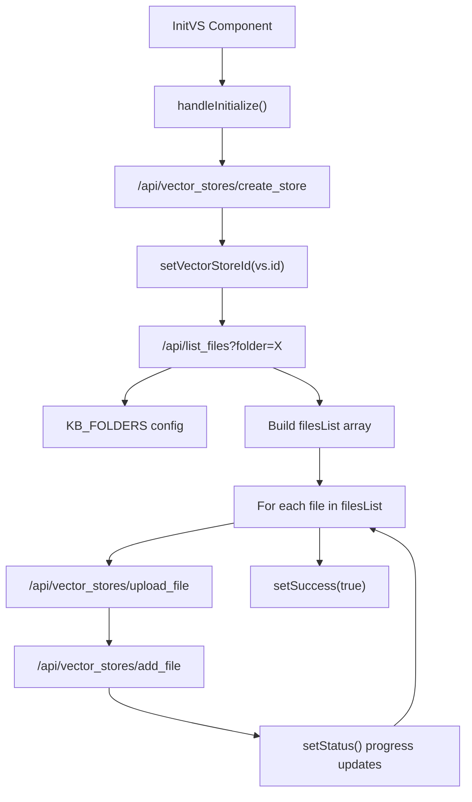

**Sources:** [app/init_vs/page.tsx:23-84]()

### File Processing Workflow

The system processes knowledge base files through a structured approach:

| Step | API Endpoint | Purpose | Data Structure |
|------|-------------|---------|----------------|
| 1 | `/api/vector_stores/create_store` | Create new vector store | `{ name: "CS Knowledge Base" }` |
| 2 | `/api/list_files?folder=${folder}` | List files in KB folders | Array of filenames |
| 3 | `/api/vector_stores/upload_file` | Upload file to OpenAI | `{ filePath: file.filepath }` |
| 4 | `/api/vector_stores/add_file` | Associate file with store | `{ vectorStoreId, fileId, attributes }` |

The `KBFile` interface defines the structure for processed files:

```typescript
interface KBFile {
  type: string;
  filename: string;
  filepath: string;
}
```

**Sources:** [app/init_vs/page.tsx:6-10](), [app/init_vs/page.tsx:35-77]()

### File Attributes and Metadata

Each uploaded file includes metadata attributes that enable categorization and retrieval:

- `type`: Folder category (from `KB_FOLDERS` config)
- `filename`: Base filename without extension 
- `filepath`: Full path to the file in `/public/` directory

The system processes files from folders defined in the `KB_FOLDERS` configuration and builds file objects with these attributes for the vector store association.

**Sources:** [app/init_vs/page.tsx:59-66]()

## Tool Functions System

The Tool Functions System provides the AI agent with executable customer service capabilities through a centralized registry pattern. The system maps OpenAI function calls to TypeScript functions that interact with the business API layer.

### Functions Registry Architecture

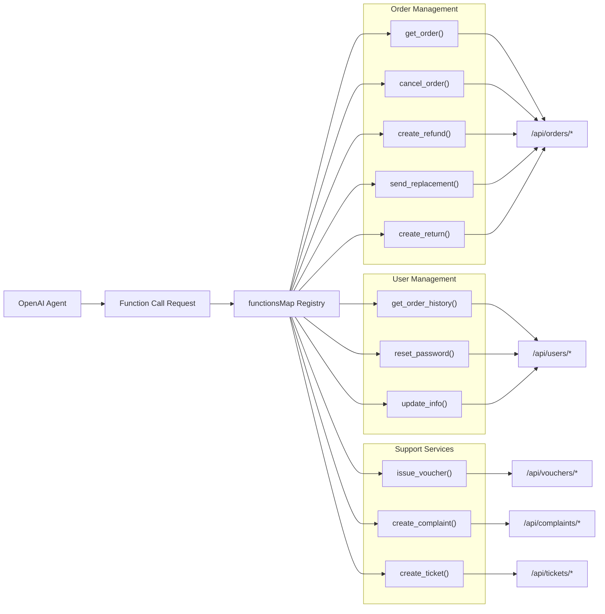

**Sources:** [config/functions.ts:226-239]()

### Function Implementation Pattern

All tool functions follow a consistent async/await pattern with error handling:

```typescript
export const function_name = async ({ param1, param2 }: { param1: type; param2: type }) => {
  try {
    const res = await fetch(`/api/endpoint`, {
      method: "POST",
      headers: { "Content-Type": "application/json" },
      body: JSON.stringify({ param1, param2 })
    }).then((res) => res.json());
    return res;
  } catch (error) {
    console.error(error);
    return { error: "Failed to perform action" };
  }
};
```

Each function is then registered in the `functionsMap` object, which serves as the central registry for all available tool functions.

**Sources:** [config/functions.ts:5-15](), [config/functions.ts:226-239]()

### Order Management Functions

The order management functions provide comprehensive order lifecycle operations:

| Function | Parameters | API Endpoint | Purpose |
|----------|------------|--------------|---------|
| `get_order` | `order_id: string` | `/api/orders/${order_id}` | Retrieve order details |
| `cancel_order` | `order_id: string` | `/api/orders/${order_id}/cancel` | Cancel existing order |
| `create_refund` | `order_id, amount, reason` | `/api/orders/${order_id}/create_refund` | Process refund |
| `send_replacement` | `product_id, order_id` | `/api/orders/${order_id}/send_replacement` | Send replacement item |
| `create_return` | `order_id, product_ids[]` | `/api/orders/${order_id}/create_return` | Initialize return process |

**Sources:** [config/functions.ts:5-15](), [config/functions.ts:29-42](), [config/functions.ts:82-104](), [config/functions.ts:60-80](), [config/functions.ts:130-150]()

### User Management Functions

User management functions handle account-related operations:

| Function | Parameters | API Endpoint | Purpose |
|----------|------------|--------------|---------|
| `get_order_history` | `user_id: string` | `/api/users/${user_id}/order_history` | Retrieve user's order history |
| `reset_password` | `user_id: string` | `/api/users/${user_id}/reset_password` | Reset user password |
| `update_info` | `user_id, info: {field, value}` | `/api/users/${user_id}/update_info` | Update user information |

**Sources:** [config/functions.ts:17-27](), [config/functions.ts:44-58](), [config/functions.ts:204-224]()

### Support Services Functions

Support functions create tickets, complaints, and issue vouchers:

| Function | Parameters | API Endpoint | Purpose |
|----------|------------|--------------|---------|
| `issue_voucher` | `user_id, amount, reason` | `/api/vouchers/create` | Issue customer voucher |
| `create_complaint` | `user_id, type, details, order_id` | `/api/complaints/create` | File customer complaint |
| `create_ticket` | `user_id, type, details, order_id` | `/api/tickets/create` | Create support ticket |

**Sources:** [config/functions.ts:106-128](), [config/functions.ts:152-176](), [config/functions.ts:178-202]()

## System Integration

The Vector Store and Tool Functions systems integrate through the main AI response pipeline. The vector store provides contextual knowledge while the tool functions enable actions. This integration occurs in the `/api/turn_response` endpoint where:

1. Vector store content is retrieved via file search
2. Tool functions are made available to the AI agent
3. The AI combines knowledge and actions to provide comprehensive responses

Both systems are essential for the human-in-the-loop workflow, where the AI agent suggests responses and actions based on vector store knowledge, and human agents approve or modify these suggestions before execution.

**Sources:** [config/functions.ts:1-4](), [app/init_vs/page.tsx:92-121]()

---

# Page: Vector Store Management

# Vector Store Management

<details>
<summary>Relevant source files</summary>

The following files were used as context for generating this wiki page:

- [app/api/list_files/route.ts](app/api/list_files/route.ts)
- [app/api/vector_stores/add_file/route.ts](app/api/vector_stores/add_file/route.ts)
- [app/api/vector_stores/create_store/route.ts](app/api/vector_stores/create_store/route.ts)
- [app/api/vector_stores/upload_file/route.ts](app/api/vector_stores/upload_file/route.ts)
- [app/init_vs/page.tsx](app/init_vs/page.tsx)

</details>


## Purpose and Scope

The Vector Store Management system handles the initialization, population, and management of OpenAI vector stores for knowledge retrieval in the customer support agent. This system processes knowledge base content from the file system, uploads it to OpenAI's vector store service, and maintains metadata for efficient retrieval during AI-powered customer interactions.

For the complete API reference of vector store endpoints, see [Vector Store APIs](#3.4). For file management operations beyond vector stores, see [File Management APIs](#3.5). For UI documentation of the initialization interface, see [Vector Store Initialization Interface](#4.3). For understanding the knowledge base content structure, see [Demo Data and Content](#5.2).

## System Architecture

The vector store management system consists of four main components: file discovery, vector store creation, file upload, and metadata management.

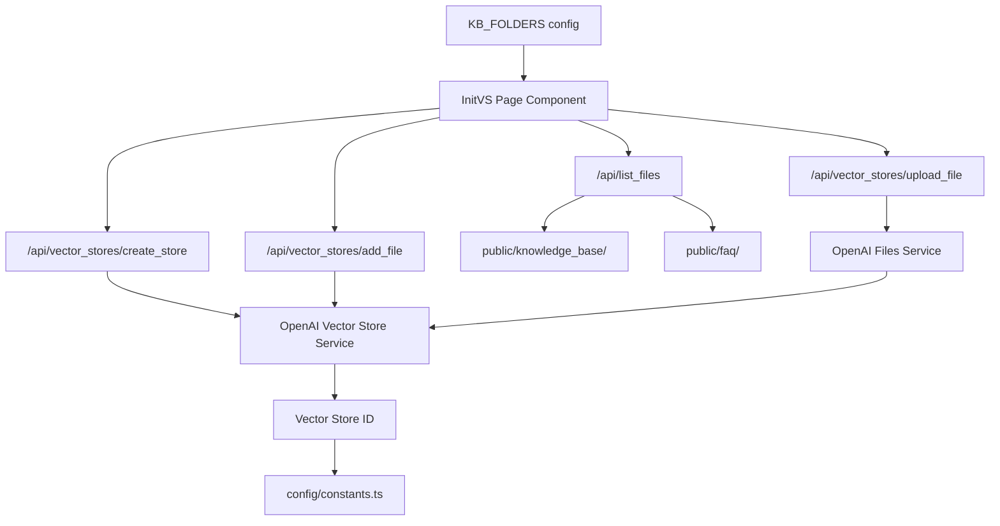

Sources: [app/init_vs/page.tsx:1-157](), [app/api/list_files/route.ts:1-16](), [app/api/vector_stores/create_store/route.ts:1-17](), [app/api/vector_stores/upload_file/route.ts:1-21](), [app/api/vector_stores/add_file/route.ts:1-20]()

## Vector Store Initialization Process

The initialization process follows a sequential workflow managed by the `InitVS` component, which orchestrates multiple API calls to build a complete vector store from local knowledge base files.

### Initialization Workflow

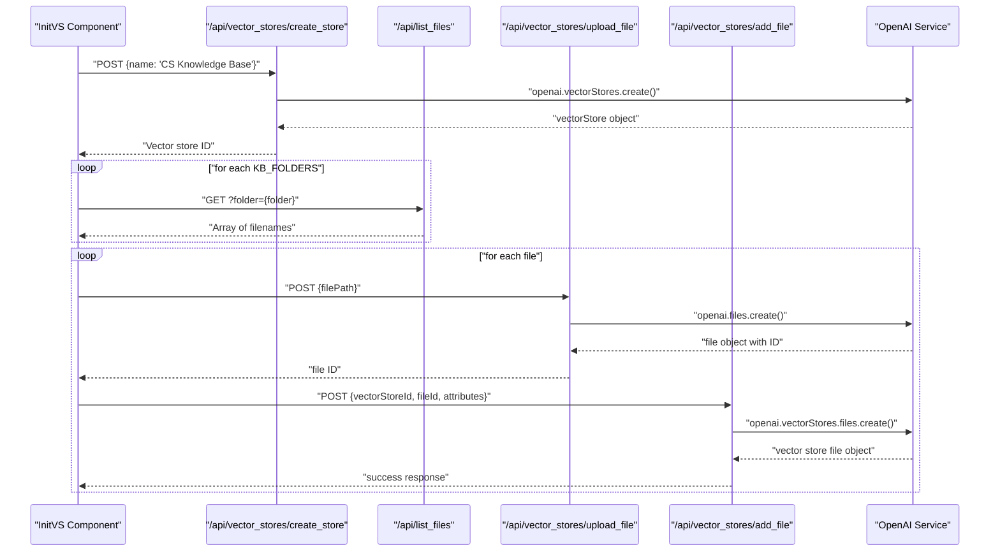

Sources: [app/init_vs/page.tsx:23-84]()

### State Management

The `InitVS` component manages initialization state through several React state variables:

| State Variable | Type | Purpose |
|----------------|------|---------|
| `loading` | `boolean` | Controls UI loading state and button availability |
| `vectorStoreId` | `string \| null` | Stores the created vector store ID for display |
| `status` | `string` | Provides real-time progress updates to user |
| `error` | `string \| null` | Captures and displays error messages |
| `success` | `boolean` | Indicates successful completion |

Sources: [app/init_vs/page.tsx:13-17]()

## File Discovery and Processing

The system discovers knowledge base content by scanning configured directories and processing files with metadata attributes.

### File Discovery Process

The `handleInitialize` function iterates through folders defined in `KB_FOLDERS` configuration to build a comprehensive file list:

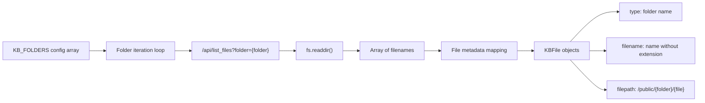

Sources: [app/init_vs/page.tsx:36-48](), [app/api/list_files/route.ts:4-16]()

### File Metadata Structure

Each discovered file is mapped to a `KBFile` interface with standardized metadata:

```typescript
interface KBFile {
  type: string;      // Source folder name (e.g., "knowledge_base", "faq")
  filename: string;  // Filename without extension
  filepath: string;  // Full path for file access
}
```

Sources: [app/init_vs/page.tsx:6-10]()

## API Endpoints

The vector store management system exposes four specialized API endpoints that handle different aspects of the initialization process.

### Vector Store Creation

**Endpoint**: `/api/vector_stores/create_store`

Creates a new OpenAI vector store with the specified name.

| Parameter | Type | Description |
|-----------|------|-------------|
| `name` | `string` | Display name for the vector store |

**Response**: OpenAI vector store object with `id` field

Sources: [app/api/vector_stores/create_store/route.ts:5-17]()

### File Upload

**Endpoint**: `/api/vector_stores/upload_file` 

Uploads a local file to OpenAI's file service for vector store usage.

| Parameter | Type | Description |
|-----------|------|-------------|
| `filePath` | `string` | Relative path from project root |

**Process**: Creates `fs.ReadStream` from local file and uploads with `purpose: "assistants"`

Sources: [app/api/vector_stores/upload_file/route.ts:5-21]()

### File Association

**Endpoint**: `/api/vector_stores/add_file`

Associates an uploaded file with a vector store and attaches metadata attributes.

| Parameter | Type | Description |
|-----------|------|-------------|
| `vectorStoreId` | `string` | Target vector store ID |
| `fileId` | `string` | OpenAI file ID from upload |
| `attributes` | `object` | Metadata for file organization |

Sources: [app/api/vector_stores/add_file/route.ts:5-20]()

### File Listing

**Endpoint**: `/api/list_files`

Lists files within a specified public directory folder.

| Parameter | Type | Description |
|-----------|------|-------------|
| `folder` | `string` | Directory name under `/public/` |

**Implementation**: Uses Node.js `fs.readdir()` to scan filesystem

Sources: [app/api/list_files/route.ts:4-16]()

## Error Handling and Status Updates

The system provides comprehensive error handling and real-time status updates throughout the initialization process.

### Error Management

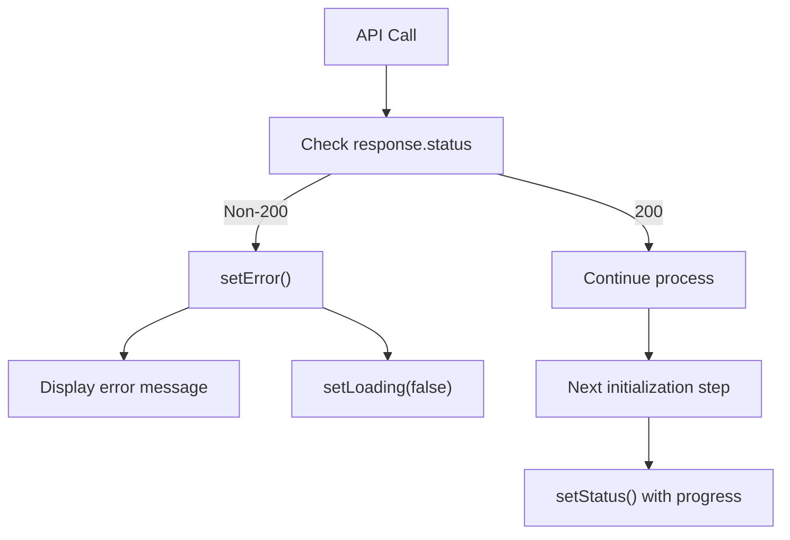

Sources: [app/init_vs/page.tsx:31-83]()

### Status Progression

The initialization process provides granular status updates:

1. **"Creating vector store..."** - Initial vector store creation
2. **"Fetching files..."** - Directory scanning phase  
3. **"Uploading {count} files to vector store..."** - Batch upload start
4. **"Uploaded {type}/{filename}"** - Individual file completion
5. **"Uploaded all files to vector store."** - Process completion

Sources: [app/init_vs/page.tsx:26-77]()

## Configuration Integration

The vector store management system integrates with the broader application configuration through specific constants and data structures.

### Required Configuration

| Configuration | Location | Purpose |
|---------------|----------|---------|
| `KB_FOLDERS` | `config/demoData.ts` | Defines source directories for content |
| `VECTOR_STORE_ID` | `config/constants.ts` | Stores active vector store ID |
| OpenAI API Key | Environment variables | Authenticates API requests |

The completed vector store ID must be manually copied from the initialization interface to `config/constants.ts` to enable AI agent file search functionality.

Sources: [app/init_vs/page.tsx:2](), [app/init_vs/page.tsx:116-121]()

---

# Page: Tool Functions System

# Tool Functions System

<details>
<summary>Relevant source files</summary>

The following files were used as context for generating this wiki page:

- [app/api/turn_response/route.ts](app/api/turn_response/route.ts)
- [config/functions.ts](config/functions.ts)

</details>


## Purpose and Scope

The Tool Functions System provides the mechanism for OpenAI agents to execute business actions within the customer support demo. This system translates AI-generated function calls into concrete API operations like canceling orders, issuing refunds, or creating support tickets.

This document covers the function implementation layer and registry system. For information about the underlying API endpoints that these functions call, see [API Reference](#3). For details about how these functions integrate with the AI response system, see [AI Response APIs](#3.6).

## System Architecture

The Tool Functions System acts as an abstraction layer between OpenAI's function calling capabilities and the application's business logic APIs. When the AI agent determines that an action should be taken, it generates a function call which is resolved through this system.

### Function Call Flow

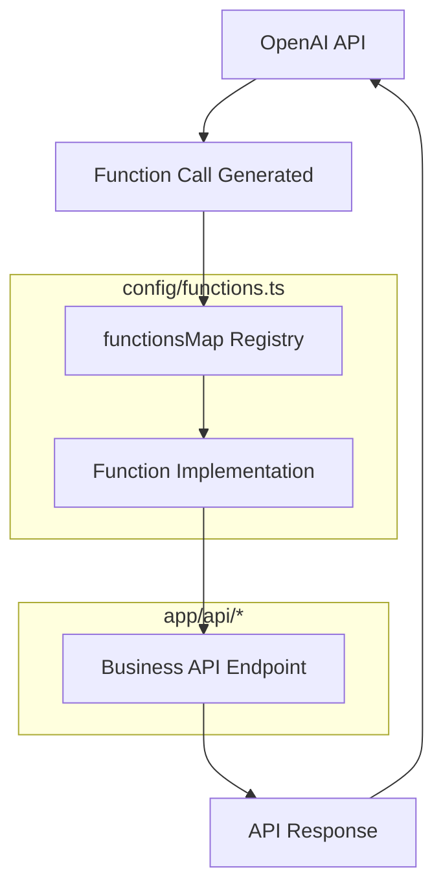

*Sources: [config/functions.ts:226-239](), [app/api/turn_response/route.ts:12-19]()*

### Function Registry Architecture

The system uses a centralized registry pattern where all available functions are mapped in the `functionsMap` object. This provides a clean interface for the AI system to discover and execute available actions.

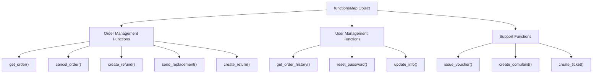

*Sources: [config/functions.ts:226-239]()*

## Function Categories

The system organizes functions into three main categories based on their business purpose:

| Category | Functions | Purpose |
|----------|-----------|---------|
| Order Management | `get_order`, `cancel_order`, `create_refund`, `send_replacement`, `create_return` | Handle order-related operations |
| User Management | `get_order_history`, `reset_password`, `update_info` | Manage user account operations |
| Support Services | `issue_voucher`, `create_complaint`, `create_ticket` | Create support records and compensations |

### Order Management Functions

These functions handle the core e-commerce operations:

- **`get_order`** - Retrieves order details by order ID
- **`cancel_order`** - Cancels an existing order
- **`create_refund`** - Processes refunds with amount and reason
- **`send_replacement`** - Initiates replacement shipments
- **`create_return`** - Creates return requests for products

*Sources: [config/functions.ts:5-15](), [config/functions.ts:29-42](), [config/functions.ts:82-104](), [config/functions.ts:60-80](), [config/functions.ts:130-150]()*

### User Management Functions

These functions manage customer account operations:

- **`get_order_history`** - Retrieves complete order history for a user
- **`reset_password`** - Initiates password reset process
- **`update_info`** - Updates user profile information

*Sources: [config/functions.ts:17-27](), [config/functions.ts:44-58](), [config/functions.ts:204-224]()*

### Support Services Functions

These functions create support records and handle customer service escalations:

- **`issue_voucher`** - Creates compensation vouchers
- **`create_complaint`** - Logs formal complaints
- **`create_ticket`** - Creates support tickets for tracking

*Sources: [config/functions.ts:106-128](), [config/functions.ts:152-176](), [config/functions.ts:178-202]()*

## Integration with OpenAI API

The Tool Functions System integrates with OpenAI's function calling through the `/api/turn_response` endpoint. The system handles streaming responses and processes function calls as they are generated.

### Function Call Processing Flow

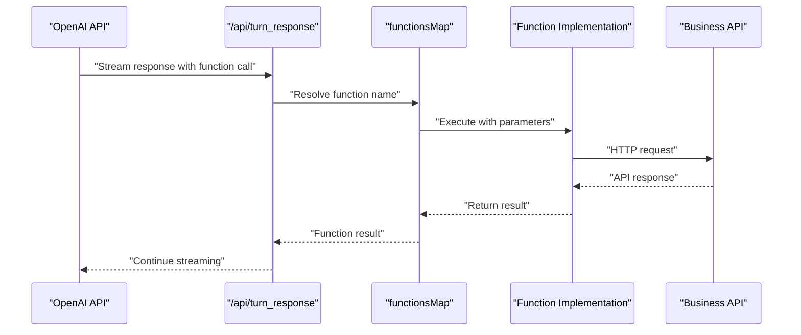

*Sources: [app/api/turn_response/route.ts:12-19]()*

## Function Implementation Pattern

All functions follow a consistent implementation pattern for error handling and API communication:

1. **Parameter destructuring** - Extract typed parameters from the function call
2. **API request** - Make HTTP request to corresponding business API endpoint
3. **Response handling** - Parse JSON response
4. **Error handling** - Catch and return standardized error messages

Each function returns either the successful API response or an error object with a descriptive message.

*Sources: [config/functions.ts:5-15](), [config/functions.ts:29-42]()*

## Error Handling Strategy

The system implements consistent error handling across all functions:

- **Try-catch blocks** wrap all API calls
- **Standardized error format** returns `{ error: "description" }`
- **Console logging** captures errors for debugging
- **Graceful degradation** ensures the AI system continues operating even when individual functions fail

*Sources: [config/functions.ts:11-14](), [config/functions.ts:38-41]()*

## Adding New Functions

To extend the system with new capabilities:

1. **Implement the function** in `config/functions.ts` following the established pattern
2. **Add to functionsMap** registry at the bottom of the file
3. **Ensure corresponding API endpoint** exists in the `app/api/` directory
4. **Update tool schemas** in the configuration if needed

The modular design makes it straightforward to add new customer service capabilities without modifying existing functions.

*Sources: [config/functions.ts:226-239]()*

---

# Page: API Reference

# API Reference

<details>
<summary>Relevant source files</summary>

The following files were used as context for generating this wiki page:

- [config/functions.ts](config/functions.ts)

</details>


This document provides a complete reference for all REST API endpoints in the OpenAI Customer Support Agent Demo system. These APIs enable customer service operations including order management, user account management, support ticket creation, and vector store operations for knowledge base functionality.

The APIs are organized into functional areas that correspond to the main business operations of the customer support system. For information about the tool functions that wrap these APIs, see [Tool Functions System](#2.2). For details about the AI response handling system, see [AI Response APIs](#3.6).

## API Architecture Overview

The system's REST APIs are organized into distinct functional areas, each handling specific aspects of customer support operations:

```mermaid
graph TB
    subgraph "Client Applications"
        CustomerUI["Customer Interface"]
        AgentUI["Agent Interface"]  
        InitUI["Vector Store Init"]
    end
    
    subgraph "API Gateway Layer"
        TurnResponse["/api/turn_response"]
    end
    
    subgraph "Order Management APIs"
        GetOrder["/api/orders/{id}"]
        CancelOrder["/api/orders/{id}/cancel"]
        CreateRefund["/api/orders/{id}/create_refund"]
        SendReplacement["/api/orders/{id}/send_replacement"]
        CreateReturn["/api/orders/{id}/create_return"]
    end
    
    subgraph "User Management APIs"
        GetOrderHistory["/api/users/{id}/order_history"]
        ResetPassword["/api/users/{id}/reset_password"]
        UpdateInfo["/api/users/{id}/update_info"]
    end
    
    subgraph "Support Services APIs"
        CreateVoucher["/api/vouchers/create"]
        CreateComplaint["/api/complaints/create"]
        CreateTicket["/api/tickets/create"]
    end
    
    subgraph "Vector Store APIs"
        CreateStore["/api/vector_stores/create_store"]
        RetrieveStore["/api/vector_stores/retrieve_store"]
        UploadFile["/api/vector_stores/upload_file"]
        AddFile["/api/vector_stores/add_file"]
        ListFiles["/api/vector_stores/list_files"]
        GetFile["/api/vector_stores/get_file"]
    end
    
    subgraph "File Management APIs"
        ListDirectoryFiles["/api/list_files"]
    end
    
    CustomerUI --> TurnResponse
    AgentUI --> TurnResponse
    InitUI --> CreateStore
    InitUI --> ListDirectoryFiles
    
    TurnResponse --> GetOrder
    TurnResponse --> CancelOrder
    TurnResponse --> CreateRefund
    TurnResponse --> SendReplacement
    TurnResponse --> CreateReturn
    TurnResponse --> GetOrderHistory
    TurnResponse --> ResetPassword
    TurnResponse --> UpdateInfo
    TurnResponse --> CreateVoucher
    TurnResponse --> CreateComplaint
    TurnResponse --> CreateTicket
    
    InitUI --> UploadFile
    InitUI --> AddFile
    
    CreateStore --> RetrieveStore
    UploadFile --> ListFiles
    AddFile --> GetFile
```

Sources: [config/functions.ts:1-240]()

## Function to API Endpoint Mapping

The system uses a clean separation between tool functions and API endpoints. Each function in the `functionsMap` corresponds to one or more API calls:

```mermaid
graph LR
    subgraph "Tool Functions (config/functions.ts)"
        get_order["get_order()"]
        cancel_order["cancel_order()"]
        create_refund["create_refund()"]
        send_replacement["send_replacement()"]
        create_return["create_return()"]
        get_order_history["get_order_history()"]
        reset_password["reset_password()"]
        update_info["update_info()"]
        issue_voucher["issue_voucher()"]
        create_complaint["create_complaint()"]
        create_ticket["create_ticket()"]
    end
    
    subgraph "REST API Endpoints"
        GetOrderAPI["GET /api/orders/{id}"]
        CancelOrderAPI["POST /api/orders/{id}/cancel"]
        RefundAPI["POST /api/orders/{id}/create_refund"]
        ReplacementAPI["POST /api/orders/{id}/send_replacement"]
        ReturnAPI["POST /api/orders/{id}/create_return"]
        OrderHistoryAPI["GET /api/users/{id}/order_history"]
        PasswordAPI["POST /api/users/{id}/reset_password"]
        UpdateAPI["POST /api/users/{id}/update_info"]
        VoucherAPI["POST /api/vouchers/create"]
        ComplaintAPI["POST /api/complaints/create"]
        TicketAPI["POST /api/tickets/create"]
    end
    
    get_order --> GetOrderAPI
    cancel_order --> CancelOrderAPI
    create_refund --> RefundAPI
    send_replacement --> ReplacementAPI
    create_return --> ReturnAPI
    get_order_history --> OrderHistoryAPI
    reset_password --> PasswordAPI
    update_info --> UpdateAPI
    issue_voucher --> VoucherAPI
    create_complaint --> ComplaintAPI
    create_ticket --> TicketAPI
```

Sources: [config/functions.ts:226-239]()

## Common Response Patterns

All API endpoints follow consistent response patterns:

| Response Type | Structure | Description |
|---------------|-----------|-------------|
| Success | `{ success: true, data: {...} }` | Successful operation with result data |
| Error | `{ error: "Error message" }` | Failed operation with error description |
| Validation Error | `{ error: "Invalid parameters", details: [...] }` | Parameter validation failures |

## Authentication and Headers

All API requests use standard HTTP headers:

| Header | Value | Required |
|--------|-------|----------|
| `Content-Type` | `application/json` | For POST requests |
| `Accept` | `application/json` | All requests |

Sources: [config/functions.ts:33-35](), [config/functions.ts:48-50]()

## Error Handling

The system implements consistent error handling across all endpoints. Functions catch errors and return standardized error responses:

```javascript
// Standard error handling pattern used across all functions
try {
  const res = await fetch(`/api/endpoint`).then((res) => res.json());
  return res;
} catch (error) {
  console.error(error);
  return { error: "Failed to perform operation" };
}
```

Sources: [config/functions.ts:6-14](), [config/functions.ts:38-42]()

---

# Page: Order Management APIs

# Order Management APIs

<details>
<summary>Relevant source files</summary>

The following files were used as context for generating this wiki page:

- [app/api/orders/[order_id]/cancel/route.ts](app/api/orders/[order_id]/cancel/route.ts)
- [app/api/orders/[order_id]/create_refund/route.ts](app/api/orders/[order_id]/create_refund/route.ts)
- [app/api/orders/[order_id]/create_return/route.ts](app/api/orders/[order_id]/create_return/route.ts)
- [app/api/orders/[order_id]/route.ts](app/api/orders/[order_id]/route.ts)
- [app/api/orders/[order_id]/send_replacement/route.ts](app/api/orders/[order_id]/send_replacement/route.ts)

</details>


## Purpose and Scope

This section documents the REST API endpoints for order management operations. These APIs handle retrieving order details, canceling orders, processing refunds, initiating returns, and sending replacements. For user-specific order history retrieval, see [User Management APIs](#3.2). For information about how these APIs are called by AI agents through tool functions, see [Tool Functions System](#2.2).

All order management APIs follow the Next.js API routes pattern with dynamic `order_id` parameters and simulate real e-commerce operations using demo data.

## API Endpoints Overview

The order management system provides five core API endpoints, all following the REST pattern with the order ID as a path parameter:

```mermaid
graph TD
    OrdersAPI["orders API namespace"]
    
    GetOrder["GET /api/orders/[order_id]<br/>Order Retrieval"]
    CancelOrder["POST /api/orders/[order_id]/cancel<br/>Order Cancellation"]
    CreateRefund["POST /api/orders/[order_id]/create_refund<br/>Refund Processing"]
    CreateReturn["POST /api/orders/[order_id]/create_return<br/>Return Initiation"]
    SendReplacement["POST /api/orders/[order_id]/send_replacement<br/>Replacement Shipping"]
    
    DEMO_ORDERS["DEMO_ORDERS<br/>from config/demoData"]
    
    OrdersAPI --> GetOrder
    OrdersAPI --> CancelOrder
    OrdersAPI --> CreateRefund
    OrdersAPI --> CreateReturn
    OrdersAPI --> SendReplacement
    
    GetOrder --> DEMO_ORDERS
    CancelOrder --> SimulatedResponse["Simulated Success Response"]
    CreateRefund --> SimulatedResponse
    CreateReturn --> SimulatedResponse
    SendReplacement --> SimulatedResponse
```

Sources: [app/api/orders/[order_id]/route.ts:1-21](), [app/api/orders/[order_id]/cancel/route.ts:1-18](), [app/api/orders/[order_id]/create_refund/route.ts:1-21](), [app/api/orders/[order_id]/create_return/route.ts:1-21](), [app/api/orders/[order_id]/send_replacement/route.ts:1-20]()

## Order Retrieval

### GET /api/orders/[order_id]

Retrieves detailed information for a specific order using the order ID.

**Parameters:**
- `order_id` (path parameter): Unique identifier for the order

**Response Format:**
- **200 OK**: Returns complete order object from `DEMO_ORDERS`
- **404 Not Found**: `{"error": "Order not found"}`
- **500 Internal Server Error**: "Error retrieving order"

**Implementation Details:**
The endpoint searches through the `DEMO_ORDERS` array to find a matching order by ID [app/api/orders/[order_id]/route.ts:9](), returning the complete order object if found.

Sources: [app/api/orders/[order_id]/route.ts:1-21]()

## Order Modification Operations

### POST /api/orders/[order_id]/cancel

Cancels an existing order.

**Parameters:**
- `order_id` (path parameter): Order to cancel

**Response Format:**
```json
{
  "message": "Order {order_id} cancelled successfully"
}
```

**Implementation:**
This endpoint simulates order cancellation and always returns success [app/api/orders/[order_id]/cancel/route.ts:9-12]().

Sources: [app/api/orders/[order_id]/cancel/route.ts:1-18]()

### POST /api/orders/[order_id]/create_refund

Processes a refund for an order.

**Request Body:**
- `amount` (number): Refund amount
- `reason` (string): Reason for refund

**Response Format:**
```json
{
  "message": "Refund of ${amount} for order {order_id} is processing",
  "reason": "customer provided reason"
}
```

**Implementation:**
Accepts refund parameters and simulates refund processing [app/api/orders/[order_id]/create_refund/route.ts:7-14]().

Sources: [app/api/orders/[order_id]/create_refund/route.ts:1-21]()

### POST /api/orders/[order_id]/create_return

Initiates a return process for order items.

**Request Body:**
- `product_ids` (array): List of product IDs to return

**Response Format:**
```json
{
  "message": "Return initiated for order {order_id}",
  "product_ids": ["array of product IDs"]
}
```

**Implementation:**
Processes return initiation for specified products [app/api/orders/[order_id]/create_return/route.ts:7-14]().

Sources: [app/api/orders/[order_id]/create_return/route.ts:1-21]()

### POST /api/orders/[order_id]/send_replacement

Sends replacement items for defective products.

**Request Body:**
- `product_id` (string): ID of product requiring replacement

**Response Format:**
```json
{
  "message": "Replacement for product {product_id} in order {order_id} sent successfully"
}
```

**Implementation:**
Simulates replacement shipping process [app/api/orders/[order_id]/send_replacement/route.ts:7-13]().

Sources: [app/api/orders/[order_id]/send_replacement/route.ts:1-20]()

## Error Handling

All order management endpoints implement consistent error handling patterns:

| Error Type | HTTP Status | Response |
|------------|-------------|----------|
| Order Not Found | 404 | `{"error": "Order not found"}` |
| Request Processing Error | 500 | Plain text error message |
| Invalid JSON | 500 | "Error [operation] order" |

Each endpoint includes try-catch blocks with console error logging [app/api/orders/[order_id]/route.ts:17]() and returns appropriate HTTP status codes.

Sources: [app/api/orders/[order_id]/route.ts:11-18](), [app/api/orders/[order_id]/cancel/route.ts:14-16](), [app/api/orders/[order_id]/create_refund/route.ts:16-19]()

## Integration with Tool Functions System

The order management APIs are designed to be called by AI agent tool functions. The following diagram shows how tool functions interact with these APIs:

```mermaid
graph LR
    subgraph "AI Agent Tool Functions"
        get_order["get_order()"]
        cancel_order["cancel_order()"]
        create_refund["create_refund()"]
        create_return["create_return()"]
        send_replacement["send_replacement()"]
    end
    
    subgraph "Order Management APIs"
        GetOrderAPI["GET /api/orders/[order_id]"]
        CancelOrderAPI["POST /api/orders/[order_id]/cancel"]
        RefundAPI["POST /api/orders/[order_id]/create_refund"]
        ReturnAPI["POST /api/orders/[order_id]/create_return"]
        ReplacementAPI["POST /api/orders/[order_id]/send_replacement"]
    end
    
    subgraph "Data Sources"
        DEMO_ORDERS_Data["DEMO_ORDERS"]
        SimulatedOps["Simulated Operations"]
    end
    
    get_order --> GetOrderAPI
    cancel_order --> CancelOrderAPI
    create_refund --> RefundAPI
    create_return --> ReturnAPI
    send_replacement --> ReplacementAPI
    
    GetOrderAPI --> DEMO_ORDERS_Data
    CancelOrderAPI --> SimulatedOps
    RefundAPI --> SimulatedOps
    ReturnAPI --> SimulatedOps
    ReplacementAPI --> SimulatedOps
```

Each tool function corresponds directly to an API endpoint, allowing the AI agent to perform order management operations through the `functionsMap` registry defined in the tool functions system.

Sources: [app/api/orders/[order_id]/route.ts:1](), [app/api/orders/[order_id]/cancel/route.ts:8](), [app/api/orders/[order_id]/create_refund/route.ts:8](), [app/api/orders/[order_id]/create_return/route.ts:8](), [app/api/orders/[order_id]/send_replacement/route.ts:8]()

---

# Page: User Management APIs

# User Management APIs

<details>
<summary>Relevant source files</summary>

The following files were used as context for generating this wiki page:

- [app/api/users/[user_id]/order_history/route.ts](app/api/users/[user_id]/order_history/route.ts)
- [app/api/users/[user_id]/reset_password/route.ts](app/api/users/[user_id]/reset_password/route.ts)
- [app/api/users/[user_id]/update_info/route.ts](app/api/users/[user_id]/update_info/route.ts)

</details>


This document covers the User Management APIs that handle user account operations, profile management, and user-specific data retrieval. These APIs provide functionality for retrieving order history, resetting passwords, and updating user information.

For order-related operations like cancellations and refunds, see [Order Management APIs](#3.1). For support tickets and complaints, see [Support Services APIs](#3.3).

## API Overview

The User Management APIs consist of three main endpoints that handle user account operations. All endpoints follow the pattern `/api/users/[user_id]/{operation}` and are designed to work with the AI agent's tool function system.

```mermaid
graph TD
    subgraph "User Management API Routes"
        OrderHistoryRoute["/api/users/[user_id]/order_history"]
        ResetPasswordRoute["/api/users/[user_id]/reset_password"] 
        UpdateInfoRoute["/api/users/[user_id]/update_info"]
    end
    
    subgraph "Tool Functions"
        GetOrderHistoryFunc["get_order_history()"]
        ResetPasswordFunc["reset_password()"]
        UpdateInfoFunc["update_info()"]
    end
    
    subgraph "Data Sources"
        UserInfoData["USER_INFO.order_history"]
        SimulatedOps["Simulated Operations"]
    end
    
    GetOrderHistoryFunc --> OrderHistoryRoute
    ResetPasswordFunc --> ResetPasswordRoute
    UpdateInfoFunc --> UpdateInfoRoute
    
    OrderHistoryRoute --> UserInfoData
    ResetPasswordRoute --> SimulatedOps
    UpdateInfoRoute --> SimulatedOps
```

**Sources:** [app/api/users/[user_id]/order_history/route.ts:1-18](), [app/api/users/[user_id]/reset_password/route.ts:1-19](), [app/api/users/[user_id]/update_info/route.ts:1-22]()

## Order History Retrieval

### GET /api/users/[user_id]/order_history

Retrieves the complete order history for a specified user. This endpoint returns static demo data from the `USER_INFO` configuration.

**Route Handler:** `GET` method in [app/api/users/[user_id]/order_history/route.ts:3-17]()

**Parameters:**
- `user_id` (string): User identifier from the URL path

**Response:**
- **200 OK**: Returns the user's order history as JSON array
- **500 Internal Server Error**: Error retrieving order history

**Implementation Details:**
- Imports `USER_INFO` from demo data configuration [app/api/users/[user_id]/order_history/route.ts:1]()
- Returns `USER_INFO.order_history` directly [app/api/users/[user_id]/order_history/route.ts:10]()
- Includes console logging for debugging [app/api/users/[user_id]/order_history/route.ts:9]()

**Sources:** [app/api/users/[user_id]/order_history/route.ts:1-18]()

## Password Reset

### POST /api/users/[user_id]/reset_password

Simulates sending a password reset email to the specified user. This endpoint provides a realistic simulation for demonstration purposes.

**Route Handler:** `POST` method in [app/api/users/[user_id]/reset_password/route.ts:1-18]()

**Parameters:**
- `user_id` (string): User identifier from the URL path

**Request Body:** None required

**Response:**
- **200 OK**: Confirmation message with user ID
- **500 Internal Server Error**: Error resetting password

**Response Format:**
```json
{
  "message": "Password reset email sent to user {user_id}"
}
```

**Implementation Details:**
- Pure simulation - no actual email is sent [app/api/users/[user_id]/reset_password/route.ts:7-8]()
- Returns formatted confirmation message [app/api/users/[user_id]/reset_password/route.ts:9-11]()

**Sources:** [app/api/users/[user_id]/reset_password/route.ts:1-19]()

## User Information Update

### POST /api/users/[user_id]/update_info

Updates user profile information with the provided field and value. This endpoint simulates profile updates for demonstration purposes.

**Route Handler:** `POST` method in [app/api/users/[user_id]/update_info/route.ts:1-21]()

**Parameters:**
- `user_id` (string): User identifier from the URL path

**Request Body:**
```json
{
  "info": {
    "field": "string",
    "value": "string"
  }
}
```

**Response:**
- **200 OK**: Update confirmation with details
- **500 Internal Server Error**: Error updating user info

**Response Format:**
```json
{
  "message": "User {user_id} info updated",
  "updatedField": "field_name",
  "newValue": "new_value"
}
```

**Implementation Details:**
- Extracts `info` object from request body [app/api/users/[user_id]/update_info/route.ts:7]()
- Returns confirmation with updated field details [app/api/users/[user_id]/update_info/route.ts:9-14]()
- Simulates database update operation [app/api/users/[user_id]/update_info/route.ts:8]()

**Sources:** [app/api/users/[user_id]/update_info/route.ts:1-22]()

## Integration with Tool Functions

These APIs are designed to be called by the AI agent through the tool functions system. The following diagram shows the relationship between tool functions and API endpoints:

```mermaid
sequenceDiagram
    participant AIAgent as "AI Agent"
    participant ToolFunc as "Tool Function"
    participant APIRoute as "API Route"
    participant DemoData as "Demo Data"
    
    AIAgent->>ToolFunc: Call get_order_history(user_id)
    ToolFunc->>APIRoute: GET /api/users/{user_id}/order_history
    APIRoute->>DemoData: Read USER_INFO.order_history
    DemoData-->>APIRoute: Return order history array
    APIRoute-->>ToolFunc: 200 OK with order data
    ToolFunc-->>AIAgent: Formatted response
    
    AIAgent->>ToolFunc: Call reset_password(user_id)
    ToolFunc->>APIRoute: POST /api/users/{user_id}/reset_password
    APIRoute-->>ToolFunc: 200 OK with confirmation
    ToolFunc-->>AIAgent: Success message
    
    AIAgent->>ToolFunc: Call update_info(user_id, field, value)
    ToolFunc->>APIRoute: POST /api/users/{user_id}/update_info
    APIRoute-->>ToolFunc: 200 OK with update details
    ToolFunc-->>AIAgent: Update confirmation
```

**Sources:** [app/api/users/[user_id]/order_history/route.ts:1-18](), [app/api/users/[user_id]/reset_password/route.ts:1-19](), [app/api/users/[user_id]/update_info/route.ts:1-22]()

## Error Handling

All User Management APIs implement consistent error handling patterns:

| Error Type | Status Code | Response | Implementation |
|------------|-------------|----------|----------------|
| Server Error | 500 | "Error retrieving order history" | [app/api/users/[user_id]/order_history/route.ts:15]() |
| Server Error | 500 | "Error resetting password" | [app/api/users/[user_id]/reset_password/route.ts:16]() |
| Server Error | 500 | "Error updating user info" | [app/api/users/[user_id]/update_info/route.ts:19]() |

Each endpoint includes try-catch blocks with console error logging and appropriate HTTP status codes.

**Sources:** [app/api/users/[user_id]/order_history/route.ts:13-16](), [app/api/users/[user_id]/reset_password/route.ts:14-17](), [app/api/users/[user_id]/update_info/route.ts:17-20]()

## Demo Data Dependencies

The User Management APIs rely on demo data for realistic simulation:

- **Order History**: Uses `USER_INFO.order_history` from the demo data configuration
- **Password Reset**: Pure simulation with no external dependencies  
- **Info Updates**: Simulated operations that return confirmation without persistence

For details on configuring demo data, see [Demo Data and Content](#5.2).

**Sources:** [app/api/users/[user_id]/order_history/route.ts:1](), [app/api/users/[user_id]/order_history/route.ts:10]()

---

# Page: Support Services APIs

# Support Services APIs

<details>
<summary>Relevant source files</summary>

The following files were used as context for generating this wiki page:

- [app/api/complaints/create/route.ts](app/api/complaints/create/route.ts)
- [app/api/tickets/create/route.ts](app/api/tickets/create/route.ts)
- [app/api/vouchers/create/route.ts](app/api/vouchers/create/route.ts)

</details>


This document covers the REST API endpoints for customer support services including complaint creation, ticket creation, and voucher issuance. These APIs provide the backend functionality for support agents and AI tools to handle customer service requests that require escalation or compensation.

For order-related operations like cancellations and refunds, see [Order Management APIs](#3.1). For user account management, see [User Management APIs](#3.2).

## Overview

The support services APIs consist of three primary endpoints that simulate backend operations for customer service workflows:

- **Complaints API** - Creates formal complaints for customer issues
- **Tickets API** - Creates support tickets for tracking customer requests  
- **Vouchers API** - Issues vouchers as compensation for customer problems

All endpoints are designed as simulation layers that return success responses without persistent storage, making them suitable for demonstration and development purposes.

## API Endpoints Structure

```mermaid
graph TB
    subgraph "Support Services API Routes"
        ComplaintsRoute["/api/complaints/create<br/>POST"]
        TicketsRoute["/api/tickets/create<br/>POST"]
        VouchersRoute["/api/vouchers/create<br/>POST"]
    end
    
    subgraph "Route Implementations"
        ComplaintsHandler["complaints/create/route.ts<br/>POST function"]
        TicketsHandler["tickets/create/route.ts<br/>POST function"]
        VouchersHandler["vouchers/create/route.ts<br/>POST function"]
    end
    
    subgraph "Tool Functions Integration"
        CreateComplaintTool["create_complaint"]
        CreateTicketTool["create_ticket"]  
        IssueVoucherTool["issue_voucher"]
    end
    
    ComplaintsRoute --> ComplaintsHandler
    TicketsRoute --> TicketsHandler
    VouchersRoute --> VouchersHandler
    
    CreateComplaintTool --> ComplaintsRoute
    CreateTicketTool --> TicketsRoute
    IssueVoucherTool --> VouchersRoute
```

Sources: [app/api/complaints/create/route.ts:1-18](), [app/api/tickets/create/route.ts:1-18](), [app/api/vouchers/create/route.ts:1-15]()

## Complaints API

### Create Complaint

**Endpoint:** `POST /api/complaints/create`

Creates a formal complaint record for customer issues requiring escalation or documentation.

#### Request Body

| Field | Type | Required | Description |
|-------|------|----------|-------------|
| `user_id` | string | Yes | Unique identifier for the user |
| `type` | string | Yes | Category or type of complaint |
| `details` | string | Yes | Detailed description of the complaint |
| `order_id` | string | No | Associated order ID if complaint is order-related |

#### Response

**Success (200):**
```json
{
  "message": "Complaint created for user {user_id}",
  "type": "{type}",
  "details": "{details}",
  "order_id": "{order_id}"
}
```

**Error (500):**
```
Error creating complaint
```

#### Implementation

The `POST` function in [app/api/complaints/create/route.ts:1-18]() extracts the request body parameters and returns a simulated success response. Error handling catches any exceptions and returns a 500 status code.

Sources: [app/api/complaints/create/route.ts:1-18]()

## Tickets API

### Create Ticket

**Endpoint:** `POST /api/tickets/create`

Creates a support ticket for tracking customer service requests and their resolution status.

#### Request Body

| Field | Type | Required | Description |
|-------|------|----------|-------------|
| `user_id` | string | Yes | Unique identifier for the user |
| `type` | string | Yes | Category or type of support request |
| `details` | string | Yes | Detailed description of the request |
| `order_id` | string | No | Associated order ID if ticket is order-related |

#### Response

**Success (200):**
```json
{
  "message": "Ticket created for user {user_id}",
  "type": "{type}",
  "details": "{details}",
  "order_id": "{order_id}"
}
```

**Error (500):**
```
Error creating ticket
```

#### Implementation

The `POST` function in [app/api/tickets/create/route.ts:1-18]() follows the same pattern as the complaints API, providing simulated ticket creation with identical request/response structure.

Sources: [app/api/tickets/create/route.ts:1-18]()

## Vouchers API

### Issue Voucher

**Endpoint:** `POST /api/vouchers/create`

Issues a voucher to a customer as compensation for service issues or as part of customer retention efforts.

#### Request Body

| Field | Type | Required | Description |
|-------|------|----------|-------------|
| `user_id` | string | Yes | Unique identifier for the user |
| `amount` | number | Yes | Monetary value of the voucher |
| `reason` | string | Yes | Reason for issuing the voucher |

#### Response

**Success (200):**
```json
{
  "message": "Voucher of ${amount} issued to user {user_id} for: {reason}"
}
```

**Error (500):**
```
Error issuing voucher
```

#### Implementation

The `POST` function in [app/api/vouchers/create/route.ts:1-15]() processes voucher issuance requests with a simpler response format that includes the amount and reason in the success message.

Sources: [app/api/vouchers/create/route.ts:1-15]()

## Request Processing Flow

```mermaid
sequenceDiagram
    participant Tool as "Tool Function"
    participant API as "Support API"
    participant Handler as "Route Handler"
    
    Tool->>API: "POST /api/{service}/create"
    Note over Tool,API: "JSON body with required fields"
    
    API->>Handler: "Extract request.json()"
    Handler->>Handler: "Simulate operation"
    
    alt Success
        Handler->>API: "200 + success JSON"
        API->>Tool: "Success response"
    else Error
        Handler->>API: "500 + error message"
        API->>Tool: "Error response"
    end
```

Sources: [app/api/complaints/create/route.ts:2-13](), [app/api/tickets/create/route.ts:2-13](), [app/api/vouchers/create/route.ts:2-10]()

## Error Handling

All support services APIs implement consistent error handling:

1. **Request Extraction Errors** - If `request.json()` fails, the catch block returns a 500 status
2. **Console Logging** - Errors are logged to console for debugging: `console.error("Error creating {service}:", error)`
3. **Generic Error Response** - Users receive a simple error message without exposing internal details

The error handling pattern is identical across all three endpoints, using try-catch blocks around the main processing logic.

Sources: [app/api/complaints/create/route.ts:14-17](), [app/api/tickets/create/route.ts:14-17](), [app/api/vouchers/create/route.ts:11-14]()

## Integration Notes

These APIs are designed to be called by tool functions in the AI agent system. The consistent request/response patterns make them suitable for automated invocation while providing human-readable success messages for agent interfaces.

All endpoints are implemented as simulation layers without persistent storage, making them ideal for demonstration environments while maintaining realistic API contracts that could be extended with actual backend integration.

---

# Page: Vector Store APIs

# Vector Store APIs

<details>
<summary>Relevant source files</summary>

The following files were used as context for generating this wiki page:

- [app/api/vector_stores/add_file/route.ts](app/api/vector_stores/add_file/route.ts)
- [app/api/vector_stores/create_store/route.ts](app/api/vector_stores/create_store/route.ts)
- [app/api/vector_stores/get_file/route.ts](app/api/vector_stores/get_file/route.ts)
- [app/api/vector_stores/list_files/route.ts](app/api/vector_stores/list_files/route.ts)
- [app/api/vector_stores/retrieve_store/route.ts](app/api/vector_stores/retrieve_store/route.ts)
- [app/api/vector_stores/upload_file/route.ts](app/api/vector_stores/upload_file/route.ts)

</details>


## Purpose and Scope

The Vector Store APIs provide REST endpoints for managing OpenAI vector stores and their associated files. These APIs serve as a wrapper layer around the OpenAI Assistants API, enabling the creation, configuration, and management of vector stores used for file search capabilities in the AI support agent system.

For information about the higher-level vector store management system, see [Vector Store Management](#2.1). For the administrative interface that uses these APIs, see [Vector Store Initialization Interface](#4.3). For general file listing operations, see [File Management APIs](#3.5).

## API Architecture

The vector store APIs are organized into two main categories: store management and file operations.

```mermaid
graph TD
    subgraph "Store Management"
        CreateStore["/api/vector_stores/create_store<br/>POST"]
        RetrieveStore["/api/vector_stores/retrieve_store<br/>GET"]
    end
    
    subgraph "File Operations"
        UploadFile["/api/vector_stores/upload_file<br/>POST"]
        AddFile["/api/vector_stores/add_file<br/>POST"]
        ListFiles["/api/vector_stores/list_files<br/>GET"]
        GetFile["/api/vector_stores/get_file<br/>GET"]
    end
    
    subgraph "OpenAI Services"
        OpenAIVectorStores["openai.vectorStores"]
        OpenAIFiles["openai.files"]
        OpenAIVectorStoreFiles["openai.vectorStores.files"]
    end
    
    CreateStore --> OpenAIVectorStores
    RetrieveStore --> OpenAIVectorStores
    UploadFile --> OpenAIFiles
    AddFile --> OpenAIVectorStoreFiles
    ListFiles --> OpenAIVectorStoreFiles
    GetFile --> OpenAIVectorStoreFiles
```

Sources: [app/api/vector_stores/create_store/route.ts:1-17](), [app/api/vector_stores/retrieve_store/route.ts:1-17](), [app/api/vector_stores/upload_file/route.ts:1-21](), [app/api/vector_stores/add_file/route.ts:1-20](), [app/api/vector_stores/list_files/route.ts:1-18](), [app/api/vector_stores/get_file/route.ts:1-19]()

## Vector Store Lifecycle Workflow

The typical workflow for setting up a vector store involves multiple API calls in sequence.

```mermaid
sequenceDiagram
    participant Client as "Client Application"
    participant CreateAPI as "/api/vector_stores/create_store"
    participant UploadAPI as "/api/vector_stores/upload_file"
    participant AddAPI as "/api/vector_stores/add_file"
    participant ListAPI as "/api/vector_stores/list_files"
    participant OpenAI as "OpenAI API"
    
    Client->>CreateAPI: "POST {name: 'store_name'}"
    CreateAPI->>OpenAI: "vectorStores.create()"
    OpenAI-->>CreateAPI: "vectorStore object"
    CreateAPI-->>Client: "vectorStore with ID"
    
    loop "For each file"
        Client->>UploadAPI: "POST {filePath: 'path/to/file'}"
        UploadAPI->>OpenAI: "files.create()"
        OpenAI-->>UploadAPI: "file object"
        UploadAPI-->>Client: "file with ID"
        
        Client->>AddAPI: "POST {vectorStoreId, fileId, attributes}"
        AddAPI->>OpenAI: "vectorStores.files.create()"
        OpenAI-->>AddAPI: "vector store file object"
        AddAPI-->>Client: "confirmation"
    end
    
    Client->>ListAPI: "GET ?vectorStoreId=xxx"
    ListAPI->>OpenAI: "vectorStores.files.list()"
    OpenAI-->>ListAPI: "files list"
    ListAPI-->>Client: "all files in store"
```

Sources: [app/api/vector_stores/create_store/route.ts:5-17](), [app/api/vector_stores/upload_file/route.ts:5-21](), [app/api/vector_stores/add_file/route.ts:5-20](), [app/api/vector_stores/list_files/route.ts:5-18]()

## Store Management Endpoints

### Create Vector Store

Creates a new OpenAI vector store with the specified name.

**Endpoint:** `POST /api/vector_stores/create_store`

**Request Body:**
```json
{
  "name": "string"
}
```

**Response:** OpenAI vector store object with generated ID

**Implementation:** Uses `openai.vectorStores.create()` at [app/api/vector_stores/create_store/route.ts:8-10]()

Sources: [app/api/vector_stores/create_store/route.ts:5-17]()

### Retrieve Vector Store

Retrieves metadata for an existing vector store.

**Endpoint:** `GET /api/vector_stores/retrieve_store`

**Query Parameters:**
| Parameter | Type | Description |
|-----------|------|-------------|
| `vector_store_id` | string | ID of the vector store to retrieve |

**Response:** OpenAI vector store object

**Implementation:** Uses `openai.vectorStores.retrieve()` at [app/api/vector_stores/retrieve_store/route.ts:9-11]()

Sources: [app/api/vector_stores/retrieve_store/route.ts:5-17]()

## File Operations Endpoints

### Upload File

Uploads a file from the local filesystem to OpenAI for use with assistants.

**Endpoint:** `POST /api/vector_stores/upload_file`

**Request Body:**
```json
{
  "filePath": "string"
}
```

**Response:** OpenAI file object with generated ID

**Implementation:** 
- Creates file stream from `process.cwd()` + `filePath` at [app/api/vector_stores/upload_file/route.ts:9-10]()
- Uses `openai.files.create()` with purpose "assistants" at [app/api/vector_stores/upload_file/route.ts:11-14]()

Sources: [app/api/vector_stores/upload_file/route.ts:5-21]()

### Add File to Vector Store

Associates an uploaded file with a vector store, enabling it for file search operations.

**Endpoint:** `POST /api/vector_stores/add_file`

**Request Body:**
```json
{
  "vectorStoreId": "string",
  "fileId": "string", 
  "attributes": "object"
}
```

**Response:** OpenAI vector store file object

**Implementation:** Uses `openai.vectorStores.files.create()` at [app/api/vector_stores/add_file/route.ts:11-14]()

Sources: [app/api/vector_stores/add_file/route.ts:5-20]()

### List Vector Store Files

Retrieves all files associated with a vector store.

**Endpoint:** `GET /api/vector_stores/list_files`

**Query Parameters:**
| Parameter | Type | Description |
|-----------|------|-------------|
| `vectorStoreId` | string | ID of the vector store |

**Response:** List of OpenAI vector store file objects

**Implementation:** Uses `openai.vectorStores.files.list()` at [app/api/vector_stores/list_files/route.ts:10-12]()

Sources: [app/api/vector_stores/list_files/route.ts:5-18]()

### Get Vector Store File

Retrieves metadata for a specific file within a vector store.

**Endpoint:** `GET /api/vector_stores/get_file`

**Query Parameters:**
| Parameter | Type | Description |
|-----------|------|-------------|
| `vectorStoreId` | string | ID of the vector store |
| `fileId` | string | ID of the file |

**Response:** OpenAI vector store file object

**Implementation:** Uses `openai.vectorStores.files.retrieve()` at [app/api/vector_stores/get_file/route.ts:10-13]()

Sources: [app/api/vector_stores/get_file/route.ts:5-19]()

## OpenAI API Integration

All vector store APIs serve as thin wrapper layers around the OpenAI API, providing consistent error handling and request/response formatting.

```mermaid
graph LR
    subgraph "Application Layer"
        ClientApp["Client Application"]
    end
    
    subgraph "API Wrapper Layer"
        CreateStoreRoute["create_store/route.ts"]
        UploadFileRoute["upload_file/route.ts"]
        AddFileRoute["add_file/route.ts"]
        ListFilesRoute["list_files/route.ts"]
        GetFileRoute["get_file/route.ts"]
        RetrieveStoreRoute["retrieve_store/route.ts"]
    end
    
    subgraph "OpenAI SDK"
        OpenAIClient["new OpenAI()"]
    end
    
    subgraph "OpenAI Services"
        VectorStoresAPI["vectorStores.create()<br/>vectorStores.retrieve()"]
        FilesAPI["files.create()"]
        VectorStoreFilesAPI["vectorStores.files.create()<br/>vectorStores.files.list()<br/>vectorStores.files.retrieve()"]
    end
    
    ClientApp --> CreateStoreRoute
    ClientApp --> UploadFileRoute
    ClientApp --> AddFileRoute
    ClientApp --> ListFilesRoute
    ClientApp --> GetFileRoute
    ClientApp --> RetrieveStoreRoute
    
    CreateStoreRoute --> OpenAIClient
    RetrieveStoreRoute --> OpenAIClient
    UploadFileRoute --> OpenAIClient
    AddFileRoute --> OpenAIClient
    ListFilesRoute --> OpenAIClient
    GetFileRoute --> OpenAIClient
    
    OpenAIClient --> VectorStoresAPI
    OpenAIClient --> FilesAPI
    OpenAIClient --> VectorStoreFilesAPI
```

Sources: [app/api/vector_stores/create_store/route.ts:1-3](), [app/api/vector_stores/upload_file/route.ts:1-2](), [app/api/vector_stores/add_file/route.ts:1-3](), [app/api/vector_stores/list_files/route.ts:1-3](), [app/api/vector_stores/get_file/route.ts:1-3](), [app/api/vector_stores/retrieve_store/route.ts:1-3]()

## Error Handling

All endpoints implement consistent error handling patterns:

- Errors are logged to console with descriptive messages
- HTTP 500 status returned for all errors
- Generic error messages returned to client to avoid exposing internal details

| Endpoint | Error Log Message | Error Response |
|----------|------------------|----------------|
| create_store | "Error creating vector store" | "Error creating vector store" |
| upload_file | "Error uploading file" | "Error uploading file" |
| add_file | "Error adding file" | "Error adding file" |
| list_files | "Error fetching files" | "Error fetching files" |
| get_file | "Error retrieving file" | "Error retrieving file" |
| retrieve_store | "Error fetching vector store" | "Error fetching vector store" |

Sources: [app/api/vector_stores/create_store/route.ts:13-16](), [app/api/vector_stores/upload_file/route.ts:17-20](), [app/api/vector_stores/add_file/route.ts:16-19](), [app/api/vector_stores/list_files/route.ts:14-17](), [app/api/vector_stores/get_file/route.ts:15-18](), [app/api/vector_stores/retrieve_store/route.ts:13-16]()

---

# Page: File Management APIs

# File Management APIs

<details>
<summary>Relevant source files</summary>

The following files were used as context for generating this wiki page:

- [app/api/list_files/route.ts](app/api/list_files/route.ts)

</details>


## Purpose and Scope

The File Management APIs provide endpoints for listing and accessing files within the public directory structure of the OpenAI Customer Support Agent Demo. These APIs enable the system to dynamically discover and serve knowledge base content, FAQ files, and other static assets stored in the `public/` directory.

This page covers file listing and directory traversal APIs. For managing files within OpenAI vector stores, see [Vector Store APIs](#3.4). For the overall API architecture, see [API Reference](#3).

## Overview

The file management system provides a simple but essential service: dynamically listing files in specified public directories. This capability supports the knowledge base initialization process and enables the system to discover available content without hardcoding file names.

### File Listing Endpoint

The primary file management endpoint is `/api/list_files`, which provides directory listing functionality for the public folder structure.

**Sources:** [app/api/list_files/route.ts:1-16]()

## API Endpoints

### GET /api/list_files

Lists all files in a specified subdirectory of the `public/` folder.

#### Parameters

| Parameter | Type | Required | Description |
|-----------|------|----------|-------------|
| `folder` | string | Yes | Subdirectory name within `public/` to list |

#### Request Example

```
GET /api/list_files?folder=knowledge_base
```

#### Response Format

Returns a JSON array of file names as strings.

```json
[
  "account_management.md",
  "billing_policies.md",
  "shipping_info.md"
]
```

#### Error Responses

| Status Code | Description |
|-------------|-------------|
| 500 | Error accessing the specified directory |

#### Implementation Details

The endpoint implementation follows a straightforward pattern:

1. Extracts the `folder` parameter from the query string
2. Constructs the full path using `path.join(process.cwd(), 'public/${folder}')`
3. Uses Node.js `fs.readdir()` to list directory contents
4. Returns the file list as JSON or an error response

**Sources:** [app/api/list_files/route.ts:4-16]()

## System Integration

### File Discovery Flow

The file management API integrates with several system components to enable dynamic content discovery:

```mermaid
graph TD
    PublicDir["public/ Directory"] --> KBDir["knowledge_base/"]
    PublicDir --> FAQDir["faq/"]
    PublicDir --> OtherDirs["Other Subdirectories"]
    
    InitVS["Vector Store Initialization"] --> ListFilesAPI["/api/list_files"]
    KBPages["Knowledge Base Pages"] --> ListFilesAPI
    ListArticles["ListArticles Component"] --> ListFilesAPI
    
    ListFilesAPI --> FileSystem["Node.js fs.readdir()"]
    FileSystem --> KBDir
    FileSystem --> FAQDir
    FileSystem --> OtherDirs
    
    ListFilesAPI --> FilesResponse["File Names Array"]
    FilesResponse --> InitVS
    FilesResponse --> KBPages
    FilesResponse --> ListArticles
```

**Sources:** [app/api/list_files/route.ts:1-16]()

### Directory Structure Support

The API is designed to work with the public directory structure that contains knowledge base content:

```mermaid
graph LR
    PublicRoot["public/"] --> KB["knowledge_base/"]
    PublicRoot --> FAQ["faq/"]
    KB --> KBFiles["*.md files"]
    FAQ --> FAQFiles["*.md files"]
    
    ListFiles["/api/list_files"] --> FolderParam["?folder=knowledge_base"]
    ListFiles --> FolderParam2["?folder=faq"]
    
    FolderParam --> KB
    FolderParam2 --> FAQ
    
    KB --> FileList1["['file1.md', 'file2.md']"]
    FAQ --> FileList2["['faq1.md', 'faq2.md']"]
```

**Sources:** [app/api/list_files/route.ts:8-11]()

## Error Handling and Logging

The API includes basic error handling and logging mechanisms:

- **Directory Access Errors**: Returns HTTP 500 status when unable to read the specified directory
- **Console Logging**: Logs successful file discovery for debugging and monitoring
- **Error Logging**: Logs detailed error information when directory access fails

The logging output includes both the requested folder name and the discovered files, making it easier to troubleshoot content discovery issues.

**Sources:** [app/api/list_files/route.ts:10-14]()

## Usage Patterns

### Knowledge Base Content Discovery

The most common usage pattern involves discovering markdown files in knowledge base directories:

1. Vector store initialization calls `/api/list_files?folder=knowledge_base`
2. The API returns an array of `.md` file names
3. The initialization process then uploads these files to the OpenAI vector store

### Dynamic Content Loading

The knowledge base pages use this API to dynamically load available content without hardcoding file names, enabling easy addition of new content files.

**Sources:** [app/api/list_files/route.ts:1-16]()

## Security Considerations

The current implementation has several security characteristics:

- **Path Restriction**: Only allows access to subdirectories within the `public/` folder
- **No Path Traversal Protection**: Does not explicitly validate against path traversal attacks
- **Public Directory Exposure**: All files in the specified public subdirectories are listable

For production use, additional validation should be considered to prevent unauthorized directory access.

**Sources:** [app/api/list_files/route.ts:8]()

---

# Page: AI Response APIs

# AI Response APIs

<details>
<summary>Relevant source files</summary>

The following files were used as context for generating this wiki page:

- [app/api/turn_response/route.ts](app/api/turn_response/route.ts)

</details>


This document covers the REST API endpoints responsible for handling AI agent responses and streaming communication between the system and OpenAI's response generation API. These APIs enable real-time AI-powered conversations with integrated tool calling and knowledge base search capabilities.

For information about the tool functions that the AI can invoke, see [Tool Functions System](#2.2). For vector store integration details, see [Vector Store APIs](#3.4).

## Turn Response API

The `/api/turn_response` endpoint serves as the primary interface for AI response generation, handling streaming conversations between users and the AI agent.

### Endpoint Overview

| Method | Path | Purpose |
|--------|------|---------|
| POST | `/api/turn_response` | Generate streaming AI responses with tool calling support |

### Request Format

The endpoint accepts JSON payloads with the following structure:

| Field | Type | Required | Description |
|-------|------|----------|-------------|
| `messages` | Array | Yes | Conversation history in OpenAI message format |
| `tools` | Array | Yes | Available tool functions for the AI to invoke |

### Response Format

The API returns Server-Sent Events (SSE) with `Content-Type: text/event-stream`. Each event contains:

```
data: {"event": "event_type", "data": {...}}
```

The response stream includes all OpenAI response events, including `file_search_call.results` for knowledge base integration.

### Streaming Implementation Architecture

```mermaid
flowchart TD
    Client["Client Interface"] --> TurnAPI["/api/turn_response POST"]
    TurnAPI --> OpenAISetup["openai.responses.create()"]
    OpenAISetup --> StreamConfig["Stream Configuration"]
    
    StreamConfig --> Model["MODEL from constants"]
    StreamConfig --> Include["include: file_search_call.results"]
    StreamConfig --> Parallel["parallel_tool_calls: false"]
    StreamConfig --> StreamFlag["stream: true"]
    
    StreamConfig --> ResponseStream["OpenAI Response Stream"]
    ResponseStream --> ReadableStream["ReadableStream Creation"]
    ReadableStream --> SSEFormat["SSE Data Formatting"]
    SSEFormat --> Controller["controller.enqueue()"]
    Controller --> ClientSSE["Client SSE Stream"]
    
    ResponseStream --> EventLoop["for await event loop"]
    EventLoop --> JSONStringify["JSON.stringify event"]
    JSONStringify --> SSEFormat
```

Sources: [app/api/turn_response/route.ts:1-59]()

### OpenAI Integration Details

The API leverages OpenAI's streaming responses API with specific configuration:

```mermaid
sequenceDiagram
    participant Client
    participant TurnAPI as "/api/turn_response"
    participant OpenAI as "openai.responses.create()"
    participant EventLoop as "Stream Event Loop"
    participant SSE as "SSE Response"
    
    Client->>TurnAPI: "POST {messages, tools}"
    TurnAPI->>OpenAI: "Create streaming response"
    Note over OpenAI: "model: MODEL<br/>stream: true<br/>include: file_search_call.results<br/>parallel_tool_calls: false"
    
    OpenAI->>EventLoop: "Async event stream"
    loop "For each event"
        EventLoop->>SSE: "controller.enqueue(data)"
        SSE->>Client: "data: {event, data}"
    end
    
    EventLoop->>SSE: "controller.close()"
    SSE->>Client: "Stream complete"
```

Sources: [app/api/turn_response/route.ts:10-19]()

## Configuration Parameters

The API uses several key configuration parameters:

| Parameter | Source | Purpose |
|-----------|--------|---------|
| `MODEL` | `config/constants` | OpenAI model specification |
| `stream: true` | Hardcoded | Enable streaming responses |
| `include: ["file_search_call.results"]` | Hardcoded | Include vector store search results |
| `parallel_tool_calls: false` | Hardcoded | Execute tool calls sequentially |

## Error Handling

The API implements comprehensive error handling at multiple levels:

### Stream-Level Error Handling

```mermaid
flowchart TD
    StreamStart["ReadableStream.start()"] --> TryBlock["try block"]
    TryBlock --> EventLoop["for await events loop"]
    EventLoop --> Success["controller.enqueue()"]
    EventLoop --> StreamError["Stream processing error"]
    StreamError --> ErrorLog["console.error()"]
    ErrorLog --> ControllerError["controller.error()"]
    
    Success --> StreamEnd["controller.close()"]
```

### HTTP-Level Error Handling

| Error Type | HTTP Status | Response Format |
|------------|-------------|-----------------|
| Request parsing error | 500 | `{"error": "error_message"}` |
| OpenAI API error | 500 | `{"error": "error_message"}` |
| Stream processing error | Stream terminates | SSE connection closed |

Sources: [app/api/turn_response/route.ts:35-58]()

## Integration Points

The turn response API serves as the central hub connecting multiple system components:

```mermaid
graph TB
    CustomerUI["Customer Interface (/)"] --> TurnResponse["/api/turn_response"]
    AgentUI["Agent Interface (/agent)"] --> TurnResponse
    
    TurnResponse --> OpenAIAPI["OpenAI responses.create()"]
    TurnResponse --> Constants["config/constants.ts MODEL"]
    
    OpenAIAPI --> VectorStore["Vector Store Search"]
    OpenAIAPI --> ToolFunctions["Tool Functions Registry"]
    
    VectorStore --> FileSearch["file_search_call.results"]
    ToolFunctions --> BusinessAPIs["Business API Endpoints"]
    
    FileSearch --> SSEStream["SSE Response Stream"]
    BusinessAPIs --> SSEStream
    
    SSEStream --> CustomerUI
    SSEStream --> AgentUI
```

Sources: [app/api/turn_response/route.ts:1-59]()

## Usage Integration

The API is consumed by both customer and agent interfaces through identical HTTP requests but with different UI handling:

- **Customer Interface**: Direct conversation flow
- **Agent Interface**: Human-in-the-loop supervision with response approval

The streaming nature enables real-time updates in both interfaces, allowing agents to see AI suggestions as they're generated and customers to receive immediate responses.

Sources: [app/api/turn_response/route.ts:7-8]()

---

# Page: User Interfaces

# User Interfaces

<details>
<summary>Relevant source files</summary>

The following files were used as context for generating this wiki page:

- [README.md](README.md)

</details>


This document covers all user-facing interfaces in the OpenAI Customer Support Agent Demo system. It describes the five main interface types: customer chat, agent chat, knowledge base browsing, FAQ viewing, and vector store initialization. These interfaces work together to provide a complete human-in-the-loop customer service experience.

For information about the underlying API endpoints that power these interfaces, see [API Reference](#3). For configuration of interface behavior and styling, see [Configuration and Customization](#5).

## Interface Architecture Overview

The system provides five distinct user interfaces, each serving different user roles and workflows:

```mermaid
graph TB
    subgraph "Customer-Facing Interfaces"
        CustomerChat["/"]
        KnowledgeBase["/kb"]  
        FAQ["/faq"]
    end
    
    subgraph "Agent-Facing Interfaces"
        AgentChat["/agent"]
        InitVS["/init_vs"]
    end
    
    subgraph "Core API Layer"
        TurnResponse["/api/turn_response"]
        VectorStores["/api/vector_stores/*"]
        ListFiles["/api/list_files"]
    end
    
    subgraph "UI Components"
        ChatInterface["Chat Interface Component"]
        ListArticles["ListArticles Component"]
        FileUpload["File Upload Component"]
    end
    
    CustomerChat --> ChatInterface
    AgentChat --> ChatInterface
    ChatInterface --> TurnResponse
    
    KnowledgeBase --> ListArticles
    FAQ --> ListArticles
    ListArticles --> ListFiles
    
    InitVS --> FileUpload
    InitVS --> VectorStores
    FileUpload --> VectorStores
    
    TurnResponse --> VectorStores
```

**Interface Types:**

| Interface | Route | Purpose | User Type |
|-----------|-------|---------|-----------|
| Customer Chat | `/` | Main customer service chat | End customers |
| Agent Chat | `/agent` | Human agent oversight interface | Support agents |
| Knowledge Base | `/kb` | Browse support articles | Public/customers |
| FAQ | `/faq` | Browse frequently asked questions | Public/customers |
| Vector Store Init | `/init_vs` | Initialize AI knowledge base | Administrators |

Sources: [README.md:1-129]()

## Customer and Agent Chat Interfaces

The core chat functionality is implemented through two parallel interfaces that share the same underlying chat components but provide different user experiences.

### Chat Interface Architecture

```mermaid
graph TB
    subgraph "Customer Interface ('/')"
        CustomerUI["Customer Chat UI"]
        CustomerInput["Message Input"]
        CustomerHistory["Chat History"]
    end
    
    subgraph "Agent Interface ('/agent')"
        AgentUI["Agent Chat UI"]
        AgentInput["Message Input with Edit"]
        AgentHistory["Chat History"]
        SuggestedResponse["Suggested Response Panel"]
        ActionsPanel["Suggested Actions Panel"]
        ContextPanel["Context & Articles Panel"]
    end
    
    subgraph "Shared Components"
        ChatInterface["Chat Interface Component"]
        MessageRenderer["Message Renderer"]
        StreamingHandler["Streaming Response Handler"]
    end
    
    subgraph "Backend Integration"
        TurnResponseAPI["/api/turn_response"]
        SSEStream["Server-Sent Events"]
        OpenAIAPI["OpenAI Responses API"]
    end
    
    CustomerUI --> ChatInterface
    AgentUI --> ChatInterface
    
    ChatInterface --> MessageRenderer
    ChatInterface --> StreamingHandler
    ChatInterface --> TurnResponseAPI
    
    TurnResponseAPI --> SSEStream
    TurnResponseAPI --> OpenAIAPI
    
    SSEStream --> SuggestedResponse
    SSEStream --> ActionsPanel
    SSEStream --> ContextPanel
    
    CustomerInput --> TurnResponseAPI
    AgentInput --> TurnResponseAPI
```

### Interface Differences

**Customer Interface (`/`):**
- Simple chat interface for end customers
- Direct message sending and receiving
- No editing capabilities for AI responses
- Focused on conversation flow

**Agent Interface (`/agent`):**
- Enhanced interface for human agents
- Streaming suggested responses from AI
- Ability to edit responses before sending
- Action suggestion panel for tool calls
- Context panel showing relevant knowledge base articles
- Human oversight controls for sensitive actions

### Chat Flow Integration

```mermaid
sequenceDiagram
    participant Customer as "Customer ('/')"
    participant Agent as "Agent ('/agent')"
    participant TurnAPI as "/api/turn_response"
    participant OpenAI as "OpenAI API"
    participant Functions as "Tool Functions"
    
    Customer->>TurnAPI: "Send message"
    TurnAPI->>OpenAI: "Stream request with tools"
    
    par "Parallel Processing"
        OpenAI-->>Agent: "Stream suggested response"
        Agent->>Agent: "Review & edit response"
    and
        OpenAI-->>Agent: "Stream suggested actions"
        Agent->>Agent: "Approve/reject actions"
        Agent->>Functions: "Execute approved actions"
    end
    
    Agent->>Customer: "Send final response"
    Customer->>Customer: "Display response"
```

Sources: [README.md:7-11](), [README.md:16-24](), [README.md:81-86]()

## Knowledge Base and FAQ Pages

The system provides public-facing interfaces for browsing the knowledge base content that powers the AI's contextual responses.

### Knowledge Base Interface Structure

```mermaid
graph TB
    subgraph "Public Content Pages"
        KBPage["/kb"]
        FAQPage["/faq"]
    end
    
    subgraph "Content Display Components"
        ListArticles["ListArticles Component"]
        ArticleRenderer["Article Content Renderer"]
        FolderNavigation["Folder Navigation"]
    end
    
    subgraph "File System Integration"
        ListFilesAPI["/api/list_files"]
        PublicKB["/public/knowledge_base/"]
        PublicFAQ["/public/faq/"]
    end
    
    subgraph "Configuration"
        KBFolders["KB_FOLDERS Config"]
        Constants["config/constants.ts"]
    end
    
    KBPage --> ListArticles
    FAQPage --> ListArticles
    
    ListArticles --> ArticleRenderer
    ListArticles --> FolderNavigation
    ListArticles --> ListFilesAPI
    
    ListFilesAPI --> PublicKB
    ListFilesAPI --> PublicFAQ
    
    KBFolders --> ListFilesAPI
    Constants --> ListArticles
```

### Content Organization

**Knowledge Base (`/kb`):**
- Displays structured support articles
- Organized by folders defined in `KB_FOLDERS` configuration
- Direct access to files in `/public/knowledge_base/`
- Used by AI for contextual responses via vector store

**FAQ (`/faq`):**
- Displays frequently asked questions
- Organized by folders defined in `KB_FOLDERS` configuration  
- Direct access to files in `/public/faq/`
- Provides quick answers to common questions

### Article Display Features

| Feature | Description | Implementation |
|---------|-------------|----------------|
| Folder Navigation | Browse articles by category | `FolderNavigation` component |
| Article Rendering | Display markdown/text content | `ArticleRenderer` component |
| File Listing | Dynamic file discovery | `/api/list_files` endpoint |
| Cross-Reference | Link articles to chat responses | Vector store integration |

Sources: [README.md:18-19](), [README.md:84-85]()

## Vector Store Initialization Interface

The `/init_vs` interface provides administrative functionality for setting up and managing the AI's knowledge base through OpenAI's vector store system.

### Vector Store Management Flow

```mermaid
graph TB
    subgraph "Initialization Interface ('/init_vs')"
        InitPage["Vector Store Init Page"]
        CreateButton["Create Vector Store Button"]
        UploadPanel["File Upload Panel"]
        StatusDisplay["Upload Status Display"]
        StoreIDInput["Vector Store ID Input"]
    end
    
    subgraph "Vector Store API Integration"
        CreateStore["/api/vector_stores/create_store"]
        UploadFile["/api/vector_stores/upload_file"]
        AddFile["/api/vector_stores/add_file"]
        RetrieveStore["/api/vector_stores/retrieve_store"]
        ListStoreFiles["/api/vector_stores/list_files"]
    end
    
    subgraph "File Processing"
        ListFiles["/api/list_files"]
        PublicFiles["/public/ directories"]
        OpenAIVectorStore["OpenAI Vector Store"]
    end
    
    subgraph "Configuration Update"
        ConstantsUpdate["Update config/constants.ts"]
        VectorStoreID["VECTOR_STORE_ID constant"]
    end
    
    InitPage --> CreateButton
    InitPage --> UploadPanel
    InitPage --> StatusDisplay
    
    CreateButton --> CreateStore
    UploadPanel --> UploadFile
    UploadPanel --> AddFile
    
    CreateStore --> OpenAIVectorStore
    UploadFile --> OpenAIVectorStore
    AddFile --> OpenAIVectorStore
    
    ListFiles --> PublicFiles
    UploadPanel --> ListFiles
    
    InitPage --> ConstantsUpdate
    ConstantsUpdate --> VectorStoreID
    
    OpenAIVectorStore --> RetrieveStore
    OpenAIVectorStore --> ListStoreFiles
```

### Initialization Workflow

**Step 1: Vector Store Creation**
- Click "Create Vector Store" to establish new vector store via `/api/vector_stores/create_store`
- Receives vector store ID from OpenAI
- Updates local configuration with new ID

**Step 2: Content Upload**
- Scans `/public/knowledge_base/` and `/public/faq/` directories
- Uploads files through `/api/vector_stores/upload_file`
- Associates files with vector store via `/api/vector_stores/add_file`

**Step 3: Configuration Update**
- Manual update of `config/constants.ts` with new `VECTOR_STORE_ID`
- Enables AI to use uploaded content for contextual responses

### Administrative Features

| Feature | API Endpoint | Purpose |
|---------|-------------|---------|
| Store Creation | `/api/vector_stores/create_store` | Initialize new vector store |
| File Upload | `/api/vector_stores/upload_file` | Upload individual files |
| File Association | `/api/vector_stores/add_file` | Link files to store |
| Store Retrieval | `/api/vector_stores/retrieve_store` | Get store metadata |
| File Listing | `/api/vector_stores/list_files` | View store contents |

Sources: [README.md:67-69](), [README.md:18]()

## Interface Integration and Data Flow

The interfaces work together to provide a complete customer service ecosystem, with data flowing between customer interactions, agent oversight, and knowledge management.

### Cross-Interface Data Flow

```mermaid
graph LR
    subgraph "Customer Journey"
        CustomerQuery["Customer Query (/)"]
        CustomerResponse["Customer Receives Response"]
    end
    
    subgraph "Agent Workflow"  
        AgentReview["Agent Reviews (/agent)"]
        AgentEdit["Agent Edits Response"]
        AgentApprove["Agent Approves Actions"]
    end
    
    subgraph "Knowledge Integration"
        VectorSearch["Vector Store Search"]
        KBArticles["KB Articles (/kb)"]
        FAQContent["FAQ Content (/faq)"]
    end
    
    subgraph "Admin Management"
        VectorInit["Vector Store Init (/init_vs)"]
        ContentUpdate["Content Updates"]
    end
    
    CustomerQuery --> VectorSearch
    VectorSearch --> KBArticles
    VectorSearch --> FAQContent
    VectorSearch --> AgentReview
    
    AgentReview --> AgentEdit
    AgentEdit --> AgentApprove
    AgentApprove --> CustomerResponse
    
    VectorInit --> ContentUpdate
    ContentUpdate --> VectorSearch
    
    AgentReview -.-> KBArticles
    AgentReview -.-> FAQContent
```

### State Management Across Interfaces

**Shared State Elements:**
- Chat conversation history
- Vector store ID and content
- Tool function availability
- Configuration settings from `config/constants.ts`

**Interface-Specific State:**
- Customer interface: Simple message history
- Agent interface: Suggested responses, pending actions, context articles
- Knowledge interfaces: File listings, folder navigation
- Admin interface: Upload progress, store status

Sources: [README.md:96-104](), [README.md:110-118]()

---

# Page: Customer and Agent Interfaces

# Customer and Agent Interfaces

<details>
<summary>Relevant source files</summary>

The following files were used as context for generating this wiki page:

- [README.md](README.md)
- [app/api/turn_response/route.ts](app/api/turn_response/route.ts)

</details>


This document covers the primary user-facing interfaces of the OpenAI Customer Support Agent Demo: the customer chat interface and the human agent interface. These interfaces form the core of the human-in-the-loop customer service system, enabling AI-assisted conversations with human oversight.

For information about the knowledge base and FAQ public pages, see [Knowledge Base Pages](#4.2). For details about the AI response processing and tool execution, see [Tool Functions System](#2.2) and [AI Response APIs](#3.6).

## Interface Overview

The system provides two distinct chat interfaces that work together to enable human-supervised AI customer service:

```mermaid
graph TB
    Customer[Customer] --> CustomerInterface["/app/page.tsx<br/>Customer Chat Interface"]
    HumanAgent[Human Agent] --> AgentInterface["/app/agent/page.tsx<br/>Agent Chat Interface"]
    
    CustomerInterface --> TurnResponseAPI["/api/turn_response"]
    AgentInterface --> TurnResponseAPI
    
    TurnResponseAPI --> OpenAIAPI["OpenAI Responses API"]
    TurnResponseAPI --> SSEStream["Server-Sent Events Stream"]
    
    SSEStream --> CustomerInterface
    SSEStream --> AgentInterface
    
    AgentInterface --> ApprovalFlow["Human Approval<br/>• Edit suggestions<br/>• Approve actions<br/>• Send responses"]
    
    OpenAIAPI --> VectorStore["Vector Store<br/>File Search"]
    OpenAIAPI --> ToolCalls["Function Calls"]
```

**Dual Interface Architecture**
- **Customer Interface** (`/`): Receives customer inquiries and displays agent responses
- **Agent Interface** (`/agent`): Shows AI suggestions, relevant context, and enables human approval workflow

Sources: [README.md:8-10](), [README.md:21-23]()

## Customer Chat Interface

The customer interface provides a standard chat experience where customers can ask questions and receive responses from human agents assisted by AI.

### Customer Interface Features

| Feature | Description | Technical Implementation |
|---------|-------------|-------------------------|
| Message Input | Text input for customer inquiries | Standard chat UI components |
| Response Display | Shows agent responses in real-time | SSE streaming from `/api/turn_response` |
| Conversation History | Maintains chat history | Client-side message state management |
| Real-time Updates | Immediate response streaming | Server-Sent Events connection |

### Customer Interaction Flow

```mermaid
sequenceDiagram
    participant Customer
    participant CustomerUI as "Customer Interface (/)"
    participant TurnAPI as "/api/turn_response"
    participant AgentUI as "Agent Interface (/agent)"
    participant HumanAgent as "Human Agent"
    
    Customer->>CustomerUI: "Types message"
    CustomerUI->>TurnAPI: "POST {messages, tools}"
    TurnAPI->>AgentUI: "SSE stream with suggestions"
    AgentUI->>HumanAgent: "Shows AI suggestions + context"
    HumanAgent->>AgentUI: "Approves/edits response"
    AgentUI->>CustomerUI: "Sends final response"
    CustomerUI->>Customer: "Displays agent response"
    
    Note over TurnAPI: "Streams OpenAI responses"
    Note over AgentUI: "Human oversight required"
```

Sources: [README.md:73-86](), [app/api/turn_response/route.ts:12-19]()

## Agent Chat Interface

The agent interface provides human agents with AI-generated suggestions, relevant context, and tools to efficiently handle customer inquiries while maintaining control over all responses and actions.

### Agent Interface Components

```mermaid
graph LR
    subgraph AgentInterface["Agent Interface (/agent)"]
        CustomerMessages["Customer Messages<br/>• Incoming inquiries<br/>• Conversation history"]
        AISuggestions["AI Suggestions<br/>• Suggested responses<br/>• Edit capability<br/>• Send approval"]
        RelevantArticles["Relevant Articles<br/>• Knowledge base matches<br/>• File search results<br/>• Clickable references"]
        SuggestedActions["Suggested Actions<br/>• Tool call proposals<br/>• Action approval<br/>• Execution confirmation"]
    end
    
    SSEStream["SSE Stream from<br/>/api/turn_response"] --> CustomerMessages
    SSEStream --> AISuggestions
    SSEStream --> RelevantArticles
    SSEStream --> SuggestedActions
```

### Agent Workflow Features

| Component | Purpose | Human Control |
|-----------|---------|---------------|
| **Suggested Responses** | AI-generated replies based on context | Agent can edit or reject before sending |
| **Relevant Articles** | Knowledge base matches from file search | Agent can reference and link articles |
| **Tool Call Suggestions** | Proposed actions (cancel order, reset password) | Agent must approve sensitive actions |
| **Auto-Execution** | Non-sensitive actions execute automatically | Sensitive actions require approval |

Sources: [README.md:81-84](), [README.md:21-23]()

## Technical Implementation

### Server-Sent Events Streaming

Both interfaces receive real-time updates through Server-Sent Events (SSE) streaming from the `/api/turn_response` endpoint:

```mermaid
graph TB
    subgraph TurnResponseAPI["/api/turn_response/route.ts"]
        OpenAICall["openai.responses.create()"]
        StreamProcessor["ReadableStream processor"]
        SSEFormatter["SSE data formatting"]
    end
    
    subgraph StreamEvents["Event Types"]
        FileSearchResults["file_search_call.results"]
        ToolCallSuggestions["tool_calls"]
        ResponseChunks["response chunks"]
        StreamEnd["stream completion"]
    end
    
    OpenAICall --> StreamProcessor
    StreamProcessor --> SSEFormatter
    SSEFormatter --> FileSearchResults
    SSEFormatter --> ToolCallSuggestions 
    SSEFormatter --> ResponseChunks
    SSEFormatter --> StreamEnd
    
    FileSearchResults --> CustomerInterface[Customer Interface]
    ToolCallSuggestions --> AgentInterface[Agent Interface]
    ResponseChunks --> CustomerInterface
    StreamEnd --> AgentInterface
    
    CustomerInterface --> SSEConnection["SSE Connection"]
    AgentInterface --> SSEConnection
```

### API Integration Details

The core `/api/turn_response` endpoint handles all chat processing:

**Request Format:**
- `messages`: Array of conversation messages
- `tools`: Available function calling tools

**Response Stream:**
- **Content-Type**: `text/event-stream`
- **Events**: JSON-formatted OpenAI response events
- **Includes**: File search results via `include: ["file_search_call.results"]`

**Streaming Configuration:**
- `stream: true` enables real-time responses
- `parallel_tool_calls: false` ensures sequential tool execution
- SSE format with `data: ${JSON.stringify(event)}\n\n`

Sources: [app/api/turn_response/route.ts:5-19](), [app/api/turn_response/route.ts:42-49]()

## Example Usage Flows

### Basic Question-Answer Flow

1. **Customer asks**: "What is the return policy?"
2. **System processes**: File search retrieves relevant articles
3. **Agent sees**: AI-suggested response with relevant articles
4. **Agent sends**: Approved response to customer

### Action-Required Flow

1. **Customer asks**: "Help me cancel order ORD1001"
2. **System suggests**: `cancel_order` function call
3. **Agent approves**: Tool execution after verification
4. **System executes**: Order cancellation function
5. **Agent sends**: Confirmation response to customer

Sources: [README.md:88-103]()

## Configuration and Customization

Both interfaces can be customized through configuration files:

- **Model and prompts**: Modified in `config/constants.ts`
- **Available functions**: Defined in `config/tools-list.ts`
- **Function implementations**: Located in `config/functions.ts`
- **Demo data**: Configured in `config/demoData.ts`

The interfaces automatically adapt to configuration changes without requiring code modifications to the UI components themselves.

Sources: [README.md:113-116]()

---

# Page: Knowledge Base Pages

# Knowledge Base Pages

<details>
<summary>Relevant source files</summary>

The following files were used as context for generating this wiki page:

- [app/api/list_files/route.ts](app/api/list_files/route.ts)
- [app/faq/page.tsx](app/faq/page.tsx)
- [app/kb/page.tsx](app/kb/page.tsx)

</details>


This document covers the public-facing knowledge base and FAQ pages that allow users to browse and access documentation content. These pages provide read-only access to articles stored in the file system, serving as the front-end interface for knowledge base content before it gets indexed into the vector store system.

For information about vector store initialization and content indexing, see [Vector Store Management](#2.1). For the underlying file management APIs, see [File Management APIs](#3.5).

## System Architecture

The knowledge base pages consist of two main public interfaces that share common functionality through a reusable component architecture:

```mermaid
graph TB
    subgraph "Public Routes"
        KBRoute["/kb page.tsx"]
        FAQRoute["/faq page.tsx"]
    end
    
    subgraph "Shared Component"
        ListArticles["ListArticles Component"]
    end
    
    subgraph "API Layer"
        ListFilesAPI["/api/list_files route.ts"]
    end
    
    subgraph "File System"
        KBFolder["public/knowledge_base/"]
        FAQFolder["public/faq/"]
    end
    
    KBRoute --> ListArticles
    FAQRoute --> ListArticles
    ListArticles --> ListFilesAPI
    ListFilesAPI --> KBFolder
    ListFilesAPI --> FAQFolder
    
    KBRoute -.-> KBFolder
    FAQRoute -.-> FAQFolder
```

Sources: [app/kb/page.tsx:1-16](), [app/faq/page.tsx:1-12](), [app/api/list_files/route.ts:1-17]()

## Knowledge Base Page (`/kb`)

The internal knowledge base page displays articles from the `knowledge_base` directory. This page is designed for internal documentation and more detailed technical content.

| Property | Value |
|----------|-------|
| Route | `/kb` |
| Component | `KnowledgeBasePage` |
| Folder | `knowledge_base` |
| Title | "Internal Knowledge Base" |
| Page Parameter | `kb` |

The page implementation is minimal, delegating all functionality to the `ListArticles` component:

```typescript
// From app/kb/page.tsx
export default function KnowledgeBasePage() {
  return (
    <div>
      <ListArticles
        page="kb"
        folder="knowledge_base"
        title="Internal Knowledge Base"
      />
    </div>
  );
}
```

Sources: [app/kb/page.tsx:5-15]()

## FAQ Page (`/faq`)

The public FAQ page displays articles from the `faq` directory. This page serves as the customer-facing documentation interface with frequently asked questions and basic help content.

| Property | Value |
|----------|-------|
| Route | `/faq` |
| Component | `KnowledgeBasePage` |
| Folder | `faq` |
| Title | "Public FAQ" |
| Page Parameter | `faq` |

The implementation follows the same pattern as the knowledge base page:

```typescript
// From app/faq/page.tsx
export default function KnowledgeBasePage() {
  return (
    <div>
      <ListArticles page="faq" folder="faq" title="Public FAQ" />
    </div>
  );
}
```

Sources: [app/faq/page.tsx:5-11]()

## File Listing API

The knowledge base pages rely on the `/api/list_files` endpoint to dynamically fetch available articles from the file system. This API provides the backend functionality for the `ListArticles` component.

```mermaid
sequenceDiagram
    participant ListArticles as "ListArticles Component"
    participant API as "/api/list_files"
    participant FS as "File System"
    
    ListArticles->>API: "GET /api/list_files?folder=knowledge_base"
    API->>FS: "fs.readdir(public/knowledge_base)"
    FS-->>API: "Array of filenames"
    API-->>ListArticles: "JSON array of files"
    
    Note over API: "Handles both knowledge_base and faq folders"
    Note over FS: "Files stored in public/ directory"
```

### API Implementation Details

The `list_files` route accepts a `folder` query parameter and returns an array of filenames:

| Parameter | Type | Description |
|-----------|------|-------------|
| `folder` | string | Target folder name (`knowledge_base` or `faq`) |

**Response Format:**
- Success: JSON array of filenames with 200 status
- Error: Error message string with 500 status

The API constructs file paths using [app/api/list_files/route.ts:8]():
```typescript
const faqDir = path.join(process.cwd(), `public/${folder}`);
```

Sources: [app/api/list_files/route.ts:4-16]()

## Component Architecture

Both knowledge base pages use the same `ListArticles` component with different configuration parameters. This creates a consistent user experience across both sections while maintaining separation of content types.

```mermaid
graph LR
    subgraph "ListArticles Props"
        PageProp["page: 'kb' | 'faq'"]
        FolderProp["folder: 'knowledge_base' | 'faq'"]
        TitleProp["title: string"]
    end
    
    subgraph "Runtime Behavior"
        APICall["GET /api/list_files?folder={folder}"]
        FileRender["Render file list UI"]
    end
    
    PageProp --> APICall
    FolderProp --> APICall
    TitleProp --> FileRender
    APICall --> FileRender
```

### Configuration Mapping

| Page | `page` prop | `folder` prop | `title` prop |
|------|-------------|---------------|--------------|
| `/kb` | `"kb"` | `"knowledge_base"` | `"Internal Knowledge Base"` |
| `/faq` | `"faq"` | `"faq"` | `"Public FAQ"` |

Sources: [app/kb/page.tsx:8-12](), [app/faq/page.tsx:8]()

## Content Organization

The knowledge base system organizes content into two distinct directories within the `public/` folder:

- **`public/knowledge_base/`** - Internal documentation and detailed technical content
- **`public/faq/`** - Public-facing FAQ and basic help articles

This separation allows for different access patterns and content types while using the same underlying infrastructure. Files in these directories are automatically discovered by the file listing API and made available through the respective pages.

Sources: [app/api/list_files/route.ts:8]()

---

# Page: Vector Store Initialization Interface

# Vector Store Initialization Interface

<details>
<summary>Relevant source files</summary>

The following files were used as context for generating this wiki page:

- [app/init_vs/page.tsx](app/init_vs/page.tsx)

</details>


## Purpose and Scope

The Vector Store Initialization Interface provides an administrative web interface for setting up OpenAI vector stores with knowledge base content. This interface automates the process of creating a vector store, uploading files from predefined directories, and generating the vector store ID needed for configuration.

This page covers the initialization UI component and its integration with vector store APIs. For detailed API reference of vector store operations, see [Vector Store APIs](#3.4). For information about configuring the generated vector store ID, see [Configuration Files](#5.1).

## Interface Overview

The Vector Store Initialization Interface is implemented as a Next.js page component located at [app/init_vs/page.tsx:1-157](). The interface provides a single-button workflow that orchestrates multiple API calls to establish a fully configured vector store.

### Core Functionality

| Feature | Description | API Endpoint |
|---------|-------------|--------------|
| Vector Store Creation | Creates new OpenAI vector store | `/api/vector_stores/create_store` |
| File Discovery | Lists files in knowledge base folders | `/api/list_files` |
| File Upload | Uploads files to OpenAI | `/api/vector_stores/upload_file` |
| File Association | Adds files to vector store with metadata | `/api/vector_stores/add_file` |

The interface operates on files within the directories specified by `KB_FOLDERS` configuration, which typically includes `knowledge_base` and `faq` folders under `/public/`.

**Sources:** [app/init_vs/page.tsx:1-157]()

## Initialization Process Flow

### Vector Store Creation Workflow

```mermaid
sequenceDiagram
    participant U as "User"
    participant InitVS as "InitVS Component"
    participant CreateAPI as "/api/vector_stores/create_store"
    participant ListAPI as "/api/list_files"
    participant UploadAPI as "/api/vector_stores/upload_file"
    participant AddAPI as "/api/vector_stores/add_file"
    participant OpenAI as "OpenAI API"

    U->>InitVS: "Click Initialize button"
    InitVS->>CreateAPI: "POST {name: 'CS Knowledge Base'}"
    CreateAPI->>OpenAI: "Create vector store"
    OpenAI-->>CreateAPI: "Vector store ID"
    CreateAPI-->>InitVS: "vectorStoreId"
    
    loop "For each KB_FOLDERS"
        InitVS->>ListAPI: "GET ?folder={folder}"
        ListAPI-->>InitVS: "File list"
    end
    
    loop "For each file"
        InitVS->>UploadAPI: "POST {filePath}"
        UploadAPI->>OpenAI: "Upload file"
        OpenAI-->>UploadAPI: "fileId"
        UploadAPI-->>InitVS: "fileId"
        
        InitVS->>AddAPI: "POST {vectorStoreId, fileId, attributes}"
        AddAPI->>OpenAI: "Add file to vector store"
        OpenAI-->>AddAPI: "Success"
        AddAPI-->>InitVS: "Success"
    end
    
    InitVS-->>U: "Display vector store ID"
```

### File Processing Logic

The initialization process iterates through folders defined in `KB_FOLDERS` and processes each file with the following metadata structure:

```typescript
interface KBFile {
  type: string;        // Folder name (e.g., "knowledge_base", "faq")
  filename: string;    // File name without extension
  filepath: string;    // Full path to file
}
```

Files are processed sequentially, with each file upload followed immediately by its addition to the vector store with metadata attributes [app/init_vs/page.tsx:59-66]().

**Sources:** [app/init_vs/page.tsx:23-84]()

## User Interface Components

### State Management

The `InitVS` component maintains several state variables to track the initialization process:

| State Variable | Type | Purpose |
|----------------|------|---------|
| `loading` | `boolean` | Controls button state and loading indicator |
| `vectorStoreId` | `string \| null` | Stores the created vector store ID |
| `status` | `string` | Current operation status message |
| `error` | `string \| null` | Error message display |
| `success` | `boolean` | Success state indicator |

### Interface Elements

```mermaid
graph TB
    InitButton["Initialize vector store button"]
    StatusDisplay["Status message display"]
    ErrorDisplay["Error message display"]
    VectorStoreDisplay["Vector Store ID display"]
    CopyButton["Copy to clipboard button"]
    
    InitButton --> StatusDisplay
    StatusDisplay --> ErrorDisplay
    StatusDisplay --> VectorStoreDisplay
    VectorStoreDisplay --> CopyButton
    
    subgraph "Status Messages"
        StatusCreating["Creating vector store..."]
        StatusFetching["Fetching files..."]
        StatusUploading["Uploading N files to vector store..."]
        StatusFileProgress["Uploaded type/filename"]
        StatusComplete["Uploaded all files to vector store."]
    end
```

The interface provides real-time feedback through status updates [app/init_vs/page.tsx:26-79]() and includes a copy-to-clipboard function for the generated vector store ID [app/init_vs/page.tsx:19-21]().

**Sources:** [app/init_vs/page.tsx:13-17](), [app/init_vs/page.tsx:86-156]()

## Integration with Configuration System

### Knowledge Base Folder Configuration

The interface reads from `KB_FOLDERS` imported from `@/config/demoData` [app/init_vs/page.tsx:2]() to determine which directories contain files for upload [app/init_vs/page.tsx:36]().

### Configuration Workflow

```mermaid
graph LR
    subgraph "Input Configuration"
        KBFolders["KB_FOLDERS"]
        PublicKB["/public/knowledge_base/"]
        PublicFAQ["/public/faq/"]
    end
    
    subgraph "Initialization Process"
        InitVS["InitVS Component"]
        CreateStore["/api/vector_stores/create_store"]
        ListFiles["/api/list_files"]
        UploadFile["/api/vector_stores/upload_file"]
        AddFile["/api/vector_stores/add_file"]
    end
    
    subgraph "Output Configuration"
        VectorStoreId["Vector Store ID"]
        ConstantsFile["/config/constants.ts"]
    end
    
    KBFolders --> InitVS
    PublicKB --> ListFiles
    PublicFAQ --> ListFiles
    
    InitVS --> CreateStore
    InitVS --> ListFiles
    InitVS --> UploadFile
    InitVS --> AddFile
    
    CreateStore --> VectorStoreId
    VectorStoreId --> ConstantsFile
```

After successful initialization, users must manually copy the generated vector store ID into `/config/constants.ts` to enable the File Search tool functionality [app/init_vs/page.tsx:116-121]().

**Sources:** [app/init_vs/page.tsx:2](), [app/init_vs/page.tsx:36](), [app/init_vs/page.tsx:116-121]()

## Error Handling and User Feedback

### Error States

The interface handles multiple error conditions:

- Vector store creation failure [app/init_vs/page.tsx:80-83]()
- File upload failures [app/init_vs/page.tsx:71-75]()
- File addition to vector store failures [app/init_vs/page.tsx:69-73]()

### User Feedback System

```mermaid
stateDiagram-v2
    [*] --> Idle
    Idle --> Loading: "Click Initialize"
    Loading --> CreatingStore: "setStatus('Creating vector store...')"
    CreatingStore --> FetchingFiles: "setStatus('Fetching files...')"
    FetchingFiles --> UploadingFiles: "setStatus('Uploading N files...')"
    UploadingFiles --> UploadingFiles: "setStatus('Uploaded type/filename')"
    UploadingFiles --> Success: "All files uploaded"
    UploadingFiles --> Error: "Upload failure"
    CreatingStore --> Error: "Creation failure"
    Success --> Idle: "Reset for next run"
    Error --> Idle: "Reset for retry"
```

The interface provides granular status updates throughout the process, showing progress for individual file uploads [app/init_vs/page.tsx:69]() and maintaining error state for troubleshooting failed operations.

**Sources:** [app/init_vs/page.tsx:15-16](), [app/init_vs/page.tsx:69-75](), [app/init_vs/page.tsx:80-83]()

---

# Page: Configuration and Customization

# Configuration and Customization

<details>
<summary>Relevant source files</summary>

The following files were used as context for generating this wiki page:

- [README.md](README.md)

</details>


This document covers how to configure and customize the OpenAI Support Agent Demo for different use cases and requirements. It provides an overview of the configuration architecture and explains how different configuration files control various aspects of the system behavior, from AI model settings to demo data and tool functions.

For detailed information about individual configuration files, see [Configuration Files](#5.1). For customizing demo data and knowledge base content, see [Demo Data and Content](#5.2). For visual customization, see [Styling and Assets](#5.3).

## Configuration Architecture

The system uses a modular configuration architecture where different aspects of functionality are controlled by separate configuration files that feed into various system components.

### Configuration Flow Diagram

```mermaid
graph TD
    subgraph "Configuration Files"
        constants["config/constants.ts"]
        toolsList["config/tools-list.ts"] 
        functions["config/functions.ts"]
        demoData["config/demoData.ts"]
    end
    
    subgraph "Core API Layer"
        turnResponse["/api/turn_response"]
        functionsMap["functionsMap object"]
        vectorStoreAPIs["/api/vector_stores/*"]
        businessAPIs["/api/{orders,users,tickets}/*"]
    end
    
    subgraph "UI Components"
        customerChat["Customer Interface (/)"]
        agentChat["Agent Interface (/agent)"]
        initVS["Vector Store Init (/init_vs)"]
        kbPages["Knowledge Base Pages"]
    end
    
    subgraph "External Services"
        openaiAPI["OpenAI API"]
        vectorStore["OpenAI Vector Store"]
    end
    
    constants --> turnResponse
    constants --> initVS
    constants --> openaiAPI
    
    toolsList --> functionsMap
    functions --> functionsMap
    functionsMap --> turnResponse
    
    demoData --> businessAPIs
    demoData --> initVS
    
    turnResponse --> customerChat
    turnResponse --> agentChat
    turnResponse --> openaiAPI
    
    vectorStoreAPIs --> vectorStore
    initVS --> vectorStoreAPIs
    
    businessAPIs --> agentChat
```

Sources: [README.md:109-119](), [config/constants.ts](), [config/tools-list.ts](), [config/functions.ts](), [config/demoData.ts]()

## Customization Workflow

The following diagram shows the typical workflow for customizing the system for a specific use case:

### Customization Process Flow

```mermaid
flowchart TD
    start["Start Customization"]
    
    subgraph "Model & Behavior Configuration"
        configModel["Configure MODEL in constants.ts"]
        configPrompts["Configure SYSTEM_PROMPT in constants.ts"] 
        configMessages["Configure INITIAL_MESSAGE in constants.ts"]
    end
    
    subgraph "Tool Functions Configuration"
        defineTools["Define available tools in tools-list.ts"]
        implementFunctions["Implement function logic in functions.ts"]
        testFunctions["Test function execution"]
    end
    
    subgraph "Data & Content Configuration"
        customizeDemo["Customize DEMO_ORDERS in demoData.ts"]
        updateKB["Update knowledge base files"]
        configVectorStore["Configure VECTOR_STORE_ID in constants.ts"]
    end
    
    subgraph "API Integration"
        modifyAPIs["Modify /api endpoints for real services"]
        updateSecurity["Add authentication & validation"]
    end
    
    start --> configModel
    configModel --> configPrompts
    configPrompts --> configMessages
    
    configMessages --> defineTools
    defineTools --> implementFunctions
    implementFunctions --> testFunctions
    
    testFunctions --> customizeDemo
    customizeDemo --> updateKB
    updateKB --> configVectorStore
    
    configVectorStore --> modifyAPIs
    modifyAPIs --> updateSecurity
    updateSecurity --> deploy["Deploy Customized System"]
```

Sources: [README.md:109-119](), [config/constants.ts](), [config/tools-list.ts](), [config/functions.ts](), [config/demoData.ts]()

## Key Configuration Areas

The system provides several key areas for customization, each controlled by specific configuration files:

| Configuration Area | Primary File | Purpose | Key Components |
|-------------------|-------------|---------|----------------|
| AI Model & Behavior | `config/constants.ts` | Controls OpenAI model, prompts, and system behavior | `MODEL`, `SYSTEM_PROMPT`, `INITIAL_MESSAGE` |
| Tool Functions | `config/tools-list.ts` + `config/functions.ts` | Defines available AI tools and their implementations | `functionsMap`, tool schemas, function logic |
| Demo Data | `config/demoData.ts` | Provides sample data for demonstration | `DEMO_ORDERS`, `USER_INFO`, `KB_FOLDERS` |
| Vector Store | `config/constants.ts` | Configures knowledge base integration | `VECTOR_STORE_ID`, vector store settings |

### Configuration Dependencies

```mermaid
graph LR
    subgraph "Configuration Dependencies"
        constants_MODEL["constants.ts MODEL"]
        constants_PROMPTS["constants.ts SYSTEM_PROMPT"]
        constants_VECTOR["constants.ts VECTOR_STORE_ID"]
        
        tools_list["tools-list.ts function schemas"]
        functions_impl["functions.ts implementations"]
        
        demo_orders["demoData.ts DEMO_ORDERS"]
        demo_users["demoData.ts USER_INFO"]
        demo_kb["demoData.ts KB_FOLDERS"]
    end
    
    subgraph "Runtime Components"
        openai_requests["OpenAI API requests"]
        function_execution["Function execution in /api/turn_response"]
        api_responses["Business API responses"]
        vector_init["Vector store initialization"]
    end
    
    constants_MODEL --> openai_requests
    constants_PROMPTS --> openai_requests
    constants_VECTOR --> vector_init
    
    tools_list --> function_execution
    functions_impl --> function_execution
    
    demo_orders --> api_responses
    demo_users --> api_responses
    demo_kb --> vector_init
```

Sources: [config/constants.ts](), [config/tools-list.ts](), [config/functions.ts](), [config/demoData.ts](), [api/turn_response.ts]()

## Configuration File Overview

The system uses four primary configuration files that control different aspects of functionality:

### Core Configuration Files Structure

| File | Primary Exports | Controls |
|------|----------------|----------|
| `config/constants.ts` | `MODEL`, `SYSTEM_PROMPT`, `INITIAL_MESSAGE`, `VECTOR_STORE_ID` | AI behavior, model selection, vector store integration |
| `config/tools-list.ts` | Function schemas for OpenAI tools | Available AI function calls and their parameters |
| `config/functions.ts` | `functionsMap` object | Implementation logic for AI function calls |
| `config/demoData.ts` | `DEMO_ORDERS`, `USER_INFO`, `KB_FOLDERS` | Sample data for demonstration and testing |

For detailed documentation of each configuration file's structure and options, see [Configuration Files](#5.1).

## Environment and Runtime Configuration

Beyond the TypeScript configuration files, the system also uses environment variables for runtime configuration:

| Environment Variable | Purpose | Required |
|---------------------|---------|----------|
| `OPENAI_API_KEY` | OpenAI API authentication | Yes |
| `NODE_ENV` | Runtime environment (development/production) | No |

The `OPENAI_API_KEY` can be set either globally in your system or in a `.env` file at the project root.

Sources: [README.md:40-49](), [.env.example]()

## Production Customization Considerations

When customizing this demo for production use, consider the following areas that require additional implementation:

- **Authentication**: Add user authentication and session management
- **Input Validation**: Implement guardrails for user inputs and AI responses  
- **Real API Integration**: Replace demo APIs with actual business system integrations
- **Error Handling**: Add comprehensive error handling and logging
- **Security**: Implement proper security measures for function calls and data access
- **Rate Limiting**: Add rate limiting for API endpoints
- **Monitoring**: Add logging and monitoring for AI interactions and function executions

Sources: [README.md:120-121]()

---

# Page: Configuration Files

# Configuration Files

<details>
<summary>Relevant source files</summary>

The following files were used as context for generating this wiki page:

- [.env.example](.env.example)
- [config/functions.ts](config/functions.ts)

</details>


This page documents the configuration files that control the behavior of the OpenAI Customer Support Agent Demo system. These files define AI models, tool functions, demo data, and system constants that can be customized without modifying core application logic.

For information about customizing demo data content and knowledge base materials, see [Demo Data and Content](#5.2).

## Configuration Architecture

The system uses a modular configuration approach where different aspects of functionality are separated into distinct files. This allows for easy customization and deployment-specific configurations.

### Configuration Flow Diagram

```mermaid
graph TD
    subgraph "Environment"
        EnvFile[".env / .env.local"]
    end
    
    subgraph "Configuration Files"
        Constants["config/constants.ts"]
        ToolsList["config/tools-list.ts"] 
        Functions["config/functions.ts"]
        DemoData["config/demoData.ts"]
    end
    
    subgraph "Core Systems"
        TurnResponse["/api/turn_response"]
        FunctionsMap["functionsMap"]
        APIs["Business APIs"]
        VectorInit["Vector Store Init"]
    end
    
    EnvFile --> Constants
    Constants --> TurnResponse
    ToolsList --> FunctionsMap
    Functions --> FunctionsMap
    DemoData --> APIs
    DemoData --> VectorInit
    
    FunctionsMap --> TurnResponse
```

**Sources:** Architecture diagrams from system overview, [config/functions.ts:226-239](), [.env.example:1]()

## Environment Configuration

### Environment Variables

The system requires OpenAI API credentials and other environment-specific settings defined in environment files.

| File | Purpose | Required |
|------|---------|----------|
| `.env.local` | Local development environment variables | Yes |
| `.env.example` | Template showing required environment variables | Reference |

#### Required Environment Variables

- `OPENAI_API_KEY`: Your OpenAI API key for accessing GPT models and vector stores

**Sources:** [.env.example:1]()

## Tool Functions Configuration

### config/functions.ts

This file contains the actual implementation of all tool functions that the AI agent can execute. Each function corresponds to a customer service action and makes API calls to the appropriate endpoints.

#### Function Implementation Pattern

All functions follow a consistent pattern:
1. Accept typed parameters matching the tool schema
2. Make HTTP requests to internal API endpoints
3. Return structured responses or error objects
4. Include proper error handling

```mermaid
graph LR
    subgraph "Function Categories"
        OrderFunctions["Order Management<br/>• get_order<br/>• cancel_order<br/>• create_refund<br/>• send_replacement<br/>• create_return"]
        UserFunctions["User Management<br/>• get_order_history<br/>• reset_password<br/>• update_info"]
        SupportFunctions["Support Services<br/>• issue_voucher<br/>• create_complaint<br/>• create_ticket"]
    end
    
    subgraph "Function Registry"
        FunctionsMap["functionsMap object"]
    end
    
    subgraph "API Endpoints"
        OrderAPI["/api/orders/*"]
        UserAPI["/api/users/*"] 
        SupportAPI["/api/vouchers/*<br/>/api/complaints/*<br/>/api/tickets/*"]
    end
    
    OrderFunctions --> FunctionsMap
    UserFunctions --> FunctionsMap
    SupportFunctions --> FunctionsMap
    
    OrderFunctions --> OrderAPI
    UserFunctions --> UserAPI
    SupportFunctions --> SupportAPI
```

#### Key Functions

| Function | Purpose | API Endpoint |
|----------|---------|--------------|
| `get_order` | Retrieve order details | `/api/orders/{order_id}` |
| `cancel_order` | Cancel an existing order | `/api/orders/{order_id}/cancel` |
| `create_refund` | Process refund requests | `/api/orders/{order_id}/create_refund` |
| `get_order_history` | Get user's order history | `/api/users/{user_id}/order_history` |
| `reset_password` | Reset user password | `/api/users/{user_id}/reset_password` |
| `issue_voucher` | Create customer vouchers | `/api/vouchers/create` |

#### functionsMap Registry

The `functionsMap` object at the end of the file creates a registry that maps function names to their implementations:

```mermaid
graph TD
    subgraph "AI Agent Tool Calls"
        ToolCall["OpenAI Function Call<br/>name: 'get_order'<br/>parameters: {order_id: '123'}"]
    end
    
    subgraph "functionsMap Registry"
        Registry["functionsMap['get_order']"]
    end
    
    subgraph "Function Implementation"
        GetOrderFunc["get_order({order_id: '123'})"]
    end
    
    subgraph "API Call"
        APIRequest["fetch('/api/orders/123')"]
    end
    
    ToolCall --> Registry
    Registry --> GetOrderFunc
    GetOrderFunc --> APIRequest
```

**Sources:** [config/functions.ts:1-240]()

## System Constants Configuration

### config/constants.ts

This file contains core system configuration including AI model settings, prompts, and vector store configurations. While not directly visible in the provided files, it is referenced throughout the system architecture.

Expected contents based on system architecture:
- `MODEL`: OpenAI model specification (likely GPT-4)
- System prompts for AI agent behavior
- `VECTOR_STORE_ID`: Default vector store identifier
- API configuration constants

**Sources:** Architecture diagrams from system overview

## Tool Schema Configuration  

### config/tools-list.ts

This file defines the OpenAI function schemas that describe available tools to the AI agent. It specifies the function signatures, parameter types, and descriptions that the AI uses to decide when and how to call functions.

The schemas in this file must match the function implementations in `config/functions.ts` to ensure proper tool execution.

**Sources:** Architecture diagrams from system overview

## Demo Data Configuration

### config/demoData.ts

Contains sample data used throughout the system for demonstration purposes, including:
- `DEMO_ORDERS`: Sample order data with various statuses
- `USER_INFO`: Sample user profiles and account information  
- `KB_FOLDERS`: Knowledge base folder structure for vector store initialization

This file enables the system to work with realistic data without requiring external databases or live customer data.

**Sources:** Architecture diagrams from system overview

## Configuration Dependencies

### Inter-file Dependencies

```mermaid
graph TD
    subgraph "Configuration Layer"
        Env[".env.local<br/>OPENAI_API_KEY"]
        Constants["constants.ts<br/>MODEL, PROMPTS"]
        ToolsList["tools-list.ts<br/>Function Schemas"] 
        Functions["functions.ts<br/>Function Implementations"]
        DemoData["demoData.ts<br/>Sample Data"]
    end
    
    subgraph "Runtime Systems"
        AI["AI Agent System"]
        VectorStore["Vector Store"]
        BusinessAPIs["Business APIs"]
    end
    
    Env --> Constants
    Constants --> AI
    ToolsList --> AI
    Functions --> AI
    DemoData --> BusinessAPIs
    DemoData --> VectorStore
    
    AI --> Functions
```

### Validation Requirements

- Function names in `tools-list.ts` must match keys in `functionsMap`
- Parameter schemas must match function parameter types
- Environment variables must be set before system startup
- Demo data structure must match API endpoint expectations

**Sources:** [config/functions.ts:226-239](), Architecture diagrams from system overview

---

# Page: Demo Data and Content

# Demo Data and Content

<details>
<summary>Relevant source files</summary>

The following files were used as context for generating this wiki page:

- [app/api/orders/[order_id]/route.ts](app/api/orders/[order_id]/route.ts)
- [app/api/users/[user_id]/order_history/route.ts](app/api/users/[user_id]/order_history/route.ts)
- [app/init_vs/page.tsx](app/init_vs/page.tsx)

</details>


This document covers the demo data structures and knowledge base content that power the OpenAI Customer Support Agent Demo. It explains how to understand, customize, and extend the pre-built content for different use cases.

For information about configuration files and system constants, see [Configuration Files](#5.1). For details about the vector store initialization process, see [Vector Store Management](#2.1).

## Demo Data Overview

The system uses structured demo data to simulate a realistic customer service environment without requiring external databases or services. All demo data is centralized in the configuration layer and imported throughout the application.

### Demo Data Structure

```mermaid
graph TB
    subgraph "config/demoData.ts"
        DEMO_ORDERS["DEMO_ORDERS[]<br/>Order objects with status, items, shipping"]
        USER_INFO["USER_INFO<br/>User profile and order_history"]
        KB_FOLDERS["KB_FOLDERS[]<br/>Knowledge base folder names"]
    end
    
    subgraph "API Usage"
        OrderAPI["app/api/orders/[order_id]/route.ts<br/>GET order by ID"]
        UserAPI["app/api/users/[user_id]/order_history/route.ts<br/>GET user order history"]
        InitVS["app/init_vs/page.tsx<br/>Vector store initialization"]
    end
    
    subgraph "File System Content"
        KBFiles["public/knowledge_base/<br/>Article files"]
        FAQFiles["public/faq/<br/>FAQ files"]
    end
    
    DEMO_ORDERS --> OrderAPI
    USER_INFO --> UserAPI
    KB_FOLDERS --> InitVS
    InitVS --> KBFiles
    InitVS --> FAQFiles
```

**Sources:** [app/api/orders/[order_id]/route.ts:1](), [app/api/users/[user_id]/order_history/route.ts:1](), [app/init_vs/page.tsx:2]()

### Data Import Pattern

All demo data follows a consistent import pattern across the application:

| Data Structure | Import Source | Usage Context |
|----------------|---------------|---------------|
| `DEMO_ORDERS` | `@/config/demoData` | Order management APIs |
| `USER_INFO` | `@/config/demoData` | User management APIs |
| `KB_FOLDERS` | `@/config/demoData` | Vector store initialization |

**Sources:** [app/api/orders/[order_id]/route.ts:1](), [app/api/users/[user_id]/order_history/route.ts:1](), [app/init_vs/page.tsx:2]()

## Knowledge Base Content Structure

The knowledge base content is organized in a two-tier structure that supports both customer-facing documentation and internal knowledge articles.

### Knowledge Base File Organization

```mermaid
graph TD
    subgraph "Public Directory Structure"
        PublicRoot["public/"]
        KBDir["knowledge_base/"]
        FAQDir["faq/"]
    end
    
    subgraph "Vector Store Initialization Flow"
        KBFoldersConst["KB_FOLDERS constant"]
        ListFilesAPI["api/list_files?folder=X"]
        UploadFileAPI["api/vector_stores/upload_file"]
        AddFileAPI["api/vector_stores/add_file"]
    end
    
    subgraph "File Processing"
        FileMetadata["KBFile interface<br/>type, filename, filepath"]
        VectorStore["OpenAI Vector Store"]
    end
    
    PublicRoot --> KBDir
    PublicRoot --> FAQDir
    
    KBFoldersConst --> ListFilesAPI
    ListFilesAPI --> KBDir
    ListFilesAPI --> FAQDir
    ListFilesAPI --> FileMetadata
    FileMetadata --> UploadFileAPI
    UploadFileAPI --> AddFileAPI
    AddFileAPI --> VectorStore
```

**Sources:** [app/init_vs/page.tsx:36-48](), [app/init_vs/page.tsx:100-106]()

### File Processing Workflow

The vector store initialization processes knowledge base files through a structured workflow:

1. **Folder Discovery**: The `KB_FOLDERS` array defines which directories to scan
2. **File Enumeration**: Each folder is queried via `/api/list_files?folder=${folder}`
3. **Metadata Generation**: Files are converted to `KBFile` objects with structured attributes
4. **Upload Process**: Files are uploaded to OpenAI's vector store via `/api/vector_stores/upload_file`
5. **Registration**: Files are registered with the vector store via `/api/vector_stores/add_file`

**Sources:** [app/init_vs/page.tsx:36-76]()

### KBFile Interface Structure

The system uses a standardized interface for processing knowledge base files:

```typescript
interface KBFile {
  type: string;      // Folder name (e.g., "knowledge_base", "faq")
  filename: string;  // File name without extension
  filepath: string;  // Full path for API access
}
```

**Sources:** [app/init_vs/page.tsx:6-10](), [app/init_vs/page.tsx:42-46]()

## Order and User Demo Data

The demo data includes realistic customer service scenarios with orders, user profiles, and interaction history.

### DEMO_ORDERS Structure

The `DEMO_ORDERS` array provides sample order data that supports various customer service scenarios:

- Order lookup by ID via `/api/orders/[order_id]`
- Order status tracking and updates
- Product information and pricing
- Shipping and fulfillment details

**Sources:** [app/api/orders/[order_id]/route.ts:9-14]()

### USER_INFO Structure

The `USER_INFO` object contains customer profile information and order history:

- User profile data for account management
- Order history for customer service context
- Historical interaction data

The order history is accessed via `/api/users/[user_id]/order_history` and returns `USER_INFO.order_history`.

**Sources:** [app/api/users/[user_id]/order_history/route.ts:10]()

## Content Customization Guidelines

### Modifying Knowledge Base Content

To customize the knowledge base content for your use case:

1. **Update File Content**: Modify files in `/public/knowledge_base/` and `/public/faq/` directories
2. **Maintain File Structure**: Keep the existing directory structure or update `KB_FOLDERS` accordingly
3. **Re-initialize Vector Store**: Use the `/init_vs` interface to reload content into the vector store
4. **Update Configuration**: Set the new vector store ID in `/config/constants.ts`

**Sources:** [app/init_vs/page.tsx:109-121]()

### Extending Demo Data

To customize the demo data for different scenarios:

1. **Modify config/demoData.ts**: Update `DEMO_ORDERS`, `USER_INFO`, and `KB_FOLDERS` as needed
2. **Maintain Data Structure**: Keep the existing object structures to ensure API compatibility
3. **Test API Endpoints**: Verify that modified data works with existing API endpoints
4. **Update Tool Functions**: Ensure tool functions can handle the new data structures

### Adding New Knowledge Base Folders

To add new knowledge base categories:

1. **Create Directory**: Add new directory under `/public/`
2. **Update KB_FOLDERS**: Add the new folder name to the `KB_FOLDERS` array
3. **Re-initialize**: Run vector store initialization to include new content
4. **Verify Access**: Test that new content appears in search results

**Sources:** [app/init_vs/page.tsx:110-112]()

### Vector Store Reinitializtion Process

When content changes, the vector store must be reinitialized:

1. Access the initialization interface at `/init_vs`
2. Click "Initialize vector store" to create a new vector store
3. The system will process all files in `KB_FOLDERS` directories
4. Copy the generated vector store ID
5. Update `VECTOR_STORE_ID` in `/config/constants.ts`

The initialization process provides real-time status updates during file processing and upload.

**Sources:** [app/init_vs/page.tsx:23-84](), [app/init_vs/page.tsx:115-121]()

---

# Page: Styling and Assets

# Styling and Assets

<details>
<summary>Relevant source files</summary>

The following files were used as context for generating this wiki page:

- [app/fonts/GeistMonoVF.woff](app/fonts/GeistMonoVF.woff)
- [app/fonts/GeistVF.woff](app/fonts/GeistVF.woff)
- [app/globals.css](app/globals.css)

</details>


This document covers the visual styling system and static assets used throughout the OpenAI Customer Support Agent Demo. This includes the CSS architecture, theming system, typography, and color design tokens.

For information about UI components and interfaces, see [User Interfaces](#4). For configuration of demo content and data, see [Demo Data and Content](#5.2).

## Styling Architecture

The application uses a modern CSS architecture built on Tailwind CSS with CSS custom properties for theming. The styling system is centralized in a single global stylesheet that establishes design tokens and base styles.

```mermaid
graph TB
    subgraph "Styling System Architecture"
        TailwindCSS["@tailwind base/components/utilities"]
        GlobalCSS["app/globals.css"]
        CustomProps["CSS Custom Properties"]
        BaseLayer["@layer base"]
        
        TailwindCSS --> GlobalCSS
        GlobalCSS --> CustomProps
        GlobalCSS --> BaseLayer
        
        subgraph "Theme System"
            LightTheme[":root (Light Theme)"]
            DarkTheme[".dark (Dark Theme)"]
        end
        
        subgraph "Design Tokens"
            ColorVars["Color Variables"]
            SizingVars["Sizing Variables"]
            ChartVars["Chart Color Variables"]
        end
        
        CustomProps --> LightTheme
        CustomProps --> DarkTheme
        LightTheme --> ColorVars
        DarkTheme --> ColorVars
        CustomProps --> SizingVars
        CustomProps --> ChartVars
    end
    
    subgraph "Application Components"
        UIComponents["React Components"]
        TailwindClasses["Tailwind Classes"]
    end
    
    BaseLayer --> UIComponents
    ColorVars --> TailwindClasses
    TailwindClasses --> UIComponents
```

**Tailwind CSS Integration**

The application imports Tailwind's three main layers in [app/globals.css:1-3]():

- `@tailwind base` - Normalizes default styles
- `@tailwind components` - Component-level utilities  
- `@tailwind utilities` - Utility classes for styling

**CSS Custom Properties System**

All design tokens are defined as CSS custom properties (CSS variables) within the `:root` selector for light theme and `.dark` class for dark theme [app/globals.css:6-105](). This approach enables:

- Consistent theming across all components
- Runtime theme switching capability
- Easy maintenance of design system values

Sources: [app/globals.css:1-116]()

## Theme System

The application implements a comprehensive dual-theme system supporting both light and dark modes through CSS custom properties.

### Light Theme Configuration

The default light theme is defined in the `:root` selector [app/globals.css:6-56]():

| Token | Value | Purpose |
|-------|--------|---------|
| `--background` | `0 0% 100%` | Primary background color |
| `--foreground` | `224 71.4% 4.1%` | Primary text color |
| `--primary` | `220.9 39.3% 11%` | Primary brand color |
| `--secondary` | `220 14.3% 95.9%` | Secondary backgrounds |
| `--muted` | `220 14.3% 95.9%` | Muted text/backgrounds |
| `--border` | `220 13% 91%` | Border colors |
| `--destructive` | `0 84.2% 60.2%` | Error/danger states |

### Dark Theme Configuration

The dark theme overrides are defined in the `.dark` class [app/globals.css:57-105]():

```mermaid
graph LR
    subgraph "Theme System Implementation"
        RootVars[":root CSS Variables"]
        DarkClass[".dark CSS Variables"]
        
        subgraph "Color Categories"
            UIColors["UI Colors<br/>background, foreground<br/>card, popover"]
            BrandColors["Brand Colors<br/>primary, secondary<br/>accent, muted"]
            StateColors["State Colors<br/>destructive"]
            BorderColors["Border & Input<br/>border, input, ring"]
            ChartColors["Chart Colors<br/>chart-1 through chart-5"]
        end
        
        RootVars --> UIColors
        RootVars --> BrandColors  
        RootVars --> StateColors
        RootVars --> BorderColors
        RootVars --> ChartColors
        
        DarkClass --> UIColors
        DarkClass --> BrandColors
        DarkClass --> StateColors
        DarkClass --> BorderColors
        DarkClass --> ChartColors
    end
```

The dark theme inverts the color relationships while maintaining contrast ratios and accessibility standards.

Sources: [app/globals.css:6-105]()

## Typography

The application uses the Geist Mono variable font for monospace text elements, providing a modern, technical aesthetic appropriate for a developer-focused support tool.

### Font Assets

The primary font asset is located at [app/fonts/GeistMonoVF.woff](). The "VF" suffix indicates this is a variable font, allowing for multiple weights and styles within a single file.

**Font Characteristics:**
- **Format**: WOFF (Web Open Font Format)
- **Type**: Variable font with multiple axes
- **Purpose**: Monospace display for code, technical content
- **Loading**: Optimized for web delivery

### Typography Implementation

While the font file is available, the actual font-family declarations and usage would typically be configured in:
- Tailwind CSS configuration
- Component-level styling
- CSS font-face declarations

The monospace nature of Geist Mono makes it particularly suitable for:
- Code snippets and technical documentation
- Fixed-width layouts in the knowledge base
- Console-style interfaces in the agent tools

Sources: [app/fonts/GeistMonoVF.woff]()

## Design Tokens

The styling system defines comprehensive design tokens through CSS custom properties, organized into logical categories.

### Color System Architecture

```mermaid
graph TB
    subgraph "Color Token Categories"
        CoreColors["Core UI Colors"]
        BrandColors["Brand Colors"] 
        StateColors["State Colors"]
        DataVizColors["Data Visualization"]
    end
    
    subgraph "Core UI Colors"
        Background["--background"]
        Foreground["--foreground"]
        Card["--card / --card-foreground"]
        Popover["--popover / --popover-foreground"]
    end
    
    subgraph "Brand Colors"
        Primary["--primary / --primary-foreground"]
        Secondary["--secondary / --secondary-foreground"]
        Muted["--muted / --muted-foreground"]
        Accent["--accent / --accent-foreground"]
    end
    
    subgraph "State Colors"
        Destructive["--destructive / --destructive-foreground"]
    end
    
    subgraph "Form & Interface"
        Border["--border"]
        Input["--input"]
        Ring["--ring"]
    end
    
    subgraph "Chart Colors"
        Chart1["--chart-1: 12 76% 61%"]
        Chart2["--chart-2: 173 58% 39%"]
        Chart3["--chart-3: 197 37% 24%"]
        Chart4["--chart-4: 43 74% 66%"]
        Chart5["--chart-5: 27 87% 67%"]
    end
    
    CoreColors --> Background
    CoreColors --> Foreground
    CoreColors --> Card
    CoreColors --> Popover
    
    BrandColors --> Primary
    BrandColors --> Secondary
    BrandColors --> Muted
    BrandColors --> Accent
    
    StateColors --> Destructive
    
    DataVizColors --> Chart1
    DataVizColors --> Chart2
    DataVizColors --> Chart3
    DataVizColors --> Chart4
    DataVizColors --> Chart5
```

### Color Value Format

All color values are defined in HSL (Hue, Saturation, Lightness) format without the `hsl()` wrapper [app/globals.css:7-54](). This format enables:

- Easy manipulation of individual color components
- Consistent color relationships across themes
- Better integration with Tailwind CSS color system

### Sizing Tokens

The system defines a border radius token [app/globals.css:55]():
- `--radius: 0.5rem` - Standard border radius for UI elements

Sources: [app/globals.css:6-105]()

## Base Styles

The application establishes foundational styles through Tailwind's `@layer base` directive, ensuring consistent behavior across all elements.

### Global Element Styles

Base layer styles [app/globals.css:108-115]() apply:

```css
* {
  @apply border-border outline-ring/50;
}
body {
  @apply bg-background text-foreground;
}
```

**Universal Element Styling (`*` selector):**
- `border-border` - Applies consistent border color using CSS custom property
- `outline-ring/50` - Sets focus outline using ring color at 50% opacity

**Body Element Styling:**
- `bg-background` - Applies background color from theme variables
- `text-foreground` - Applies text color from theme variables

### Integration with Theme System

The base styles create seamless integration between Tailwind utilities and the CSS custom property system:

```mermaid
graph LR
    subgraph "Base Styles Integration"
        BaseLayer["@layer base"]
        TailwindUtilities["Tailwind Utilities"]
        CSSProps["CSS Custom Properties"]
        
        BaseLayer --> UniversalStyles["* { border-border, outline-ring }"]
        BaseLayer --> BodyStyles["body { bg-background, text-foreground }"]
        
        UniversalStyles --> TailwindUtilities
        BodyStyles --> TailwindUtilities
        TailwindUtilities --> CSSProps
        
        subgraph "Runtime Application"
            DOMElements["All DOM Elements"]
            ThemeClasses["Theme Classes (.dark)"]
        end
        
        CSSProps --> DOMElements
        ThemeClasses --> CSSProps
    end
```

This architecture ensures that theme changes propagate automatically throughout the application without requiring component-level modifications.

Sources: [app/globals.css:108-115]()

---

# Page: Development and Deployment

# Development and Deployment

<details>
<summary>Relevant source files</summary>

The following files were used as context for generating this wiki page:

- [.gitignore](.gitignore)
- [LICENSE](LICENSE)
- [README.md](README.md)

</details>


This document provides comprehensive information for developers working on or deploying the OpenAI Customer Support Agent Demo system. It covers environment setup, development workflow, build processes, and deployment considerations.

For information about configuring the system and customizing behavior, see [Configuration and Customization](#5). For details about the API endpoints and their implementation, see [API Reference](#3).

## Development Environment Setup

### Prerequisites and Dependencies

The system is built on Next.js and requires Node.js and npm for development. The primary external dependency is the OpenAI API for AI functionality.

```mermaid
graph TD
    Developer["Developer Environment"]
    NodeJS["Node.js Runtime"]
    NPM["npm Package Manager"]
    OpenAIAPI["OpenAI API Key"]
    GitRepo["Git Repository"]
    
    Developer --> NodeJS
    Developer --> NPM
    Developer --> OpenAIAPI
    Developer --> GitRepo
    
    NodeJS --> NPMInstall["npm install"]
    NPMInstall --> Dependencies["Next.js Dependencies"]
    Dependencies --> DevServer["npm run dev"]
    
    OpenAIAPI --> EnvConfig[".env Configuration"]
    EnvConfig --> DevServer
```

**Development Environment Setup Process**

Sources: [README.md:29-66]()

### Environment Configuration

The system requires an `OPENAI_API_KEY` environment variable for API access. Two configuration approaches are supported:

| Configuration Method | Implementation | Location |
|---------------------|----------------|----------|
| Global System Variable | Set `OPENAI_API_KEY` in system environment | System-wide |
| Project-Specific Variable | Create `.env` file with `OPENAI_API_KEY=<key>` | Project root |

The `.env.example` file provides a template for local environment setup, while `.gitignore` ensures sensitive environment files are excluded from version control.

Sources: [README.md:40-49](), [.gitignore:33-35]()

### Initial Setup Commands

```bash
# 1. Clone repository
git clone https://github.com/openai/openai-support-agent-demo.git

# 2. Install dependencies
npm install

# 3. Start development server
npm run dev

# 4. Initialize vector store (browser)
# Navigate to http://localhost:3000/init_vs
```

The development server runs on `http://localhost:3000` by default.

Sources: [README.md:34-66]()

## Project Structure and Development Workflow

### Core Development Components

```mermaid
graph TB
    subgraph "Development Source Files"
        ConfigFiles["config/ Directory"]
        APIRoutes["app/api/ Routes"]
        UIPages["app/ Pages"]
        PublicAssets["public/ Assets"]
    end
    
    subgraph "Configuration Layer"
        Constants["config/constants.ts"]
        ToolsList["config/tools-list.ts"]
        Functions["config/functions.ts"]
        DemoData["config/demoData.ts"]
    end
    
    subgraph "API Implementation"
        TurnResponse["api/turn_response"]
        VectorStoreAPIs["api/vector_stores/*"]
        BusinessAPIs["api/orders, users, etc"]
    end
    
    subgraph "User Interface Layer"
        CustomerUI["app/page.tsx"]
        AgentUI["app/agent/page.tsx"]
        InitVS["app/init_vs/page.tsx"]
        KBUI["app/kb, faq pages"]
    end
    
    ConfigFiles --> Constants
    ConfigFiles --> ToolsList
    ConfigFiles --> Functions
    ConfigFiles --> DemoData
    
    APIRoutes --> TurnResponse
    APIRoutes --> VectorStoreAPIs
    APIRoutes --> BusinessAPIs
    
    UIPages --> CustomerUI
    UIPages --> AgentUI
    UIPages --> InitVS
    UIPages --> KBUI
```

**Development Architecture Components**

Sources: Based on system architecture analysis from diagrams

### Vector Store Initialization Workflow

A critical development step involves initializing the vector store with knowledge base content:

```mermaid
sequenceDiagram
    participant Dev as "Developer"
    participant InitUI as "/init_vs Page"
    participant CreateAPI as "/api/vector_stores/create_store"
    participant UploadAPI as "/api/vector_stores/upload_file"
    participant ConstantsTS as "config/constants.ts"
    participant OpenAI as "OpenAI Vector Store"
    
    Dev->>InitUI: "Navigate to /init_vs"
    InitUI->>CreateAPI: "Create new vector store"
    CreateAPI->>OpenAI: "Create vector store"
    OpenAI-->>CreateAPI: "Return vector store ID"
    CreateAPI-->>InitUI: "Display vector store ID"
    
    InitUI->>UploadAPI: "Upload knowledge base files"
    UploadAPI->>OpenAI: "Upload files to vector store"
    OpenAI-->>UploadAPI: "Confirm file upload"
    UploadAPI-->>InitUI: "Show upload status"
    
    Dev->>ConstantsTS: "Update VECTOR_STORE_ID"
    Note over Dev,ConstantsTS: "Manual step required"
```

**Vector Store Development Setup Process**

After creating a vector store through the `/init_vs` interface, developers must manually update the `VECTOR_STORE_ID` constant in `config/constants.ts`.

Sources: [README.md:67-69]()

## Build Process and Dependencies

### Package Management

The system uses npm for dependency management with standard Next.js development and build processes. The `.gitignore` file excludes common development artifacts:

| Excluded Directory/File | Purpose |
|------------------------|---------|
| `node_modules/` | Package dependencies |
| `/.next/` | Next.js build cache |
| `/build/` | Production build output |
| `.env*` | Environment variables |
| `*.tsbuildinfo` | TypeScript build cache |

Sources: [.gitignore:1-42]()

### Development vs Production Considerations

The system is explicitly designed as a demo and is **not production-ready**. Key development considerations include:

- **Security**: No input guardrails implemented
- **Authentication**: No user authentication system
- **Data Persistence**: Functions use placeholder implementations
- **Error Handling**: Limited production-grade error handling

Sources: [README.md:105-121]()

## Configuration Management for Development

### Customization Points

Developers can modify system behavior through four primary configuration files:

| Configuration File | Purpose | Development Impact |
|-------------------|---------|-------------------|
| `config/constants.ts` | Model settings, prompts, vector store ID | Core system behavior |
| `config/tools-list.ts` | Available AI functions | Function calling capabilities |
| `config/functions.ts` | Function implementations | Business logic execution |
| `config/demoData.ts` | Sample data | Testing and demonstration |

Sources: [README.md:110-117]()

### API Endpoint Customization

The `/api` folder structure allows developers to customize backend integrations:

```mermaid
graph LR
    subgraph "API Development Structure"
        APIFolder["app/api/"]
        Orders["orders/"]
        Users["users/"]
        Tickets["tickets/"]
        VectorStores["vector_stores/"]
        TurnResponse["turn_response/"]
    end
    
    subgraph "Integration Points"
        ExternalBackend["External Backend Services"]
        DatabaseSystems["Database Systems"]
        ThirdPartyAPIs["Third-party APIs"]
    end
    
    APIFolder --> Orders
    APIFolder --> Users
    APIFolder --> Tickets
    APIFolder --> VectorStores
    APIFolder --> TurnResponse
    
    Orders --> ExternalBackend
    Users --> ExternalBackend
    Tickets --> DatabaseSystems
    VectorStores --> ThirdPartyAPIs
```

**API Development Integration Points**

Developers can replace demo implementations with production backend integrations by modifying the API route handlers.

Sources: [README.md:118-119]()

## Testing and Debugging

### Demo Flow Testing

The system provides specific test scenarios for development validation:

**Knowledge Base Testing Queries:**
- "What is the return policy?"
- "How do I return a product?"
- "How can I cancel an order?"

**Function Calling Testing Queries:**
- "Help me cancel order ORD1001" → Should suggest `cancel_order` action
- "Help me reset my password" → Should suggest `reset_password` action
- "Give me a list of my past orders" → Should execute `get_order_history`

**End-to-End Test Flow:**
1. Ask: "How can I cancel my order?"
2. Confirm suggested response
3. Ask: "Help me cancel order ORD1001"
4. Confirm suggested response
5. Confirm suggested action
6. Confirm final response

Sources: [README.md:71-103]()

### Development Limitations

Function executions are placeholder implementations that don't modify actual data. The `cancel_order` function, for example, doesn't change order status in any persistent storage.

Sources: [README.md:105-107]()

## Deployment Considerations

### Production Readiness Requirements

For production deployment, developers must implement additional safety measures:

- **Input Guardrails**: Validate and sanitize user inputs
- **User Authentication**: Implement proper user authentication system
- **Data Persistence**: Replace placeholder functions with real backend operations
- **Error Handling**: Add comprehensive error handling and logging
- **Security Headers**: Implement appropriate security headers and CORS policies
- **Rate Limiting**: Add API rate limiting and abuse prevention

Sources: [README.md:120-121]()

### Licensing Considerations

The project uses MIT License for the main codebase and includes SIL Open Font License for Geist fonts. Both licenses permit commercial use with attribution requirements.

Sources: [LICENSE:1-19](), [LICENSE:21-116]()

## Contributing and Development Guidelines

### Contribution Process

The project accepts issues and pull requests with the caveat that not all suggestions may be reviewed. Developers should follow standard GitHub workflow practices for contributions.

### Code Customization Guidelines

When extending the system, developers should:

1. **Maintain Configuration-Driven Architecture**: Use existing configuration files rather than hardcoding values
2. **Follow API Route Patterns**: Implement new endpoints following existing `/api` structure
3. **Preserve Function Registry Pattern**: Add new AI functions through `config/tools-list.ts` and `config/functions.ts`
4. **Maintain Demo Data Structure**: Keep `config/demoData.ts` structure for testing compatibility

Sources: [README.md:122-125](), [README.md:109-119]()