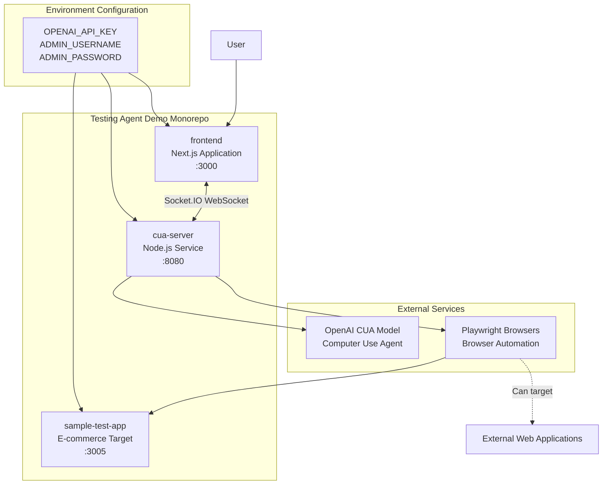
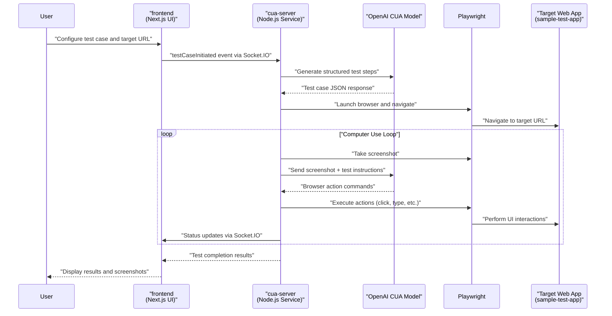

<!-- source: DeepWiki mcp.deepwiki.com · repo openai/openai-testing-agent-demo · page 1 Overview · fetched 2026-10-26 -->

# Overview

Relevant source files

The following files were used as context for generating this wiki page:

- [LICENSE](LICENSE)
- [README.md](README.md)

## Purpose and Scope

This document provides an overview of the Testing Agent Demo repository, a monorepo that demonstrates automated web testing using OpenAI's Computer Use Agent (CUA) model. The system showcases how AI-driven browser automation can be used to execute test cases on web applications through natural language instructions and visual feedback.

The Testing Agent Demo consists of three interconnected applications that work together to provide end-to-end automated testing capabilities. For detailed information about individual components, see [CUA Server](#4), [Frontend Application](#5), and [Getting Started](#2) for setup instructions.

Sources: [README.md:1-91]()

## System Composition

The Testing Agent Demo is structured as a monorepo containing three distinct applications:

| Application | Technology | Port | Purpose |
|-------------|------------|------|---------|
| `frontend` | Next.js | 3000 | Web interface for configuring tests and monitoring execution |
| `cua-server` | Node.js | 8080 | Core service that orchestrates AI-driven browser automation |
| `sample-test-app` | Node.js | 3005 | Example e-commerce application used as a testing target |

The system leverages OpenAI's CUA model with computer use capabilities to interpret test instructions and execute browser actions through Playwright automation.

Sources: [README.md:7-11]()

## High-Level Architecture

The following diagram illustrates how the three applications interact within the broader system:

### System Architecture Diagram

Sources: [README.md:5-11](), [README.md:59-64]()

## Core Testing Workflow

The system follows a structured workflow that combines AI decision-making with browser automation:

### Testing Execution Flow

Sources: [README.md:5-6]()

## Key Technologies and Integrations

The system integrates several key technologies to enable AI-driven testing:

### Core Dependencies

- **OpenAI CUA Model**: Provides computer use capabilities for interpreting screenshots and generating browser actions
- **Playwright**: Handles browser automation, screenshot capture, and UI element interactions
- **Socket.IO**: Enables real-time communication between `frontend` and `cua-server`
- **Next.js**: Powers the web interface for test configuration and monitoring

### Environment Requirements

The system requires several environment variables to function properly:

| Variable | Purpose | Required By |
|----------|---------|-------------|
| `OPENAI_API_KEY` | Authentication for OpenAI CUA model | `frontend`, `cua-server` |
| `ADMIN_USERNAME` | Demo login credentials for sample app | `sample-test-app` |
| `ADMIN_PASSWORD` | Demo login credentials for sample app | `sample-test-app` |

Sources: [README.md:29-44](), [README.md:49-50]()

## Use Cases and Applications

The Testing Agent Demo serves multiple purposes:

### Primary Use Cases

1. **Demonstration Platform**: Shows how AI can automate web testing through natural language instructions
2. **Development Framework**: Provides a foundation for building custom AI-driven testing solutions
3. **Integration Example**: Illustrates how to combine OpenAI's computer use capabilities with browser automation

### Customization Capabilities

The system is designed to be adaptable for different testing scenarios. Users can:

- Test any web application by updating the target URL in `frontend/lib/constants.ts`
- Modify test cases through the configuration UI
- Extend the `cua-server` logic for custom testing workflows

The `sample-test-app` serves purely as an example target, while the core testing logic resides in the `cua-server` component.

Sources: [README.md:73-77]()

---

