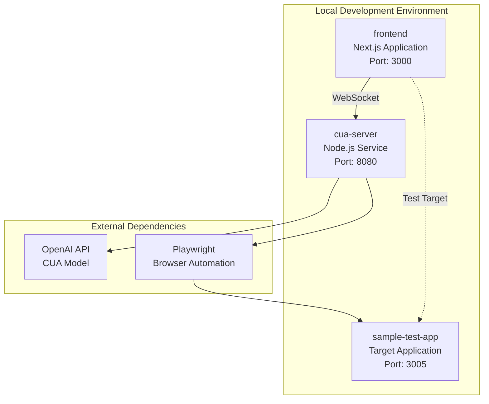
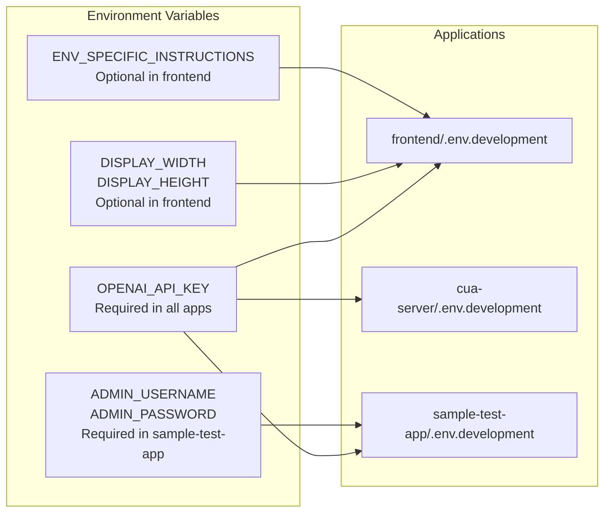

<!-- source: DeepWiki mcp.deepwiki.com · repo openai/openai-testing-agent-demo · page 2 Getting Started · fetched 2026-10-26 -->

# Getting Started

<details>
<summary>Relevant source files</summary>

The following files were used as context for generating this wiki page:

- [README.md](README.md)
- [cua-server/.env.example](cua-server/.env.example)
- [frontend/.env.example](frontend/.env.example)

</details>


This guide provides step-by-step instructions for setting up and running the Testing Agent Demo system locally. The setup process will get all three applications running together: the frontend UI, CUA server, and sample test application.

For detailed information about the system architecture and how components interact, see [System Architecture](#3). For configuration options and environment variables, see [Configuration and Environment](#4.6).

## Overview

The Testing Agent Demo is a monorepo containing three interconnected applications that must be configured and started together to function properly. The setup process involves environment configuration, dependency installation, and coordinated startup of all services.

### System Components



Sources: [README.md:7-11](), [README.md:59-63]()

## Prerequisites

Before starting the setup process, ensure you have the following installed on your system:

| Requirement | Purpose | Notes |
|-------------|---------|-------|
| Node.js (v18+) | Runtime environment | Required for all three applications |
| npm | Package manager | Comes with Node.js |
| OpenAI API Key | AI model access | Required for CUA functionality |
| Git | Version control | For cloning the repository |

## Step-by-Step Setup

### 1. Clone Repository

```bash
git clone https://github.com/openai/testing-agent-demo
cd testing-agent-demo
```

Sources: [README.md:20-25]()

### 2. Environment Configuration

The system requires environment files for each application. Create these files from the provided examples:

```bash
cp frontend/.env.example frontend/.env.development
cp cua-server/.env.example cua-server/.env.development
cp sample-test-app/.env.example sample-test-app/.env.development
```

#### Required Environment Variables

Configure the following variables in each `.env.development` file:



**OpenAI API Key Setup:**
- Add your OpenAI API key to all three `.env.development` files
- Set `OPENAI_API_KEY=your-openai-key`
- If not set globally, instructions available at [OpenAI API documentation](https://platform.openai.com/docs/libraries#create-and-export-an-api-key)

**Sample App Credentials:**
- Default credentials for testing: `ADMIN_USERNAME=test_user_name` and `ADMIN_PASSWORD=test_password`
- These are required for the sample e-commerce application to function

Sources: [README.md:27-44](), [frontend/.env.example:1-6](), [cua-server/.env.example:1-1]()

### 3. Install Dependencies

Install Node.js dependencies and Playwright browsers:

```bash
npm install
npx playwright install
```

This command will:
- Install all npm dependencies across all three applications (monorepo setup)
- Download Playwright browser binaries required for browser automation

Sources: [README.md:46-51]()

### 4. Start All Applications

Launch all three applications simultaneously:

```bash
npm run dev
```

This command starts all applications in development mode with the following endpoints:

| Application | URL | Purpose |
|-------------|-----|---------|
| Frontend UI | http://localhost:3000 | Test configuration and monitoring interface |
| Sample Test App | http://localhost:3005 | Target application for testing |
| CUA Server | ws://localhost:8080 | WebSocket server for AI-browser communication |

Sources: [README.md:53-65]()

## Verification Steps

After completing the setup, verify that all components are working correctly:

### 1. Check Application Accessibility

Visit each application URL to ensure they're running:
- **Frontend**: Navigate to http://localhost:3000 - should display the test configuration interface
- **Sample App**: Navigate to http://localhost:3005 - should display the e-commerce demo site
- **CUA Server**: WebSocket server should be accessible (no direct browser interface)

### 2. Test Basic Functionality

From the frontend interface at http://localhost:3000:
1. Verify the test configuration form is displayed
2. Confirm the sample app URL (http://localhost:3005) is set as default target
3. Check that WebSocket connection to CUA server is established

### 3. Environment Variable Validation

Ensure all required environment variables are properly set:
- `OPENAI_API_KEY` is configured in all three applications
- Sample app credentials are configured
- No missing environment variable errors in console logs

## Next Steps

After successful setup, you can:

1. **Run Your First Test**: Use the frontend interface to configure and execute a test case against the sample application
2. **Customize Test Scenarios**: Modify test cases and target URLs in the frontend interface
3. **Explore Sample Application**: Familiarize yourself with the demo e-commerce site to understand available test scenarios
4. **Configure Custom Targets**: Point the system at your own web applications for testing

For detailed information about:
- Configuring custom test cases, see [Frontend Application](#5)
- Understanding the AI agents and test execution process, see [CUA Server](#4)
- Customizing the system for your own applications, see [Development Guide](#6)

## Troubleshooting Common Issues

| Issue | Cause | Solution |
|-------|-------|----------|
| "OpenAI API key not found" | Missing or incorrect API key | Verify `OPENAI_API_KEY` in all `.env.development` files |
| Port conflicts | Ports 3000, 3005, or 8080 already in use | Stop conflicting services or modify port configuration |
| Playwright browser issues | Browsers not installed | Run `npx playwright install` |
| WebSocket connection failed | CUA server not running | Ensure `npm run dev` started all services successfully |

Sources: [README.md:15-16](), [README.md:84-87]()

---

