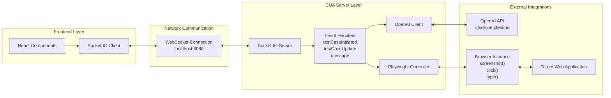
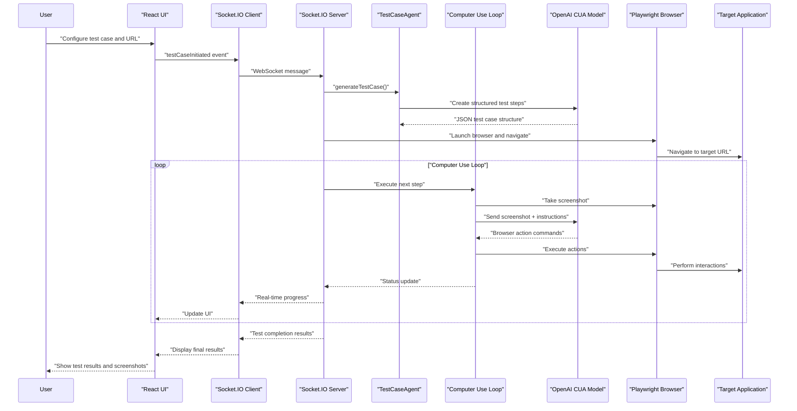
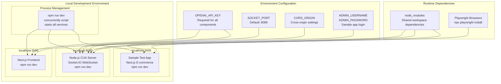
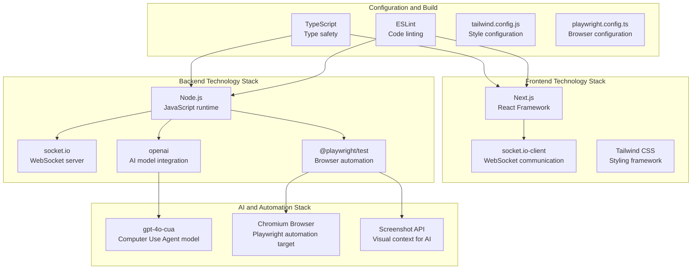

<!-- source: DeepWiki mcp.deepwiki.com · repo openai/openai-testing-agent-demo · page 3 System Architecture · fetched 2026-10-26 -->

# System Architecture

<details>
<summary>Relevant source files</summary>

The following files were used as context for generating this wiki page:

- [README.md](README.md)
- [cua-server/README.md](cua-server/README.md)
- [frontend/README.md](frontend/README.md)

</details>


## Purpose and Scope

This document provides a high-level overview of the Testing Agent Demo's system architecture, focusing on how the three main applications work together to enable AI-driven web testing. It covers the overall system design, communication patterns, and execution flow between components.

For detailed implementation of individual components, see [CUA Server](#4) for the core backend service, [Frontend Application](#5) for the web interface, and [Development Guide](#6) for the sample test application structure.

## System Overview

The Testing Agent Demo is architected as a monorepo containing three distinct applications that work together to provide AI-powered web testing capabilities.

### Application Architecture

```mermaid
graph TB
    subgraph MonorepoRoot["Testing Agent Demo Monorepo"]
        FrontendApp[Frontend<br/>"Next.js Application"<br/>":3000"]
        CuaServerApp[CuaServer<br/>"Node.js Service"<br/>":8080"]
        SampleApp[SampleTestApp<br/>"Demo E-commerce Site"<br/>":3005"]
    end
    
    subgraph ExternalServices["External Dependencies"]
        OpenAIAPI["OpenAI CUA Model<br/>"gpt-4o-cua""]
        PlaywrightEngine["Playwright Browser<br/>"Chromium/Firefox/Safari""]
    end
    
    User --> FrontendApp
    FrontendApp <-->|"Socket.IO WebSocket"| CuaServerApp
    CuaServerApp --> OpenAIAPI
    CuaServerApp --> PlaywrightEngine
    PlaywrightEngine --> SampleApp
    PlaywrightEngine -.->|"Can target any web app"| ExternalWebApps["External Web Applications"]
```

**Sources:** [README.md:7-11](), [frontend/README.md:5-6](), [cua-server/README.md:5]()

### Component Responsibilities

| Component | Primary Responsibility | Technology | Default Port |
|-----------|----------------------|------------|--------------|
| `frontend` | User interface for test configuration and monitoring | Next.js | 3000 |
| `cua-server` | AI orchestration and browser automation | Node.js + Socket.IO | 8080 |
| `sample-test-app` | Demo target application for testing | Next.js | 3005 |

**Sources:** [README.md:9-11](), [README.md:59-63]()

## Application Communication Architecture

The system uses WebSocket-based real-time communication between the frontend and CUA server, with the CUA server orchestrating external API calls and browser automation.

### Communication Flow Architecture



**Sources:** [cua-server/README.md:5](), [frontend/README.md:5]()

## Test Execution Flow Architecture

The system follows a structured flow from user input through AI processing to browser automation and result reporting.

### Execution Pipeline Architecture



**Sources:** [README.md:5](), [cua-server/README.md:5]()

## Deployment Architecture

The system is designed to run locally with specific port assignments and environment configurations.

### Service Deployment Architecture



**Sources:** [README.md:53-63](), [README.md:27-44](), [cua-server/README.md:20-26]()

## Technology Stack and Dependencies

The system integrates multiple technologies to provide AI-driven browser automation capabilities.

### Technology Integration Architecture



**Sources:** [README.md:5](), [README.md:48-50](), [cua-server/README.md:14-18](), [frontend/README.md:14-17]()

---

