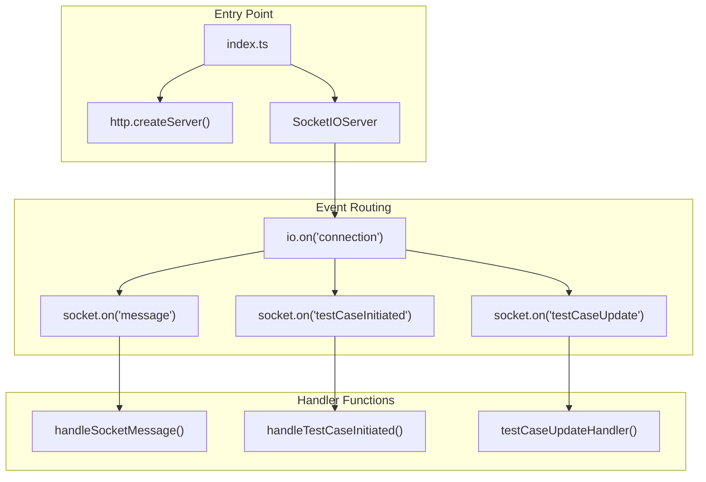
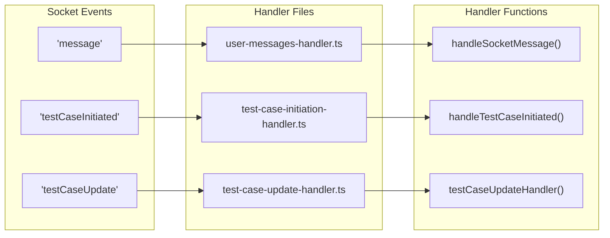
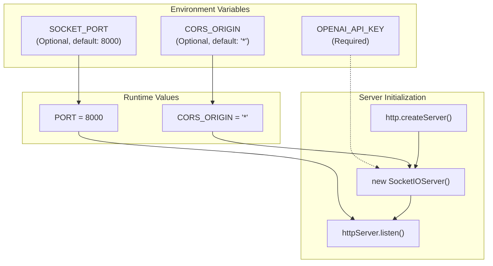
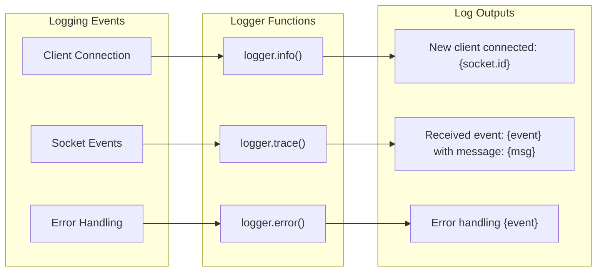

<!-- source: DeepWiki mcp.deepwiki.com · repo openai/openai-testing-agent-demo · page 4 CUA Server · fetched 2026-10-26 -->

# CUA Server

Relevant source files

The following files were used as context for generating this wiki page:

- [cua-server/README.md](cua-server/README.md)
- [cua-server/package.json](cua-server/package.json)
- [cua-server/src/index.ts](cua-server/src/index.ts)

## Purpose and Scope

The CUA Server is the core backend service that orchestrates AI-driven web testing using OpenAI's Computer Use Agent (CUA) model. It serves as the central coordinator between the frontend interface and browser automation, providing real-time test execution capabilities through WebSocket communication.

This document covers the high-level architecture, core components, and communication patterns of the CUA Server. For detailed implementation specifics, see the following subsections: [Server Overview and Entry Point](#4.1), [AI Agents](#4.2), [Event Handlers](#4.3), [Browser Automation](#4.4), [External Services](#4.5), [Configuration and Environment](#4.6), and [Utilities and Helpers](#4.7).

## Service Architecture

The CUA Server follows a modular event-driven architecture built on Node.js with Socket.IO for real-time communication:

### Core Server Infrastructure

Sources: [cua-server/src/index.ts:1-70]()

### Socket Data Management

Each connected socket maintains session state through the `socket.data` object:

| Property | Type | Purpose |
|----------|------|---------|
| `testCaseReviewAgent` | `undefined \| Agent` | AI agent for reviewing test progress |
| `lastCallId` | `undefined \| string` | Tracking conversation context |
| `previousResponseId` | `undefined \| string` | OpenAI response tracking |
| `testCaseStatus` | `string` | Current test execution status |

Sources: [cua-server/src/index.ts:33-36]()

## Component Architecture

The CUA Server is composed of several key component categories that work together to enable AI-driven testing:

### Handler-Based Event Processing

Sources: [cua-server/src/index.ts:4-6](), [cua-server/src/index.ts:46-62]()

## Technology Stack

The CUA Server is built using the following core technologies:

| Technology | Version | Purpose |
|------------|---------|---------|
| `socket.io` | ^4.8.1 | Real-time WebSocket communication |
| `playwright` | ^1.52.0 | Browser automation and control |
| `openai` | ^4.87.3 | OpenAI CUA model integration |
| `pino` | ^9.6.0 | Structured logging |
| `uuid` | ^11.1.0 | Unique identifier generation |
| `typescript` | ^5 | Type-safe development |

Sources: [cua-server/package.json:7-19]()

## Runtime Configuration

The server accepts configuration through environment variables:

### Server Configuration

Sources: [cua-server/src/index.ts:10-14](), [cua-server/README.md:22-26]()

## Development Workflow

The CUA Server supports both development and production execution modes:

| Command | Purpose | Runtime |
|---------|---------|---------|
| `npm run dev` | Development server with auto-reload | `ts-node-dev` |
| `npm run build` | Compile TypeScript to JavaScript | `tsc` |
| `npm start` | Production server | `node dist/index.js` |

Sources: [cua-server/package.json:2-6]()

## Logging and Monitoring

The server uses structured logging through the `pino` library with trace-level event monitoring:

Sources: [cua-server/src/index.ts:30](), [cua-server/src/index.ts:39-43](), [cua-server/src/index.ts:47-61]()

## Component Organization

The CUA Server codebase is organized into logical modules that handle different aspects of the testing workflow. Each module is covered in detail in the following subsections:

- **[Server Overview and Entry Point](#4.1)**: Socket.IO setup and connection handling
- **[AI Agents](#4.2)**: OpenAI model integration and test case generation
- **[Event Handlers](#4.3)**: Processing different types of client events
- **[Browser Automation](#4.4)**: Playwright integration and action execution
- **[External Services](#4.5)**: OpenAI API client and login automation
- **[Configuration and Environment](#4.6)**: Build setup and environment management
- **[Utilities and Helpers](#4.7)**: Logging, test case processing, and shared utilities

This modular architecture enables the CUA Server to coordinate complex AI-driven testing workflows while maintaining clear separation of concerns and facilitating development and maintenance.

Sources: [cua-server/src/index.ts:1-70](), [cua-server/README.md:1-27](), [cua-server/package.json:1-21]()

---

