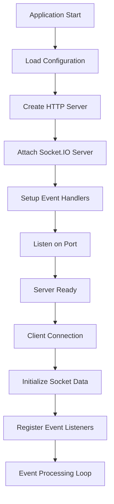
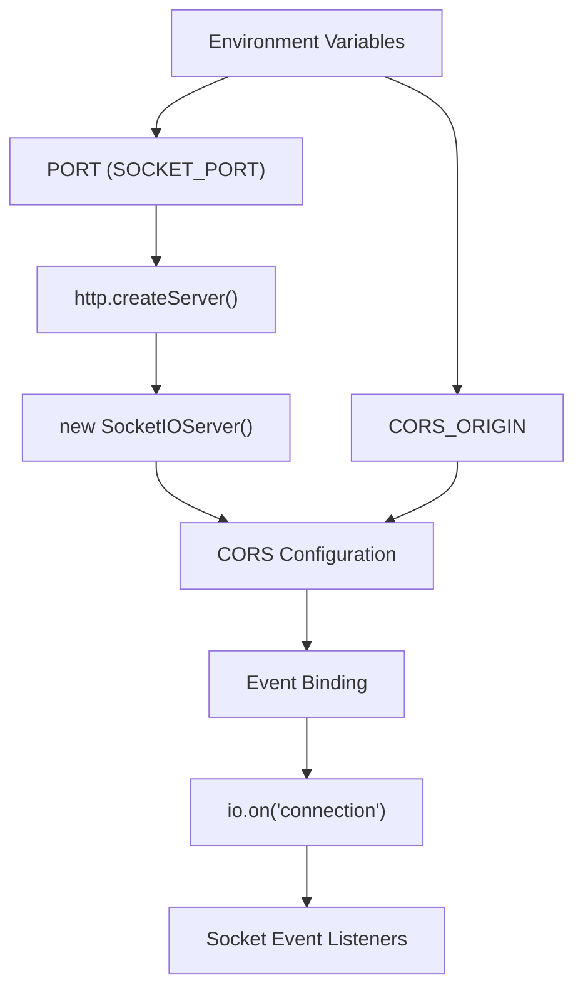
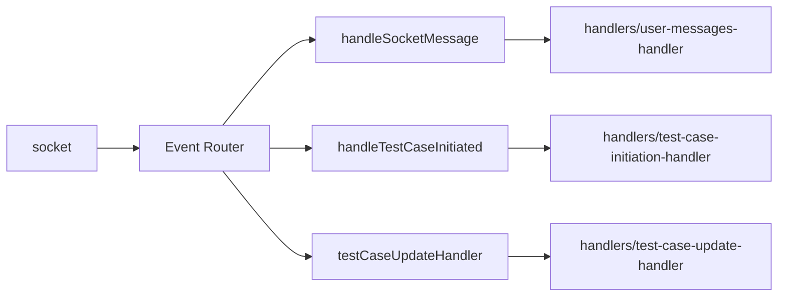
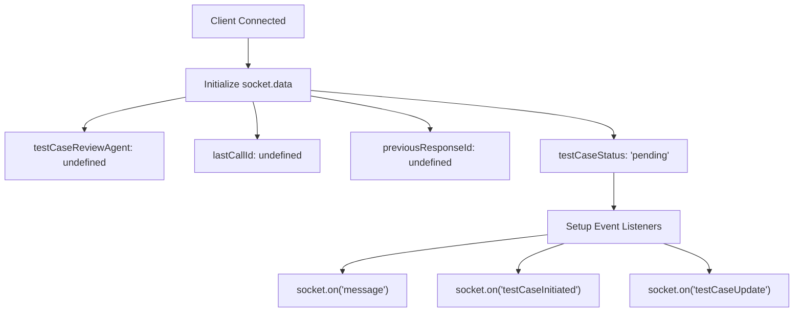
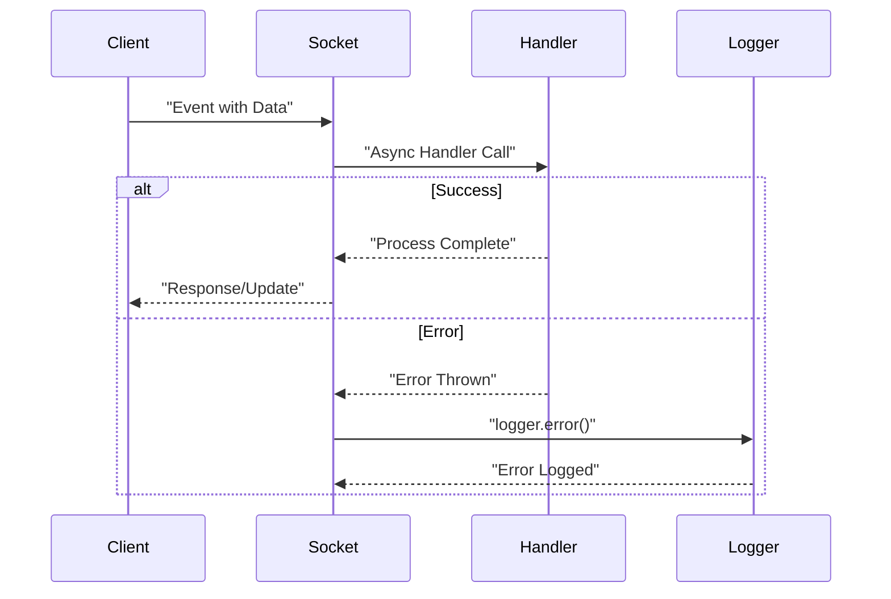
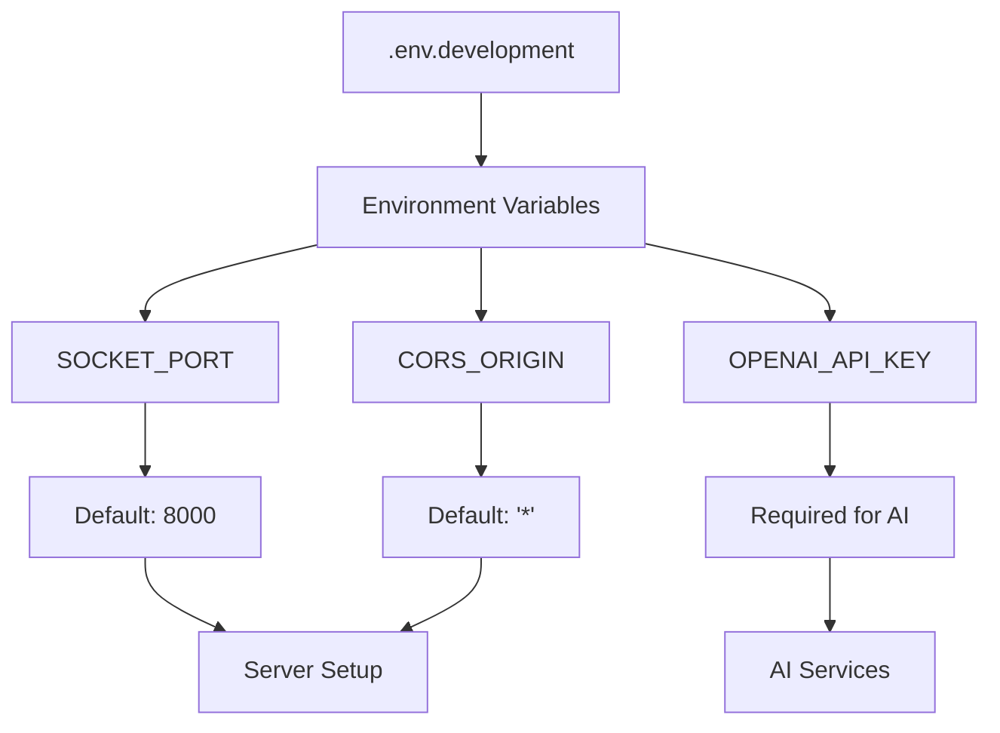
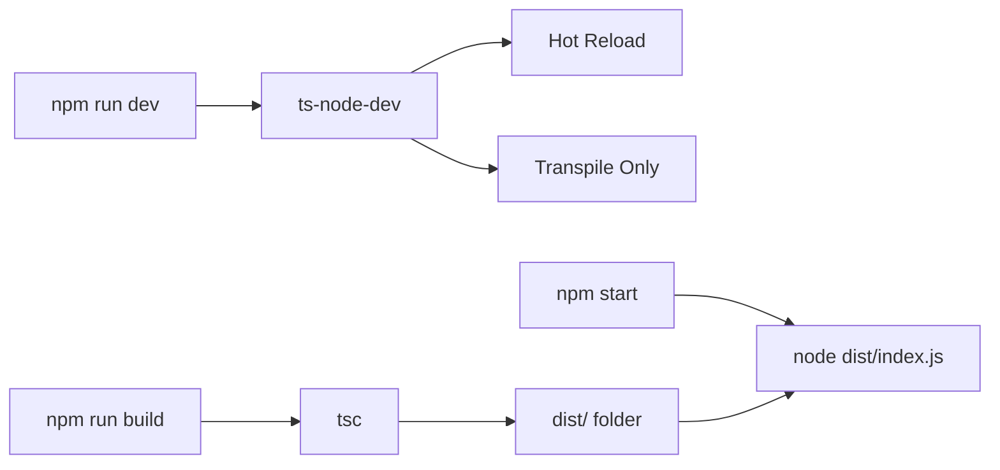

<!-- source: DeepWiki mcp.deepwiki.com · repo openai/openai-testing-agent-demo · page 4.1 Server Overview and Entry Point · fetched 2026-10-26 -->

# Server Overview and Entry Point

Relevant source files

The following files were used as context for generating this wiki page:

- [cua-server/README.md](cua-server/README.md)
- [cua-server/package.json](cua-server/package.json)
- [cua-server/src/index.ts](cua-server/src/index.ts)

This document covers the CUA Server's main entry point, Socket.IO server setup, and core event handling infrastructure. It explains how the server starts up, establishes WebSocket connections, and routes incoming events to appropriate handlers.

For information about the specific AI agents that handle test case generation and review, see [AI Agents](#4.2). For details about browser automation and the computer use loop, see [Browser Automation](#4.4).

## Purpose and Architecture

The CUA Server serves as the central orchestrator for AI-driven web testing, implemented as a Node.js service that exposes a Socket.IO WebSocket API. The server's primary responsibilities include establishing real-time communication with the frontend, routing events to specialized handlers, and managing the overall test execution lifecycle.

### Server Entry Point Flow

**Sources:** [cua-server/src/index.ts:1-70]()

## Socket.IO Server Setup

The server uses Socket.IO for real-time bidirectional communication with the frontend. The setup process involves creating an HTTP server and attaching the Socket.IO server with CORS configuration.

### Core Server Components

| Component | Purpose | Configuration |
|-----------|---------|---------------|
| HTTP Server | Provides basic HTTP endpoint | Returns "Socket.IO server is running." |
| Socket.IO Server | Handles WebSocket connections | CORS origin configurable |
| Event Handlers | Process incoming events | Async error handling |
| Logger | Structured logging | Pino with pretty printing |

### Socket.IO Configuration

**Sources:** [cua-server/src/index.ts:16-27](), [cua-server/src/index.ts:10-14]()

## Event Handling System

The server implements a comprehensive event handling system that processes three main types of events from connected clients.

### Event Handler Architecture

### Socket Data Initialization

When a client connects, the server initializes socket-specific data to track the session state:

**Sources:** [cua-server/src/index.ts:29-43](), [cua-server/src/index.ts:32-36]()

## Event Processing Flow

The server processes events asynchronously with comprehensive error handling and logging.

### Event Handling Implementation

| Event Name | Handler Function | Purpose |
|------------|------------------|---------|
| `message` | `handleSocketMessage` | Process user messages and chat interactions |
| `testCaseInitiated` | `handleTestCaseInitiated` | Start new test case generation and execution |
| `testCaseUpdate` | `testCaseUpdateHandler` | Update test case status and progress |

### Error Handling Pattern

**Sources:** [cua-server/src/index.ts:46-62]()

## Configuration Management

The server uses environment variables for configuration with sensible defaults.

### Configuration Parameters

### Environment Variable Processing

The server processes configuration at startup with type conversion and validation:

- `SOCKET_PORT`: Parsed as integer with fallback to `8000`
- `CORS_ORIGIN`: String value with fallback to `"*"`
- `OPENAI_API_KEY`: Required for AI functionality (validated by handlers)

**Sources:** [cua-server/src/index.ts:10-14](), [cua-server/README.md:22-26]()

## Dependencies and Runtime

The server relies on several key dependencies for its core functionality.

### Core Dependencies

| Package | Version | Purpose |
|---------|---------|---------|
| `socket.io` | ^4.8.1 | WebSocket server implementation |
| `pino` | ^9.6.0 | Structured logging |
| `playwright` | ^1.52.0 | Browser automation |
| `openai` | ^4.87.3 | OpenAI API integration |
| `uuid` | ^11.1.0 | Unique identifier generation |

### Development Dependencies

| Package | Purpose |
|---------|---------|
| `typescript` | Type checking and compilation |
| `ts-node-dev` | Development server with hot reload |
| `@types/node` | Node.js type definitions |

**Sources:** [cua-server/package.json:7-19]()

### Build and Development Scripts

**Sources:** [cua-server/package.json:2-6]()

---

