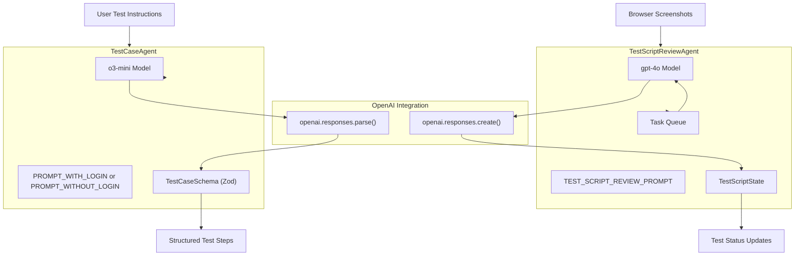
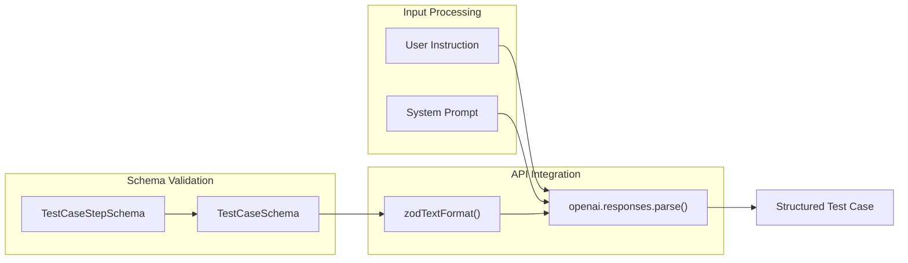
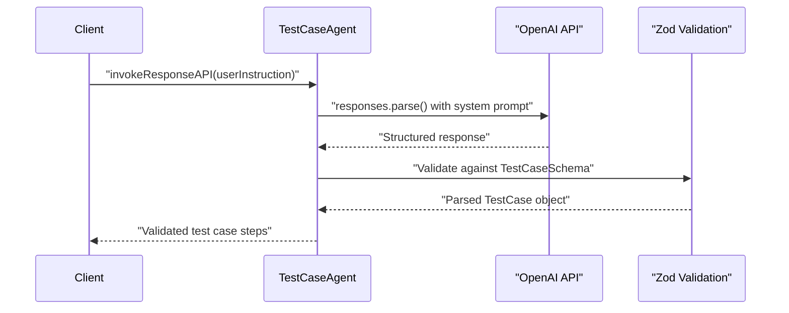
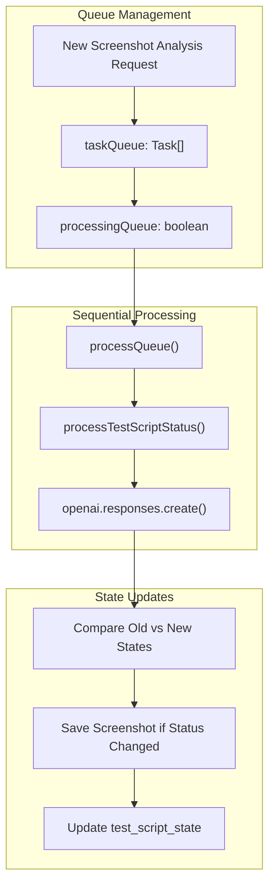
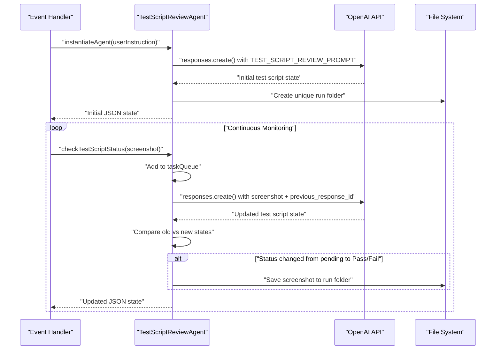

<!-- source: DeepWiki mcp.deepwiki.com · repo openai/openai-testing-agent-demo · page 4.2 AI Agents · fetched 2026-10-26 -->

# AI Agents

Relevant source files

The following files were used as context for generating this wiki page:

- [cua-server/src/agents/test-case-agent.ts](cua-server/src/agents/test-case-agent.ts)
- [cua-server/src/agents/test-script-review-agent.ts](cua-server/src/agents/test-script-review-agent.ts)
- [cua-server/src/lib/constants.ts](cua-server/src/lib/constants.ts)

This document covers the AI-powered agents within the CUA Server that leverage OpenAI models to generate and review test cases. These agents transform natural language test instructions into structured test steps and continuously monitor test execution progress through visual analysis.

For information about the browser automation that executes the test steps generated by these agents, see [Browser Automation](#4.4). For details about the event handlers that coordinate agent invocation, see [Event Handlers](#4.3).

## Agent Architecture Overview

The CUA Server employs two specialized AI agents that work together to provide intelligent test case generation and execution monitoring:

Sources: [cua-server/src/agents/test-case-agent.ts:1-55](), [cua-server/src/agents/test-script-review-agent.ts:1-355]()

## TestCaseAgent

The `TestCaseAgent` class converts natural language test instructions into structured, executable test steps using OpenAI's structured output capabilities.

### Core Implementation

The agent is initialized with a login requirement flag that determines which system prompt to use:

| Property | Type | Purpose |
|----------|------|---------|
| `model` | `string` | Always set to "o3-mini" |
| `developer_prompt` | `string` | Either `PROMPT_WITH_LOGIN` or `PROMPT_WITHOUT_LOGIN` |
| `login_required` | `boolean` | Determines prompt selection |

The agent uses Zod schemas to ensure structured output:

Sources: [cua-server/src/agents/test-case-agent.ts:7-17](), [cua-server/src/agents/test-case-agent.ts:21-32]()

### Prompt Templates

The agent uses two distinct prompt templates based on whether authentication is required:

- **`PROMPT_WITH_LOGIN`**: Includes standard login steps (navigate, enter credentials, verify login) followed by user-specified test steps
- **`PROMPT_WITHOUT_LOGIN`**: Starts directly with navigation to target URL followed by user test steps

Both prompts enforce a consistent JSON structure with `step_number`, `step_instructions`, and `status` fields.

Sources: [cua-server/src/lib/constants.ts:1-49]()

### API Integration

The `invokeResponseAPI` method orchestrates the test case generation process:

Sources: [cua-server/src/agents/test-case-agent.ts:37-51]()

## TestScriptReviewAgent

The `TestScriptReviewAgent` class monitors test execution by analyzing screenshots and updating test step statuses in real-time. It maintains conversational context with the AI model throughout the test execution.

### State Management

The agent maintains several key state properties:

| Property | Type | Purpose |
|----------|------|---------|
| `test_script_state` | `TestScriptState \| null` | Current test step statuses and reasoning |
| `previous_response_id` | `string \| null` | OpenAI conversation context ID |
| `runFolder` | `string \| null` | Unique folder for storing test artifacts |
| `taskQueue` | `Task[]` | Sequential processing queue for screenshots |

Sources: [cua-server/src/agents/test-script-review-agent.ts:30-55]()

### Task Queue Processing

The agent implements a sequential task queue to handle multiple screenshot analysis requests without race conditions:

Sources: [cua-server/src/agents/test-script-review-agent.ts:144-177](), [cua-server/src/agents/test-script-review-agent.ts:159-177]()

### Agent Instantiation Workflow

The agent follows a two-phase initialization process:

1. **Initial Setup** (`instantiateAgent`): Creates the initial test script state from user instructions
2. **Continuous Monitoring** (`checkTestScriptStatus`): Processes screenshots and updates test progress

Sources: [cua-server/src/agents/test-script-review-agent.ts:60-140](), [cua-server/src/agents/test-script-review-agent.ts:183-351]()

### Screenshot Management

The agent implements intelligent screenshot storage based on test step status transitions:

- Screenshots are saved only when a test step transitions from "pending" to "Pass" or "Fail"
- Each test run gets a unique folder using `uuidv4()` 
- Screenshots are stored in `/frontend/public/test_results/{runFolder}/` for web accessibility
- Image paths are embedded in the test state JSON for frontend display

Sources: [cua-server/src/agents/test-script-review-agent.ts:282-342]()

## Integration with OpenAI Services

Both agents leverage OpenAI's advanced API features for reliable structured output:

### Response API Usage

| Agent | API Method | Model | Key Features |
|-------|------------|-------|-------------|
| `TestCaseAgent` | `responses.parse()` | o3-mini | Zod schema validation, structured JSON output |
| `TestScriptReviewAgent` | `responses.create()` | gpt-4o | Conversation continuity, image analysis |

### Conversation Context

The `TestScriptReviewAgent` maintains conversation context using `previous_response_id`, allowing the AI model to understand the progression of test execution across multiple screenshot analyses.

Sources: [cua-server/src/agents/test-case-agent.ts:39-48](), [cua-server/src/agents/test-script-review-agent.ts:222-255]()

---

