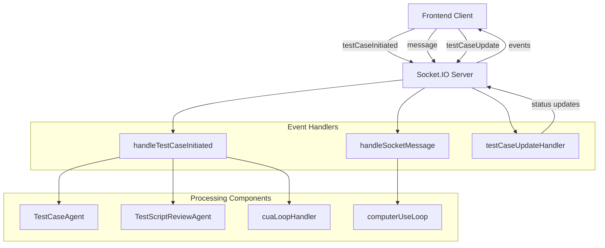
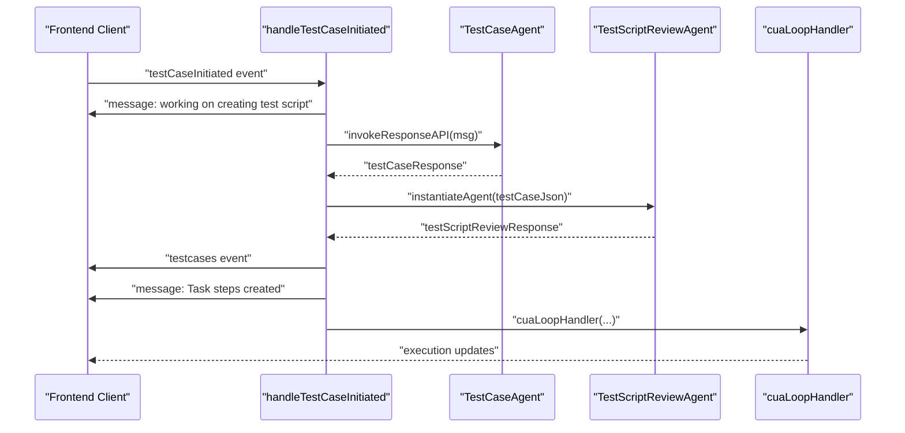
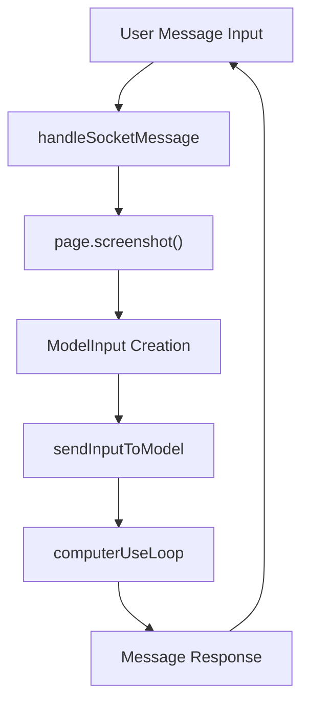
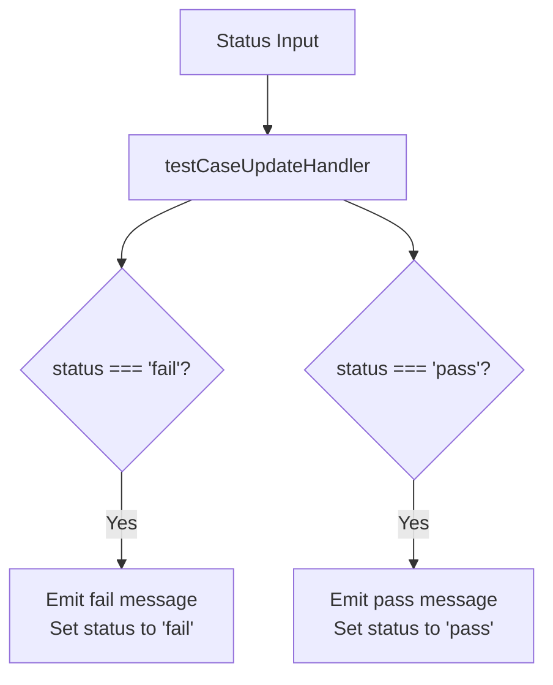

<!-- source: DeepWiki mcp.deepwiki.com · repo openai/openai-testing-agent-demo · page 4.3 Event Handlers · fetched 2026-10-26 -->

# Event Handlers

Relevant source files

The following files were used as context for generating this wiki page:

- [cua-server/src/handlers/test-case-initiation-handler.ts](cua-server/src/handlers/test-case-initiation-handler.ts)
- [cua-server/src/handlers/test-case-update-handler.ts](cua-server/src/handlers/test-case-update-handler.ts)
- [cua-server/src/handlers/user-messages-handler.ts](cua-server/src/handlers/user-messages-handler.ts)

This section documents the event handlers in the CUA Server that process different types of Socket.IO events from the frontend client. These handlers form the communication layer between the frontend UI and the server's AI-driven testing capabilities.

For information about the AI agents that these handlers coordinate with, see [AI Agents](#4.2). For details about the browser automation that handlers trigger, see [Browser Automation](#4.4).

## Purpose and Architecture

The CUA Server uses Socket.IO to handle real-time communication with the frontend client. Event handlers process incoming events and coordinate between AI agents, browser automation, and client updates. The handlers manage the complete lifecycle of test execution from initiation through completion.

### Event Handler Flow

Sources: [cua-server/src/handlers/test-case-initiation-handler.ts:1-94](), [cua-server/src/handlers/user-messages-handler.ts:1-52](), [cua-server/src/handlers/test-case-update-handler.ts:1-25]()

## Test Case Initiation Handler

The `handleTestCaseInitiated` function processes the primary event that starts a new test execution. This handler orchestrates the entire test setup and execution process.

### Handler Workflow

### Key Components

The handler processes the following input data structure:

| Field | Type | Purpose |
|-------|------|---------|
| `testCase` | string | Natural language test description |
| `url` | string | Target application URL |
| `userName` | string | Login credentials username |
| `password` | string | Login credentials password |
| `userInfo` | string | Additional user context |
| `loginRequired` | boolean | Whether login is needed (default: true) |

The handler performs these operations:

1. **Input Processing** - Extracts and validates event data [cua-server/src/handlers/test-case-initiation-handler.ts:14-25]()
2. **Agent Creation** - Instantiates `TestCaseAgent` and `TestScriptReviewAgent` [cua-server/src/handlers/test-case-initiation-handler.ts:34-48]()
3. **Test Case Generation** - Converts natural language to structured test steps [cua-server/src/handlers/test-case-initiation-handler.ts:36-67]()
4. **Execution Initiation** - Starts the CUA loop with generated test script [cua-server/src/handlers/test-case-initiation-handler.ts:73-82]()

Sources: [cua-server/src/handlers/test-case-initiation-handler.ts:8-87]()

## User Message Handler

The `handleSocketMessage` function processes user input during test execution, allowing users to provide additional instructions or resume paused tests.

### Message Processing Flow

The handler retrieves the current page state and processes user messages through these steps:

1. **Context Gathering** - Takes screenshot and retrieves previous response data [cua-server/src/handlers/user-messages-handler.ts:13-25]()
2. **Model Input Creation** - Constructs `ModelInput` with screenshot and context [cua-server/src/handlers/user-messages-handler.ts:21-25]()
3. **AI Processing** - Sends input to the OpenAI model [cua-server/src/handlers/user-messages-handler.ts:27]()
4. **Execution Resume** - Continues the computer use loop [cua-server/src/handlers/user-messages-handler.ts:29-34]()
5. **Response Filtering** - Extracts and emits message responses [cua-server/src/handlers/user-messages-handler.ts:36-50]()

Sources: [cua-server/src/handlers/user-messages-handler.ts:6-51]()

## Test Case Update Handler

The `testCaseUpdateHandler` manages test execution status updates, handling both pass and fail conditions.

### Status Management

| Status | Action | Socket Data Update |
|--------|--------|-------------------|
| `"fail"` | Emit failure message | `socket.data.testCaseStatus = "fail"` |
| `"pass"` | Emit success message | `socket.data.testCaseStatus = "pass"` |

### Handler Logic

The handler performs case-insensitive status checking and updates both the client interface and socket data state. For failed tests, it provides guidance for reviewing and retrying. For passed tests, it indicates completion and suggests refreshing for new tests.

Sources: [cua-server/src/handlers/test-case-update-handler.ts:4-25]()

## Handler Integration Points

### Socket Data Management

Event handlers utilize `socket.data` to maintain test execution state:

- `socket.data.page` - Playwright page instance for browser control
- `socket.data.testCaseReviewAgent` - Review agent for test monitoring  
- `socket.data.previousResponseId` - OpenAI conversation continuity
- `socket.data.lastCallId` - Action execution tracking
- `socket.data.testCaseStatus` - Current test status ("pass"/"fail")

### Client Communication Events

| Outbound Event | Purpose | Handler Source |
|----------------|---------|----------------|
| `"message"` | Status updates and user feedback | All handlers |
| `"testcases"` | Structured test case data | Test initiation |

Sources: [cua-server/src/handlers/test-case-initiation-handler.ts:26-82](), [cua-server/src/handlers/user-messages-handler.ts:45](), [cua-server/src/handlers/test-case-update-handler.ts:12-21]()

---

