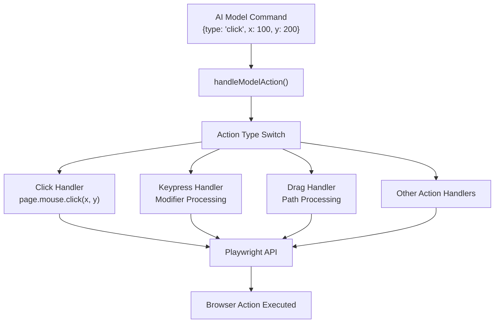
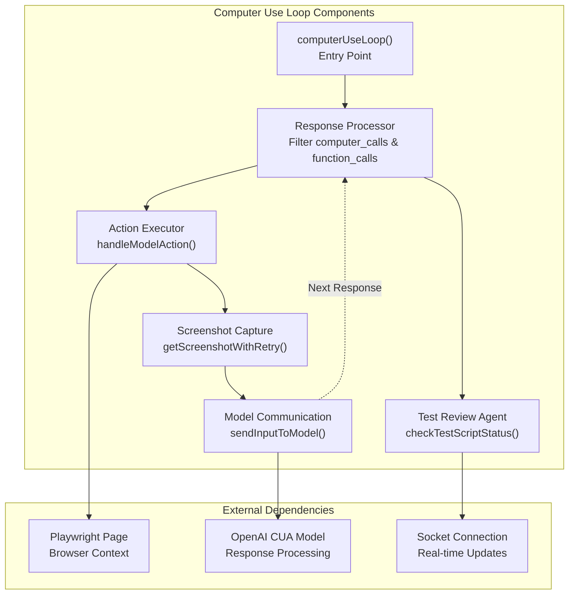
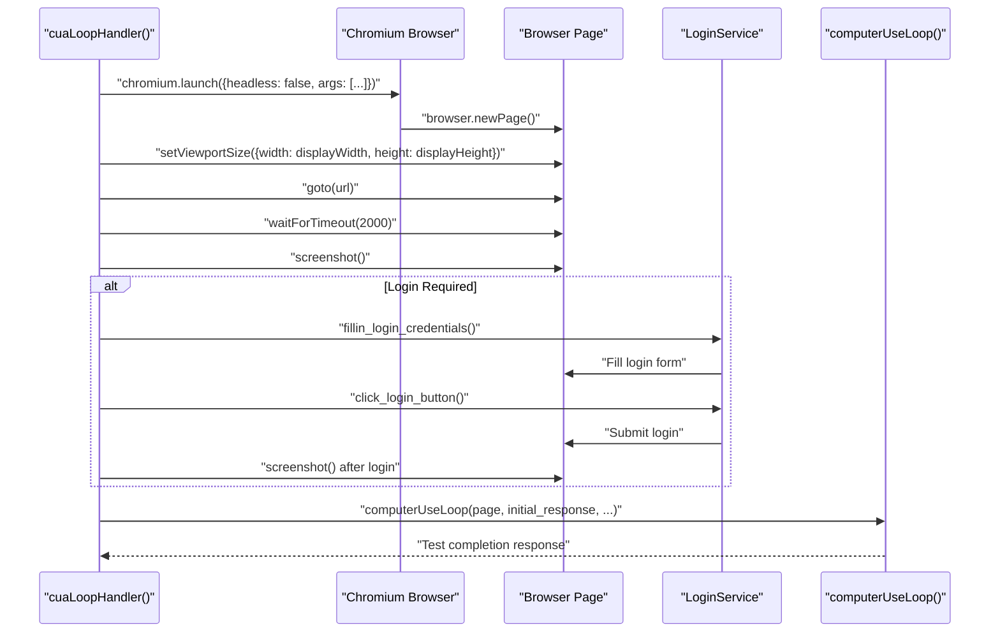
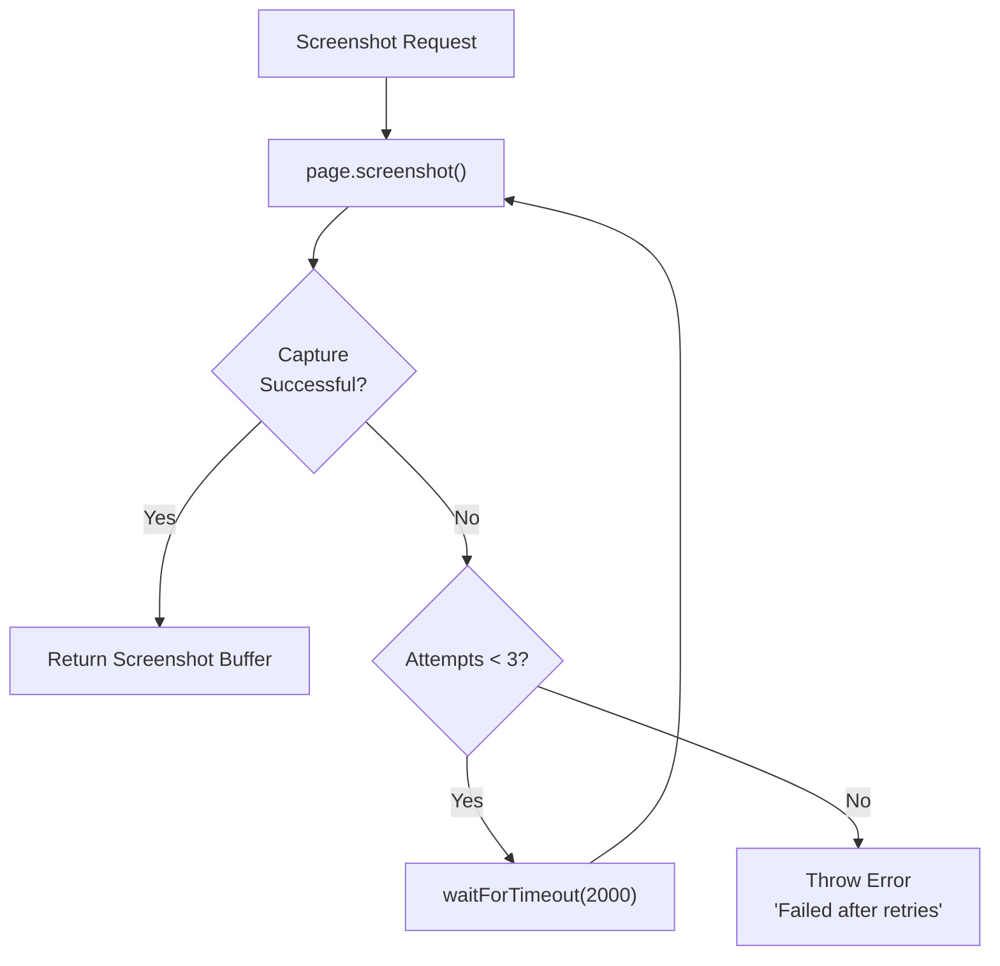

<!-- source: DeepWiki mcp.deepwiki.com · repo openai/openai-testing-agent-demo · page 4.4 Browser Automation · fetched 2026-10-26 -->

# Browser Automation

Relevant source files

The following files were used as context for generating this wiki page:

- [cua-server/src/handlers/action-handler.ts](cua-server/src/handlers/action-handler.ts)
- [cua-server/src/handlers/cua-loop-handler.ts](cua-server/src/handlers/cua-loop-handler.ts)
- [cua-server/src/lib/computer-use-loop.ts](cua-server/src/lib/computer-use-loop.ts)

This document covers the browser automation components of the CUA Server that are responsible for executing browser actions and managing the automation loop. These components translate AI model commands into actual browser interactions via Playwright and coordinate the continuous feedback loop between AI reasoning and browser state.

For information about the AI agents that generate test cases and review execution status, see [AI Agents](#4.2). For details about OpenAI API integration, see [External Services](#4.5).

## Action Execution System

The browser automation system centers around the `handleModelAction` function, which serves as the translation layer between AI model commands and Playwright browser actions. This function processes structured action objects from the OpenAI CUA model and executes them in the browser context.

### Action Types and Implementation

The system supports the following action types, each implemented with specific Playwright API calls:

| Action Type | Parameters | Playwright Implementation |
|-------------|------------|---------------------------|
| `click` | `x`, `y`, `button` | `page.mouse.click()` |
| `double_click` | `x`, `y`, `button` | `page.mouse.dblclick()` |
| `scroll` | `x`, `y`, `scrollX`/`scroll_x`, `scrollY`/`scroll_y` | `page.evaluate()` with `window.scrollBy()` |
| `keypress` | `keys` (array) | `page.keyboard.down()`/`up()`/`press()` |
| `drag` | `path` (array of coordinates) | `page.mouse.move()`/`down()`/`up()` |
| `type` | `text` | `page.keyboard.type()` |
| `wait` | none | `page.waitForTimeout(2000)` |
| `screenshot` | none | Handled separately in loop |

#### Keypress Action Processing

The keypress implementation includes sophisticated modifier key handling that separates modifier keys (`SHIFT`, `CTRL`, `ALT`, `META`, `CMD`) from main keys, processes them in the correct order, and handles special keys like `ENTER`, `SPACE`, `PAGEDOWN`, and `PAGEUP`.

**Action Execution Flow Diagram**

Sources: [cua-server/src/handlers/action-handler.ts:5-153]()

## Computer Use Loop

The `computerUseLoop` function implements the core automation cycle that coordinates between AI model responses and browser execution. This loop processes model outputs, executes browser actions, captures screenshots, and sends feedback back to the model.

### Loop Components and Data Flow

The computer use loop operates through several key components:

**Computer Use Loop Architecture**

### Loop Termination Conditions

The computer use loop can terminate under several conditions:

1. **Test Case Success**: When `socket.data.testCaseStatus === "pass"` or a `mark_done` function call is received
2. **Test Case Failure**: When `socket.data.testCaseStatus === "fail"` or safety checks are triggered
3. **No Computer Calls**: When the model response contains no `computer_call` items
4. **Safety Violations**: When `pending_safety_checks` are detected in the model response

### New Tab Handling

The loop includes sophisticated logic for handling new browser tabs that may open during test execution. When a new tab is detected, the system:

1. Identifies the new page context using `page.context().pages()`
2. Sets the viewport size to default dimensions
3. Takes a screenshot of the new page
4. Recursively calls `computerUseLoop` with the new page context
5. Uses a `switchedToNewTab` flag to prevent infinite recursion

Sources: [cua-server/src/lib/computer-use-loop.ts:16-276]()

## Browser Lifecycle Management

The `cuaLoopHandler` function manages the complete browser lifecycle from launch to test completion, including initialization, login handling, and test execution coordination.

### Browser Initialization and Configuration

The browser is launched with specific configurations optimized for automated testing:

### Viewport Management

The system uses environment variables to configure browser viewport dimensions:

- `DISPLAY_WIDTH` (default: 1024)
- `DISPLAY_HEIGHT` (default: 768)

These dimensions are consistently applied across browser initialization and new tab handling to ensure predictable screenshot dimensions for the AI model.

### Screenshot and State Management

The handler captures screenshots at key moments and coordinates with the test review agent:

1. **Before Login**: Initial page screenshot for baseline test state
2. **After Login**: Post-authentication screenshot to verify login success
3. **Continuous Monitoring**: Screenshots during action execution for test progress tracking

Sources: [cua-server/src/handlers/cua-loop-handler.ts:16-185]()

## Error Handling and Retries

The browser automation system includes robust error handling mechanisms to deal with common automation challenges.

### Screenshot Retry Logic

The `getScreenshotWithRetry` function implements exponential backoff for screenshot capture failures:

**Screenshot Retry Mechanism**

### Action Execution Error Handling

All action execution in `handleModelAction` is wrapped in try-catch blocks that log detailed error information while allowing the automation loop to continue processing subsequent actions.

### Network Idle Waiting

The `waitForNetworkIdle` utility function ensures page stability before proceeding with actions by waiting for the `networkidle` load state, which indicates that no network requests have been made for at least 500ms.

Sources: [cua-server/src/lib/computer-use-loop.ts:258-275](), [cua-server/src/handlers/action-handler.ts:150-153](), [cua-server/src/handlers/action-handler.ts:156-161]()

---

