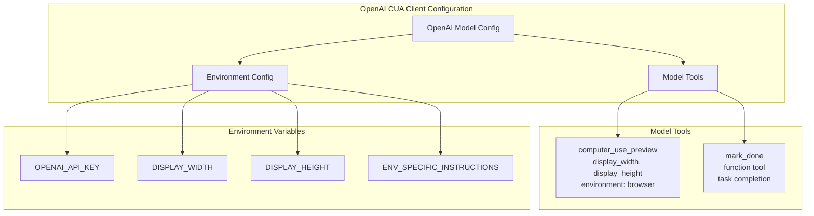
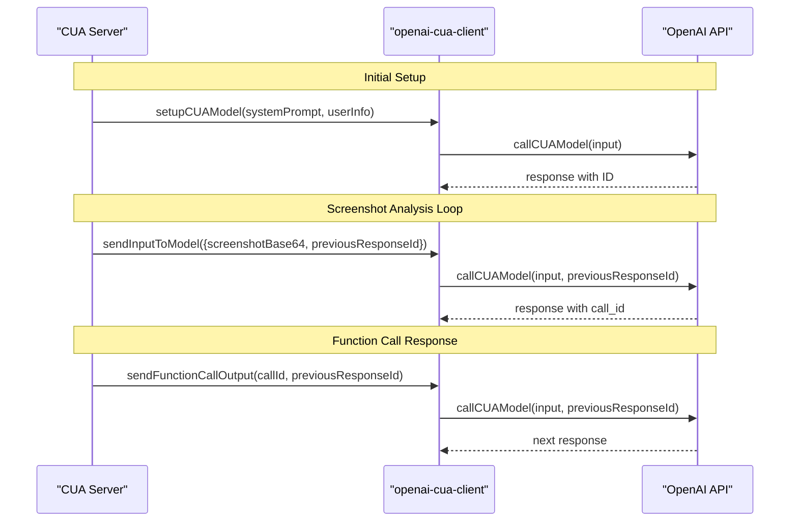
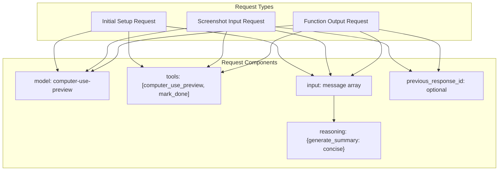
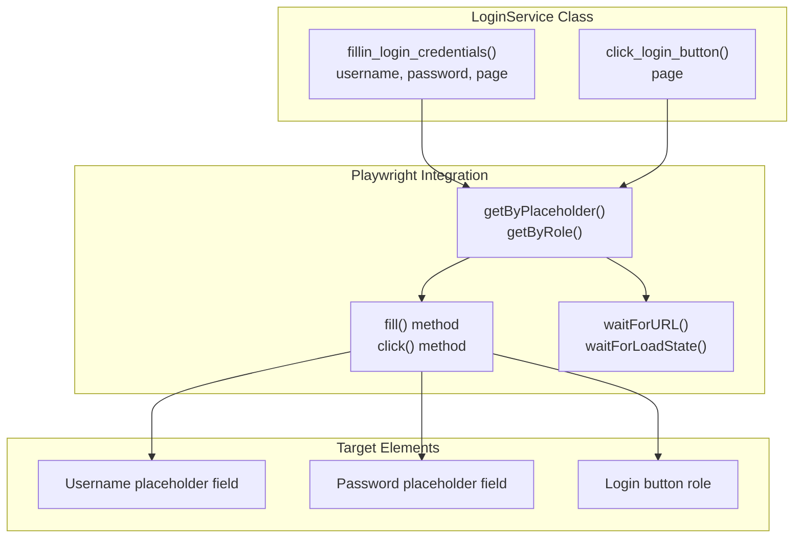
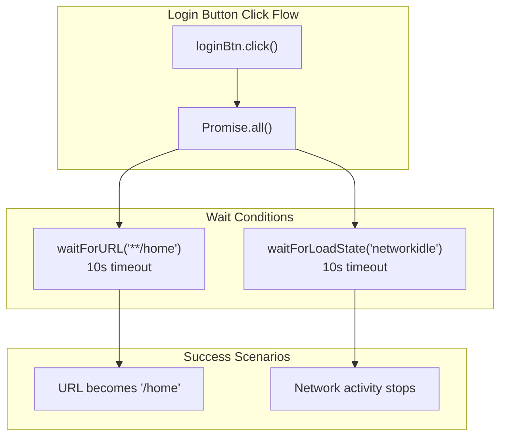
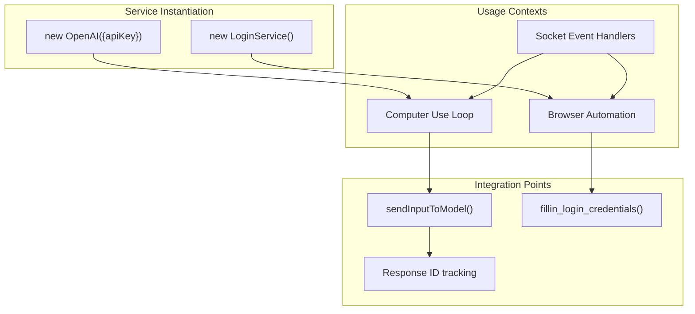

<!-- source: DeepWiki mcp.deepwiki.com · repo openai/openai-testing-agent-demo · page 4.5 External Services · fetched 2026-10-26 -->

# External Services

Relevant source files

The following files were used as context for generating this wiki page:

- [cua-server/src/services/login-service.ts](cua-server/src/services/login-service.ts)
- [cua-server/src/services/openai-cua-client.ts](cua-server/src/services/openai-cua-client.ts)

This document covers the external service integrations within the CUA Server, focusing on the OpenAI Computer Use Agent (CUA) model integration and automated login functionality. These services enable the CUA Server to communicate with AI models and perform automated authentication on web applications.

For information about browser automation components, see [Browser Automation](#4.4). For server configuration details, see [Configuration and Environment](#4.6).

## OpenAI CUA Client Integration

The `OpenAICUAClient` service manages all communication with OpenAI's Computer Use Agent model, which provides the AI-powered decision making for automated browser testing. This service handles model setup, screenshot analysis, and action generation.

### Core Model Configuration

The CUA model is configured with specific tools and display parameters to enable computer vision and browser interaction capabilities.

**Sources:** [cua-server/src/services/openai-cua-client.ts:23-37](), [cua-server/src/services/openai-cua-client.ts:4-10](), [cua-server/src/services/openai-cua-client.ts:19-21]()

### Model Communication Flow

The service implements a conversational pattern with the AI model, maintaining state across multiple interactions through response IDs and call tracking.

**Sources:** [cua-server/src/services/openai-cua-client.ts:137-162](), [cua-server/src/services/openai-cua-client.ts:89-119](), [cua-server/src/services/openai-cua-client.ts:121-135]()

### Key Service Methods

| Method | Purpose | Parameters | Returns |
|--------|---------|------------|---------|
| `setupCUAModel` | Initialize conversation with system prompt | `systemPrompt`, `userInfo` | `OpenAIResponse` |
| `sendInputToModel` | Send screenshot and user input | `ModelInput` object | `OpenAIResponse` |
| `sendFunctionCallOutput` | Send function execution results | `callId`, `previousResponseId`, `outputObj` | `OpenAIResponse` |
| `callCUAModel` | Core API communication helper | `input[]`, `previousResponseId?` | `OpenAIResponse` |

**Sources:** [cua-server/src/services/openai-cua-client.ts:44-48](), [cua-server/src/services/openai-cua-client.ts:39-42]()

### Request Structure and Payload

The service constructs specific request payloads for different interaction types with the AI model.

**Sources:** [cua-server/src/services/openai-cua-client.ts:51-83]()

## Login Service

The `LoginService` provides automated authentication capabilities for web applications, enabling the CUA Server to handle login flows without manual intervention.

### Service Architecture

**Sources:** [cua-server/src/services/login-service.ts:11-67]()

### Login Flow Implementation

The service implements a two-step authentication process with error handling and timeout management.

| Method | Function | Timeout | Error Handling |
|--------|----------|---------|----------------|
| `fillin_login_credentials` | Fill username and password fields | 5,000ms per field | Returns `false` on failure |
| `click_login_button` | Click login and wait for navigation | 10,000ms total | Returns `false` on failure |

**Sources:** [cua-server/src/services/login-service.ts:15-39](), [cua-server/src/services/login-service.ts:45-66]()

### Navigation and State Management

The login service handles post-authentication navigation by waiting for either URL change or network idle state.

**Sources:** [cua-server/src/services/login-service.ts:52-58]()

## Configuration Dependencies

Both external services rely on environment variables for proper configuration and authentication.

### Required Environment Variables

| Variable | Service | Purpose | Default |
|----------|---------|---------|---------|
| `OPENAI_API_KEY` | OpenAI CUA Client | API authentication | Required |
| `DISPLAY_WIDTH` | OpenAI CUA Client | Browser viewport width | 1024 |
| `DISPLAY_HEIGHT` | OpenAI CUA Client | Browser viewport height | 768 |
| `ENV_SPECIFIC_INSTRUCTIONS` | OpenAI CUA Client | OS-specific commands | Optional |

**Sources:** [cua-server/src/services/openai-cua-client.ts:4-6](), [cua-server/src/services/openai-cua-client.ts:20-21](), [cua-server/src/services/openai-cua-client.ts:9]()

### Service Integration Patterns

External services are instantiated and used throughout the CUA Server's event handling and automation loops, following dependency injection patterns for testability and modularity.

**Sources:** [cua-server/src/services/openai-cua-client.ts:4-6](), [cua-server/src/services/login-service.ts:11]()

---

