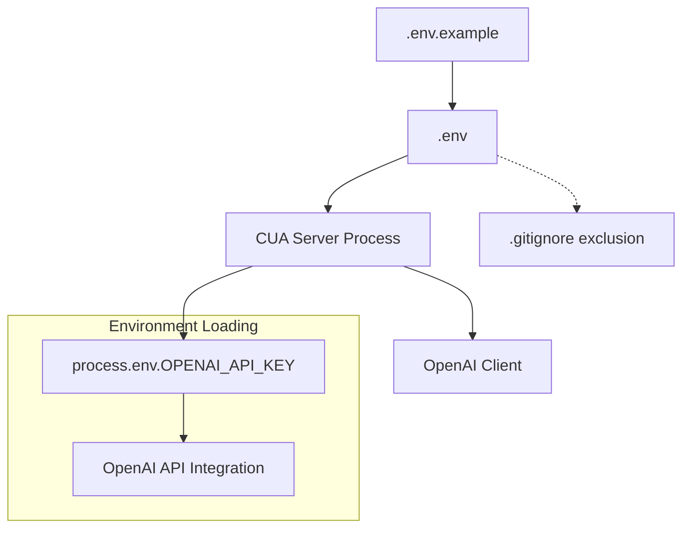
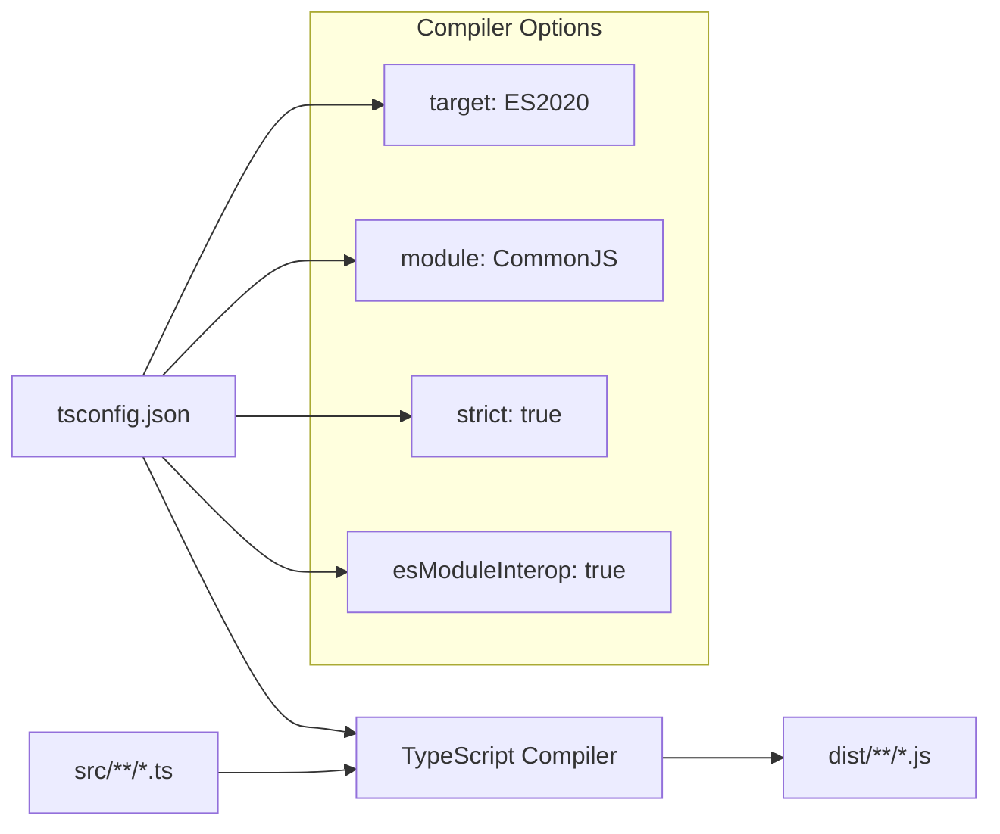
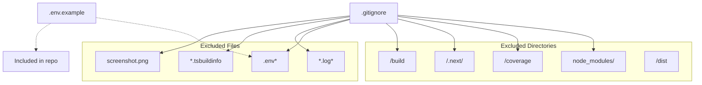
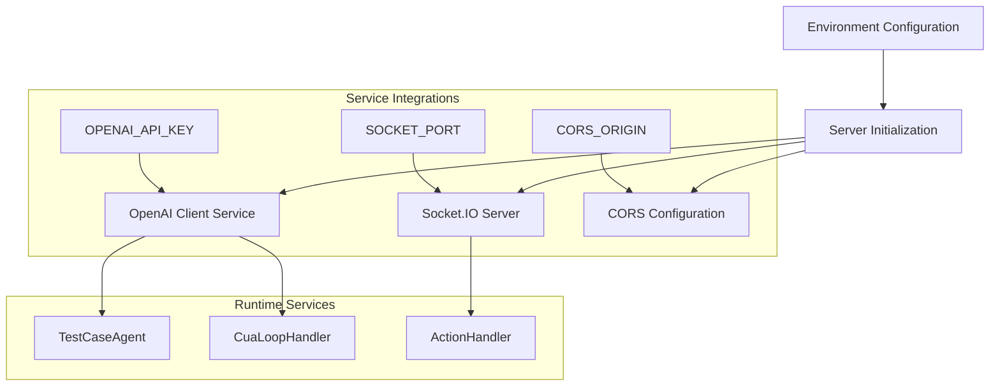
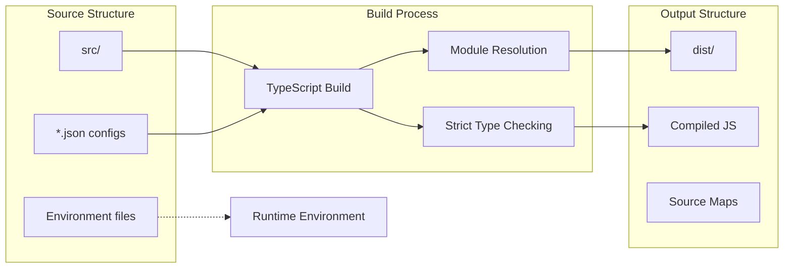

<!-- source: DeepWiki mcp.deepwiki.com · repo openai/openai-testing-agent-demo · page 4.6 Configuration and Environment · fetched 2026-10-26 -->

# Configuration and Environment

Relevant source files

The following files were used as context for generating this wiki page:

- [cua-server/.env.example](cua-server/.env.example)
- [cua-server/.gitignore](cua-server/.gitignore)
- [cua-server/tsconfig.json](cua-server/tsconfig.json)

This document covers the configuration and environment setup for the CUA Server component of the Testing Agent Demo system. It includes environment variables, TypeScript build configuration, development setup, and project structure requirements.

For information about the CUA Server's runtime architecture and core functionality, see [Server Overview and Entry Point](#4.1). For frontend configuration details, see [Frontend Setup and Configuration](#5.1).

## Environment Variables

The CUA Server requires specific environment variables to integrate with external services and configure runtime behavior.

### Required Configuration

The primary configuration is defined through environment variables, with an example template provided:

| Variable | Purpose | Required | Example |
|----------|---------|-----------|---------|
| `OPENAI_API_KEY` | API key for OpenAI CUA model integration | Yes | `your-openai-key` |

**Configuration Environment Flow**

Sources: [cua-server/.env.example:1-2]()

## TypeScript Configuration

The CUA Server uses TypeScript with a specific compilation configuration optimized for Node.js backend services.

### Compiler Settings

The TypeScript configuration targets ES2020 with CommonJS modules for Node.js compatibility:

| Setting | Value | Purpose |
|---------|-------|---------|
| `target` | ES2020 | JavaScript target version |
| `module` | CommonJS | Module system for Node.js |
| `outDir` | dist | Compiled output directory |
| `rootDir` | src | Source code directory |
| `moduleResolution` | node | Node.js module resolution |

**TypeScript Build Pipeline**

Sources: [cua-server/tsconfig.json:1-13]()

## Build and Development Configuration

### Git Ignore Patterns

The build system excludes specific directories and files from version control:

**Build Artifacts and Dependencies**

Sources: [cua-server/.gitignore:1-44]()

### Development Dependencies

The system manages several categories of build artifacts and dependencies:

| Category | Examples | Purpose |
|----------|----------|---------|
| Dependencies | `node_modules/`, `.pnp.*` | Package management |
| Build Outputs | `/build`, `/dist`, `/.next/` | Compiled artifacts |
| Testing | `/coverage` | Test coverage reports |
| Development | `*.tsbuildinfo`, `*.log*` | Development artifacts |
| Runtime | `screenshot.png` | Browser automation artifacts |

## Configuration Integration Points

### Environment Variable Usage

The CUA Server integrations depend on proper environment configuration:

**Configuration Dependencies Flow**

### Build Process Integration

The TypeScript build process integrates with the overall development workflow:

**Development Workflow Configuration**

Sources: [cua-server/tsconfig.json:2-12](), [cua-server/.gitignore:3-11]()

## Prerequisites and Dependencies

### Required System Components

The CUA Server configuration assumes certain system-level dependencies:

| Component | Purpose | Configuration Impact |
|-----------|---------|----------------------|
| Node.js | Runtime environment | Module resolution, ES2020 support |
| TypeScript | Build toolchain | Compilation settings |
| OpenAI API Access | AI model integration | API key configuration |
| Playwright Browsers | Browser automation | Display configuration |

### Configuration Validation

The system requires proper configuration validation at startup:

- `OPENAI_API_KEY` must be valid for AI model access
- TypeScript compilation must succeed for deployment
- Environment files must be properly excluded from version control
- Build artifacts must be properly generated in `dist/` directory

Sources: [cua-server/.env.example:1-2](), [cua-server/tsconfig.json:1-13](), [cua-server/.gitignore:1-44]()

---

