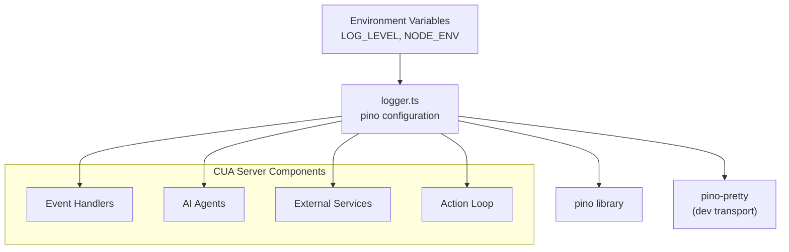
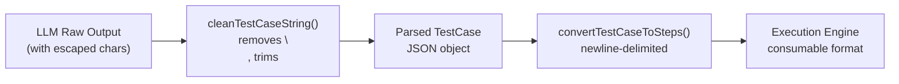
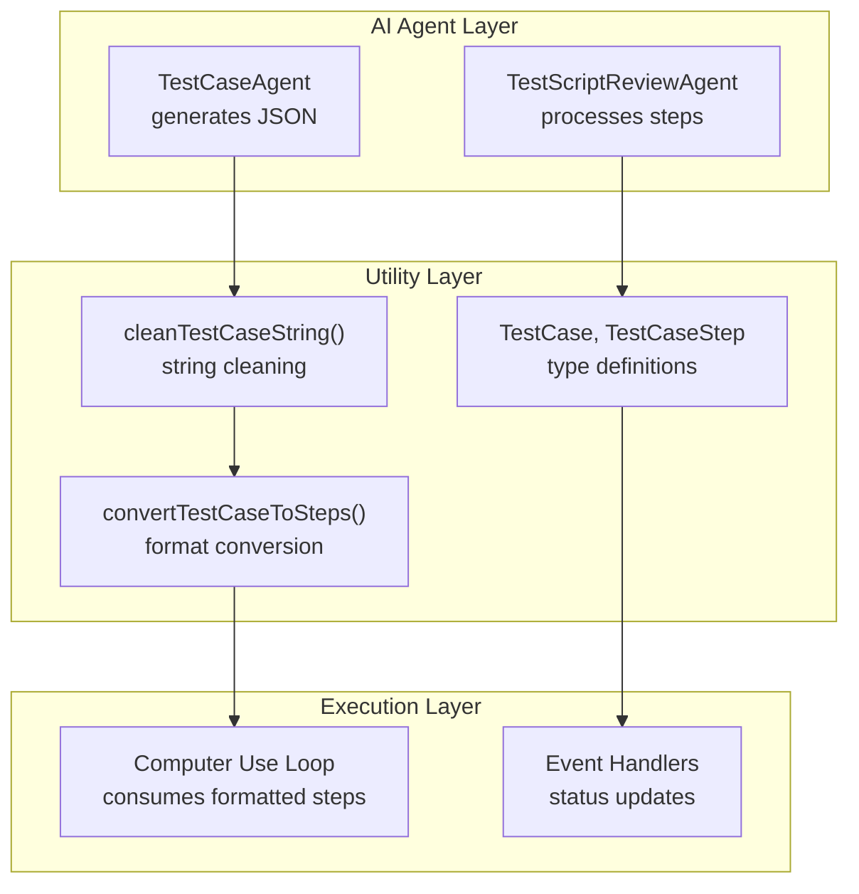

<!-- source: DeepWiki mcp.deepwiki.com · repo openai/openai-testing-agent-demo · page 4.7 Utilities and Helpers · fetched 2026-10-26 -->

# Utilities and Helpers

<details>
<summary>Relevant source files</summary>

The following files were used as context for generating this wiki page:

- [cua-server/src/utils/logger.ts](cua-server/src/utils/logger.ts)
- [cua-server/src/utils/testCaseUtils.ts](cua-server/src/utils/testCaseUtils.ts)

</details>


This section documents the supporting utility functions and helper modules that provide common functionality across the CUA Server. These utilities handle logging infrastructure and test case data processing, serving as foundational components used throughout the system.

For information about the main AI agents that use these utilities, see [AI Agents](#4.2). For browser automation components that utilize logging, see [Browser Automation](#4.4).

## Logging Infrastructure

The CUA Server uses a centralized logging system built on the Pino library, providing structured logging with environment-specific configuration.

### Logger Configuration

The `logger` module provides a pre-configured Pino logger instance that adapts its behavior based on the runtime environment:

| Environment | Log Transport | Features |
|------------|---------------|----------|
| Development | `pino-pretty` | Colorized output, human-readable format |
| Production | Standard JSON | Structured JSON logs for processing |

The logger accepts configuration through environment variables:
- `LOG_LEVEL`: Controls verbosity (default: "info")
- `NODE_ENV`: Determines transport configuration

**Logger Usage Pattern**


Sources: [cua-server/src/utils/logger.ts:1-22]()

## Test Case Data Processing

The test case utilities provide functions for processing and transforming test case data structures that flow between AI agents and the execution engine.

### Data Structures

The system defines standardized interfaces for test case representation:

```typescript
interface TestCaseStep {
  step_number: number;
  step_instructions: string;
  status?: string;
}

interface TestCase {
  steps: TestCaseStep[];
}
```

### Processing Functions

**Test Case Processing Pipeline**


The utility functions handle common transformations:

| Function | Input | Output | Purpose |
|----------|-------|--------|---------|
| `cleanTestCaseString()` | Raw LLM string with escape chars | Cleaned string | Removes `\\n` and excess whitespace |
| `convertTestCaseToSteps()` | `TestCase` object | Formatted step string | Converts to human-readable format |

### Error Handling

The `convertTestCaseToSteps()` function includes validation to ensure the input contains a properly formatted `steps` array, throwing an error with message "Invalid test case format: missing steps array" if validation fails.

**Test Case Utility Integration**


Sources: [cua-server/src/utils/testCaseUtils.ts:1-29]()

## Utility Module Organization

The utilities are organized in the `src/utils/` directory with focused, single-responsibility modules:

| Module | Exports | Dependencies |
|--------|---------|-------------|
| `logger.ts` | Default logger instance | `pino`, `pino-pretty` |
| `testCaseUtils.ts` | Processing functions, type interfaces | None (pure functions) |

This modular approach ensures utilities remain lightweight and can be imported selectively by consuming modules throughout the CUA Server codebase.

Sources: [cua-server/src/utils/logger.ts:1-22](), [cua-server/src/utils/testCaseUtils.ts:1-29]()

---

