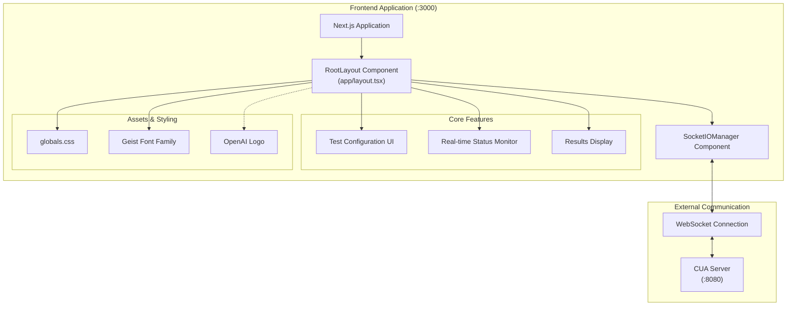
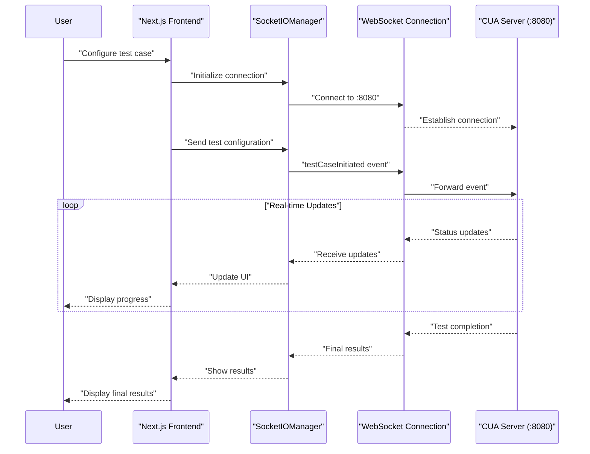
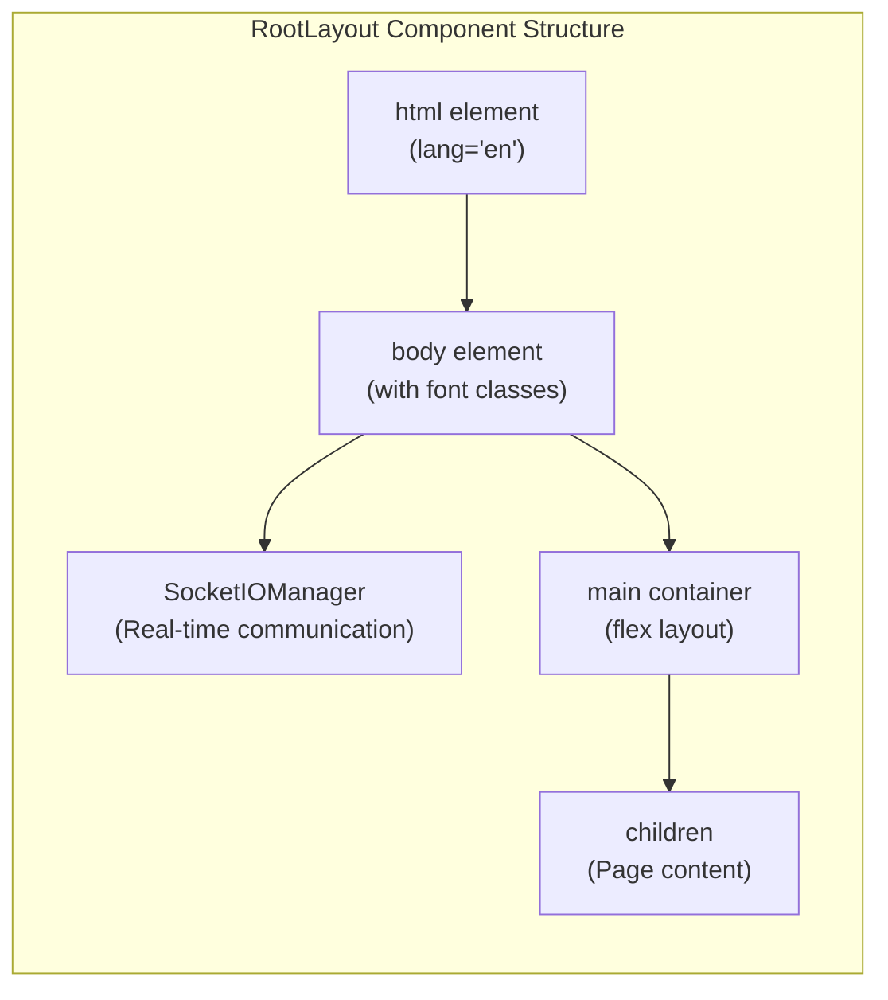
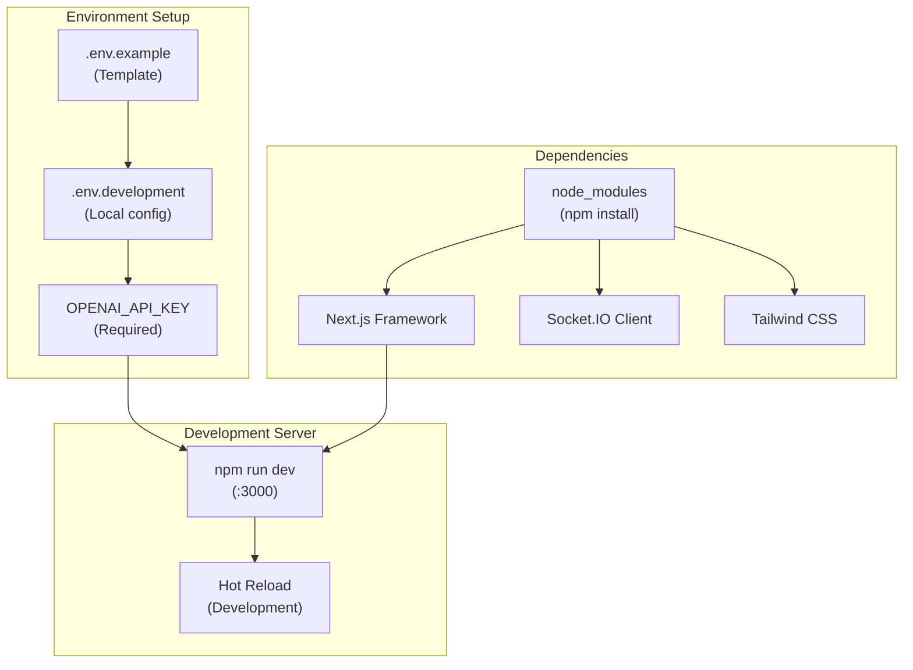

<!-- source: DeepWiki mcp.deepwiki.com · repo openai/openai-testing-agent-demo · page 5 Frontend Application · fetched 2026-10-26 -->

# Frontend Application

Relevant source files

The following files were used as context for generating this wiki page:

- [frontend/README.md](frontend/README.md)
- [frontend/app/layout.tsx](frontend/app/layout.tsx)

## Purpose and Scope

The Frontend Application is a Next.js web interface that serves as the primary user interaction layer for the Testing Agent Demo system. This document covers the overall architecture, communication patterns, and core components of the frontend application. For detailed setup and configuration information, see [Frontend Setup and Configuration](#5.1). For specific UI component documentation, see [UI Components and Layout](#5.2). For styling and asset management, see [Styling and Assets](#5.3).

The frontend enables users to define test cases, monitor real-time test execution, and view results from the AI-powered testing system. It communicates with the CUA Server via WebSocket connections to provide live updates during test execution.

## Application Overview

The Frontend Application is a Next.js application that runs on port 3000 and provides the web interface for interacting with the Testing Agent Demo system. It serves as the entry point for users to configure test cases and monitor their execution in real-time.

| Component | Technology | Port | Purpose |
|-----------|------------|------|---------|
| Frontend UI | Next.js 14+ | 3000 | User interface for test configuration and monitoring |
| Socket.IO Client | Socket.IO | WebSocket | Real-time communication with CUA Server |
| OpenAI Integration | Environment Variable | N/A | API key configuration for AI services |

The application follows a modern React architecture with server-side rendering capabilities provided by Next.js, enabling both interactive client-side features and optimized initial page loads.

**Sources:** [frontend/README.md:1-22]()

## Architecture and Communication Flow

### Frontend System Architecture

### Communication Pattern with CUA Server

**Sources:** [frontend/app/layout.tsx:1-40](), [frontend/README.md:5-6]()

## Key Components and Structure

### Root Layout Component

The `RootLayout` component in [frontend/app/layout.tsx:23-39]() serves as the application's root wrapper, establishing the fundamental structure and integrating key services:

The layout implements several critical features:

- **Font Integration**: Loads Geist Sans and Geist Mono fonts via `localFont` from [frontend/app/layout.tsx:6-15]()
- **Metadata Configuration**: Sets application title and OpenAI logo via [frontend/app/layout.tsx:17-21]()
- **Global Styling**: Applies Tailwind CSS classes for responsive design and consistent theming
- **Socket Integration**: Embeds `SocketIOManager` component for WebSocket connectivity

### Application Metadata

| Property | Value | Source |
|----------|-------|--------|
| Title | "Automated Testing Agent Demo" | [frontend/app/layout.tsx:18]() |
| Description | "Automated Testing Agent Demo using the OpenAI CUA model" | [frontend/app/layout.tsx:19]() |
| Icon | "/openai_logo.svg" | [frontend/app/layout.tsx:20]() |

**Sources:** [frontend/app/layout.tsx:1-40]()

## Development Environment Integration

### Environment Configuration

The frontend requires specific environment configuration to integrate with the broader system:

### System Dependencies

The frontend operates as part of a coordinated system requiring:

- **CUA Server**: Must be running on port 8080 for WebSocket communication
- **Sample Test App**: Required for demonstration purposes on port 3005
- **OpenAI API Key**: Essential for AI-powered testing functionality

The development workflow follows standard Next.js patterns with `npm run dev` providing hot reload capabilities during development.

**Sources:** [frontend/README.md:7-21]()

## Integration Points

The Frontend Application serves as the orchestration point for user interactions with the testing system, maintaining real-time connectivity with the CUA Server through WebSocket protocols. The `SocketIOManager` component handles all aspects of this communication, enabling bidirectional data flow for test configuration, execution monitoring, and result presentation.

The application's architecture supports both immediate user feedback through optimistic UI updates and reliable state synchronization through server-driven events, ensuring users have accurate, real-time visibility into test execution progress and outcomes.

**Sources:** [frontend/app/layout.tsx:4](), [frontend/README.md:5-6]()

---

