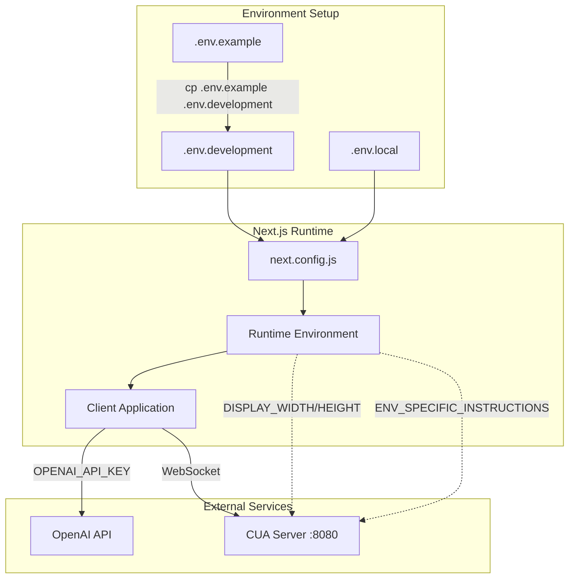
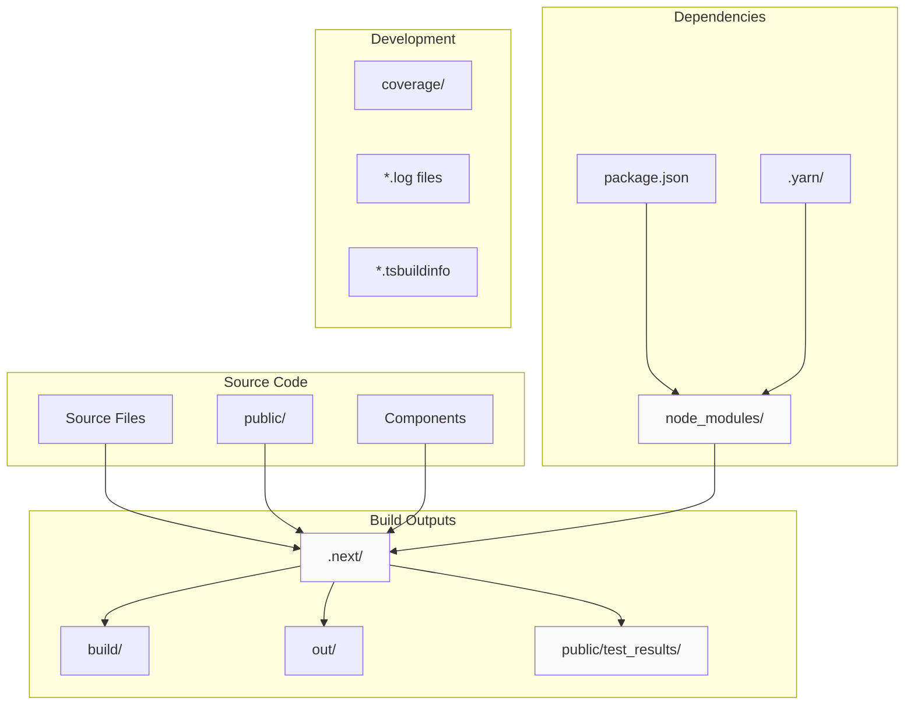
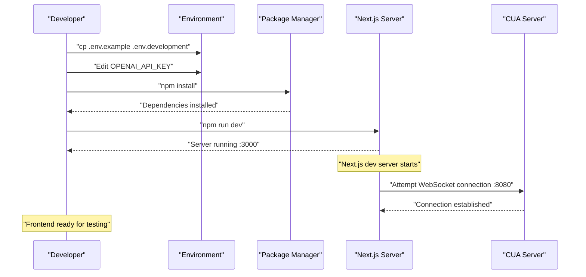
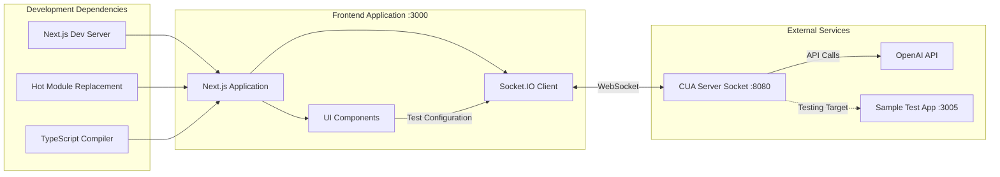

<!-- source: DeepWiki mcp.deepwiki.com · repo openai/openai-testing-agent-demo · page 5.1 Frontend Setup and Configuration · fetched 2026-10-26 -->

# Frontend Setup and Configuration

Relevant source files

The following files were used as context for generating this wiki page:

- [frontend/.env.example](frontend/.env.example)
- [frontend/.gitignore](frontend/.gitignore)
- [frontend/README.md](frontend/README.md)

This document covers the environment setup, build configuration, and project structure for the Next.js frontend application. The frontend serves as the web interface for configuring test cases and monitoring AI-driven test execution in real-time. For information about the UI components and Socket.IO integration, see [UI Components and Layout](#5.2). For styling and static assets, see [Styling and Assets](#5.3).

## Environment Configuration

The frontend application requires specific environment variables to function properly, primarily for OpenAI API integration and browser display configuration.

### Environment Variables Setup

The application uses a standard `.env` file pattern for configuration management:

| Variable | Purpose | Default | Required |
|----------|---------|---------|----------|
| `OPENAI_API_KEY` | Authentication for OpenAI CUA model | None | Yes |
| `DISPLAY_WIDTH` | Browser viewport width for testing | 1024 | No |
| `DISPLAY_HEIGHT` | Browser viewport height for testing | 768 | No |
| `ENV_SPECIFIC_INSTRUCTIONS` | Platform-specific testing instructions | None | No |

### Environment Configuration Flow

**Sources:** [frontend/.env.example:1-6]()

## Project Structure and Build Configuration

The frontend follows Next.js conventions with specific build artifacts and dependency management configured for the testing agent demo.

### Build Artifacts and Dependencies

### Ignored Files and Build Artifacts

The `.gitignore` configuration reveals the development and build structure:

- **Dependencies**: `node_modules/`, `.pnp.*`, `.yarn/*` (with selective inclusion)
- **Build outputs**: `.next/`, `out/`, `build/`
- **Development artifacts**: `coverage/`, debug logs, TypeScript build info
- **Test results**: `public/test_results/` (dynamically generated screenshots and reports)
- **Environment files**: `.env*` (except `.env.example`)

**Sources:** [frontend/.gitignore:1-45]()

## Development Setup Process

The frontend setup follows a standard Next.js development workflow with specific requirements for the testing agent demo.

### Setup Sequence

### Required Setup Steps

| Step | Command | Purpose |
|------|---------|---------|
| 1 | `cp .env.example .env.development` | Create development environment file |
| 2 | Edit `.env.development` | Add `OPENAI_API_KEY` and optional display settings |
| 3 | `npm install` | Install project dependencies |
| 4 | `npm run dev` | Start development server on port 3000 |

**Sources:** [frontend/README.md:9-18]()

## Dependencies and External Services

The frontend application integrates with multiple external services and depends on the broader testing agent ecosystem.

### Service Dependencies

| Service | Port | Purpose | Dependency Level |
|---------|------|---------|-----------------|
| CUA Server | 8080 | WebSocket communication and test orchestration | Required |
| Sample Test App | 3005 | Demo testing target | Optional (for demo) |
| OpenAI API | HTTPS | AI model for test generation | Required |

### Integration Architecture

The frontend must be running alongside the CUA Server for full functionality, as noted in the README: "Make sure the CUA server is running" and "for demo purposes, the sample app".

**Sources:** [frontend/README.md:21-22](), [frontend/.env.example:1-6]()

## Configuration Management

The frontend uses Next.js environment variable handling with specific patterns for the testing agent demo requirements.

### Environment File Hierarchy

1. `.env.example` - Template with required variables
2. `.env.development` - Development-specific configuration
3. `.env.local` - Local overrides (gitignored)

The `ENV_SPECIFIC_INSTRUCTIONS` variable allows platform-specific testing instructions, such as macOS keyboard shortcuts: `"This is MacOS, so use CMD key for actions that are typically done with Control key on Windows"`.

**Sources:** [frontend/.env.example:5-6](), [frontend/.gitignore:33-35]()

---

