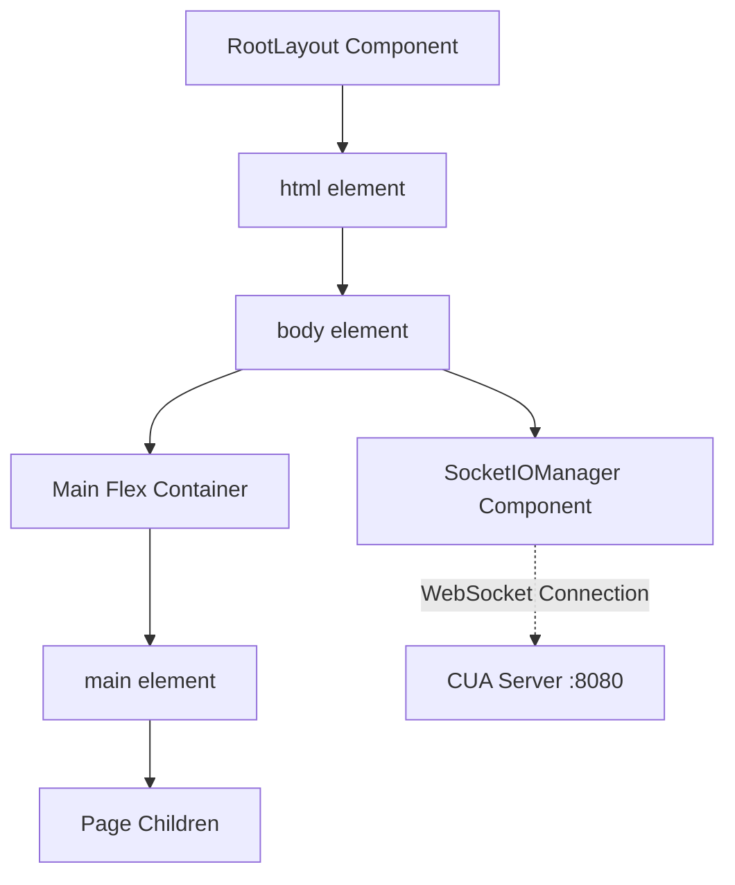
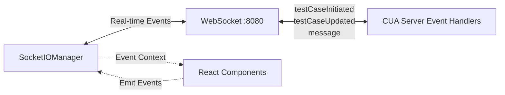
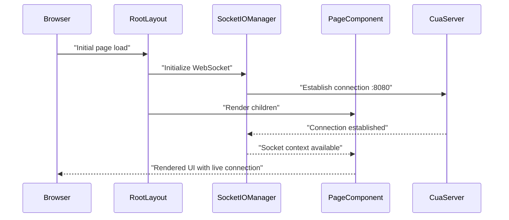

<!-- source: DeepWiki mcp.deepwiki.com · repo openai/openai-testing-agent-demo · page 5.2 UI Components and Layout · fetched 2026-10-26 -->

# UI Components and Layout

<details>
<summary>Relevant source files</summary>

The following files were used as context for generating this wiki page:

- [frontend/app/layout.tsx](frontend/app/layout.tsx)

</details>


This document covers the core UI components and layout structure of the frontend Next.js application. It focuses on the root layout configuration, component hierarchy, and integration patterns used for real-time communication with the CUA Server. For specific styling details and asset management, see [Styling and Assets](#5.3). For frontend setup and configuration, see [Frontend Setup and Configuration](#5.1).

## Root Layout Architecture

The frontend application uses Next.js 13+ app directory structure with a centralized root layout that establishes the foundational structure for all pages. The `RootLayout` component in [frontend/app/layout.tsx:23-39]() serves as the primary wrapper for the entire application.

### Layout Component Structure



Sources: [frontend/app/layout.tsx:23-39]()

The layout implements a full-height flex container design with the following structure:
- Outer container: `flex flex-col h-screen overflow-hidden bg-gray-50 text-gray-900` [frontend/app/layout.tsx:33]()
- Main content area: `flex-1 min-h-0 flex flex-col` [frontend/app/layout.tsx:34]()

This configuration ensures the application takes the full viewport height while preventing overflow and maintaining responsive behavior.

## Socket.IO Integration Pattern

The `SocketIOManager` component is instantiated at the root level [frontend/app/layout.tsx:31](), establishing a singleton pattern for WebSocket communication throughout the application lifecycle.

### Communication Architecture



Sources: [frontend/app/layout.tsx:4](), [frontend/app/layout.tsx:31]()

The placement of `SocketIOManager` at the root level ensures that:
- WebSocket connection is established once per application session
- All child components can access the socket context
- Real-time updates are available application-wide

## Typography and Font Configuration

The application uses a dual-font system with custom variable fonts loaded via Next.js `localFont`:

| Font Variable | File | Weight Range | CSS Variable |
|---------------|------|-------------|--------------|
| `geistSans` | `GeistVF.woff` | 100-900 | `--font-geist-sans` |
| `geistMono` | `GeistMonoVF.woff` | 100-900 | `--font-geist-mono` |

Sources: [frontend/app/layout.tsx:6-15]()

Both fonts are applied to the body element via CSS custom properties [frontend/app/layout.tsx:29](), making them available throughout the application component tree.

## Application Metadata

The application metadata configuration defines the browser presentation:

```typescript
metadata: Metadata = {
  title: "Automated Testing Agent Demo",
  description: "Automated Testing Agent Demo using the OpenAI CUA model",
  icons: { icon: "/openai_logo.svg" }
}
```

Sources: [frontend/app/layout.tsx:17-21]()

## Layout Rendering Flow



Sources: [frontend/app/layout.tsx:23-39]()

The layout ensures that Socket.IO connection is established before page components render, providing immediate access to real-time communication capabilities for test monitoring and configuration.

## Responsive Design Foundation

The root layout establishes responsive behavior through:
- Full viewport height utilization (`h-screen`)
- Flexible content area scaling (`flex-1 min-h-0`)
- Overflow management to prevent scroll issues
- Consistent color theming (`bg-gray-50 text-gray-900`)

Sources: [frontend/app/layout.tsx:33-34]()

This foundation supports the application's primary use case of displaying real-time test execution results and screenshots within a contained, responsive interface.

---

