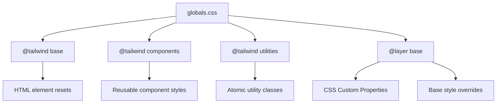
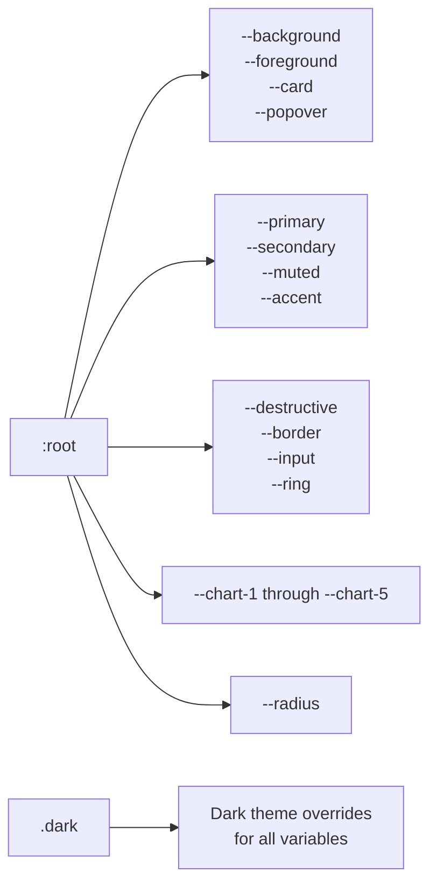
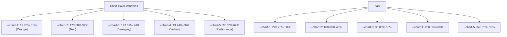
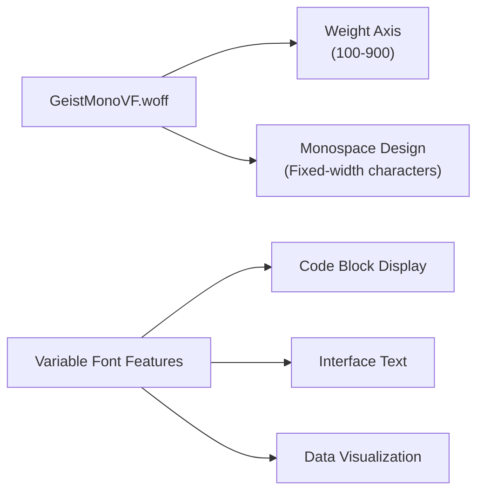
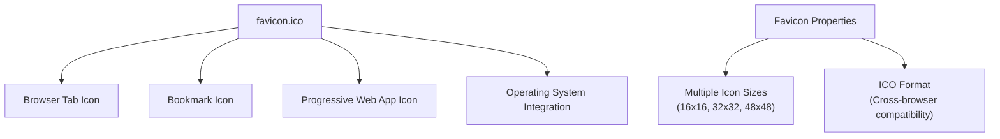
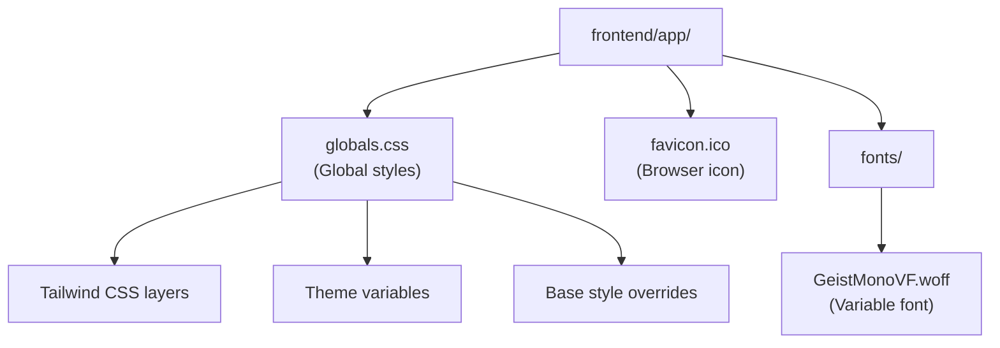

<!-- source: DeepWiki mcp.deepwiki.com · repo openai/openai-testing-agent-demo · page 5.3 Styling and Assets · fetched 2026-10-26 -->

# Styling and Assets

<details>
<summary>Relevant source files</summary>

The following files were used as context for generating this wiki page:

- [frontend/app/favicon.ico](frontend/app/favicon.ico)
- [frontend/app/fonts/GeistMonoVF.woff](frontend/app/fonts/GeistMonoVF.woff)
- [frontend/app/fonts/GeistVF.woff](frontend/app/fonts/GeistVF.woff)
- [frontend/app/globals.css](frontend/app/globals.css)

</details>


This document covers the global CSS styling system, theme configuration, typography, and static assets used in the frontend application. It details the Tailwind CSS integration, CSS custom properties for theming, font loading, and asset organization.

For information about UI components and their styling implementation, see [UI Components and Layout](#5.2). For frontend configuration and build setup, see [Frontend Setup and Configuration](#5.1).

## Global Styling System

The frontend uses a hybrid styling approach combining Tailwind CSS utility classes with CSS custom properties for theming. The global styles are defined in a single CSS file that establishes the design system foundation.

### Tailwind CSS Integration

The styling system is built on Tailwind CSS with three main directive layers:



**Tailwind CSS Layer Architecture**

Sources: [frontend/app/globals.css:1-3]()

### CSS Custom Properties System

The application uses CSS custom properties (CSS variables) defined on the `:root` selector to create a systematic approach to colors and spacing. These properties are referenced throughout the Tailwind configuration.



**CSS Custom Properties Structure**

Sources: [frontend/app/globals.css:6-56](), [frontend/app/globals.css:57-105]()

## Theme Configuration

The application supports both light and dark themes through a systematic color token approach. Each theme defines the same set of semantic color variables with different HSL values.

### Light Theme Variables

| Variable | HSL Value | Purpose |
|----------|-----------|---------|
| `--background` | `0 0% 100%` | Primary background color |
| `--foreground` | `224 71.4% 4.1%` | Primary text color |
| `--primary` | `220.9 39.3% 11%` | Primary brand color |
| `--secondary` | `220 14.3% 95.9%` | Secondary UI elements |
| `--muted` | `220 14.3% 95.9%` | Subdued content |
| `--border` | `220 13% 91%` | Border colors |
| `--destructive` | `0 84.2% 60.2%` | Error/danger states |

### Dark Theme Variables

| Variable | HSL Value | Purpose |
|----------|-----------|---------|
| `--background` | `224 71.4% 4.1%` | Primary background color |
| `--foreground` | `210 20% 98%` | Primary text color |
| `--primary` | `210 20% 98%` | Primary brand color |
| `--secondary` | `215 27.9% 16.9%` | Secondary UI elements |
| `--muted` | `215 27.9% 16.9%` | Subdued content |
| `--border` | `215 27.9% 16.9%` | Border colors |
| `--destructive` | `0 62.8% 30.6%` | Error/danger states |

Sources: [frontend/app/globals.css:6-56](), [frontend/app/globals.css:57-105]()

### Chart Color System

The theme includes a dedicated color palette for data visualization components:



**Chart Color Palette Structure**

Sources: [frontend/app/globals.css:45-54](), [frontend/app/globals.css:96-104]()

## Typography and Fonts

### Font Loading System

The application uses the Geist Mono variable font family for consistent typography across the interface. The font is loaded as a web font file in WOFF format.



**Font System Architecture**

The Geist Mono font provides:
- Variable weight axis for different text hierarchies
- Monospace design for code and data display
- Optimized readability for technical content
- Consistent character spacing for tabular data

Sources: [frontend/app/fonts/GeistMonoVF.woff]()

### Global Typography Styles

The base layer defines global typography behavior through Tailwind's base layer:

```css
@layer base {
  * {
    @apply border-border outline-ring/50;
  }
  body {
    @apply bg-background text-foreground;
  }
}
```

This establishes:
- Consistent border and outline styling using theme variables
- Background and text colors from the theme system
- Default styling that respects the current theme mode

Sources: [frontend/app/globals.css:108-115]()

## Static Assets

### Favicon System

The application includes a standard ICO favicon file that provides the browser tab icon and bookmark representation.



**Favicon Asset Structure**

The favicon provides visual branding for:
- Browser tabs and window titles
- Bookmark listings
- Operating system app representations
- Search engine result listings

Sources: [frontend/app/favicon.ico]()

### Asset Organization



**Frontend Asset Organization**

This structure provides:
- Centralized global styling in `globals.css`
- Font assets organized in dedicated `fonts/` directory
- Root-level placement of favicon for standard browser discovery
- Clear separation between styling code and binary assets

Sources: [frontend/app/](), [frontend/app/fonts/](), [frontend/app/globals.css](), [frontend/app/favicon.ico]()

## Integration with Component System

The styling system integrates with the broader frontend architecture through Tailwind's utility-first approach and the CSS custom properties system.

### Theme Variable Usage Pattern

Components reference theme variables through Tailwind utilities:
- `bg-background` maps to `--background` CSS variable
- `text-foreground` maps to `--foreground` CSS variable  
- `border-border` maps to `--border` CSS variable
- `ring-ring` maps to `--ring` CSS variable

This creates a consistent design system where theme changes automatically propagate to all components without requiring individual component updates.

Sources: [frontend/app/globals.css:108-115]()

---

