# Page: Overview

# Overview

<details>
<summary>Relevant source files</summary>

The following files were used as context for generating this wiki page:

- [LICENSE](LICENSE)
- [README.md](README.md)

</details>


## Purpose and Scope

This document provides an overview of the Testing Agent Demo repository, a monorepo that demonstrates automated web testing using OpenAI's Computer Use Agent (CUA) model. The system showcases how AI-driven browser automation can be used to execute test cases on web applications through natural language instructions and visual feedback.

The Testing Agent Demo consists of three interconnected applications that work together to provide end-to-end automated testing capabilities. For detailed information about individual components, see [CUA Server](#4), [Frontend Application](#5), and [Getting Started](#2) for setup instructions.

Sources: [README.md:1-91]()

## System Composition

The Testing Agent Demo is structured as a monorepo containing three distinct applications:

| Application | Technology | Port | Purpose |
|-------------|------------|------|---------|
| `frontend` | Next.js | 3000 | Web interface for configuring tests and monitoring execution |
| `cua-server` | Node.js | 8080 | Core service that orchestrates AI-driven browser automation |
| `sample-test-app` | Node.js | 3005 | Example e-commerce application used as a testing target |

The system leverages OpenAI's CUA model with computer use capabilities to interpret test instructions and execute browser actions through Playwright automation.

Sources: [README.md:7-11]()

## High-Level Architecture

The following diagram illustrates how the three applications interact within the broader system:

### System Architecture Diagram

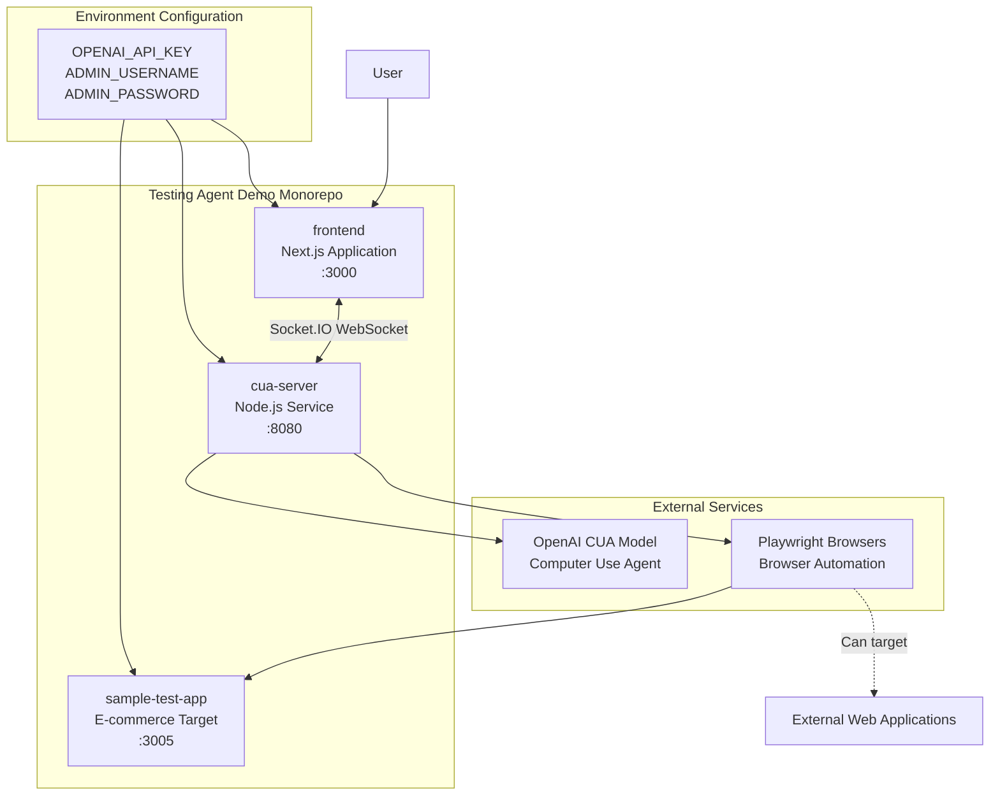

Sources: [README.md:5-11](), [README.md:59-64]()

## Core Testing Workflow

The system follows a structured workflow that combines AI decision-making with browser automation:

### Testing Execution Flow

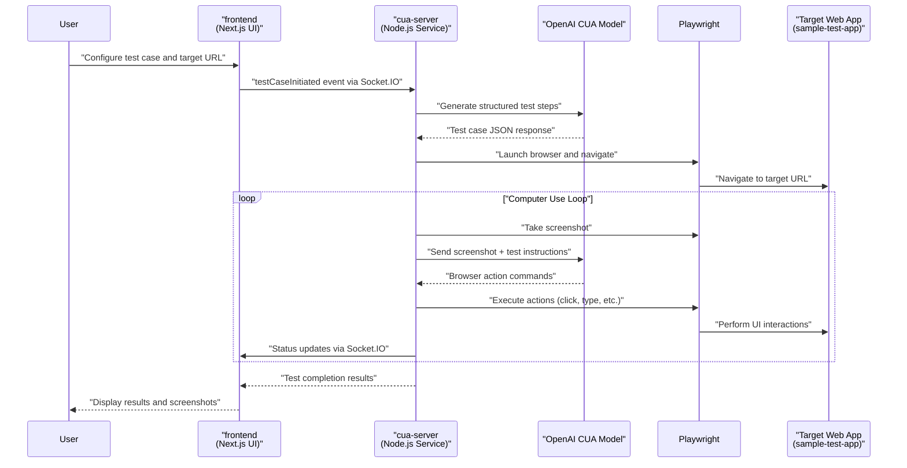

Sources: [README.md:5-6]()

## Key Technologies and Integrations

The system integrates several key technologies to enable AI-driven testing:

### Core Dependencies

- **OpenAI CUA Model**: Provides computer use capabilities for interpreting screenshots and generating browser actions
- **Playwright**: Handles browser automation, screenshot capture, and UI element interactions
- **Socket.IO**: Enables real-time communication between `frontend` and `cua-server`
- **Next.js**: Powers the web interface for test configuration and monitoring

### Environment Requirements

The system requires several environment variables to function properly:

| Variable | Purpose | Required By |
|----------|---------|-------------|
| `OPENAI_API_KEY` | Authentication for OpenAI CUA model | `frontend`, `cua-server` |
| `ADMIN_USERNAME` | Demo login credentials for sample app | `sample-test-app` |
| `ADMIN_PASSWORD` | Demo login credentials for sample app | `sample-test-app` |

Sources: [README.md:29-44](), [README.md:49-50]()

## Use Cases and Applications

The Testing Agent Demo serves multiple purposes:

### Primary Use Cases

1. **Demonstration Platform**: Shows how AI can automate web testing through natural language instructions
2. **Development Framework**: Provides a foundation for building custom AI-driven testing solutions
3. **Integration Example**: Illustrates how to combine OpenAI's computer use capabilities with browser automation

### Customization Capabilities

The system is designed to be adaptable for different testing scenarios. Users can:

- Test any web application by updating the target URL in `frontend/lib/constants.ts`
- Modify test cases through the configuration UI
- Extend the `cua-server` logic for custom testing workflows

The `sample-test-app` serves purely as an example target, while the core testing logic resides in the `cua-server` component.

Sources: [README.md:73-77]()

---

# Page: Getting Started

# Getting Started

<details>
<summary>Relevant source files</summary>

The following files were used as context for generating this wiki page:

- [README.md](README.md)
- [cua-server/.env.example](cua-server/.env.example)
- [frontend/.env.example](frontend/.env.example)

</details>


This guide provides step-by-step instructions for setting up and running the Testing Agent Demo system locally. The setup process will get all three applications running together: the frontend UI, CUA server, and sample test application.

For detailed information about the system architecture and how components interact, see [System Architecture](#3). For configuration options and environment variables, see [Configuration and Environment](#4.6).

## Overview

The Testing Agent Demo is a monorepo containing three interconnected applications that must be configured and started together to function properly. The setup process involves environment configuration, dependency installation, and coordinated startup of all services.

### System Components

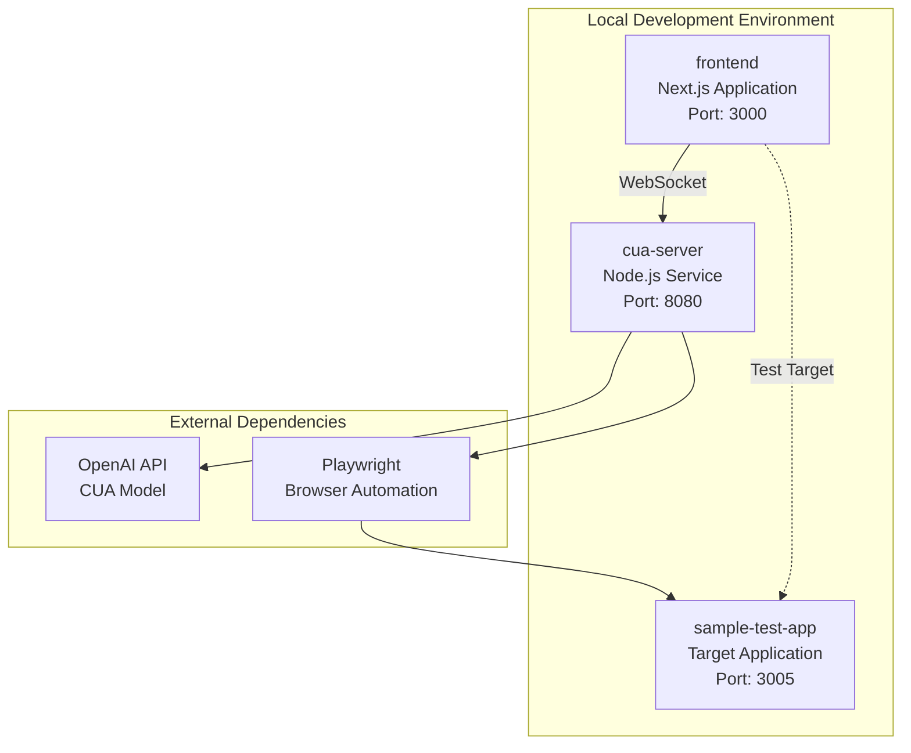

Sources: [README.md:7-11](), [README.md:59-63]()

## Prerequisites

Before starting the setup process, ensure you have the following installed on your system:

| Requirement | Purpose | Notes |
|-------------|---------|-------|
| Node.js (v18+) | Runtime environment | Required for all three applications |
| npm | Package manager | Comes with Node.js |
| OpenAI API Key | AI model access | Required for CUA functionality |
| Git | Version control | For cloning the repository |

## Step-by-Step Setup

### 1. Clone Repository

```bash
git clone https://github.com/openai/testing-agent-demo
cd testing-agent-demo
```

Sources: [README.md:20-25]()

### 2. Environment Configuration

The system requires environment files for each application. Create these files from the provided examples:

```bash
cp frontend/.env.example frontend/.env.development
cp cua-server/.env.example cua-server/.env.development
cp sample-test-app/.env.example sample-test-app/.env.development
```

#### Required Environment Variables

Configure the following variables in each `.env.development` file:

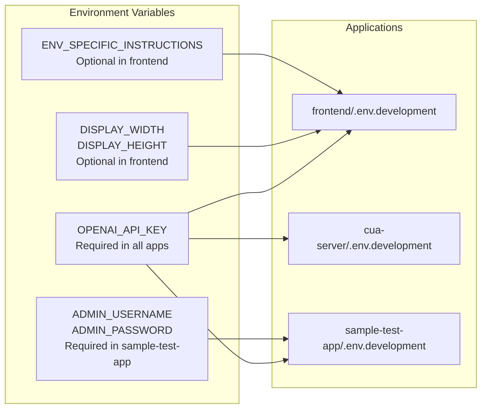

**OpenAI API Key Setup:**
- Add your OpenAI API key to all three `.env.development` files
- Set `OPENAI_API_KEY=your-openai-key`
- If not set globally, instructions available at [OpenAI API documentation](https://platform.openai.com/docs/libraries#create-and-export-an-api-key)

**Sample App Credentials:**
- Default credentials for testing: `ADMIN_USERNAME=test_user_name` and `ADMIN_PASSWORD=test_password`
- These are required for the sample e-commerce application to function

Sources: [README.md:27-44](), [frontend/.env.example:1-6](), [cua-server/.env.example:1-1]()

### 3. Install Dependencies

Install Node.js dependencies and Playwright browsers:

```bash
npm install
npx playwright install
```

This command will:
- Install all npm dependencies across all three applications (monorepo setup)
- Download Playwright browser binaries required for browser automation

Sources: [README.md:46-51]()

### 4. Start All Applications

Launch all three applications simultaneously:

```bash
npm run dev
```

This command starts all applications in development mode with the following endpoints:

| Application | URL | Purpose |
|-------------|-----|---------|
| Frontend UI | http://localhost:3000 | Test configuration and monitoring interface |
| Sample Test App | http://localhost:3005 | Target application for testing |
| CUA Server | ws://localhost:8080 | WebSocket server for AI-browser communication |

Sources: [README.md:53-65]()

## Verification Steps

After completing the setup, verify that all components are working correctly:

### 1. Check Application Accessibility

Visit each application URL to ensure they're running:
- **Frontend**: Navigate to http://localhost:3000 - should display the test configuration interface
- **Sample App**: Navigate to http://localhost:3005 - should display the e-commerce demo site
- **CUA Server**: WebSocket server should be accessible (no direct browser interface)

### 2. Test Basic Functionality

From the frontend interface at http://localhost:3000:
1. Verify the test configuration form is displayed
2. Confirm the sample app URL (http://localhost:3005) is set as default target
3. Check that WebSocket connection to CUA server is established

### 3. Environment Variable Validation

Ensure all required environment variables are properly set:
- `OPENAI_API_KEY` is configured in all three applications
- Sample app credentials are configured
- No missing environment variable errors in console logs

## Next Steps

After successful setup, you can:

1. **Run Your First Test**: Use the frontend interface to configure and execute a test case against the sample application
2. **Customize Test Scenarios**: Modify test cases and target URLs in the frontend interface
3. **Explore Sample Application**: Familiarize yourself with the demo e-commerce site to understand available test scenarios
4. **Configure Custom Targets**: Point the system at your own web applications for testing

For detailed information about:
- Configuring custom test cases, see [Frontend Application](#5)
- Understanding the AI agents and test execution process, see [CUA Server](#4)
- Customizing the system for your own applications, see [Development Guide](#6)

## Troubleshooting Common Issues

| Issue | Cause | Solution |
|-------|-------|----------|
| "OpenAI API key not found" | Missing or incorrect API key | Verify `OPENAI_API_KEY` in all `.env.development` files |
| Port conflicts | Ports 3000, 3005, or 8080 already in use | Stop conflicting services or modify port configuration |
| Playwright browser issues | Browsers not installed | Run `npx playwright install` |
| WebSocket connection failed | CUA server not running | Ensure `npm run dev` started all services successfully |

Sources: [README.md:15-16](), [README.md:84-87]()

---

# Page: System Architecture

# System Architecture

<details>
<summary>Relevant source files</summary>

The following files were used as context for generating this wiki page:

- [README.md](README.md)
- [cua-server/README.md](cua-server/README.md)
- [frontend/README.md](frontend/README.md)

</details>


## Purpose and Scope

This document provides a high-level overview of the Testing Agent Demo's system architecture, focusing on how the three main applications work together to enable AI-driven web testing. It covers the overall system design, communication patterns, and execution flow between components.

For detailed implementation of individual components, see [CUA Server](#4) for the core backend service, [Frontend Application](#5) for the web interface, and [Development Guide](#6) for the sample test application structure.

## System Overview

The Testing Agent Demo is architected as a monorepo containing three distinct applications that work together to provide AI-powered web testing capabilities.

### Application Architecture

```mermaid
graph TB
    subgraph MonorepoRoot["Testing Agent Demo Monorepo"]
        FrontendApp[Frontend<br/>"Next.js Application"<br/>":3000"]
        CuaServerApp[CuaServer<br/>"Node.js Service"<br/>":8080"]
        SampleApp[SampleTestApp<br/>"Demo E-commerce Site"<br/>":3005"]
    end
    
    subgraph ExternalServices["External Dependencies"]
        OpenAIAPI["OpenAI CUA Model<br/>"gpt-4o-cua""]
        PlaywrightEngine["Playwright Browser<br/>"Chromium/Firefox/Safari""]
    end
    
    User --> FrontendApp
    FrontendApp <-->|"Socket.IO WebSocket"| CuaServerApp
    CuaServerApp --> OpenAIAPI
    CuaServerApp --> PlaywrightEngine
    PlaywrightEngine --> SampleApp
    PlaywrightEngine -.->|"Can target any web app"| ExternalWebApps["External Web Applications"]
```

**Sources:** [README.md:7-11](), [frontend/README.md:5-6](), [cua-server/README.md:5]()

### Component Responsibilities

| Component | Primary Responsibility | Technology | Default Port |
|-----------|----------------------|------------|--------------|
| `frontend` | User interface for test configuration and monitoring | Next.js | 3000 |
| `cua-server` | AI orchestration and browser automation | Node.js + Socket.IO | 8080 |
| `sample-test-app` | Demo target application for testing | Next.js | 3005 |

**Sources:** [README.md:9-11](), [README.md:59-63]()

## Application Communication Architecture

The system uses WebSocket-based real-time communication between the frontend and CUA server, with the CUA server orchestrating external API calls and browser automation.

### Communication Flow Architecture

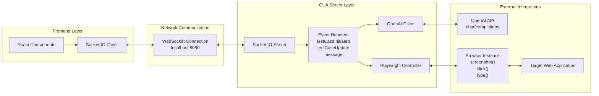

**Sources:** [cua-server/README.md:5](), [frontend/README.md:5]()

## Test Execution Flow Architecture

The system follows a structured flow from user input through AI processing to browser automation and result reporting.

### Execution Pipeline Architecture

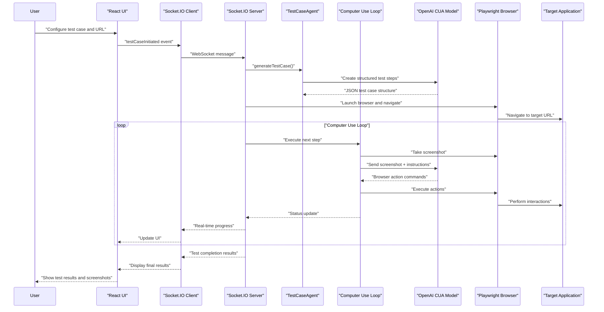

**Sources:** [README.md:5](), [cua-server/README.md:5]()

## Deployment Architecture

The system is designed to run locally with specific port assignments and environment configurations.

### Service Deployment Architecture

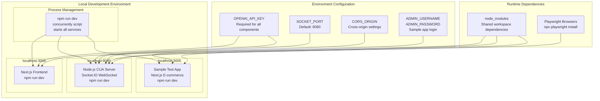

**Sources:** [README.md:53-63](), [README.md:27-44](), [cua-server/README.md:20-26]()

## Technology Stack and Dependencies

The system integrates multiple technologies to provide AI-driven browser automation capabilities.

### Technology Integration Architecture

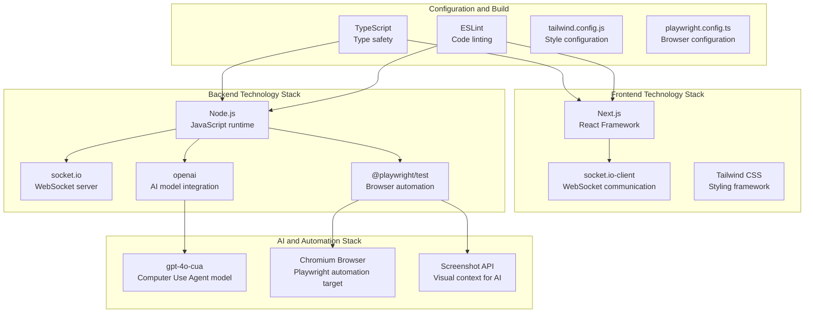

**Sources:** [README.md:5](), [README.md:48-50](), [cua-server/README.md:14-18](), [frontend/README.md:14-17]()

---

# Page: CUA Server

# CUA Server

<details>
<summary>Relevant source files</summary>

The following files were used as context for generating this wiki page:

- [cua-server/README.md](cua-server/README.md)
- [cua-server/package.json](cua-server/package.json)
- [cua-server/src/index.ts](cua-server/src/index.ts)

</details>


## Purpose and Scope

The CUA Server is the core backend service that orchestrates AI-driven web testing using OpenAI's Computer Use Agent (CUA) model. It serves as the central coordinator between the frontend interface and browser automation, providing real-time test execution capabilities through WebSocket communication.

This document covers the high-level architecture, core components, and communication patterns of the CUA Server. For detailed implementation specifics, see the following subsections: [Server Overview and Entry Point](#4.1), [AI Agents](#4.2), [Event Handlers](#4.3), [Browser Automation](#4.4), [External Services](#4.5), [Configuration and Environment](#4.6), and [Utilities and Helpers](#4.7).

## Service Architecture

The CUA Server follows a modular event-driven architecture built on Node.js with Socket.IO for real-time communication:

### Core Server Infrastructure

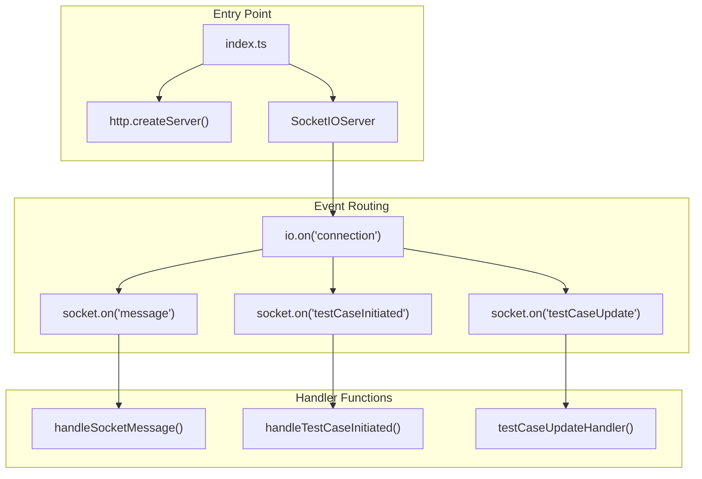

Sources: [cua-server/src/index.ts:1-70]()

### Socket Data Management

Each connected socket maintains session state through the `socket.data` object:

| Property | Type | Purpose |
|----------|------|---------|
| `testCaseReviewAgent` | `undefined \| Agent` | AI agent for reviewing test progress |
| `lastCallId` | `undefined \| string` | Tracking conversation context |
| `previousResponseId` | `undefined \| string` | OpenAI response tracking |
| `testCaseStatus` | `string` | Current test execution status |

Sources: [cua-server/src/index.ts:33-36]()

## Component Architecture

The CUA Server is composed of several key component categories that work together to enable AI-driven testing:

### Handler-Based Event Processing

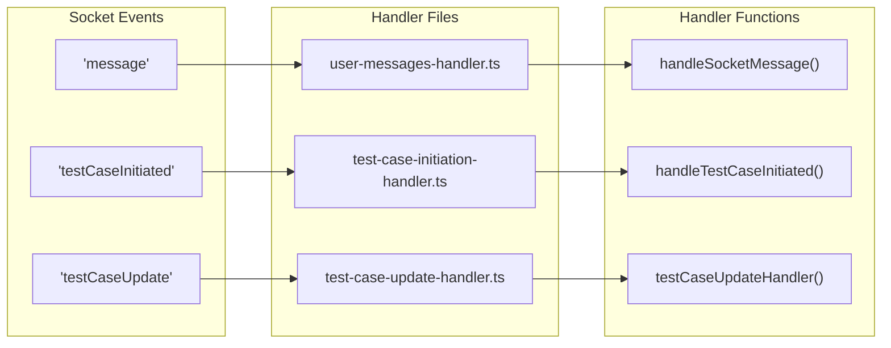

Sources: [cua-server/src/index.ts:4-6](), [cua-server/src/index.ts:46-62]()

## Technology Stack

The CUA Server is built using the following core technologies:

| Technology | Version | Purpose |
|------------|---------|---------|
| `socket.io` | ^4.8.1 | Real-time WebSocket communication |
| `playwright` | ^1.52.0 | Browser automation and control |
| `openai` | ^4.87.3 | OpenAI CUA model integration |
| `pino` | ^9.6.0 | Structured logging |
| `uuid` | ^11.1.0 | Unique identifier generation |
| `typescript` | ^5 | Type-safe development |

Sources: [cua-server/package.json:7-19]()

## Runtime Configuration

The server accepts configuration through environment variables:

### Server Configuration

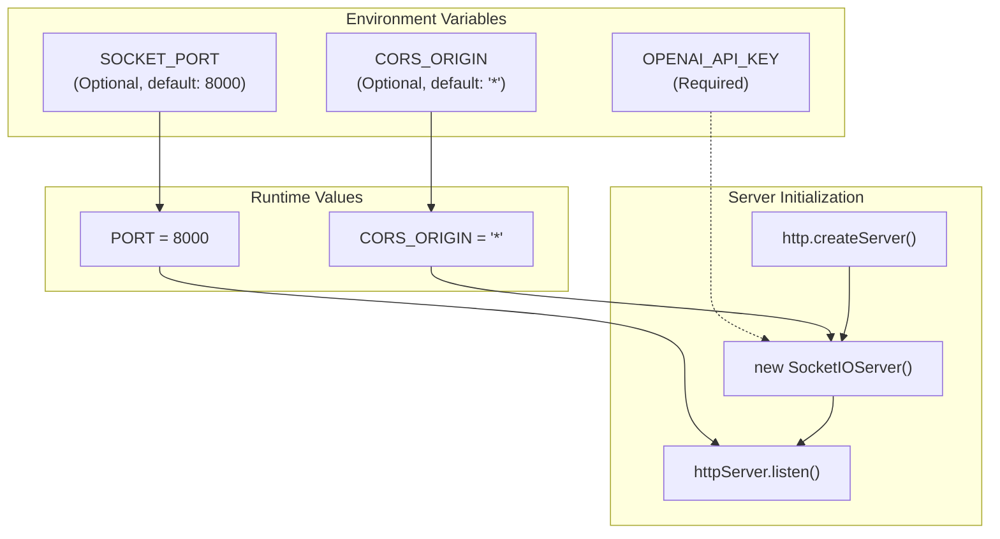

Sources: [cua-server/src/index.ts:10-14](), [cua-server/README.md:22-26]()

## Development Workflow

The CUA Server supports both development and production execution modes:

| Command | Purpose | Runtime |
|---------|---------|---------|
| `npm run dev` | Development server with auto-reload | `ts-node-dev` |
| `npm run build` | Compile TypeScript to JavaScript | `tsc` |
| `npm start` | Production server | `node dist/index.js` |

Sources: [cua-server/package.json:2-6]()

## Logging and Monitoring

The server uses structured logging through the `pino` library with trace-level event monitoring:

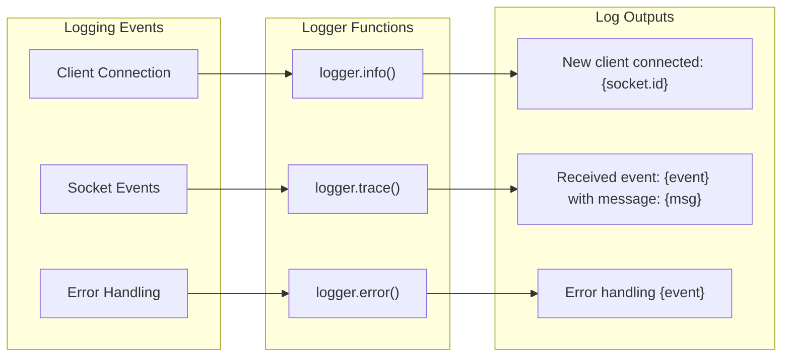

Sources: [cua-server/src/index.ts:30](), [cua-server/src/index.ts:39-43](), [cua-server/src/index.ts:47-61]()

## Component Organization

The CUA Server codebase is organized into logical modules that handle different aspects of the testing workflow. Each module is covered in detail in the following subsections:

- **[Server Overview and Entry Point](#4.1)**: Socket.IO setup and connection handling
- **[AI Agents](#4.2)**: OpenAI model integration and test case generation
- **[Event Handlers](#4.3)**: Processing different types of client events
- **[Browser Automation](#4.4)**: Playwright integration and action execution
- **[External Services](#4.5)**: OpenAI API client and login automation
- **[Configuration and Environment](#4.6)**: Build setup and environment management
- **[Utilities and Helpers](#4.7)**: Logging, test case processing, and shared utilities

This modular architecture enables the CUA Server to coordinate complex AI-driven testing workflows while maintaining clear separation of concerns and facilitating development and maintenance.

Sources: [cua-server/src/index.ts:1-70](), [cua-server/README.md:1-27](), [cua-server/package.json:1-21]()

---

# Page: Server Overview and Entry Point

# Server Overview and Entry Point

<details>
<summary>Relevant source files</summary>

The following files were used as context for generating this wiki page:

- [cua-server/README.md](cua-server/README.md)
- [cua-server/package.json](cua-server/package.json)
- [cua-server/src/index.ts](cua-server/src/index.ts)

</details>


This document covers the CUA Server's main entry point, Socket.IO server setup, and core event handling infrastructure. It explains how the server starts up, establishes WebSocket connections, and routes incoming events to appropriate handlers.

For information about the specific AI agents that handle test case generation and review, see [AI Agents](#4.2). For details about browser automation and the computer use loop, see [Browser Automation](#4.4).

## Purpose and Architecture

The CUA Server serves as the central orchestrator for AI-driven web testing, implemented as a Node.js service that exposes a Socket.IO WebSocket API. The server's primary responsibilities include establishing real-time communication with the frontend, routing events to specialized handlers, and managing the overall test execution lifecycle.

### Server Entry Point Flow

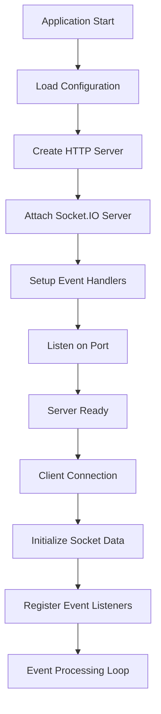

**Sources:** [cua-server/src/index.ts:1-70]()

## Socket.IO Server Setup

The server uses Socket.IO for real-time bidirectional communication with the frontend. The setup process involves creating an HTTP server and attaching the Socket.IO server with CORS configuration.

### Core Server Components

| Component | Purpose | Configuration |
|-----------|---------|---------------|
| HTTP Server | Provides basic HTTP endpoint | Returns "Socket.IO server is running." |
| Socket.IO Server | Handles WebSocket connections | CORS origin configurable |
| Event Handlers | Process incoming events | Async error handling |
| Logger | Structured logging | Pino with pretty printing |

### Socket.IO Configuration

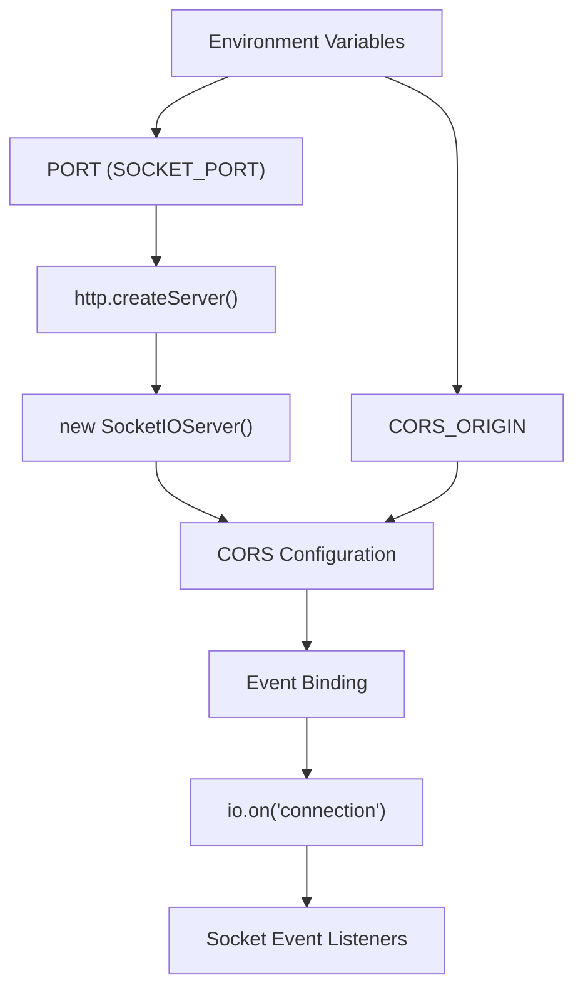

**Sources:** [cua-server/src/index.ts:16-27](), [cua-server/src/index.ts:10-14]()

## Event Handling System

The server implements a comprehensive event handling system that processes three main types of events from connected clients.

### Event Handler Architecture

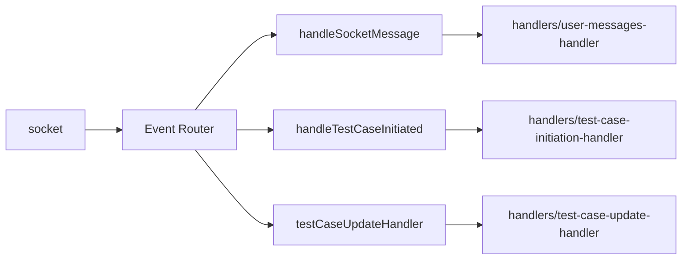

### Socket Data Initialization

When a client connects, the server initializes socket-specific data to track the session state:

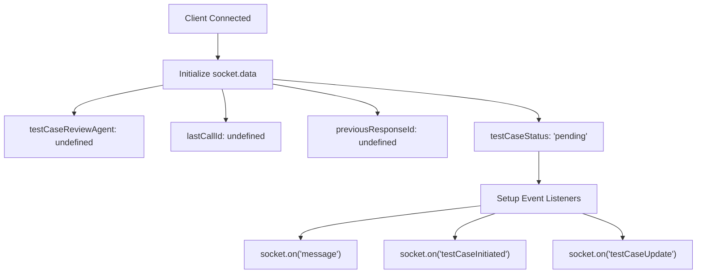

**Sources:** [cua-server/src/index.ts:29-43](), [cua-server/src/index.ts:32-36]()

## Event Processing Flow

The server processes events asynchronously with comprehensive error handling and logging.

### Event Handling Implementation

| Event Name | Handler Function | Purpose |
|------------|------------------|---------|
| `message` | `handleSocketMessage` | Process user messages and chat interactions |
| `testCaseInitiated` | `handleTestCaseInitiated` | Start new test case generation and execution |
| `testCaseUpdate` | `testCaseUpdateHandler` | Update test case status and progress |

### Error Handling Pattern

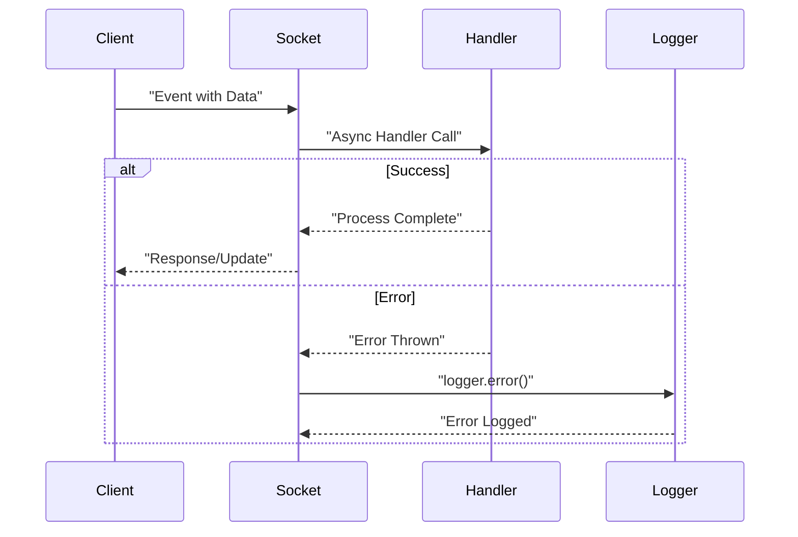

**Sources:** [cua-server/src/index.ts:46-62]()

## Configuration Management

The server uses environment variables for configuration with sensible defaults.

### Configuration Parameters

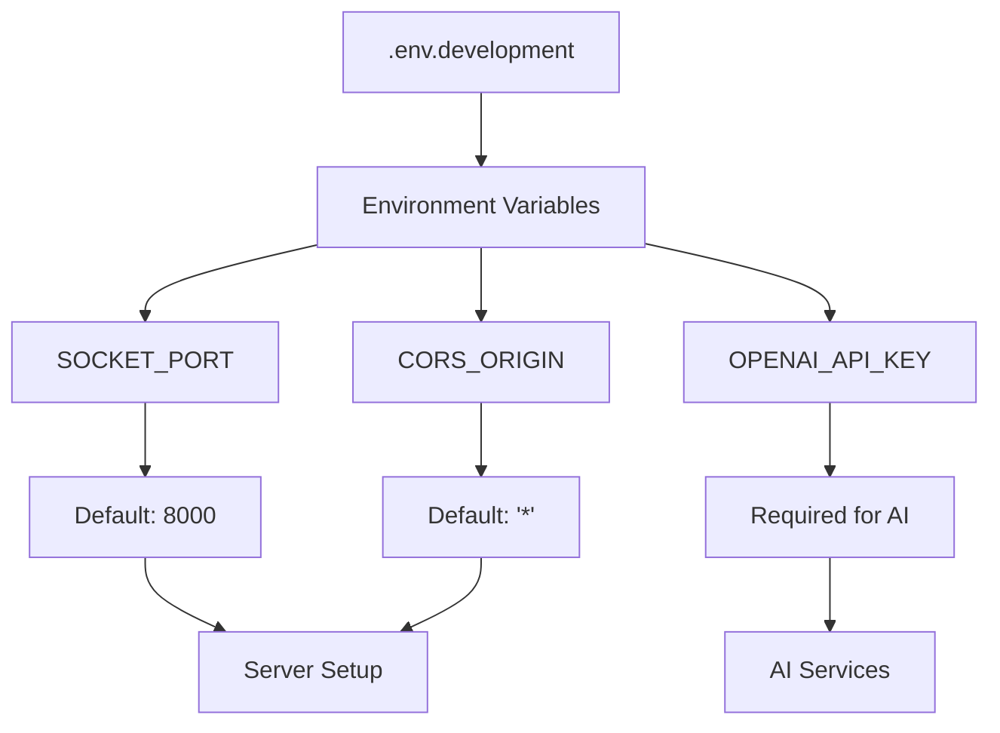

### Environment Variable Processing

The server processes configuration at startup with type conversion and validation:

- `SOCKET_PORT`: Parsed as integer with fallback to `8000`
- `CORS_ORIGIN`: String value with fallback to `"*"`
- `OPENAI_API_KEY`: Required for AI functionality (validated by handlers)

**Sources:** [cua-server/src/index.ts:10-14](), [cua-server/README.md:22-26]()

## Dependencies and Runtime

The server relies on several key dependencies for its core functionality.

### Core Dependencies

| Package | Version | Purpose |
|---------|---------|---------|
| `socket.io` | ^4.8.1 | WebSocket server implementation |
| `pino` | ^9.6.0 | Structured logging |
| `playwright` | ^1.52.0 | Browser automation |
| `openai` | ^4.87.3 | OpenAI API integration |
| `uuid` | ^11.1.0 | Unique identifier generation |

### Development Dependencies

| Package | Purpose |
|---------|---------|
| `typescript` | Type checking and compilation |
| `ts-node-dev` | Development server with hot reload |
| `@types/node` | Node.js type definitions |

**Sources:** [cua-server/package.json:7-19]()

### Build and Development Scripts

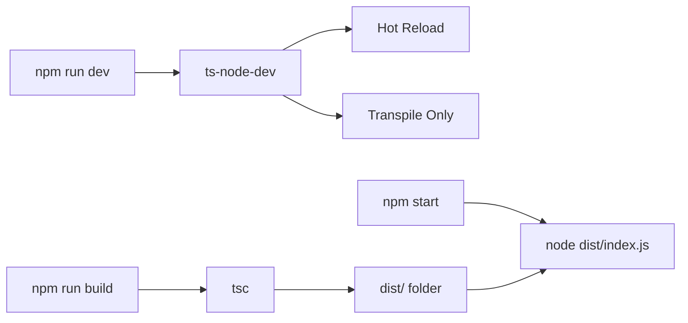

**Sources:** [cua-server/package.json:2-6]()

---

# Page: AI Agents

# AI Agents

<details>
<summary>Relevant source files</summary>

The following files were used as context for generating this wiki page:

- [cua-server/src/agents/test-case-agent.ts](cua-server/src/agents/test-case-agent.ts)
- [cua-server/src/agents/test-script-review-agent.ts](cua-server/src/agents/test-script-review-agent.ts)
- [cua-server/src/lib/constants.ts](cua-server/src/lib/constants.ts)

</details>


This document covers the AI-powered agents within the CUA Server that leverage OpenAI models to generate and review test cases. These agents transform natural language test instructions into structured test steps and continuously monitor test execution progress through visual analysis.

For information about the browser automation that executes the test steps generated by these agents, see [Browser Automation](#4.4). For details about the event handlers that coordinate agent invocation, see [Event Handlers](#4.3).

## Agent Architecture Overview

The CUA Server employs two specialized AI agents that work together to provide intelligent test case generation and execution monitoring:

```mermaid
graph TD
    UserInput["User Test Instructions"]
    
    subgraph "TestCaseAgent"
        TCA_Model["o3-mini Model"]
        TCA_Prompt["PROMPT_WITH_LOGIN or PROMPT_WITHOUT_LOGIN"]
        TCA_Schema["TestCaseSchema (Zod)"]
    end
    
    subgraph "TestScriptReviewAgent"
        TSRA_Model["gpt-4o Model"]
        TSRA_Prompt["TEST_SCRIPT_REVIEW_PROMPT"]
        TSRA_Queue["Task Queue"]
        TSRA_State["TestScriptState"]
    end
    
    subgraph "OpenAI Integration"
        ResponseAPI["openai.responses.parse()"]
        CreateAPI["openai.responses.create()"]
    end
    
    UserInput --> TestCaseAgent
    TestCaseAgent --> TCA_Model
    TCA_Model --> ResponseAPI
    ResponseAPI --> TCA_Schema
    
    Screenshots["Browser Screenshots"] --> TestScriptReviewAgent
    TestScriptReviewAgent --> TSRA_Queue
    TSRA_Queue --> TSRA_Model
    TSRA_Model --> CreateAPI
    CreateAPI --> TSRA_State
    
    TCA_Schema --> StructuredSteps["Structured Test Steps"]
    TSRA_State --> StatusUpdates["Test Status Updates"]
```

Sources: [cua-server/src/agents/test-case-agent.ts:1-55](), [cua-server/src/agents/test-script-review-agent.ts:1-355]()

## TestCaseAgent

The `TestCaseAgent` class converts natural language test instructions into structured, executable test steps using OpenAI's structured output capabilities.

### Core Implementation

The agent is initialized with a login requirement flag that determines which system prompt to use:

| Property | Type | Purpose |
|----------|------|---------|
| `model` | `string` | Always set to "o3-mini" |
| `developer_prompt` | `string` | Either `PROMPT_WITH_LOGIN` or `PROMPT_WITHOUT_LOGIN` |
| `login_required` | `boolean` | Determines prompt selection |

The agent uses Zod schemas to ensure structured output:

```mermaid
graph LR
    subgraph "Input Processing"
        UserInstr["User Instruction"]
        SystemPrompt["System Prompt"]
    end
    
    subgraph "Schema Validation"
        TestCaseStepSchema["TestCaseStepSchema"]
        TestCaseSchema["TestCaseSchema"]
    end
    
    subgraph "API Integration"
        ResponsesAPI["openai.responses.parse()"]
        ZodFormat["zodTextFormat()"]
    end
    
    UserInstr --> ResponsesAPI
    SystemPrompt --> ResponsesAPI
    TestCaseStepSchema --> TestCaseSchema
    TestCaseSchema --> ZodFormat
    ZodFormat --> ResponsesAPI
    
    ResponsesAPI --> StructuredOutput["Structured Test Case"]
```

Sources: [cua-server/src/agents/test-case-agent.ts:7-17](), [cua-server/src/agents/test-case-agent.ts:21-32]()

### Prompt Templates

The agent uses two distinct prompt templates based on whether authentication is required:

- **`PROMPT_WITH_LOGIN`**: Includes standard login steps (navigate, enter credentials, verify login) followed by user-specified test steps
- **`PROMPT_WITHOUT_LOGIN`**: Starts directly with navigation to target URL followed by user test steps

Both prompts enforce a consistent JSON structure with `step_number`, `step_instructions`, and `status` fields.

Sources: [cua-server/src/lib/constants.ts:1-49]()

### API Integration

The `invokeResponseAPI` method orchestrates the test case generation process:

```mermaid
sequenceDiagram
    participant Client
    participant TestCaseAgent
    participant OpenAI as "OpenAI API"
    participant ZodSchema as "Zod Validation"
    
    Client->>TestCaseAgent: "invokeResponseAPI(userInstruction)"
    TestCaseAgent->>OpenAI: "responses.parse() with system prompt"
    OpenAI-->>TestCaseAgent: "Structured response"
    TestCaseAgent->>ZodSchema: "Validate against TestCaseSchema"
    ZodSchema-->>TestCaseAgent: "Parsed TestCase object"
    TestCaseAgent-->>Client: "Validated test case steps"
```

Sources: [cua-server/src/agents/test-case-agent.ts:37-51]()

## TestScriptReviewAgent

The `TestScriptReviewAgent` class monitors test execution by analyzing screenshots and updating test step statuses in real-time. It maintains conversational context with the AI model throughout the test execution.

### State Management

The agent maintains several key state properties:

| Property | Type | Purpose |
|----------|------|---------|
| `test_script_state` | `TestScriptState \| null` | Current test step statuses and reasoning |
| `previous_response_id` | `string \| null` | OpenAI conversation context ID |
| `runFolder` | `string \| null` | Unique folder for storing test artifacts |
| `taskQueue` | `Task[]` | Sequential processing queue for screenshots |

Sources: [cua-server/src/agents/test-script-review-agent.ts:30-55]()

### Task Queue Processing

The agent implements a sequential task queue to handle multiple screenshot analysis requests without race conditions:

```mermaid
graph TD
    subgraph "Queue Management"
        NewTask["New Screenshot Analysis Request"]
        TaskQueue["taskQueue: Task[]"]
        ProcessingFlag["processingQueue: boolean"]
    end
    
    subgraph "Sequential Processing"
        ProcessQueue["processQueue()"]
        ProcessTask["processTestScriptStatus()"]
        OpenAICall["openai.responses.create()"]
    end
    
    subgraph "State Updates"
        CompareStates["Compare Old vs New States"]
        SaveScreenshot["Save Screenshot if Status Changed"]
        UpdateState["Update test_script_state"]
    end
    
    NewTask --> TaskQueue
    TaskQueue --> ProcessingFlag
    ProcessingFlag --> ProcessQueue
    ProcessQueue --> ProcessTask
    ProcessTask --> OpenAICall
    OpenAICall --> CompareStates
    CompareStates --> SaveScreenshot
    SaveScreenshot --> UpdateState
```

Sources: [cua-server/src/agents/test-script-review-agent.ts:144-177](), [cua-server/src/agents/test-script-review-agent.ts:159-177]()

### Agent Instantiation Workflow

The agent follows a two-phase initialization process:

1. **Initial Setup** (`instantiateAgent`): Creates the initial test script state from user instructions
2. **Continuous Monitoring** (`checkTestScriptStatus`): Processes screenshots and updates test progress

```mermaid
sequenceDiagram
    participant Handler as "Event Handler"
    participant Agent as "TestScriptReviewAgent"
    participant OpenAI as "OpenAI API"
    participant FileSystem as "File System"
    
    Handler->>Agent: "instantiateAgent(userInstruction)"
    Agent->>OpenAI: "responses.create() with TEST_SCRIPT_REVIEW_PROMPT"
    OpenAI-->>Agent: "Initial test script state"
    Agent->>FileSystem: "Create unique run folder"
    Agent-->>Handler: "Initial JSON state"
    
    loop "Continuous Monitoring"
        Handler->>Agent: "checkTestScriptStatus(screenshot)"
        Agent->>Agent: "Add to taskQueue"
        Agent->>OpenAI: "responses.create() with screenshot + previous_response_id"
        OpenAI-->>Agent: "Updated test script state"
        Agent->>Agent: "Compare old vs new states"
        alt "Status changed from pending to Pass/Fail"
            Agent->>FileSystem: "Save screenshot to run folder"
        end
        Agent-->>Handler: "Updated JSON state"
    end
```

Sources: [cua-server/src/agents/test-script-review-agent.ts:60-140](), [cua-server/src/agents/test-script-review-agent.ts:183-351]()

### Screenshot Management

The agent implements intelligent screenshot storage based on test step status transitions:

- Screenshots are saved only when a test step transitions from "pending" to "Pass" or "Fail"
- Each test run gets a unique folder using `uuidv4()` 
- Screenshots are stored in `/frontend/public/test_results/{runFolder}/` for web accessibility
- Image paths are embedded in the test state JSON for frontend display

Sources: [cua-server/src/agents/test-script-review-agent.ts:282-342]()

## Integration with OpenAI Services

Both agents leverage OpenAI's advanced API features for reliable structured output:

### Response API Usage

| Agent | API Method | Model | Key Features |
|-------|------------|-------|-------------|
| `TestCaseAgent` | `responses.parse()` | o3-mini | Zod schema validation, structured JSON output |
| `TestScriptReviewAgent` | `responses.create()` | gpt-4o | Conversation continuity, image analysis |

### Conversation Context

The `TestScriptReviewAgent` maintains conversation context using `previous_response_id`, allowing the AI model to understand the progression of test execution across multiple screenshot analyses.

Sources: [cua-server/src/agents/test-case-agent.ts:39-48](), [cua-server/src/agents/test-script-review-agent.ts:222-255]()

---

# Page: Event Handlers

# Event Handlers

<details>
<summary>Relevant source files</summary>

The following files were used as context for generating this wiki page:

- [cua-server/src/handlers/test-case-initiation-handler.ts](cua-server/src/handlers/test-case-initiation-handler.ts)
- [cua-server/src/handlers/test-case-update-handler.ts](cua-server/src/handlers/test-case-update-handler.ts)
- [cua-server/src/handlers/user-messages-handler.ts](cua-server/src/handlers/user-messages-handler.ts)

</details>


This section documents the event handlers in the CUA Server that process different types of Socket.IO events from the frontend client. These handlers form the communication layer between the frontend UI and the server's AI-driven testing capabilities.

For information about the AI agents that these handlers coordinate with, see [AI Agents](#4.2). For details about the browser automation that handlers trigger, see [Browser Automation](#4.4).

## Purpose and Architecture

The CUA Server uses Socket.IO to handle real-time communication with the frontend client. Event handlers process incoming events and coordinate between AI agents, browser automation, and client updates. The handlers manage the complete lifecycle of test execution from initiation through completion.

### Event Handler Flow

```mermaid
graph TD
    Frontend["Frontend Client"] 
    SocketServer["Socket.IO Server"]
    
    subgraph "Event Handlers"
        TestCaseHandler["handleTestCaseInitiated"]
        MessageHandler["handleSocketMessage"] 
        UpdateHandler["testCaseUpdateHandler"]
    end
    
    subgraph "Processing Components"
        TestCaseAgent["TestCaseAgent"]
        ReviewAgent["TestScriptReviewAgent"]
        CuaLoop["cuaLoopHandler"]
        ComputerLoop["computerUseLoop"]
    end
    
    Frontend -->|"testCaseInitiated"| SocketServer
    Frontend -->|"message"| SocketServer  
    Frontend -->|"testCaseUpdate"| SocketServer
    
    SocketServer --> TestCaseHandler
    SocketServer --> MessageHandler
    SocketServer --> UpdateHandler
    
    TestCaseHandler --> TestCaseAgent
    TestCaseHandler --> ReviewAgent
    TestCaseHandler --> CuaLoop
    
    MessageHandler --> ComputerLoop
    
    UpdateHandler -->|"status updates"| SocketServer
    SocketServer -->|"events"| Frontend
```

Sources: [cua-server/src/handlers/test-case-initiation-handler.ts:1-94](), [cua-server/src/handlers/user-messages-handler.ts:1-52](), [cua-server/src/handlers/test-case-update-handler.ts:1-25]()

## Test Case Initiation Handler

The `handleTestCaseInitiated` function processes the primary event that starts a new test execution. This handler orchestrates the entire test setup and execution process.

### Handler Workflow

```mermaid
sequenceDiagram
    participant Client as "Frontend Client"
    participant Handler as "handleTestCaseInitiated"
    participant Agent as "TestCaseAgent"
    participant ReviewAgent as "TestScriptReviewAgent"
    participant CuaLoop as "cuaLoopHandler"
    
    Client->>Handler: "testCaseInitiated event"
    Handler->>Client: "message: working on creating test script"
    Handler->>Agent: "invokeResponseAPI(msg)"
    Agent-->>Handler: "testCaseResponse"
    Handler->>ReviewAgent: "instantiateAgent(testCaseJson)"
    ReviewAgent-->>Handler: "testScriptReviewResponse"
    Handler->>Client: "testcases event"
    Handler->>Client: "message: Task steps created"
    Handler->>CuaLoop: "cuaLoopHandler(...)"
    CuaLoop-->>Client: "execution updates"
```

### Key Components

The handler processes the following input data structure:

| Field | Type | Purpose |
|-------|------|---------|
| `testCase` | string | Natural language test description |
| `url` | string | Target application URL |
| `userName` | string | Login credentials username |
| `password` | string | Login credentials password |
| `userInfo` | string | Additional user context |
| `loginRequired` | boolean | Whether login is needed (default: true) |

The handler performs these operations:

1. **Input Processing** - Extracts and validates event data [cua-server/src/handlers/test-case-initiation-handler.ts:14-25]()
2. **Agent Creation** - Instantiates `TestCaseAgent` and `TestScriptReviewAgent` [cua-server/src/handlers/test-case-initiation-handler.ts:34-48]()
3. **Test Case Generation** - Converts natural language to structured test steps [cua-server/src/handlers/test-case-initiation-handler.ts:36-67]()
4. **Execution Initiation** - Starts the CUA loop with generated test script [cua-server/src/handlers/test-case-initiation-handler.ts:73-82]()

Sources: [cua-server/src/handlers/test-case-initiation-handler.ts:8-87]()

## User Message Handler

The `handleSocketMessage` function processes user input during test execution, allowing users to provide additional instructions or resume paused tests.

### Message Processing Flow

```mermaid
graph TD
    UserInput["User Message Input"]
    Handler["handleSocketMessage"]
    Screenshot["page.screenshot()"]
    ModelInput["ModelInput Creation"]
    OpenAI["sendInputToModel"]
    ComputerLoop["computerUseLoop"]
    Response["Message Response"]
    
    UserInput --> Handler
    Handler --> Screenshot
    Screenshot --> ModelInput
    ModelInput --> OpenAI
    OpenAI --> ComputerLoop
    ComputerLoop --> Response
    Response --> UserInput
```

The handler retrieves the current page state and processes user messages through these steps:

1. **Context Gathering** - Takes screenshot and retrieves previous response data [cua-server/src/handlers/user-messages-handler.ts:13-25]()
2. **Model Input Creation** - Constructs `ModelInput` with screenshot and context [cua-server/src/handlers/user-messages-handler.ts:21-25]()
3. **AI Processing** - Sends input to the OpenAI model [cua-server/src/handlers/user-messages-handler.ts:27]()
4. **Execution Resume** - Continues the computer use loop [cua-server/src/handlers/user-messages-handler.ts:29-34]()
5. **Response Filtering** - Extracts and emits message responses [cua-server/src/handlers/user-messages-handler.ts:36-50]()

Sources: [cua-server/src/handlers/user-messages-handler.ts:6-51]()

## Test Case Update Handler

The `testCaseUpdateHandler` manages test execution status updates, handling both pass and fail conditions.

### Status Management

| Status | Action | Socket Data Update |
|--------|--------|-------------------|
| `"fail"` | Emit failure message | `socket.data.testCaseStatus = "fail"` |
| `"pass"` | Emit success message | `socket.data.testCaseStatus = "pass"` |

### Handler Logic

```mermaid
graph TD
    StatusInput["Status Input"]
    Handler["testCaseUpdateHandler"]
    FailCheck{"status === 'fail'?"}
    PassCheck{"status === 'pass'?"}
    FailAction["Emit fail message<br/>Set status to 'fail'"]
    PassAction["Emit pass message<br/>Set status to 'pass'"]
    
    StatusInput --> Handler
    Handler --> FailCheck
    Handler --> PassCheck
    FailCheck -->|Yes| FailAction
    PassCheck -->|Yes| PassAction
```

The handler performs case-insensitive status checking and updates both the client interface and socket data state. For failed tests, it provides guidance for reviewing and retrying. For passed tests, it indicates completion and suggests refreshing for new tests.

Sources: [cua-server/src/handlers/test-case-update-handler.ts:4-25]()

## Handler Integration Points

### Socket Data Management

Event handlers utilize `socket.data` to maintain test execution state:

- `socket.data.page` - Playwright page instance for browser control
- `socket.data.testCaseReviewAgent` - Review agent for test monitoring  
- `socket.data.previousResponseId` - OpenAI conversation continuity
- `socket.data.lastCallId` - Action execution tracking
- `socket.data.testCaseStatus` - Current test status ("pass"/"fail")

### Client Communication Events

| Outbound Event | Purpose | Handler Source |
|----------------|---------|----------------|
| `"message"` | Status updates and user feedback | All handlers |
| `"testcases"` | Structured test case data | Test initiation |

Sources: [cua-server/src/handlers/test-case-initiation-handler.ts:26-82](), [cua-server/src/handlers/user-messages-handler.ts:45](), [cua-server/src/handlers/test-case-update-handler.ts:12-21]()

---

# Page: Browser Automation

# Browser Automation

<details>
<summary>Relevant source files</summary>

The following files were used as context for generating this wiki page:

- [cua-server/src/handlers/action-handler.ts](cua-server/src/handlers/action-handler.ts)
- [cua-server/src/handlers/cua-loop-handler.ts](cua-server/src/handlers/cua-loop-handler.ts)
- [cua-server/src/lib/computer-use-loop.ts](cua-server/src/lib/computer-use-loop.ts)

</details>


This document covers the browser automation components of the CUA Server that are responsible for executing browser actions and managing the automation loop. These components translate AI model commands into actual browser interactions via Playwright and coordinate the continuous feedback loop between AI reasoning and browser state.

For information about the AI agents that generate test cases and review execution status, see [AI Agents](#4.2). For details about OpenAI API integration, see [External Services](#4.5).

## Action Execution System

The browser automation system centers around the `handleModelAction` function, which serves as the translation layer between AI model commands and Playwright browser actions. This function processes structured action objects from the OpenAI CUA model and executes them in the browser context.

### Action Types and Implementation

The system supports the following action types, each implemented with specific Playwright API calls:

| Action Type | Parameters | Playwright Implementation |
|-------------|------------|---------------------------|
| `click` | `x`, `y`, `button` | `page.mouse.click()` |
| `double_click` | `x`, `y`, `button` | `page.mouse.dblclick()` |
| `scroll` | `x`, `y`, `scrollX`/`scroll_x`, `scrollY`/`scroll_y` | `page.evaluate()` with `window.scrollBy()` |
| `keypress` | `keys` (array) | `page.keyboard.down()`/`up()`/`press()` |
| `drag` | `path` (array of coordinates) | `page.mouse.move()`/`down()`/`up()` |
| `type` | `text` | `page.keyboard.type()` |
| `wait` | none | `page.waitForTimeout(2000)` |
| `screenshot` | none | Handled separately in loop |

#### Keypress Action Processing

The keypress implementation includes sophisticated modifier key handling that separates modifier keys (`SHIFT`, `CTRL`, `ALT`, `META`, `CMD`) from main keys, processes them in the correct order, and handles special keys like `ENTER`, `SPACE`, `PAGEDOWN`, and `PAGEUP`.

**Action Execution Flow Diagram**

```mermaid
flowchart TD
    ModelCommand["AI Model Command<br/>{type: 'click', x: 100, y: 200}"]
    ActionHandler["handleModelAction()"]
    TypeSwitch["Action Type Switch"]
    ClickHandler["Click Handler<br/>page.mouse.click(x, y)"]
    KeypressHandler["Keypress Handler<br/>Modifier Processing"]
    DragHandler["Drag Handler<br/>Path Processing"]
    OtherHandlers["Other Action Handlers"]
    PlaywrightAPI["Playwright API"]
    BrowserAction["Browser Action Executed"]
    
    ModelCommand --> ActionHandler
    ActionHandler --> TypeSwitch
    TypeSwitch --> ClickHandler
    TypeSwitch --> KeypressHandler
    TypeSwitch --> DragHandler
    TypeSwitch --> OtherHandlers
    ClickHandler --> PlaywrightAPI
    KeypressHandler --> PlaywrightAPI
    DragHandler --> PlaywrightAPI
    OtherHandlers --> PlaywrightAPI
    PlaywrightAPI --> BrowserAction
```

Sources: [cua-server/src/handlers/action-handler.ts:5-153]()

## Computer Use Loop

The `computerUseLoop` function implements the core automation cycle that coordinates between AI model responses and browser execution. This loop processes model outputs, executes browser actions, captures screenshots, and sends feedback back to the model.

### Loop Components and Data Flow

The computer use loop operates through several key components:

**Computer Use Loop Architecture**

```mermaid
graph TB
    subgraph "Computer Use Loop Components"
        LoopEntry["computerUseLoop()<br/>Entry Point"]
        ResponseProcessor["Response Processor<br/>Filter computer_calls & function_calls"]
        ActionExecutor["Action Executor<br/>handleModelAction()"]
        ScreenshotCapture["Screenshot Capture<br/>getScreenshotWithRetry()"]
        ModelCommunication["Model Communication<br/>sendInputToModel()"]
        TestReview["Test Review Agent<br/>checkTestScriptStatus()"]
    end
    
    subgraph "External Dependencies"
        PlaywrightPage["Playwright Page<br/>Browser Context"]
        OpenAIModel["OpenAI CUA Model<br/>Response Processing"]
        SocketConnection["Socket Connection<br/>Real-time Updates"]
    end
    
    LoopEntry --> ResponseProcessor
    ResponseProcessor --> ActionExecutor
    ActionExecutor --> PlaywrightPage
    ActionExecutor --> ScreenshotCapture
    ScreenshotCapture --> ModelCommunication
    ModelCommunication --> OpenAIModel
    ResponseProcessor --> TestReview
    TestReview --> SocketConnection
    
    ModelCommunication -.->|Next Response| ResponseProcessor
```

### Loop Termination Conditions

The computer use loop can terminate under several conditions:

1. **Test Case Success**: When `socket.data.testCaseStatus === "pass"` or a `mark_done` function call is received
2. **Test Case Failure**: When `socket.data.testCaseStatus === "fail"` or safety checks are triggered
3. **No Computer Calls**: When the model response contains no `computer_call` items
4. **Safety Violations**: When `pending_safety_checks` are detected in the model response

### New Tab Handling

The loop includes sophisticated logic for handling new browser tabs that may open during test execution. When a new tab is detected, the system:

1. Identifies the new page context using `page.context().pages()`
2. Sets the viewport size to default dimensions
3. Takes a screenshot of the new page
4. Recursively calls `computerUseLoop` with the new page context
5. Uses a `switchedToNewTab` flag to prevent infinite recursion

Sources: [cua-server/src/lib/computer-use-loop.ts:16-276]()

## Browser Lifecycle Management

The `cuaLoopHandler` function manages the complete browser lifecycle from launch to test completion, including initialization, login handling, and test execution coordination.

### Browser Initialization and Configuration

The browser is launched with specific configurations optimized for automated testing:

```mermaid
sequenceDiagram
    participant Handler as "cuaLoopHandler()"
    participant Browser as "Chromium Browser"
    participant Page as "Browser Page"
    participant LoginService as "LoginService"
    participant ComputerLoop as "computerUseLoop()"
    
    Handler->>Browser: "chromium.launch({headless: false, args: [...]})"
    Browser->>Page: "browser.newPage()"
    Handler->>Page: "setViewportSize({width: displayWidth, height: displayHeight})"
    Handler->>Page: "goto(url)"
    Handler->>Page: "waitForTimeout(2000)"
    Handler->>Page: "screenshot()"
    
    alt Login Required
        Handler->>LoginService: "fillin_login_credentials()"
        LoginService->>Page: "Fill login form"
        Handler->>LoginService: "click_login_button()"
        LoginService->>Page: "Submit login"
        Handler->>Page: "screenshot() after login"
    end
    
    Handler->>ComputerLoop: "computerUseLoop(page, initial_response, ...)"
    ComputerLoop-->>Handler: "Test completion response"
```

### Viewport Management

The system uses environment variables to configure browser viewport dimensions:

- `DISPLAY_WIDTH` (default: 1024)
- `DISPLAY_HEIGHT` (default: 768)

These dimensions are consistently applied across browser initialization and new tab handling to ensure predictable screenshot dimensions for the AI model.

### Screenshot and State Management

The handler captures screenshots at key moments and coordinates with the test review agent:

1. **Before Login**: Initial page screenshot for baseline test state
2. **After Login**: Post-authentication screenshot to verify login success
3. **Continuous Monitoring**: Screenshots during action execution for test progress tracking

Sources: [cua-server/src/handlers/cua-loop-handler.ts:16-185]()

## Error Handling and Retries

The browser automation system includes robust error handling mechanisms to deal with common automation challenges.

### Screenshot Retry Logic

The `getScreenshotWithRetry` function implements exponential backoff for screenshot capture failures:

**Screenshot Retry Mechanism**

```mermaid
flowchart TD
    StartScreenshot["Screenshot Request"]
    AttemptCapture["page.screenshot()"]
    CaptureSuccess{"Capture<br/>Successful?"}
    ReturnBuffer["Return Screenshot Buffer"]
    CheckRetries{"Attempts < 3?"}
    WaitDelay["waitForTimeout(2000)"]
    ThrowError["Throw Error<br/>'Failed after retries'"]
    
    StartScreenshot --> AttemptCapture
    AttemptCapture --> CaptureSuccess
    CaptureSuccess -->|Yes| ReturnBuffer
    CaptureSuccess -->|No| CheckRetries
    CheckRetries -->|Yes| WaitDelay
    CheckRetries -->|No| ThrowError
    WaitDelay --> AttemptCapture
```

### Action Execution Error Handling

All action execution in `handleModelAction` is wrapped in try-catch blocks that log detailed error information while allowing the automation loop to continue processing subsequent actions.

### Network Idle Waiting

The `waitForNetworkIdle` utility function ensures page stability before proceeding with actions by waiting for the `networkidle` load state, which indicates that no network requests have been made for at least 500ms.

Sources: [cua-server/src/lib/computer-use-loop.ts:258-275](), [cua-server/src/handlers/action-handler.ts:150-153](), [cua-server/src/handlers/action-handler.ts:156-161]()

---

# Page: External Services

# External Services

<details>
<summary>Relevant source files</summary>

The following files were used as context for generating this wiki page:

- [cua-server/src/services/login-service.ts](cua-server/src/services/login-service.ts)
- [cua-server/src/services/openai-cua-client.ts](cua-server/src/services/openai-cua-client.ts)

</details>


This document covers the external service integrations within the CUA Server, focusing on the OpenAI Computer Use Agent (CUA) model integration and automated login functionality. These services enable the CUA Server to communicate with AI models and perform automated authentication on web applications.

For information about browser automation components, see [Browser Automation](#4.4). For server configuration details, see [Configuration and Environment](#4.6).

## OpenAI CUA Client Integration

The `OpenAICUAClient` service manages all communication with OpenAI's Computer Use Agent model, which provides the AI-powered decision making for automated browser testing. This service handles model setup, screenshot analysis, and action generation.

### Core Model Configuration

The CUA model is configured with specific tools and display parameters to enable computer vision and browser interaction capabilities.

```mermaid
graph TB
    subgraph "OpenAI CUA Client Configuration"
        ModelConfig["OpenAI Model Config"]
        Tools["Model Tools"]
        EnvConfig["Environment Config"]
    end
    
    subgraph "Model Tools"
        ComputerUse["computer_use_preview<br/>display_width, display_height<br/>environment: browser"]
        MarkDone["mark_done<br/>function tool<br/>task completion"]
    end
    
    subgraph "Environment Variables"
        ApiKey["OPENAI_API_KEY"]
        DisplayWidth["DISPLAY_WIDTH"]
        DisplayHeight["DISPLAY_HEIGHT"] 
        EnvInstructions["ENV_SPECIFIC_INSTRUCTIONS"]
    end
    
    ModelConfig --> Tools
    ModelConfig --> EnvConfig
    Tools --> ComputerUse
    Tools --> MarkDone
    EnvConfig --> ApiKey
    EnvConfig --> DisplayWidth
    EnvConfig --> DisplayHeight
    EnvConfig --> EnvInstructions
```

**Sources:** [cua-server/src/services/openai-cua-client.ts:23-37](), [cua-server/src/services/openai-cua-client.ts:4-10](), [cua-server/src/services/openai-cua-client.ts:19-21]()

### Model Communication Flow

The service implements a conversational pattern with the AI model, maintaining state across multiple interactions through response IDs and call tracking.

```mermaid
sequenceDiagram
    participant CUAServer as "CUA Server"
    participant OpenAIClient as "openai-cua-client"
    participant OpenAIAPI as "OpenAI API"
    
    Note over CUAServer,OpenAIAPI: Initial Setup
    CUAServer->>OpenAIClient: setupCUAModel(systemPrompt, userInfo)
    OpenAIClient->>OpenAIAPI: callCUAModel(input)
    OpenAIAPI-->>OpenAIClient: response with ID
    
    Note over CUAServer,OpenAIAPI: Screenshot Analysis Loop
    CUAServer->>OpenAIClient: sendInputToModel({screenshotBase64, previousResponseId})
    OpenAIClient->>OpenAIAPI: callCUAModel(input, previousResponseId)
    OpenAIAPI-->>OpenAIClient: response with call_id
    
    Note over CUAServer,OpenAIAPI: Function Call Response
    CUAServer->>OpenAIClient: sendFunctionCallOutput(callId, previousResponseId)
    OpenAIClient->>OpenAIAPI: callCUAModel(input, previousResponseId)
    OpenAIAPI-->>OpenAIClient: next response
```

**Sources:** [cua-server/src/services/openai-cua-client.ts:137-162](), [cua-server/src/services/openai-cua-client.ts:89-119](), [cua-server/src/services/openai-cua-client.ts:121-135]()

### Key Service Methods

| Method | Purpose | Parameters | Returns |
|--------|---------|------------|---------|
| `setupCUAModel` | Initialize conversation with system prompt | `systemPrompt`, `userInfo` | `OpenAIResponse` |
| `sendInputToModel` | Send screenshot and user input | `ModelInput` object | `OpenAIResponse` |
| `sendFunctionCallOutput` | Send function execution results | `callId`, `previousResponseId`, `outputObj` | `OpenAIResponse` |
| `callCUAModel` | Core API communication helper | `input[]`, `previousResponseId?` | `OpenAIResponse` |

**Sources:** [cua-server/src/services/openai-cua-client.ts:44-48](), [cua-server/src/services/openai-cua-client.ts:39-42]()

### Request Structure and Payload

The service constructs specific request payloads for different interaction types with the AI model.

```mermaid
graph TB
    subgraph "Request Types"
        InitialSetup["Initial Setup Request"]
        ScreenshotInput["Screenshot Input Request"]
        FunctionOutput["Function Output Request"]
    end
    
    subgraph "Request Components"
        Model["model: computer-use-preview"]
        Tools["tools: [computer_use_preview, mark_done]"]
        Input["input: message array"]
        Reasoning["reasoning: {generate_summary: concise}"]
        PrevResponse["previous_response_id: optional"]
    end
    
    InitialSetup --> Model
    InitialSetup --> Tools
    InitialSetup --> Input
    ScreenshotInput --> Model
    ScreenshotInput --> Tools
    ScreenshotInput --> Input
    ScreenshotInput --> PrevResponse
    FunctionOutput --> Model
    FunctionOutput --> Tools
    FunctionOutput --> Input
    FunctionOutput --> PrevResponse
    
    Input --> Reasoning
```

**Sources:** [cua-server/src/services/openai-cua-client.ts:51-83]()

## Login Service

The `LoginService` provides automated authentication capabilities for web applications, enabling the CUA Server to handle login flows without manual intervention.

### Service Architecture

```mermaid
graph TB
    subgraph "LoginService Class"
        FillCredentials["fillin_login_credentials()<br/>username, password, page"]
        ClickLogin["click_login_button()<br/>page"]
    end
    
    subgraph "Playwright Integration"
        PageSelectors["getByPlaceholder()<br/>getByRole()"]
        UserInput["fill() method<br/>click() method"]
        Navigation["waitForURL()<br/>waitForLoadState()"]
    end
    
    subgraph "Target Elements"
        UsernameField["Username placeholder field"]
        PasswordField["Password placeholder field"] 
        LoginButton["Login button role"]
    end
    
    FillCredentials --> PageSelectors
    ClickLogin --> PageSelectors
    PageSelectors --> UserInput
    PageSelectors --> Navigation
    UserInput --> UsernameField
    UserInput --> PasswordField
    UserInput --> LoginButton
```

**Sources:** [cua-server/src/services/login-service.ts:11-67]()

### Login Flow Implementation

The service implements a two-step authentication process with error handling and timeout management.

| Method | Function | Timeout | Error Handling |
|--------|----------|---------|----------------|
| `fillin_login_credentials` | Fill username and password fields | 5,000ms per field | Returns `false` on failure |
| `click_login_button` | Click login and wait for navigation | 10,000ms total | Returns `false` on failure |

**Sources:** [cua-server/src/services/login-service.ts:15-39](), [cua-server/src/services/login-service.ts:45-66]()

### Navigation and State Management

The login service handles post-authentication navigation by waiting for either URL change or network idle state.

```mermaid
graph TB
    subgraph "Login Button Click Flow"
        ClickAction["loginBtn.click()"]
        WaitConditions["Promise.all()"]
    end
    
    subgraph "Wait Conditions"
        URLWait["waitForURL('**/home')<br/>10s timeout"]
        NetworkWait["waitForLoadState('networkidle')<br/>10s timeout"]
    end
    
    subgraph "Success Scenarios"
        HomeNavigation["URL becomes '/home'"]
        NetworkIdle["Network activity stops"]
    end
    
    ClickAction --> WaitConditions
    WaitConditions --> URLWait
    WaitConditions --> NetworkWait
    URLWait --> HomeNavigation
    NetworkWait --> NetworkIdle
```

**Sources:** [cua-server/src/services/login-service.ts:52-58]()

## Configuration Dependencies

Both external services rely on environment variables for proper configuration and authentication.

### Required Environment Variables

| Variable | Service | Purpose | Default |
|----------|---------|---------|---------|
| `OPENAI_API_KEY` | OpenAI CUA Client | API authentication | Required |
| `DISPLAY_WIDTH` | OpenAI CUA Client | Browser viewport width | 1024 |
| `DISPLAY_HEIGHT` | OpenAI CUA Client | Browser viewport height | 768 |
| `ENV_SPECIFIC_INSTRUCTIONS` | OpenAI CUA Client | OS-specific commands | Optional |

**Sources:** [cua-server/src/services/openai-cua-client.ts:4-6](), [cua-server/src/services/openai-cua-client.ts:20-21](), [cua-server/src/services/openai-cua-client.ts:9]()

### Service Integration Patterns

External services are instantiated and used throughout the CUA Server's event handling and automation loops, following dependency injection patterns for testability and modularity.

```mermaid
graph TB
    subgraph "Service Instantiation"
        OpenAIInstance["new OpenAI({apiKey})"]
        LoginServiceInstance["new LoginService()"]
    end
    
    subgraph "Usage Contexts"
        CUALoop["Computer Use Loop"]
        EventHandlers["Socket Event Handlers"]
        BrowserAutomation["Browser Automation"]
    end
    
    subgraph "Integration Points"
        ModelCalls["sendInputToModel()"]
        AuthFlows["fillin_login_credentials()"]
        StateManagement["Response ID tracking"]
    end
    
    OpenAIInstance --> CUALoop
    LoginServiceInstance --> BrowserAutomation
    CUALoop --> ModelCalls
    BrowserAutomation --> AuthFlows
    ModelCalls --> StateManagement
    EventHandlers --> CUALoop
    EventHandlers --> BrowserAutomation
```

**Sources:** [cua-server/src/services/openai-cua-client.ts:4-6](), [cua-server/src/services/login-service.ts:11]()

---

# Page: Configuration and Environment

# Configuration and Environment

<details>
<summary>Relevant source files</summary>

The following files were used as context for generating this wiki page:

- [cua-server/.env.example](cua-server/.env.example)
- [cua-server/.gitignore](cua-server/.gitignore)
- [cua-server/tsconfig.json](cua-server/tsconfig.json)

</details>


This document covers the configuration and environment setup for the CUA Server component of the Testing Agent Demo system. It includes environment variables, TypeScript build configuration, development setup, and project structure requirements.

For information about the CUA Server's runtime architecture and core functionality, see [Server Overview and Entry Point](#4.1). For frontend configuration details, see [Frontend Setup and Configuration](#5.1).

## Environment Variables

The CUA Server requires specific environment variables to integrate with external services and configure runtime behavior.

### Required Configuration

The primary configuration is defined through environment variables, with an example template provided:

| Variable | Purpose | Required | Example |
|----------|---------|-----------|---------|
| `OPENAI_API_KEY` | API key for OpenAI CUA model integration | Yes | `your-openai-key` |

**Configuration Environment Flow**
```mermaid
flowchart TD
    EnvExample[".env.example"] --> EnvFile[".env"]
    EnvFile --> CuaServer["CUA Server Process"]
    CuaServer --> OpenAIClient["OpenAI Client"]
    
    EnvFile -.-> GitIgnore[".gitignore exclusion"]
    
    subgraph "Environment Loading"
        ProcessEnv["process.env.OPENAI_API_KEY"]
        ProcessEnv --> OpenAIIntegration["OpenAI API Integration"]
    end
    
    CuaServer --> ProcessEnv
```

Sources: [cua-server/.env.example:1-2]()

## TypeScript Configuration

The CUA Server uses TypeScript with a specific compilation configuration optimized for Node.js backend services.

### Compiler Settings

The TypeScript configuration targets ES2020 with CommonJS modules for Node.js compatibility:

| Setting | Value | Purpose |
|---------|-------|---------|
| `target` | ES2020 | JavaScript target version |
| `module` | CommonJS | Module system for Node.js |
| `outDir` | dist | Compiled output directory |
| `rootDir` | src | Source code directory |
| `moduleResolution` | node | Node.js module resolution |

**TypeScript Build Pipeline**
```mermaid
flowchart LR
    SrcFiles["src/**/*.ts"] --> TSCompiler["TypeScript Compiler"]
    TSConfig["tsconfig.json"] --> TSCompiler
    TSCompiler --> DistFiles["dist/**/*.js"]
    
    subgraph "Compiler Options"
        Target["target: ES2020"]
        Module["module: CommonJS"]
        Strict["strict: true"]
        ESModule["esModuleInterop: true"]
    end
    
    TSConfig --> Target
    TSConfig --> Module
    TSConfig --> Strict
    TSConfig --> ESModule
```

Sources: [cua-server/tsconfig.json:1-13]()

## Build and Development Configuration

### Git Ignore Patterns

The build system excludes specific directories and files from version control:

**Build Artifacts and Dependencies**
```mermaid
flowchart TD
    subgraph "Excluded Directories"
        NodeModules["node_modules/"]
        Coverage["/coverage"]
        NextBuild["/.next/"]
        BuildDir["/build"]
        DistDir["/dist"]
    end
    
    subgraph "Excluded Files"
        EnvFiles[".env*"]
        LogFiles["*.log*"]
        DebugFiles["*.tsbuildinfo"]
        Screenshot["screenshot.png"]
    end
    
    GitIgnore[".gitignore"] --> NodeModules
    GitIgnore --> Coverage
    GitIgnore --> NextBuild
    GitIgnore --> BuildDir
    GitIgnore --> EnvFiles
    GitIgnore --> LogFiles
    GitIgnore --> DebugFiles
    GitIgnore --> Screenshot
    
    EnvExample[".env.example"] -.-> EnvFiles
    EnvExample -.-> Included["Included in repo"]
```

Sources: [cua-server/.gitignore:1-44]()

### Development Dependencies

The system manages several categories of build artifacts and dependencies:

| Category | Examples | Purpose |
|----------|----------|---------|
| Dependencies | `node_modules/`, `.pnp.*` | Package management |
| Build Outputs | `/build`, `/dist`, `/.next/` | Compiled artifacts |
| Testing | `/coverage` | Test coverage reports |
| Development | `*.tsbuildinfo`, `*.log*` | Development artifacts |
| Runtime | `screenshot.png` | Browser automation artifacts |

## Configuration Integration Points

### Environment Variable Usage

The CUA Server integrations depend on proper environment configuration:

**Configuration Dependencies Flow**
```mermaid
flowchart TD
    EnvConfig["Environment Configuration"] --> ServerInit["Server Initialization"]
    
    subgraph "Service Integrations"
        OpenAIKey["OPENAI_API_KEY"] --> OpenAIService["OpenAI Client Service"]
        ServerPort["SOCKET_PORT"] --> SocketServer["Socket.IO Server"]
        CorsOrigin["CORS_ORIGIN"] --> CorsConfig["CORS Configuration"]
    end
    
    ServerInit --> OpenAIService
    ServerInit --> SocketServer
    ServerInit --> CorsConfig
    
    subgraph "Runtime Services"
        TestCaseAgent["TestCaseAgent"]
        CuaLoopHandler["CuaLoopHandler"] 
        ActionHandler["ActionHandler"]
    end
    
    OpenAIService --> TestCaseAgent
    OpenAIService --> CuaLoopHandler
    SocketServer --> ActionHandler
```

### Build Process Integration

The TypeScript build process integrates with the overall development workflow:

**Development Workflow Configuration**
```mermaid
flowchart LR
    subgraph "Source Structure"
        SrcDir["src/"]
        ConfigFiles["*.json configs"]
        EnvFiles["Environment files"]
    end
    
    subgraph "Build Process"
        TSBuild["TypeScript Build"]
        ModuleRes["Module Resolution"]
        StrictCheck["Strict Type Checking"]
    end
    
    subgraph "Output Structure" 
        DistDir["dist/"]
        JSFiles["Compiled JS"]
        SourceMaps["Source Maps"]
    end
    
    SrcDir --> TSBuild
    ConfigFiles --> TSBuild
    TSBuild --> ModuleRes
    TSBuild --> StrictCheck
    ModuleRes --> DistDir
    StrictCheck --> JSFiles
    EnvFiles -.-> Runtime["Runtime Environment"]
```

Sources: [cua-server/tsconfig.json:2-12](), [cua-server/.gitignore:3-11]()

## Prerequisites and Dependencies

### Required System Components

The CUA Server configuration assumes certain system-level dependencies:

| Component | Purpose | Configuration Impact |
|-----------|---------|----------------------|
| Node.js | Runtime environment | Module resolution, ES2020 support |
| TypeScript | Build toolchain | Compilation settings |
| OpenAI API Access | AI model integration | API key configuration |
| Playwright Browsers | Browser automation | Display configuration |

### Configuration Validation

The system requires proper configuration validation at startup:

- `OPENAI_API_KEY` must be valid for AI model access
- TypeScript compilation must succeed for deployment
- Environment files must be properly excluded from version control
- Build artifacts must be properly generated in `dist/` directory

Sources: [cua-server/.env.example:1-2](), [cua-server/tsconfig.json:1-13](), [cua-server/.gitignore:1-44]()

---

# Page: Utilities and Helpers

# Utilities and Helpers

<details>
<summary>Relevant source files</summary>

The following files were used as context for generating this wiki page:

- [cua-server/src/utils/logger.ts](cua-server/src/utils/logger.ts)
- [cua-server/src/utils/testCaseUtils.ts](cua-server/src/utils/testCaseUtils.ts)

</details>


This section documents the supporting utility functions and helper modules that provide common functionality across the CUA Server. These utilities handle logging infrastructure and test case data processing, serving as foundational components used throughout the system.

For information about the main AI agents that use these utilities, see [AI Agents](#4.2). For browser automation components that utilize logging, see [Browser Automation](#4.4).

## Logging Infrastructure

The CUA Server uses a centralized logging system built on the Pino library, providing structured logging with environment-specific configuration.

### Logger Configuration

The `logger` module provides a pre-configured Pino logger instance that adapts its behavior based on the runtime environment:

| Environment | Log Transport | Features |
|------------|---------------|----------|
| Development | `pino-pretty` | Colorized output, human-readable format |
| Production | Standard JSON | Structured JSON logs for processing |

The logger accepts configuration through environment variables:
- `LOG_LEVEL`: Controls verbosity (default: "info")
- `NODE_ENV`: Determines transport configuration

**Logger Usage Pattern**
```mermaid
graph TB
    EnvVars["Environment Variables<br/>LOG_LEVEL, NODE_ENV"]
    LoggerModule["logger.ts<br/>pino configuration"]
    PinoLib["pino library"]
    PinoPretty["pino-pretty<br/>(dev transport)"]
    
    EnvVars --> LoggerModule
    LoggerModule --> PinoLib
    LoggerModule --> PinoPretty
    
    subgraph "CUA Server Components"
        Handlers["Event Handlers"]
        Agents["AI Agents"] 
        Services["External Services"]
        ActionLoop["Action Loop"]
    end
    
    LoggerModule --> Handlers
    LoggerModule --> Agents
    LoggerModule --> Services
    LoggerModule --> ActionLoop
```

Sources: [cua-server/src/utils/logger.ts:1-22]()

## Test Case Data Processing

The test case utilities provide functions for processing and transforming test case data structures that flow between AI agents and the execution engine.

### Data Structures

The system defines standardized interfaces for test case representation:

```typescript
interface TestCaseStep {
  step_number: number;
  step_instructions: string;
  status?: string;
}

interface TestCase {
  steps: TestCaseStep[];
}
```

### Processing Functions

**Test Case Processing Pipeline**
```mermaid
graph LR
    LLMOutput["LLM Raw Output<br/>(with escaped chars)"]
    CleanString["cleanTestCaseString()<br/>removes \\n, trims"]
    ParsedJSON["Parsed TestCase<br/>JSON object"]
    StepsString["convertTestCaseToSteps()<br/>newline-delimited"]
    ExecutionEngine["Execution Engine<br/>consumable format"]
    
    LLMOutput --> CleanString
    CleanString --> ParsedJSON
    ParsedJSON --> StepsString
    StepsString --> ExecutionEngine
```

The utility functions handle common transformations:

| Function | Input | Output | Purpose |
|----------|-------|--------|---------|
| `cleanTestCaseString()` | Raw LLM string with escape chars | Cleaned string | Removes `\\n` and excess whitespace |
| `convertTestCaseToSteps()` | `TestCase` object | Formatted step string | Converts to human-readable format |

### Error Handling

The `convertTestCaseToSteps()` function includes validation to ensure the input contains a properly formatted `steps` array, throwing an error with message "Invalid test case format: missing steps array" if validation fails.

**Test Case Utility Integration**
```mermaid
graph TB
    subgraph "AI Agent Layer"
        TestCaseAgent["TestCaseAgent<br/>generates JSON"]
        TestReviewAgent["TestScriptReviewAgent<br/>processes steps"]
    end
    
    subgraph "Utility Layer"
        CleanFunction["cleanTestCaseString()<br/>string cleaning"]
        ConvertFunction["convertTestCaseToSteps()<br/>format conversion"]
        Interfaces["TestCase, TestCaseStep<br/>type definitions"]
    end
    
    subgraph "Execution Layer"
        CuaLoop["Computer Use Loop<br/>consumes formatted steps"]
        EventHandlers["Event Handlers<br/>status updates"]
    end
    
    TestCaseAgent --> CleanFunction
    CleanFunction --> ConvertFunction
    ConvertFunction --> CuaLoop
    TestReviewAgent --> Interfaces
    Interfaces --> EventHandlers
```

Sources: [cua-server/src/utils/testCaseUtils.ts:1-29]()

## Utility Module Organization

The utilities are organized in the `src/utils/` directory with focused, single-responsibility modules:

| Module | Exports | Dependencies |
|--------|---------|-------------|
| `logger.ts` | Default logger instance | `pino`, `pino-pretty` |
| `testCaseUtils.ts` | Processing functions, type interfaces | None (pure functions) |

This modular approach ensures utilities remain lightweight and can be imported selectively by consuming modules throughout the CUA Server codebase.

Sources: [cua-server/src/utils/logger.ts:1-22](), [cua-server/src/utils/testCaseUtils.ts:1-29]()

---

# Page: Frontend Application

# Frontend Application

<details>
<summary>Relevant source files</summary>

The following files were used as context for generating this wiki page:

- [frontend/README.md](frontend/README.md)
- [frontend/app/layout.tsx](frontend/app/layout.tsx)

</details>


## Purpose and Scope

The Frontend Application is a Next.js web interface that serves as the primary user interaction layer for the Testing Agent Demo system. This document covers the overall architecture, communication patterns, and core components of the frontend application. For detailed setup and configuration information, see [Frontend Setup and Configuration](#5.1). For specific UI component documentation, see [UI Components and Layout](#5.2). For styling and asset management, see [Styling and Assets](#5.3).

The frontend enables users to define test cases, monitor real-time test execution, and view results from the AI-powered testing system. It communicates with the CUA Server via WebSocket connections to provide live updates during test execution.

## Application Overview

The Frontend Application is a Next.js application that runs on port 3000 and provides the web interface for interacting with the Testing Agent Demo system. It serves as the entry point for users to configure test cases and monitor their execution in real-time.

| Component | Technology | Port | Purpose |
|-----------|------------|------|---------|
| Frontend UI | Next.js 14+ | 3000 | User interface for test configuration and monitoring |
| Socket.IO Client | Socket.IO | WebSocket | Real-time communication with CUA Server |
| OpenAI Integration | Environment Variable | N/A | API key configuration for AI services |

The application follows a modern React architecture with server-side rendering capabilities provided by Next.js, enabling both interactive client-side features and optimized initial page loads.

**Sources:** [frontend/README.md:1-22]()

## Architecture and Communication Flow

### Frontend System Architecture

```mermaid
graph TB
    subgraph "Frontend Application (:3000)"
        NextApp["Next.js Application"]
        RootLayout["RootLayout Component<br/>(app/layout.tsx)"]
        SocketManager["SocketIOManager Component"]
        
        subgraph "Core Features"
            TestConfig["Test Configuration UI"]
            StatusMonitor["Real-time Status Monitor"]
            ResultsDisplay["Results Display"]
        end
        
        subgraph "Assets & Styling"
            GlobalCSS["globals.css"]
            GeistFonts["Geist Font Family"]
            OpenAILogo["OpenAI Logo"]
        end
    end
    
    subgraph "External Communication"
        CuaServer["CUA Server<br/>(:8080)"]
        WebSocket["WebSocket Connection"]
    end
    
    NextApp --> RootLayout
    RootLayout --> SocketManager
    RootLayout --> TestConfig
    RootLayout --> StatusMonitor
    RootLayout --> ResultsDisplay
    RootLayout --> GlobalCSS
    RootLayout --> GeistFonts
    
    SocketManager <--> WebSocket
    WebSocket <--> CuaServer
    
    RootLayout -.-> OpenAILogo
```

### Communication Pattern with CUA Server

```mermaid
sequenceDiagram
    participant User
    participant NextJS as "Next.js Frontend"
    participant SocketManager as "SocketIOManager"
    participant WebSocket as "WebSocket Connection"
    participant CuaServer as "CUA Server (:8080)"
    
    User->>NextJS: "Configure test case"
    NextJS->>SocketManager: "Initialize connection"
    SocketManager->>WebSocket: "Connect to :8080"
    WebSocket-->>CuaServer: "Establish connection"
    
    NextJS->>SocketManager: "Send test configuration"
    SocketManager->>WebSocket: "testCaseInitiated event"
    WebSocket->>CuaServer: "Forward event"
    
    loop "Real-time Updates"
        CuaServer-->>WebSocket: "Status updates"
        WebSocket-->>SocketManager: "Receive updates"
        SocketManager-->>NextJS: "Update UI"
        NextJS-->>User: "Display progress"
    end
    
    CuaServer-->>WebSocket: "Test completion"
    WebSocket-->>SocketManager: "Final results"
    SocketManager-->>NextJS: "Show results"
    NextJS-->>User: "Display final results"
```

**Sources:** [frontend/app/layout.tsx:1-40](), [frontend/README.md:5-6]()

## Key Components and Structure

### Root Layout Component

The `RootLayout` component in [frontend/app/layout.tsx:23-39]() serves as the application's root wrapper, establishing the fundamental structure and integrating key services:

```mermaid
graph LR
    subgraph "RootLayout Component Structure"
        HTML["html element<br/>(lang='en')"]
        Body["body element<br/>(with font classes)"]
        SocketManager["SocketIOManager<br/>(Real-time communication)"]
        MainContainer["main container<br/>(flex layout)"]
        Children["children<br/>(Page content)"]
    end
    
    HTML --> Body
    Body --> SocketManager
    Body --> MainContainer
    MainContainer --> Children
```

The layout implements several critical features:

- **Font Integration**: Loads Geist Sans and Geist Mono fonts via `localFont` from [frontend/app/layout.tsx:6-15]()
- **Metadata Configuration**: Sets application title and OpenAI logo via [frontend/app/layout.tsx:17-21]()
- **Global Styling**: Applies Tailwind CSS classes for responsive design and consistent theming
- **Socket Integration**: Embeds `SocketIOManager` component for WebSocket connectivity

### Application Metadata

| Property | Value | Source |
|----------|-------|--------|
| Title | "Automated Testing Agent Demo" | [frontend/app/layout.tsx:18]() |
| Description | "Automated Testing Agent Demo using the OpenAI CUA model" | [frontend/app/layout.tsx:19]() |
| Icon | "/openai_logo.svg" | [frontend/app/layout.tsx:20]() |

**Sources:** [frontend/app/layout.tsx:1-40]()

## Development Environment Integration

### Environment Configuration

The frontend requires specific environment configuration to integrate with the broader system:

```mermaid
graph TB
    subgraph "Environment Setup"
        EnvExample[".env.example<br/>(Template)"]
        EnvDev[".env.development<br/>(Local config)"]
        OpenAIKey["OPENAI_API_KEY<br/>(Required)"]
    end
    
    subgraph "Dependencies"
        NodeModules["node_modules<br/>(npm install)"]
        NextJSDeps["Next.js Framework"]
        SocketIOClient["Socket.IO Client"]
        TailwindCSS["Tailwind CSS"]
    end
    
    subgraph "Development Server"
        DevServer["npm run dev<br/>(:3000)"]
        HotReload["Hot Reload<br/>(Development)"]
    end
    
    EnvExample --> EnvDev
    EnvDev --> OpenAIKey
    OpenAIKey --> DevServer
    NodeModules --> NextJSDeps
    NodeModules --> SocketIOClient
    NodeModules --> TailwindCSS
    NextJSDeps --> DevServer
    DevServer --> HotReload
```

### System Dependencies

The frontend operates as part of a coordinated system requiring:

- **CUA Server**: Must be running on port 8080 for WebSocket communication
- **Sample Test App**: Required for demonstration purposes on port 3005
- **OpenAI API Key**: Essential for AI-powered testing functionality

The development workflow follows standard Next.js patterns with `npm run dev` providing hot reload capabilities during development.

**Sources:** [frontend/README.md:7-21]()

## Integration Points

The Frontend Application serves as the orchestration point for user interactions with the testing system, maintaining real-time connectivity with the CUA Server through WebSocket protocols. The `SocketIOManager` component handles all aspects of this communication, enabling bidirectional data flow for test configuration, execution monitoring, and result presentation.

The application's architecture supports both immediate user feedback through optimistic UI updates and reliable state synchronization through server-driven events, ensuring users have accurate, real-time visibility into test execution progress and outcomes.

**Sources:** [frontend/app/layout.tsx:4](), [frontend/README.md:5-6]()

---

# Page: Frontend Setup and Configuration

# Frontend Setup and Configuration

<details>
<summary>Relevant source files</summary>

The following files were used as context for generating this wiki page:

- [frontend/.env.example](frontend/.env.example)
- [frontend/.gitignore](frontend/.gitignore)
- [frontend/README.md](frontend/README.md)

</details>


This document covers the environment setup, build configuration, and project structure for the Next.js frontend application. The frontend serves as the web interface for configuring test cases and monitoring AI-driven test execution in real-time. For information about the UI components and Socket.IO integration, see [UI Components and Layout](#5.2). For styling and static assets, see [Styling and Assets](#5.3).

## Environment Configuration

The frontend application requires specific environment variables to function properly, primarily for OpenAI API integration and browser display configuration.

### Environment Variables Setup

The application uses a standard `.env` file pattern for configuration management:

| Variable | Purpose | Default | Required |
|----------|---------|---------|----------|
| `OPENAI_API_KEY` | Authentication for OpenAI CUA model | None | Yes |
| `DISPLAY_WIDTH` | Browser viewport width for testing | 1024 | No |
| `DISPLAY_HEIGHT` | Browser viewport height for testing | 768 | No |
| `ENV_SPECIFIC_INSTRUCTIONS` | Platform-specific testing instructions | None | No |

### Environment Configuration Flow

```mermaid
graph TB
    subgraph "Environment Setup"
        EnvExample[".env.example"]
        EnvDev[".env.development"]
        EnvLocal[".env.local"]
    end
    
    subgraph "Next.js Runtime"
        NextConfig["next.config.js"]
        RuntimeEnv["Runtime Environment"]
        ClientApp["Client Application"]
    end
    
    subgraph "External Services"
        OpenAIAPI["OpenAI API"]
        CuaServer["CUA Server :8080"]
    end
    
    EnvExample -->|"cp .env.example .env.development"| EnvDev
    EnvDev --> NextConfig
    EnvLocal --> NextConfig
    NextConfig --> RuntimeEnv
    RuntimeEnv --> ClientApp
    ClientApp -->|"OPENAI_API_KEY"| OpenAIAPI
    ClientApp -->|"WebSocket"| CuaServer
    
    RuntimeEnv -.->|"DISPLAY_WIDTH/HEIGHT"| CuaServer
    RuntimeEnv -.->|"ENV_SPECIFIC_INSTRUCTIONS"| CuaServer
```

**Sources:** [frontend/.env.example:1-6]()

## Project Structure and Build Configuration

The frontend follows Next.js conventions with specific build artifacts and dependency management configured for the testing agent demo.

### Build Artifacts and Dependencies

```mermaid
graph TB
    subgraph "Source Code"
        SourceFiles["Source Files"]
        PublicAssets["public/"]
        ComponentFiles["Components"]
    end
    
    subgraph "Dependencies"
        NodeModules["node_modules/"]
        YarnFiles[".yarn/"]
        PackageFiles["package.json"]
    end
    
    subgraph "Build Outputs"
        NextBuild[".next/"]
        BuildDir["build/"]
        OutDir["out/"]
        TestResults["public/test_results/"]
    end
    
    subgraph "Development"
        Coverage["coverage/"]
        DebugLogs["*.log files"]
        TSBuild["*.tsbuildinfo"]
    end
    
    SourceFiles --> NextBuild
    PublicAssets --> NextBuild
    ComponentFiles --> NextBuild
    NodeModules --> NextBuild
    
    PackageFiles --> NodeModules
    YarnFiles --> NodeModules
    
    NextBuild --> BuildDir
    NextBuild --> OutDir
    NextBuild --> TestResults
    
    style NextBuild fill:#f9f9f9
    style NodeModules fill:#f9f9f9
    style TestResults fill:#f9f9f9
```

### Ignored Files and Build Artifacts

The `.gitignore` configuration reveals the development and build structure:

- **Dependencies**: `node_modules/`, `.pnp.*`, `.yarn/*` (with selective inclusion)
- **Build outputs**: `.next/`, `out/`, `build/`
- **Development artifacts**: `coverage/`, debug logs, TypeScript build info
- **Test results**: `public/test_results/` (dynamically generated screenshots and reports)
- **Environment files**: `.env*` (except `.env.example`)

**Sources:** [frontend/.gitignore:1-45]()

## Development Setup Process

The frontend setup follows a standard Next.js development workflow with specific requirements for the testing agent demo.

### Setup Sequence

```mermaid
sequenceDiagram
    participant Dev as "Developer"
    participant Env as "Environment"
    participant NPM as "Package Manager"
    participant Next as "Next.js Server"
    participant CUA as "CUA Server"
    
    Dev->>Env: "cp .env.example .env.development"
    Dev->>Env: "Edit OPENAI_API_KEY"
    Dev->>NPM: "npm install"
    NPM-->>Dev: "Dependencies installed"
    Dev->>Next: "npm run dev"
    Next-->>Dev: "Server running :3000"
    Note over Next: "Next.js dev server starts"
    Next->>CUA: "Attempt WebSocket connection :8080"
    CUA-->>Next: "Connection established"
    Note over Dev: "Frontend ready for testing"
```

### Required Setup Steps

| Step | Command | Purpose |
|------|---------|---------|
| 1 | `cp .env.example .env.development` | Create development environment file |
| 2 | Edit `.env.development` | Add `OPENAI_API_KEY` and optional display settings |
| 3 | `npm install` | Install project dependencies |
| 4 | `npm run dev` | Start development server on port 3000 |

**Sources:** [frontend/README.md:9-18]()

## Dependencies and External Services

The frontend application integrates with multiple external services and depends on the broader testing agent ecosystem.

### Service Dependencies

| Service | Port | Purpose | Dependency Level |
|---------|------|---------|-----------------|
| CUA Server | 8080 | WebSocket communication and test orchestration | Required |
| Sample Test App | 3005 | Demo testing target | Optional (for demo) |
| OpenAI API | HTTPS | AI model for test generation | Required |

### Integration Architecture

```mermaid
graph LR
    subgraph "Frontend Application :3000"
        NextApp["Next.js Application"]
        SocketClient["Socket.IO Client"]
        UIComponents["UI Components"]
    end
    
    subgraph "Development Dependencies"
        DevServer["Next.js Dev Server"]
        HotReload["Hot Module Replacement"]
        TypeScript["TypeScript Compiler"]
    end
    
    subgraph "External Services"
        CuaServerSocket["CUA Server Socket :8080"]
        OpenAIService["OpenAI API"]
        SampleApp["Sample Test App :3005"]
    end
    
    NextApp --> SocketClient
    NextApp --> UIComponents
    SocketClient <-->|"WebSocket"| CuaServerSocket
    UIComponents -->|"Test Configuration"| SocketClient
    
    DevServer --> NextApp
    HotReload --> NextApp
    TypeScript --> NextApp
    
    CuaServerSocket -->|"API Calls"| OpenAIService
    CuaServerSocket -.->|"Testing Target"| SampleApp
```

The frontend must be running alongside the CUA Server for full functionality, as noted in the README: "Make sure the CUA server is running" and "for demo purposes, the sample app".

**Sources:** [frontend/README.md:21-22](), [frontend/.env.example:1-6]()

## Configuration Management

The frontend uses Next.js environment variable handling with specific patterns for the testing agent demo requirements.

### Environment File Hierarchy

1. `.env.example` - Template with required variables
2. `.env.development` - Development-specific configuration
3. `.env.local` - Local overrides (gitignored)

The `ENV_SPECIFIC_INSTRUCTIONS` variable allows platform-specific testing instructions, such as macOS keyboard shortcuts: `"This is MacOS, so use CMD key for actions that are typically done with Control key on Windows"`.

**Sources:** [frontend/.env.example:5-6](), [frontend/.gitignore:33-35]()

---

# Page: UI Components and Layout

# UI Components and Layout

<details>
<summary>Relevant source files</summary>

The following files were used as context for generating this wiki page:

- [frontend/app/layout.tsx](frontend/app/layout.tsx)

</details>


This document covers the core UI components and layout structure of the frontend Next.js application. It focuses on the root layout configuration, component hierarchy, and integration patterns used for real-time communication with the CUA Server. For specific styling details and asset management, see [Styling and Assets](#5.3). For frontend setup and configuration, see [Frontend Setup and Configuration](#5.1).

## Root Layout Architecture

The frontend application uses Next.js 13+ app directory structure with a centralized root layout that establishes the foundational structure for all pages. The `RootLayout` component in [frontend/app/layout.tsx:23-39]() serves as the primary wrapper for the entire application.

### Layout Component Structure

```mermaid
graph TD
    RootLayout["RootLayout Component"]
    HtmlElement["html element"]
    BodyElement["body element"]
    SocketIOManager["SocketIOManager Component"]
    FlexContainer["Main Flex Container"]
    MainElement["main element"]
    Children["Page Children"]

    RootLayout --> HtmlElement
    HtmlElement --> BodyElement
    BodyElement --> SocketIOManager
    BodyElement --> FlexContainer
    FlexContainer --> MainElement
    MainElement --> Children

    SocketIOManager -.->|"WebSocket Connection"| CuaServer["CUA Server :8080"]
```

Sources: [frontend/app/layout.tsx:23-39]()

The layout implements a full-height flex container design with the following structure:
- Outer container: `flex flex-col h-screen overflow-hidden bg-gray-50 text-gray-900` [frontend/app/layout.tsx:33]()
- Main content area: `flex-1 min-h-0 flex flex-col` [frontend/app/layout.tsx:34]()

This configuration ensures the application takes the full viewport height while preventing overflow and maintaining responsive behavior.

## Socket.IO Integration Pattern

The `SocketIOManager` component is instantiated at the root level [frontend/app/layout.tsx:31](), establishing a singleton pattern for WebSocket communication throughout the application lifecycle.

### Communication Architecture

```mermaid
graph LR
    SocketIOManager["SocketIOManager"]
    WebSocketConnection["WebSocket :8080"]
    CuaServerEvents["CUA Server Event Handlers"]
    ReactComponents["React Components"]

    SocketIOManager <-->|"Real-time Events"| WebSocketConnection
    WebSocketConnection <-->|"testCaseInitiated<br/>testCaseUpdated<br/>message"| CuaServerEvents
    SocketIOManager -.->|"Event Context"| ReactComponents
    ReactComponents -.->|"Emit Events"| SocketIOManager
```

Sources: [frontend/app/layout.tsx:4](), [frontend/app/layout.tsx:31]()

The placement of `SocketIOManager` at the root level ensures that:
- WebSocket connection is established once per application session
- All child components can access the socket context
- Real-time updates are available application-wide

## Typography and Font Configuration

The application uses a dual-font system with custom variable fonts loaded via Next.js `localFont`:

| Font Variable | File | Weight Range | CSS Variable |
|---------------|------|-------------|--------------|
| `geistSans` | `GeistVF.woff` | 100-900 | `--font-geist-sans` |
| `geistMono` | `GeistMonoVF.woff` | 100-900 | `--font-geist-mono` |

Sources: [frontend/app/layout.tsx:6-15]()

Both fonts are applied to the body element via CSS custom properties [frontend/app/layout.tsx:29](), making them available throughout the application component tree.

## Application Metadata

The application metadata configuration defines the browser presentation:

```typescript
metadata: Metadata = {
  title: "Automated Testing Agent Demo",
  description: "Automated Testing Agent Demo using the OpenAI CUA model",
  icons: { icon: "/openai_logo.svg" }
}
```

Sources: [frontend/app/layout.tsx:17-21]()

## Layout Rendering Flow

```mermaid
sequenceDiagram
    participant Browser
    participant RootLayout
    participant SocketIOManager
    participant PageComponent
    participant CuaServer

    Browser->>RootLayout: "Initial page load"
    RootLayout->>SocketIOManager: "Initialize WebSocket"
    SocketIOManager->>CuaServer: "Establish connection :8080"
    RootLayout->>PageComponent: "Render children"
    CuaServer-->>SocketIOManager: "Connection established"
    SocketIOManager-->>PageComponent: "Socket context available"
    PageComponent-->>Browser: "Rendered UI with live connection"
```

Sources: [frontend/app/layout.tsx:23-39]()

The layout ensures that Socket.IO connection is established before page components render, providing immediate access to real-time communication capabilities for test monitoring and configuration.

## Responsive Design Foundation

The root layout establishes responsive behavior through:
- Full viewport height utilization (`h-screen`)
- Flexible content area scaling (`flex-1 min-h-0`)
- Overflow management to prevent scroll issues
- Consistent color theming (`bg-gray-50 text-gray-900`)

Sources: [frontend/app/layout.tsx:33-34]()

This foundation supports the application's primary use case of displaying real-time test execution results and screenshots within a contained, responsive interface.

---

# Page: Styling and Assets

# Styling and Assets

<details>
<summary>Relevant source files</summary>

The following files were used as context for generating this wiki page:

- [frontend/app/favicon.ico](frontend/app/favicon.ico)
- [frontend/app/fonts/GeistMonoVF.woff](frontend/app/fonts/GeistMonoVF.woff)
- [frontend/app/fonts/GeistVF.woff](frontend/app/fonts/GeistVF.woff)
- [frontend/app/globals.css](frontend/app/globals.css)

</details>


This document covers the global CSS styling system, theme configuration, typography, and static assets used in the frontend application. It details the Tailwind CSS integration, CSS custom properties for theming, font loading, and asset organization.

For information about UI components and their styling implementation, see [UI Components and Layout](#5.2). For frontend configuration and build setup, see [Frontend Setup and Configuration](#5.1).

## Global Styling System

The frontend uses a hybrid styling approach combining Tailwind CSS utility classes with CSS custom properties for theming. The global styles are defined in a single CSS file that establishes the design system foundation.

### Tailwind CSS Integration

The styling system is built on Tailwind CSS with three main directive layers:

```mermaid
graph TB
    GlobalCSS["globals.css"]
    Base["@tailwind base"]
    Components["@tailwind components"] 
    Utilities["@tailwind utilities"]
    CustomBase["@layer base"]
    CustomProperties["CSS Custom Properties"]
    
    GlobalCSS --> Base
    GlobalCSS --> Components
    GlobalCSS --> Utilities
    GlobalCSS --> CustomBase
    CustomBase --> CustomProperties
    
    Base --> HTMLReset["HTML element resets"]
    Components --> UIComponents["Reusable component styles"]
    Utilities --> UtilityClasses["Atomic utility classes"]
    CustomBase --> BaseOverrides["Base style overrides"]
```

**Tailwind CSS Layer Architecture**

Sources: [frontend/app/globals.css:1-3]()

### CSS Custom Properties System

The application uses CSS custom properties (CSS variables) defined on the `:root` selector to create a systematic approach to colors and spacing. These properties are referenced throughout the Tailwind configuration.

```mermaid
graph LR
    RootSelector[":root"]
    DarkSelector[".dark"]
    
    RootSelector --> BackgroundVars["--background<br/>--foreground<br/>--card<br/>--popover"]
    RootSelector --> SemanticVars["--primary<br/>--secondary<br/>--muted<br/>--accent"]
    RootSelector --> StateVars["--destructive<br/>--border<br/>--input<br/>--ring"]
    RootSelector --> ChartVars["--chart-1 through --chart-5"]
    RootSelector --> RadiusVar["--radius"]
    
    DarkSelector --> DarkOverrides["Dark theme overrides<br/>for all variables"]
```

**CSS Custom Properties Structure**

Sources: [frontend/app/globals.css:6-56](), [frontend/app/globals.css:57-105]()

## Theme Configuration

The application supports both light and dark themes through a systematic color token approach. Each theme defines the same set of semantic color variables with different HSL values.

### Light Theme Variables

| Variable | HSL Value | Purpose |
|----------|-----------|---------|
| `--background` | `0 0% 100%` | Primary background color |
| `--foreground` | `224 71.4% 4.1%` | Primary text color |
| `--primary` | `220.9 39.3% 11%` | Primary brand color |
| `--secondary` | `220 14.3% 95.9%` | Secondary UI elements |
| `--muted` | `220 14.3% 95.9%` | Subdued content |
| `--border` | `220 13% 91%` | Border colors |
| `--destructive` | `0 84.2% 60.2%` | Error/danger states |

### Dark Theme Variables

| Variable | HSL Value | Purpose |
|----------|-----------|---------|
| `--background` | `224 71.4% 4.1%` | Primary background color |
| `--foreground` | `210 20% 98%` | Primary text color |
| `--primary` | `210 20% 98%` | Primary brand color |
| `--secondary` | `215 27.9% 16.9%` | Secondary UI elements |
| `--muted` | `215 27.9% 16.9%` | Subdued content |
| `--border` | `215 27.9% 16.9%` | Border colors |
| `--destructive` | `0 62.8% 30.6%` | Error/danger states |

Sources: [frontend/app/globals.css:6-56](), [frontend/app/globals.css:57-105]()

### Chart Color System

The theme includes a dedicated color palette for data visualization components:

```mermaid
graph TD
    ChartColors["Chart Color Variables"]
    
    ChartColors --> Chart1["--chart-1: 12 76% 61%<br/>(Orange)"]
    ChartColors --> Chart2["--chart-2: 173 58% 39%<br/>(Teal)"]
    ChartColors --> Chart3["--chart-3: 197 37% 24%<br/>(Blue-gray)"]
    ChartColors --> Chart4["--chart-4: 43 74% 66%<br/>(Yellow)"]
    ChartColors --> Chart5["--chart-5: 27 87% 67%<br/>(Red-orange)"]
    
    DarkMode[".dark"] --> DarkChart1["--chart-1: 220 70% 50%"]
    DarkMode --> DarkChart2["--chart-2: 160 60% 45%"]
    DarkMode --> DarkChart3["--chart-3: 30 80% 55%"]
    DarkMode --> DarkChart4["--chart-4: 280 65% 60%"]
    DarkMode --> DarkChart5["--chart-5: 340 75% 55%"]
```

**Chart Color Palette Structure**

Sources: [frontend/app/globals.css:45-54](), [frontend/app/globals.css:96-104]()

## Typography and Fonts

### Font Loading System

The application uses the Geist Mono variable font family for consistent typography across the interface. The font is loaded as a web font file in WOFF format.

```mermaid
graph LR
    FontFile["GeistMonoVF.woff"]
    FontFeatures["Variable Font Features"]
    
    FontFile --> Weight["Weight Axis<br/>(100-900)"]
    FontFile --> Monospace["Monospace Design<br/>(Fixed-width characters)"]
    
    FontFeatures --> CodeDisplay["Code Block Display"]
    FontFeatures --> UIText["Interface Text"]
    FontFeatures --> DataDisplay["Data Visualization"]
```

**Font System Architecture**

The Geist Mono font provides:
- Variable weight axis for different text hierarchies
- Monospace design for code and data display
- Optimized readability for technical content
- Consistent character spacing for tabular data

Sources: [frontend/app/fonts/GeistMonoVF.woff]()

### Global Typography Styles

The base layer defines global typography behavior through Tailwind's base layer:

```css
@layer base {
  * {
    @apply border-border outline-ring/50;
  }
  body {
    @apply bg-background text-foreground;
  }
}
```

This establishes:
- Consistent border and outline styling using theme variables
- Background and text colors from the theme system
- Default styling that respects the current theme mode

Sources: [frontend/app/globals.css:108-115]()

## Static Assets

### Favicon System

The application includes a standard ICO favicon file that provides the browser tab icon and bookmark representation.

```mermaid
graph TD
    FaviconFile["favicon.ico"]
    
    FaviconFile --> BrowserTab["Browser Tab Icon"]
    FaviconFile --> Bookmarks["Bookmark Icon"]
    FaviconFile --> PWA["Progressive Web App Icon"]
    FaviconFile --> OSIntegration["Operating System Integration"]
    
    Properties["Favicon Properties"]
    Properties --> MultiSize["Multiple Icon Sizes<br/>(16x16, 32x32, 48x48)"]
    Properties --> StandardFormat["ICO Format<br/>(Cross-browser compatibility)"]
```

**Favicon Asset Structure**

The favicon provides visual branding for:
- Browser tabs and window titles
- Bookmark listings
- Operating system app representations
- Search engine result listings

Sources: [frontend/app/favicon.ico]()

### Asset Organization

```mermaid
graph TD
    AppDir["frontend/app/"]
    
    AppDir --> GlobalCSS["globals.css<br/>(Global styles)"]
    AppDir --> Favicon["favicon.ico<br/>(Browser icon)"]
    AppDir --> FontsDir["fonts/"]
    
    FontsDir --> GeistMono["GeistMonoVF.woff<br/>(Variable font)"]
    
    GlobalCSS --> TailwindLayers["Tailwind CSS layers"]
    GlobalCSS --> ThemeVars["Theme variables"]
    GlobalCSS --> BaseStyles["Base style overrides"]
```

**Frontend Asset Organization**

This structure provides:
- Centralized global styling in `globals.css`
- Font assets organized in dedicated `fonts/` directory
- Root-level placement of favicon for standard browser discovery
- Clear separation between styling code and binary assets

Sources: [frontend/app/](), [frontend/app/fonts/](), [frontend/app/globals.css](), [frontend/app/favicon.ico]()

## Integration with Component System

The styling system integrates with the broader frontend architecture through Tailwind's utility-first approach and the CSS custom properties system.

### Theme Variable Usage Pattern

Components reference theme variables through Tailwind utilities:
- `bg-background` maps to `--background` CSS variable
- `text-foreground` maps to `--foreground` CSS variable  
- `border-border` maps to `--border` CSS variable
- `ring-ring` maps to `--ring` CSS variable

This creates a consistent design system where theme changes automatically propagate to all components without requiring individual component updates.

Sources: [frontend/app/globals.css:108-115]()

---

# Page: Development Guide

# Development Guide

<details>
<summary>Relevant source files</summary>

The following files were used as context for generating this wiki page:

- [.gitignore](.gitignore)
- [cua-server/package.json](cua-server/package.json)
- [cua-server/tsconfig.json](cua-server/tsconfig.json)

</details>


This document provides comprehensive information for developers working on the Testing Agent Demo project, including project structure, build processes, development workflows, and deployment considerations. It covers the technical aspects of developing and maintaining the three core applications: Frontend, CUA Server, and Sample Test App.

For information about system architecture and component interactions, see [System Architecture](#3). For detailed API documentation of individual components, see [CUA Server](#4) and [Frontend Application](#5).

## Project Structure and Organization

### Monorepo Layout

The Testing Agent Demo is organized as a monorepo containing three distinct applications that work together to provide AI-driven web testing capabilities.

```mermaid
graph TD
    Root["Repository Root"]
    Frontend["frontend/<br/>(Next.js Application)"]
    CuaServer["cua-server/<br/>(Node.js/TypeScript Service)"]
    SampleApp["sample-app/<br/>(Test Target Application)"]
    SharedConfig["Shared Configuration<br/>(.gitignore, README.md)"]
    
    Root --> Frontend
    Root --> CuaServer
    Root --> SampleApp
    Root --> SharedConfig
    
    subgraph "Frontend Structure"
        FrontendSrc["src/<br/>(React Components)"]
        FrontendPublic["public/<br/>(Static Assets)"]
        FrontendConfig["Configuration<br/>(next.config.js, package.json)"]
    end
    
    subgraph "CUA Server Structure"
        ServerSrc["src/<br/>(TypeScript Source)"]
        ServerDist["dist/<br/>(Compiled JavaScript)"]
        ServerConfig["Configuration<br/>(tsconfig.json, package.json)"]
    end
    
    Frontend --> FrontendSrc
    Frontend --> FrontendPublic
    Frontend --> FrontendConfig
    CuaServer --> ServerSrc
    CuaServer --> ServerDist
    CuaServer --> ServerConfig
```

**Directory Structure Overview:**
- `frontend/` - Next.js web application for test configuration and monitoring
- `cua-server/` - Node.js backend service for AI-driven browser automation
- `sample-app/` - Sample e-commerce application used as a testing target
- Root-level configuration files for project-wide settings

Sources: [.gitignore:1-42]()

### Build Artifacts and Generated Files

The project generates several types of build artifacts that are excluded from version control:

```mermaid
graph LR
    SourceCode["Source Code<br/>(Tracked in Git)"]
    BuildArtifacts["Build Artifacts<br/>(Git Ignored)"]
    
    subgraph "Generated Outputs"
        NextBuild[".next/<br/>(Next.js Build)"]
        TypeScriptBuild["dist/<br/>(TypeScript Compiled)"]
        NodeModules["node_modules/<br/>(Dependencies)"]
        Coverage["coverage/<br/>(Test Reports)"]
        TsBuildInfo["*.tsbuildinfo<br/>(TypeScript Cache)"]
    end
    
    subgraph "Development Files"
        EnvFiles[".env*<br/>(Environment Variables)"]
        LogFiles["*.log*<br/>(Debug Logs)"]
        SystemFiles[".DS_Store, *.pem<br/>(System Files)"]
    end
    
    SourceCode --> BuildArtifacts
    BuildArtifacts --> NextBuild
    BuildArtifacts --> TypeScriptBuild
    BuildArtifacts --> NodeModules
    BuildArtifacts --> Coverage
    BuildArtifacts --> TsBuildInfo
    BuildArtifacts --> EnvFiles
    BuildArtifacts --> LogFiles
    BuildArtifacts --> SystemFiles
```

**Key Ignored Patterns:**
- `/node_modules` - Package dependencies
- `/.next/` - Next.js build output
- `/build`, `/dist` - Compiled application bundles
- `/coverage` - Test coverage reports
- `.env*` - Environment configuration files (except `.env.example`)

Sources: [.gitignore:3-41]()

## Build Systems and Tooling

### CUA Server Build Configuration

The CUA Server uses TypeScript with a standard compilation setup for Node.js deployment.

#### TypeScript Configuration

| Setting | Value | Purpose |
|---------|-------|---------|
| `target` | `ES2020` | Modern JavaScript features support |
| `module` | `CommonJS` | Node.js compatibility |
| `outDir` | `dist` | Compiled output directory |
| `rootDir` | `src` | Source code directory |
| `strict` | `true` | Enhanced type checking |
| `esModuleInterop` | `true` | Better module compatibility |

#### Build Scripts

```mermaid
graph LR
    DevScript["npm run dev<br/>(ts-node-dev)"]
    BuildScript["npm run build<br/>(tsc)"]
    StartScript["npm run start<br/>(node dist/index.js)"]
    
    SourceFiles["src/*.ts<br/>(TypeScript Source)"]
    CompiledFiles["dist/*.js<br/>(JavaScript Output)"]
    RunningProcess["Node.js Process<br/>(Port 8080)"]
    
    DevScript --> SourceFiles
    DevScript --> RunningProcess
    BuildScript --> SourceFiles
    BuildScript --> CompiledFiles
    StartScript --> CompiledFiles
    StartScript --> RunningProcess
    
    DevScript -.->|"Hot Reload<br/>--respawn --transpile-only"| SourceFiles
```

**Available Scripts:**
- `npm run dev` - Development mode with hot reload using `ts-node-dev`
- `npm run build` - Compile TypeScript to JavaScript in `dist/` directory
- `npm run start` - Run compiled JavaScript from `dist/index.js`

Sources: [cua-server/package.json:2-6](), [cua-server/tsconfig.json:1-13]()

### Dependencies and Package Management

#### Core Dependencies

| Package | Version | Purpose |
|---------|---------|---------|
| `socket.io` | `^4.8.1` | WebSocket communication |
| `playwright` | `^1.52.0` | Browser automation |
| `openai` | `^4.87.3` | OpenAI API integration |
| `pino` | `^9.6.0` | Structured logging |
| `pino-pretty` | `^13.0.0` | Development log formatting |
| `uuid` | `^11.1.0` | Unique identifier generation |

#### Development Dependencies

| Package | Version | Purpose |
|---------|---------|---------|
| `typescript` | `^5` | TypeScript compiler |
| `ts-node-dev` | `^2.0.0` | Development server with hot reload |
| `@types/node` | `^20` | Node.js type definitions |

Sources: [cua-server/package.json:7-19]()

## Development Workflows

### Local Development Setup

```mermaid
sequenceDiagram
    participant Dev as Developer
    participant Repo as Repository
    participant Env as Environment
    participant Services as Services
    
    Dev->>Repo: git clone repository
    Dev->>Repo: Install dependencies (npm install)
    Dev->>Env: Configure .env files
    Dev->>Services: Start CUA Server (npm run dev)
    Dev->>Services: Start Frontend (npm run dev)
    Dev->>Services: Start Sample App (npm run dev)
    
    Note over Services: All services running concurrently
    Services-->>Dev: Development environment ready
    
    loop Development Cycle
        Dev->>Repo: Make code changes
        Services->>Services: Hot reload applications
        Dev->>Services: Test functionality
        Dev->>Repo: Commit changes
    end
```

**Setup Steps:**
1. Clone repository and install dependencies for all three applications
2. Configure environment variables (OpenAI API key, ports, etc.)
3. Start all services in development mode
4. Verify inter-service communication via WebSocket connections

### Hot Reload and Development Server

The CUA Server uses `ts-node-dev` with specific flags for optimal development experience:

| Flag | Purpose |
|------|---------|
| `--respawn` | Automatically restart on file changes |
| `--transpile-only` | Skip type checking for faster restarts |

This configuration enables rapid iteration while developing TypeScript code without full compilation cycles.

Sources: [cua-server/package.json:5]()

## Configuration Management

### Environment Variables

The project uses environment-based configuration with the following pattern:

```mermaid
graph TD
    EnvExample[".env.example<br/>(Template)"]
    EnvLocal[".env.local<br/>(Development)"]
    EnvProd[".env.production<br/>(Production)"]
    EnvDev[".env.development<br/>(Development)"]
    
    AppConfig["Application Configuration"]
    
    EnvExample -.->|"Copy and modify"| EnvLocal
    EnvExample -.->|"Copy and modify"| EnvProd
    EnvExample -.->|"Copy and modify"| EnvDev
    
    EnvLocal --> AppConfig
    EnvProd --> AppConfig
    EnvDev --> AppConfig
    
    subgraph "Required Variables"
        OpenAIKey["OPENAI_API_KEY"]
        DisplayConfig["DISPLAY_WIDTH/HEIGHT"]
        ServerConfig["SOCKET_PORT, CORS_ORIGIN"]
        AuthConfig["ADMIN_USERNAME/PASSWORD"]
    end
    
    AppConfig --> OpenAIKey
    AppConfig --> DisplayConfig
    AppConfig --> ServerConfig
    AppConfig --> AuthConfig
```

**Environment File Handling:**
- `.env.example` - Template file tracked in Git
- `.env*` - Actual configuration files ignored by Git
- Environment-specific overrides supported for different deployment targets

Sources: [.gitignore:35-37]()

### TypeScript Configuration

The TypeScript configuration follows Node.js best practices:

| Configuration | Setting | Rationale |
|---------------|---------|-----------|
| Module System | `CommonJS` | Node.js compatibility |
| Target | `ES2020` | Modern JavaScript features |
| Source Maps | Implied | Debugging support |
| Strict Mode | `true` | Enhanced type safety |
| JSON Modules | `true` | Configuration file imports |

Sources: [cua-server/tsconfig.json:2-11]()

## Testing and Quality Assurance

### Test Coverage and Reporting

The project supports test coverage reporting through the `/coverage` directory:

```mermaid
graph LR
    TestSuite["Test Suite<br/>(Unit/Integration)"]
    CoverageReports["coverage/<br/>(Coverage Reports)"]
    QualityGates["Quality Gates<br/>(CI/CD)"]
    
    TestSuite --> CoverageReports
    CoverageReports --> QualityGates
    
    subgraph "Coverage Artifacts"
        HtmlReports["HTML Reports"]
        JsonReports["JSON Data"]
        LcovReports["LCOV Format"]
    end
    
    CoverageReports --> HtmlReports
    CoverageReports --> JsonReports
    CoverageReports --> LcovReports
```

Coverage reports are generated in multiple formats for different tools and CI/CD integration.

Sources: [.gitignore:16]()

### Development and Production Builds

```mermaid
graph TD
    DevBuild["Development Build"]
    ProdBuild["Production Build"]
    
    subgraph "Development Features"
        HotReload["Hot Reload"]
        SourceMaps["Source Maps"]
        DevLogging["Verbose Logging"]
        TypeCheck["Type Checking"]
    end
    
    subgraph "Production Features"
        Minification["Code Minification"]
        Optimization["Performance Optimization"]
        ProdLogging["Production Logging"]
        AssetOptim["Asset Optimization"]
    end
    
    DevBuild --> HotReload
    DevBuild --> SourceMaps
    DevBuild --> DevLogging
    DevBuild --> TypeCheck
    
    ProdBuild --> Minification
    ProdBuild --> Optimization
    ProdBuild --> ProdLogging
    ProdBuild --> AssetOptim
```

**Build Optimization:**
- Development builds prioritize fast iteration and debugging
- Production builds focus on performance and minimal bundle size
- TypeScript compilation produces optimized JavaScript for Node.js

## Deployment Considerations

### Service Dependencies

The system requires careful orchestration of multiple services during deployment:

| Service | Port | Dependencies |
|---------|------|--------------|
| Frontend | 3000 | CUA Server WebSocket |
| CUA Server | 8080 | OpenAI API, Playwright |
| Sample App | 3005 | None (standalone) |

### Runtime Requirements

**System Dependencies:**
- Node.js runtime environment
- Playwright browser binaries
- OpenAI API access
- WebSocket-capable network configuration

**Resource Considerations:**
- Browser automation requires significant memory
- Screenshot processing impacts CPU usage
- OpenAI API calls introduce network latency

Sources: [cua-server/package.json:11-12]()

### Build and Deployment Pipeline

```mermaid
graph LR
    Source["Source Code<br/>(Git Repository)"]
    Build["Build Process<br/>(npm run build)"]
    Artifacts["Build Artifacts<br/>(dist/, .next/)"]
    Deploy["Deployment<br/>(Production Environment)"]
    
    Source --> Build
    Build --> Artifacts
    Artifacts --> Deploy
    
    subgraph "Build Steps"
        TSCompile["TypeScript Compilation"]
        NextBuild["Next.js Build"]
        AssetOptim["Asset Optimization"]
        Testing["Test Execution"]
    end
    
    Build --> TSCompile
    Build --> NextBuild
    Build --> AssetOptim
    Build --> Testing
    
    subgraph "Deployment Targets"
        Development["Development"]
        Staging["Staging"]
        Production["Production"]
    end
    
    Deploy --> Development
    Deploy --> Staging
    Deploy --> Production
```

**Deployment Sequence:**
1. Install dependencies for all applications
2. Build CUA Server using TypeScript compiler
3. Build Frontend using Next.js build system
4. Configure environment variables for target environment
5. Start services in correct order (CUA Server first, then Frontend)

Sources: [cua-server/package.json:3-4]()