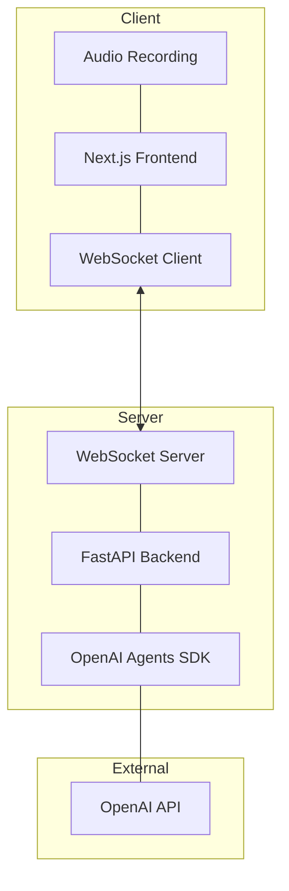
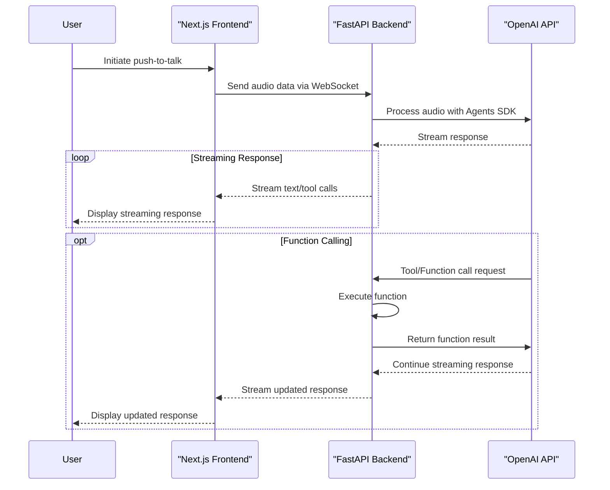
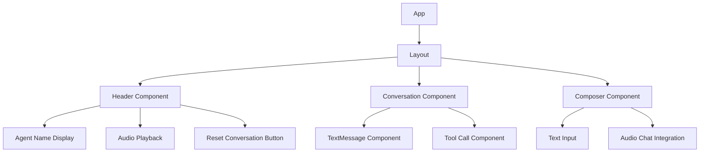
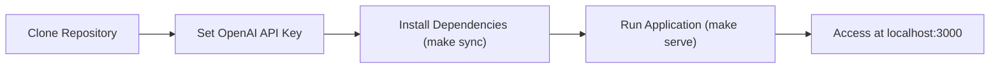

<!-- source: DeepWiki mcp.deepwiki.com · repo openai/openai-voice-agent-sdk-sample · page 1 Overview · fetched 2026-10-26 -->

# Overview

Relevant source files

The following files were used as context for generating this wiki page:

- [README.md](README.md)

This document provides an introduction to the OpenAI Voice Agent SDK Sample App, a reference implementation demonstrating how to build voice-enabled conversational agents using the OpenAI Agents SDK. For detailed setup instructions, see [Getting Started](#2), and for in-depth architectural details, see [System Architecture](#3).

## Purpose and Scope

The OpenAI Voice Agent SDK Sample App serves as a foundation for developers to create customizable voice-enabled conversational assistants. It demonstrates best practices for implementing real-time audio processing, multi-turn conversations, streaming responses, and function calling capabilities using OpenAI's APIs.

Sources: [README.md:1-17]()

## Key Features

The sample application showcases several key capabilities essential for modern voice agent applications:

- **Multi-turn conversation handling**: Support for contextual, ongoing dialogues
- **Push-to-talk audio mode**: Real-time voice input processing
- **Function calling**: Ability for the agent to execute actions or retrieve information
- **Streaming responses & tool calls**: Progressive display of agent responses

These features are implemented through a combination of frontend and backend components working together to provide a seamless user experience.

Sources: [README.md:10-15]()

## System Architecture

The application follows a client-server architecture with real-time communication capabilities:

### Client Components

- **Next.js Frontend**: Provides the user interface for interaction with the voice agent
- **WebSocket Client**: Manages real-time communication with the server
- **Audio Recording**: Handles capture and transmission of user voice input

### Server Components

- **FastAPI Backend**: Processes requests and manages application logic
- **WebSocket Server**: Enables bidirectional, real-time communication
- **OpenAI Agents SDK**: Interfaces with OpenAI's APIs for voice processing and language model interaction

Sources: [README.md:8-9]()

## Communication Flow

The following diagram illustrates the interaction pattern between system components during a typical conversation:

This real-time, bidirectional communication enables the responsive experience necessary for effective voice agents.

Sources: [README.md:8-15]()

## Frontend Architecture

The user interface is composed of several key components that work together to provide a cohesive experience:

For more detailed information about these components, see [Frontend Components](#5).

## Technology Stack

The application leverages the following technologies:

| Component | Technology | Purpose |
|-----------|------------|---------|
| Frontend | Next.js | User interface and client-side logic |
| Backend | FastAPI | API server and WebSocket endpoint |
| Communication | WebSockets | Real-time bidirectional data exchange |
| AI Integration | OpenAI Agents SDK | Interface to OpenAI's API services |

Sources: [README.md:4-6]()

## Getting Started

To use this application, you'll need:

- An OpenAI API key
- Node.js and npm
- The `uv` package manager

For complete setup instructions, see the [Getting Started](#2) section.

Sources: [README.md:19-61]()

## Development Workflow

The application uses a streamlined development workflow:

For detailed development guidelines, see the [Development Guide](#8).

Sources: [README.md:40-61]()

## Customization Opportunities

This sample application is designed as a starting point that developers can customize to their specific requirements. Common customization areas include:

- Adding domain-specific function calls
- Customizing the conversation UI
- Extending the agent's capabilities
- Integrating with additional services or APIs

For information on extending the application with function calling, see [Function Calling](#7).

Sources: [README.md:17]()

---

