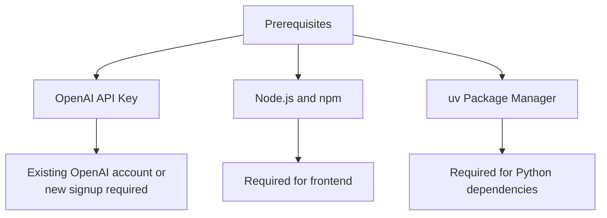
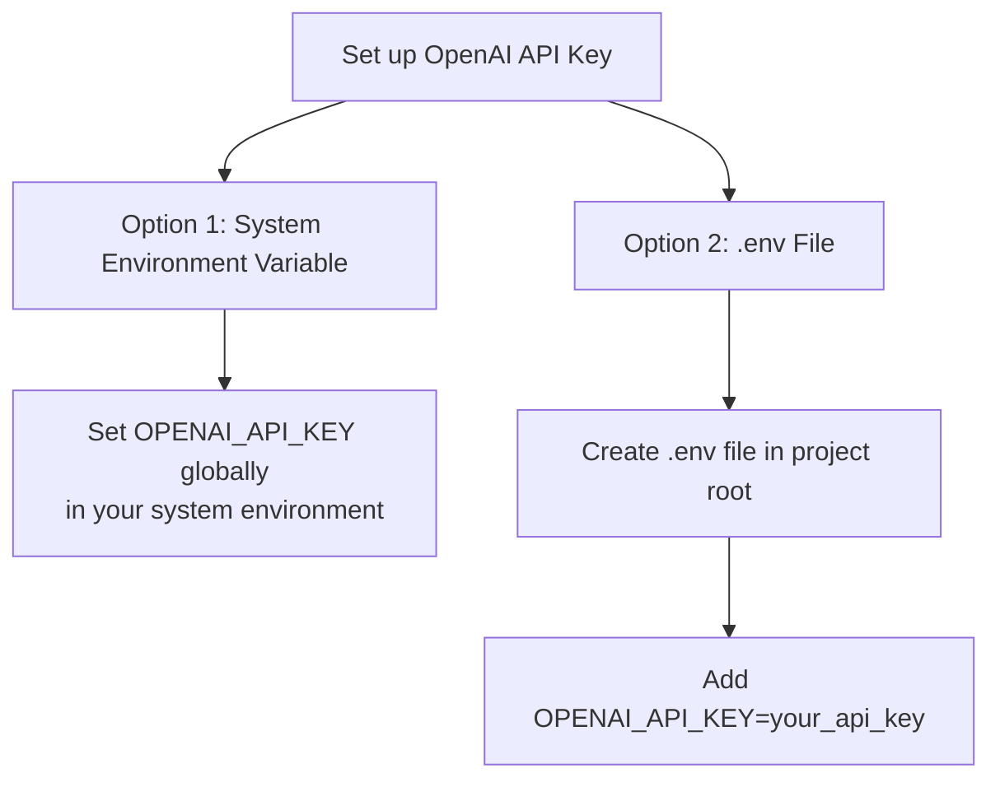
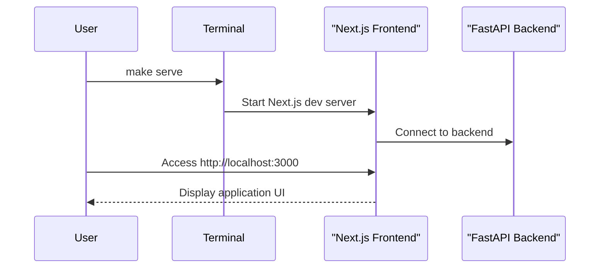
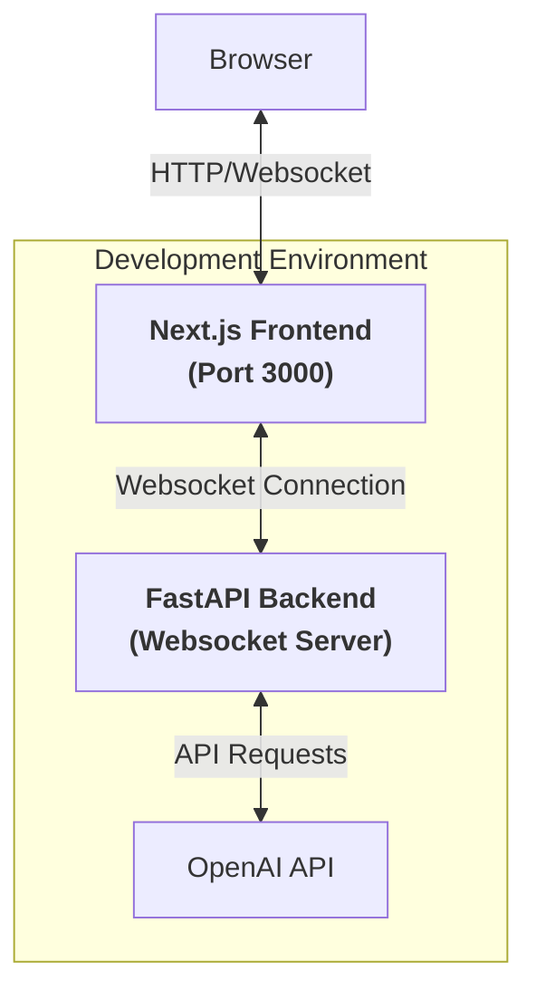

<!-- source: DeepWiki mcp.deepwiki.com · repo openai/openai-voice-agent-sdk-sample · page 2 Getting Started · fetched 2026-10-26 -->

# Getting Started

<details>
<summary>Relevant source files</summary>

The following files were used as context for generating this wiki page:

- [Makefile](Makefile)
- [README.md](README.md)

</details>


This guide walks you through setting up and running the OpenAI Voice Agent SDK Sample App on your local development environment. It covers prerequisites, installation steps, and launching the application. For information about the system architecture, see [System Architecture](#3).

## Prerequisites

Before you begin, ensure you have the following requirements installed and configured:



### Required Software

1. **OpenAI API Key**
   - Required to access OpenAI's API services
   - If you're new to the OpenAI API, [sign up for an account](https://platform.openai.com/signup)
   - Generate your API key by following the [Quickstart guide](https://platform.openai.com/docs/quickstart)

2. **Node.js and npm**
   - Required to build and run the Next.js frontend
   - Latest LTS version recommended

3. **uv Package Manager**
   - Required to install Python dependencies for the backend
   - Make sure it's properly installed on your system

Sources: [README.md:19-26]()

## Installation Process

Follow these steps to set up the application:

### 1. Clone the Repository

```bash
git clone https://github.com/openai/openai-voice-agent-sdk-sample.git
cd openai-voice-agent-sdk-sample/
```

Sources: [README.md:40-45]()

### 2. Set up OpenAI API Key

You have two options to set up your OpenAI API key:



**Option 1**: Set the `OPENAI_API_KEY` environment variable globally in your system

**Option 2**: Create a `.env` file at the root of the project with your API key:
```
OPENAI_API_KEY=your_api_key
```

Sources: [README.md:29-38]()

### 3. Install Dependencies

Run the following command from the project root directory to install dependencies for both frontend and backend:

```bash
make sync
```

This command executes two operations:
- `cd frontend && npm install` - Installs Node.js dependencies for the Next.js frontend
- `cd server && uv sync` - Installs Python dependencies for the FastAPI backend using uv

Sources: [README.md:47-53](), [Makefile:1-4]()

## Running the Application

To start the application, run:

```bash
make serve
```

This command launches the Next.js development server. The application will be available at http://localhost:3000.



Sources: [README.md:55-61](), [Makefile:7-10]()

## Development Environment Architecture

The following diagram illustrates the components of the development environment and how they interact:



When you run `make serve`, the development environment starts with:
1. The Next.js frontend server running on port 3000
2. The FastAPI backend handling the WebSocket connections
3. The backend communicating with the OpenAI API using your provided API key

Sources: [README.md:8-17]()

## Next Steps

After successfully setting up and running the application, you can:

1. Try out the voice agent functionality through the browser interface
2. Explore the multi-turn conversation handling
3. Test the push-to-talk audio mode and streaming responses
4. Experiment with function calling capabilities

For a deeper understanding of the system architecture, refer to [System Architecture](#3).

Sources: [README.md:10-17]()

---

