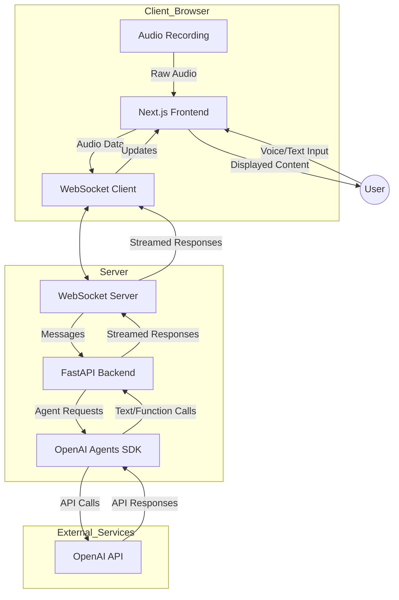
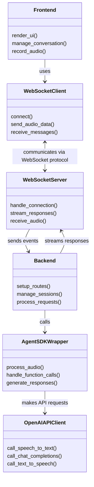
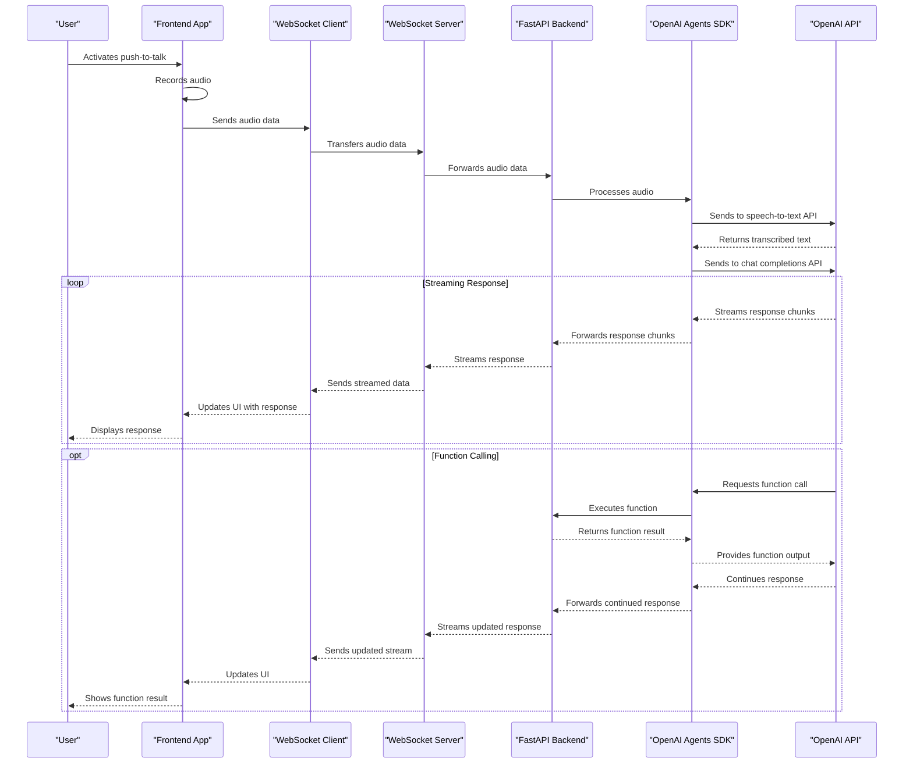

<!-- source: DeepWiki mcp.deepwiki.com · repo openai/openai-voice-agent-sdk-sample · page 3 System Architecture · fetched 2026-10-26 -->

# System Architecture

Relevant source files

The following files were used as context for generating this wiki page:

- [README.md](README.md)
- [frontend/package.json](frontend/package.json)

This document provides an overview of the OpenAI Voice Agent SDK Sample App's architecture, including its major components and how they interact. It covers the high-level system design, component relationships, and data flow. For detailed information about specific components, see [Frontend Architecture](#3.1) and [Backend Architecture](#3.2).

## High-Level Architecture Overview

The OpenAI Voice Agent SDK Sample App is structured as a client-server application that enables voice-based conversations with AI agents. The system consists of three main parts: a browser-based client, a Python server, and the OpenAI API services.

Sources: [README.md:8-17]()

## Core System Components

### 1. Client-Side Components

The client-side components run in the user's browser and are built with Next.js.

| Component | Purpose |
|-----------|---------|
| Next.js Frontend | Provides the user interface and manages the overall client-side application state |
| WebSocket Client | Handles real-time communication with the server |
| Audio Recording | Captures user's voice input when the push-to-talk button is active |

The client components work together to capture user input (voice or text), send it to the server, and display the responses in a conversational UI.

Sources: [README.md:8-17](), [frontend/package.json:13-26]()

### 2. Server-Side Components

The server-side components run on a Python backend built with FastAPI.

| Component | Purpose |
|-----------|---------|
| FastAPI Backend | Handles HTTP requests and manages the application logic |
| WebSocket Server | Provides real-time, bidirectional communication with the client |
| OpenAI Agents SDK | Integrates with OpenAI's APIs to process conversations and function calls |

The server components manage the conversation state, process audio and text inputs, call the OpenAI API, and stream responses back to the client.

Sources: [README.md:8-17]()

### 3. External Services

The application relies on external services for its core AI capabilities:

| Service | Purpose |
|---------|---------|
| OpenAI API | Provides the AI models for speech recognition, natural language understanding, text generation, and text-to-speech |

Sources: [README.md:8-17]()

## Component Relationships Diagram

The following diagram shows the relationships between the main code components and their communication paths:

Sources: [README.md:8-17]()

## Data Flow

The data flow through the system follows this sequence:

1. **User Input**:
   - User provides audio input using the push-to-talk feature or text input.
   - The frontend captures and processes this input.

2. **Client to Server Communication**:
   - The WebSocket client sends the audio data or text message to the server.
   - For audio, the data is sent as chunks to enable real-time processing.

3. **Server Processing**:
   - The WebSocket server receives the input and passes it to the FastAPI backend.
   - For audio input, the backend uses the OpenAI Agents SDK to convert speech to text.
   - The backend processes the input text using the OpenAI Agents SDK.

4. **OpenAI API Interaction**:
   - The Agents SDK sends the processed input to the OpenAI API.
   - The API processes the request and begins streaming a response.

5. **Response Handling**:
   - The server receives the streaming response from the OpenAI API.
   - If function calls are detected, the server executes them and returns results to the API.
   - The server streams text responses and function call information back to the client.

6. **Client-Side Rendering**:
   - The WebSocket client receives the streamed response.
   - The frontend displays the text responses and renders any function call results.
   - For voice responses, the text may be converted to speech and played back.

Sources: [README.md:10-16]()

## Technical Architecture Decisions

The architecture of the OpenAI Voice Agent SDK Sample App is designed around several key technical decisions:

1. **Real-time Communication**: WebSockets are used for bidirectional, low-latency communication between client and server, enabling real-time streaming of both audio input and text responses.

2. **Frontend Framework**: Next.js was chosen for the frontend to provide a modern React-based development experience with built-in routing, server-side rendering capabilities, and a component-based architecture.

3. **Backend Framework**: FastAPI was selected for the backend to provide a high-performance, async-capable Python web framework that integrates well with the OpenAI Python SDK.

4. **Separation of Concerns**: The architecture clearly separates:
   - User interface (Next.js frontend)
   - Communication layer (WebSockets)
   - Business logic (FastAPI backend)
   - AI capabilities (OpenAI Agents SDK)

5. **Streaming Responses**: The system is designed to stream responses, enabling immediate feedback to users as the AI generates content rather than waiting for complete responses.

6. **Function Calling Integration**: The architecture supports OpenAI's function calling capability, allowing the AI to trigger actions in the application during conversations.

Sources: [README.md:8-17]()

## System Requirements and Dependencies

The application has the following key dependencies:

| Component | Key Dependencies |
|-----------|------------------|
| Frontend | Next.js, React, WebSockets, react-markdown |
| Backend | FastAPI, OpenAI Agents SDK, Python WebSockets |
| Development | Node.js, npm, uv (Python package manager) |
| External | OpenAI API key |

Sources: [README.md:19-26](), [frontend/package.json:13-26]()

For more detailed information about specific system components, please refer to [Frontend Architecture](#3.1) and [Backend Architecture](#3.2).

---

