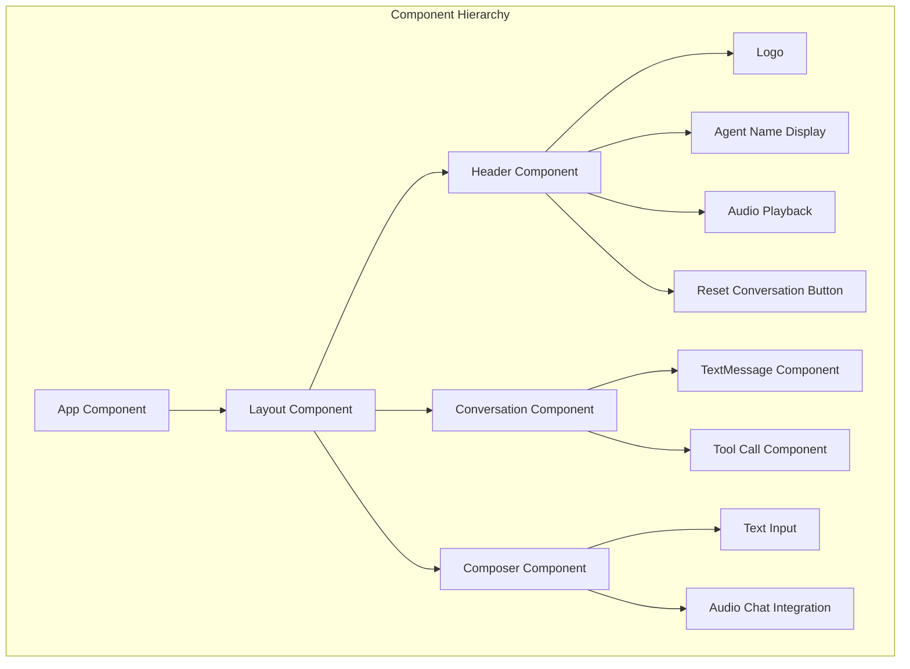
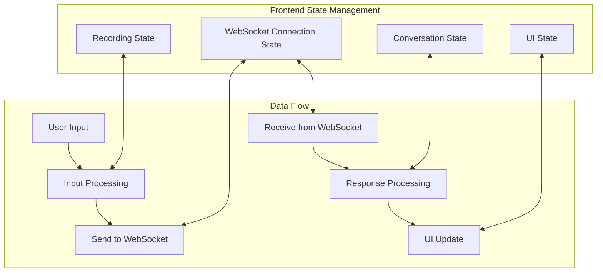
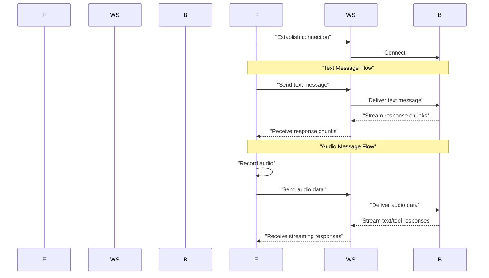
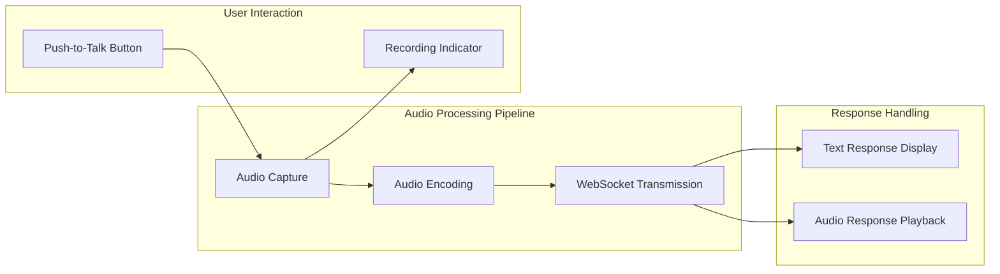
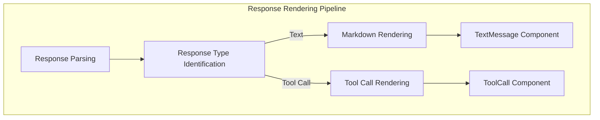
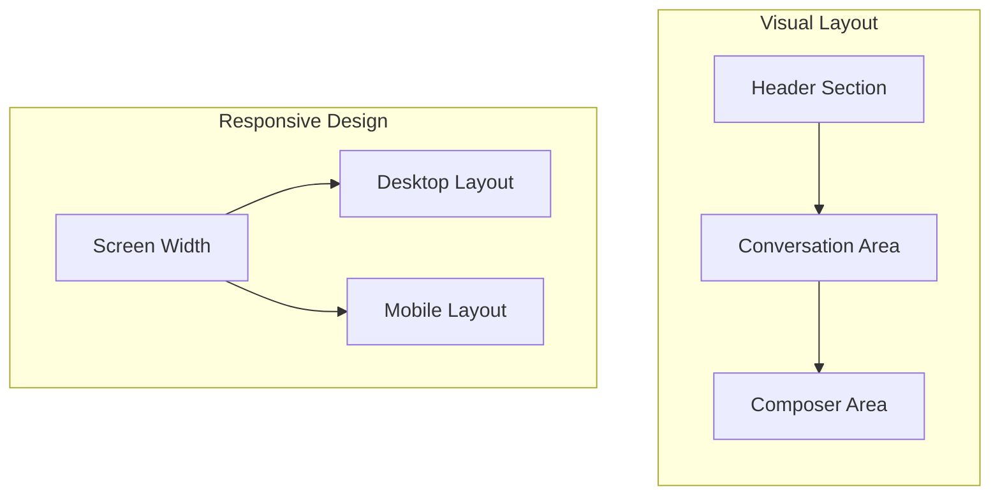

<!-- source: DeepWiki mcp.deepwiki.com · repo openai/openai-voice-agent-sdk-sample · page 3.1 Frontend Architecture · fetched 2026-10-26 -->

# Frontend Architecture

Relevant source files

The following files were used as context for generating this wiki page:

- [README.md](README.md)
- [frontend/eslint.config.mjs](frontend/eslint.config.mjs)
- [frontend/next.config.ts](frontend/next.config.ts)
- [frontend/package.json](frontend/package.json)
- [frontend/postcss.config.mjs](frontend/postcss.config.mjs)

## Purpose and Scope

This document details the architecture of the Next.js frontend in the OpenAI Voice Agent SDK Sample App. It covers the component hierarchy, data flow, WebSocket communication, and key UI elements that enable voice-based interactions with the OpenAI API. For backend implementation details, see [Backend Architecture](#3.2).

## Technology Stack

The frontend is built using modern web technologies focused on creating a responsive, real-time voice agent interface:

| Technology | Purpose |
|------------|---------|
| Next.js | React framework providing the foundation for the application |
| React | UI library for building component-based interfaces |
| WebSockets | Protocol enabling real-time bidirectional communication |
| Tailwind CSS | Utility-first CSS framework for styling |
| React Markdown | Component for rendering markdown content in responses |
| wavtools | Library used for audio processing |

Sources: [frontend/package.json:1-45]()

## Component Architecture

The frontend follows a hierarchical component structure designed to support conversational voice interactions.

Sources: [README.md:7-17]()

## Key Components and Responsibilities

### App and Layout Components

The App component serves as the entry point for the application, while the Layout component provides the structural framework for all other components.

### Header Component

The Header component provides navigation and control elements:

- Displays the agent name and logo
- Contains the audio playback controls
- Includes a reset button to start a new conversation

### Conversation Component

The Conversation component manages the display of the conversation history:

- Renders the exchange of messages between user and agent
- Houses two specialized components:
  - TextMessage: Displays text responses with markdown support
  - ToolCall: Visualizes tool/function calls and their results

### Composer Component

The Composer component handles user input mechanisms:

- Text input field for typing messages
- Push-to-talk functionality for voice input
- Controls for starting/stopping audio recording

## Data Flow and State Management

The frontend maintains several key states that drive the user experience:

Sources: [README.md:10-16]()

## WebSocket Communication

The frontend establishes and maintains a WebSocket connection to the backend for real-time bidirectional communication:

Sources: [README.md:7-17]()

## Audio Processing Flow

The frontend implements a complete audio recording and processing workflow:

Sources: [README.md:12-13]()

## Rendering Responses

The frontend handles multiple types of responses from the agent:

1. **Text responses**: Displayed with markdown formatting support
2. **Tool call responses**: Visualized with appropriate UI elements
3. **Streaming responses**: Rendered incrementally as chunks arrive

The TextMessage component uses React Markdown to render formatted text, while the ToolCall component displays function calls and their results in a structured format.

Sources: [frontend/package.json:24](), [README.md:14-15]()

## Page Layout and Styling

The application uses Tailwind CSS for styling and responsive design:

Sources: [frontend/package.json:38](), [frontend/postcss.config.mjs:1-5]()

## Conclusion

The frontend architecture of the OpenAI Voice Agent SDK Sample App is designed around a component-based structure that facilitates real-time voice interactions. The application uses WebSockets for bidirectional communication with the backend, supports audio recording and playback, and provides a responsive user interface for conversational interactions.

The modular design allows for easy extension and customization, making it a solid foundation for building voice-enabled applications powered by OpenAI's language models.

---

